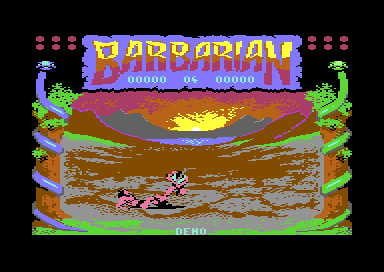
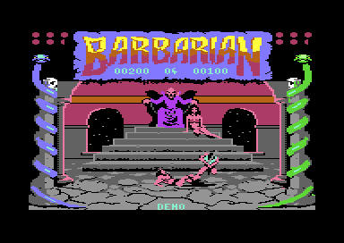

# The development of Barbarian

This page tells what the four programs show about the work of Palace Software on the C64 game. The game has two parts, and each part comes in two builds with a date in a version text. The page compares the builds and the parts byte by byte. It also explains the bytes that no code uses. These are a CPU switch of the Commodore 128, RAM fill patterns, copies of screen and colour RAM, and a cartridge header. Each of these tells something about the machine and the tools of the authors.

**Evidence.** **Observed** marks a fact that a run or a byte compare of the captured programs showed. **Code** marks a fact from the code only. **Conclusion** marks an interpretation.

**Conventions.**
- Addresses are C64 addresses. Names are the names of the knowledge. A label before a name gives its project: `practice_v1:`, `practice_v2:`, `game_v1:` or `game_v2:`.
- *Part 1* is Combat Practice (projects `practice_v1` and `practice_v2`). *Part 2* is the story game (projects `game_v1` and `game_v2`).
- A *build* is one assembly of both parts with one version text. V 05 05 87 is in the projects `*_v1`, and V 05 10 87 is in the projects `*_v2`.
- A *pass* is one run of the main loop. The main loop does not wait for a frame, and a pass takes about 10 frames in the demo.
- The *fill pattern* is the byte pair `$00 $FF` that repeats over a RAM area that no program wrote.

## The authors and the two builds

The programs hold no credit text, no author name and no copyright line. The only texts are the game texts and one version text. CTRL+V shows the version text while the keys stay pressed. **Observed** (byte search of the four captures).

| Build | Version text | Second line | Projects | Releases | Crack date |
|---|---|---|---|---|---|
| V 05 05 87 | "V 05 05 87" | none | `practice_v1`, `game_v1` | RDI, HTL | RDI 19 May 1987 |
| V 05 10 87 | "V 05 10 87" | "WHY DID YOU PRESS ME" | `practice_v2`, `game_v2` | FLT | FLT 21 May 1987 |

Both parts of one build have the same version text. In part 2 it is [`game_v1:text_version` `$BAAF`](../game_v1/src/text/texts.asm#L17) and [`game_v2:text_version` `$BAD1`](../game_v2/src/text/texts.asm#L17). The text starts with column 15, row 17 and a colour byte. In V 05 10 87 a `$0D` byte starts a second line at column 10, row 18. **Code** / **Observed** (byte compare).

The text is a date. In the US order (month, day, year), the builds are of 5 May 1987 and 10 May 1987. Both dates come before the first crack of each build. The day-month order gives 5 October 1987 for the second build. That is after the FLT crack of 21 May 1987, so this order cannot be right. **Conclusion**.

The second line answers the player who found the hidden key: "WHY DID YOU PRESS ME". It is the only text in the game that speaks to the person at the keyboard. **Conclusion** (a joke of the programmer).

The older build was still on sale after the newer build existed: Raw Deal Inc. cracked V 05 05 87 on 19 May 1987, nine days after the date of V 05 10 87. **Conclusion** (from the dates of the releases). The releases are on [releases.md](releases.md).

## V 05 10 87 is the later build

The order of the two builds is clear from the date and from the code. V 05 10 87 contains each part of V 05 05 87 and adds guards, corrections and new code. No change goes in the other direction. The full list is on [versions.md](versions.md).

The graphics and the music data are the same in both builds. A byte compare finds 0 different bytes in each part for these data: the fighter pieces, the sprite frames, the background bitmaps and the font. The same is true for the corner frames, the tunes at `$ED80-$FC03` and the end sprites. Only the code and the tables changed. **Observed** (byte compare).

These changes show that V 05 10 87 corrects V 05 05 87. Each item is in the code of V 05 10 87, with a comment that V 05 05 87 does not have it. **Code**:

1. **The pause.** In V 05 05 87, F5 stores the set-up flag (0) in `sprites_frozen`. The IRQ thus moves the sprites during the pause. V 05 10 87 stores `$80`, and the sprites stop. It also stops the sprites while CTRL+V shows the version text. See [`game_v2:read_keys` `$93A7`](../game_v2/src/input/keyboard.asm#L6).
2. **A guard for each hit.** [`game_v2:check_attack_hit` `$87C7`](../game_v2/src/combat/hits.asm#L25) does no hit after a fighter is beaten (`bout_loser` bit 7). V 05 05 87 tests this flag only once for both attacks of a pass. Thus both fighters can lose their last energy in the same pass (**Conclusion**).
3. **More guards in the damage and the score.** A fighter with 0 energy loses no more energy. Score numbers 5 and higher add nothing. A `CLC` comes before the add of the score text number.
4. **A guard in the raster IRQ.** The new flag `raster_irq_busy` (`$CE`) skips the sprite update when the last update still runs. The music variables of zero page move up by one byte to make room for it.
5. **A carry correction.** [`game_v1:find_move_row` `$8663`](../game_v1/src/input/joystick.asm#L60) adds two numbers to the low byte before it adds the carry to the high byte. A carry of the first add thus goes to the low byte. With the table at `$CE3A`, no carry occurs. V 05 10 87 adds the table address last, so each carry goes to the high byte.
6. **A new pose routine.** [`game_v2:set_fighter_poses` `$878C`](../game_v2/src/fighter/pose_update.asm#L6) sets the pose of both fighters from the move step in each pass. The places that set the first pose of a new move in V 05 05 87 now only set the step to 0.
7. **New data.** New AI rows, changed hit lists, a new pose at the end of one move sequence, and one changed entry of the move selection.
8. **Rules of the game.** The bout clock starts at 90 seconds (60 in V 05 05 87). In the demo, the scores of both fighters go back to 0 at the end of a bout.

The corrections came between 5 May and 10 May 1987, in five days. Most of them stop a fault that a player sees only in rare cases. Thus the authors most likely played the first build and corrected what they found. **Conclusion**.

## One source for both parts

Part 1 and part 2 are two assemblies of one source text. Part 1 lacks the final stage, and part 2 lacks the choice of two players. Each part keeps the code and the data of the other part that it does not use. **Code** / **Observed** (byte compare).

### Part 1 is part 2 without the final stage

The layout of the two parts is the same up to the end of the bout code. There, part 1 lacks four pieces of part 2. **Code**:

| Piece of part 2 | Bytes |
|---|---|
| `final_stage.asm`: the final stage and the end of the story | 327 |
| `end_bout_final_stage` in `end_of_bout.asm`: the start of the final stage | 31 |
| Two `JSR` in the main loop: `final_stage_attack` and `set_end_figure` | 6 |
| F1 in part 1: `LDA two_players` / `EOR #$01` in place of `LDA #$00` | -2 |
| Total | 362 = `$16A` |

Thus each table after the code is exactly `$16A` lower in part 1. For example the text table starts at `$B90E` in part 1 and at `$BA78` in part 2 of V 05 05 87. The program ends `$16A` bytes earlier, and the unused RAM before `$D000` grows by `$16A` bytes. **Observed** (the module ranges of both projects).

The clearest trace is [`practice_v1:set_end_figure` `$8CAB`](../practice_v1/src/leftovers/leftover_8cab.asm#L6). In part 2, `game_v1:set_end_figure` sets the four sprites of the end of the story, and the main loop calls it in each pass. In part 1 nothing calls it. The byte compare of the 92 bytes of both copies finds 6 different bytes. They are the high and low bytes of three operands: `end_scene_ptrs` (two times) and `bit_masks_inverted`. Each operand is exactly `$16A` lower in part 1. V 05 10 87 has the same result at `practice_v2:set_end_figure` (`$8CC5`). **Observed** (byte compare).

The data of the routine is also in part 1. [`practice_v1:end_scene_ptrs` `$CB33`](../practice_v1/src/leftovers/leftover_cb33.asm#L6) holds the four sprite set-ups of the end of the story. After them come the tables of the bolt paths of Drax in the final stage. They give two paths and the moves that avoid the bolt of each path. The 70 bytes are equal to part 2 except the 12 bytes of the six pointers, which are `$16A` lower. **Observed** (byte compare).

More parts of the story stay in part 1, and no code of part 1 uses them. **Code**:

- The 13 sprites of the end of the story at `$FC40-$FF7F`, with the same bytes as in part 2. Only `quit_to_demo` can swap them in, when `final_stage` bit 7 is set. Part 1 writes only 0 to `final_stage`.
- Text 9 "YOUR END HAS COME" and text 10 "THANKS BIG BOY".
- The swaps of the picture blocks and the sprite shapes of the end of the story, and the tests of `final_stage` in `quit_to_demo`.
- The variables `final_stage`, `final_goal_reached` and `final_scene_pose`. Part 1 writes only 0 to them.


The 13 sprites of the end of the story in part 1, where no code shows them.

### Part 2 keeps the two-player code

Part 2 has only one player, but it keeps each test of two players. Eight instructions read `two_players`. The text "2PLR" is in the text table. Part 2 writes only 0 to `two_players`: in `init_game_state` and at F1. Thus the two-player code of part 2 never runs. **Code**.

The edit of F1 is the only difference. Part 1 has `LDA two_players` / `EOR #$01` at [`practice_v1:read_keys` `$922F`](../practice_v1/src/input/keyboard.asm#L6). Part 2 has `LDA #$00` at the same place. **Code**.

### The pictures

The pictures of the two parts differ. Part 1 has the arena with the sunset and the forest. Part 2 has the throne room and the dungeon. The two builds of one part have the same picture bytes. They also have the same RAM noise in them (see [The copies of screen and colour RAM](#the-copies-of-screen-and-colour-ram)). Thus the authors made each picture one time and loaded the same file into both builds. **Observed** (byte compare) / **Conclusion**.



Part 1 in the demo: the arena with the sunset.



Part 2 in the demo: the throne room with Drax and the princess.

### What the parts tell

The authors kept one source text and changed a few lines for each part. For part 1 they removed the final stage module, the start of the final stage and its two calls. They did not remove the end figure routine, the end data, the end sprites and the end texts. For part 2 they changed one instruction of F1 and kept all the code of two players. **Conclusion**.

The direction of the edit is not certain. Part 1 lacks a whole module of part 2, but part 2 lacks only one instruction of part 1. Thus the source text was most likely the full game, and part 1 is the cut version. **Conclusion**.

## The Commodore 128 code

Part 2 of both builds holds 32 bytes of code for the Commodore 128 at `$FFD0-$FFEF`, inside [`game_v1:unused_ff80` `$FF80`](../game_v1/src/leftovers/leftover_ff80.asm#L6). No code of the game jumps there. **Code**.

The first 16 bytes are 6502 code:

```text
$FFD0  78        SEI
$FFD1  A9 3E     LDA #$3E
$FFD3  8D 00 FF  STA $FF00     ; C128 MMU: configuration register
$FFD6  A9 B0     LDA #$B0
$FFD8  8D 05 D5  STA $D505     ; C128 MMU: mode register, bit 0 = 0 selects the Z80
$FFDB  EA        NOP
$FFDC  4C 00 11  JMP $1100
$FFDF  EA        NOP
```

The next 16 bytes are Z80 code:

```text
$FFE0  F3        DI
$FFE1  3E 3E     LD A,$3E
$FFE3  32 00 FF  LD ($FF00),A
$FFE6  01 05 D5  LD BC,$D505
$FFE9  3E B1     LD A,$B1      ; bit 0 = 1 selects the 8502
$FFEB  ED 79     OUT (C),A
$FFED  00        NOP
$FFEE  CF        RST $08
$FFEF  FF        RST $38
```

The first half gives the bus to the Z80 of a C128. The second half gives the bus back to the 8502. **Code** (decode of the bytes). These are the two CPU switch routines of the Commodore 128, which the C128 keeps in RAM at `$FFD0`. **Conclusion** (from the decode. We did not compare the bytes with a C128 ROM).

Both builds of part 2 have the same 32 bytes, and two different groups cracked them. Part 1 of V 05 05 87 comes from the same crack as part 2 (RDI), but it has the fill pattern at `$FFD0-$FFEF`. Thus the crack did not write these bytes. They were in the original file of part 2. **Observed** (byte compare) / **Conclusion**.

Conclusion: a Commodore 128 held part 2 in its memory before the save. The C128 keeps its RAM when it changes to C64 mode, so the bytes stayed. The authors, or the person who mastered the disk, used a C128 in C64 mode for part 2. Part 1 has no such trace.

## The cartridge header

Each program starts at `$8000` with a cartridge header: [`game_v1:cart_cold_start_vector` `$8000`](../game_v1/src/init/cartridge_header.asm#L6) holds `$8009` two times, then the signature "CBM80" (`$C3 $C2 $CD $38 $30`). The game entry [`game_v1:start` `$8009`](../game_v1/src/init/init.asm#L6) follows directly after it. **Code**.

At a hardware reset, the KERNAL finds "CBM80" at `$8004` and jumps to `$8009`. Thus RESET starts the game again without a new load. RESTORE does not restart it: the game maps out the KERNAL and points the NMI vector to an `RTI`. **Code**.

The game is not a cartridge program. It fills `$0800-$FFFF`, much more than a cartridge of 16 KB holds. The header lets a programmer reset a hung game and start it again without a load. The authors thus used it as a tool during the development. **Conclusion**. The Hotline trainer cleared the header (see [releases.md](releases.md)).

## The RAM in the gaps

Several areas of each program hold bytes that no code reads. Their contents come from the RAM of the machine that saved the program, not from the source. **Code** (no reader) / **Conclusion** (where the bytes came from).

| Area | V 05 05 87 part 1 | V 05 05 87 part 2 | V 05 10 87 part 1 | V 05 10 87 part 2 |
|---|---|---|---|---|
| End of the tables to `$CFFF` | fill pattern, `$CDB6-$CFFF` | fill pattern, `$CF20-$CFFF` | `$FF` ×9, then `$A3` | `$00`, last byte `$FF` |
| `$FC04-$FC3F` | fill pattern | fill pattern | 4 bytes fill pattern, then `$00` | fill pattern |
| `$FF80-$FFEF` | fill pattern | fill pattern and C128 code | `$00` | fill pattern and C128 code |
| `$FFF0-$FFFE` | copy of `$9FF0-$9FFE` | copy of `$9FF0-$9FFE` | `$00`, then `$02` at `$FFFE` | copy of `$9FF0-$9FFE` |
| `$0801-$080F` | `$00` | `$00` | `$00` | `$00` |
| `$E938-$E97F` (after the font) | `$00` | `$00` | `$00` | `$00` |

**Observed** (byte compare). The FLT crack copies its colour mover to `$CF00-$CF21` (part 1) or `$CF80-$CFA1` (part 2). These bytes are not in the program.

### The fill pattern

The fill pattern is `$00` at the even addresses and `$FF` at the odd addresses. In V 05 05 87 it fills [`game_v1:unused_cf20` `$CF20`](../game_v1/src/data/unused_cf20.asm#L6) and [`practice_v1:unused_cdb6` `$CDB6`](../practice_v1/src/data/unused_cdb6.asm#L6) up to `$CFFF`. Only the last two bytes of each page differ, for example `$BF $6D` at `$CDFE` and `$E9 $7F` at `$CEFE`. **Observed** (byte compare).

Thus the authors saved each part as a whole memory range up to `$FFFF`, not as the exact length of the code. Part 1 has `$16A` more bytes of the pattern because its code is shorter. **Conclusion**.

In V 05 10 87, part 1 has other values: `$A3` and `$00`. Part 2 of the same build still has the pattern at `$FC04` and `$FF80`. Thus the two parts of V 05 10 87 came from different RAM states. **Observed** / **Conclusion**. The FLT crack can also have changed bytes there, see [Still open](#still-open).

### The copy of `$9FF0`

In three programs, `$FFF0-$FFFE` hold the same 15 bytes as `$9FF0-$9FFE`. The byte at `$FFFF` repeats the byte at `$FFFE`. Part 1 of V 05 10 87 has `$00` there. **Observed** (byte compare).

The copy follows the address, not the data. In part 2, `$9FF0` is inside `game_v1:freq_table`. In part 1 the code is `$16A` shorter, so `$9FF0` is inside the music driver tables. Each copy has the bytes of its own program at `$9FF0`. Thus a memory action of the machine made the copy, after each build was in memory. The source did not make it. **Conclusion**.

### The copies of screen and colour RAM

The second arena of each part is in RAM at `$D000-$E7FF`. The game uses only rows 7-22 and columns 4-35 of it. The screen part at `$E000` and the colour part at [`game_v1:arena2_colours` `$E400`](../game_v1/src/graphics/arena2_screen.asm#L140) have 1024 bytes each, with bytes that nothing reads. **Code**. In `game_v1`, the hit record bug of `check_attack_hit` reads 4 bytes at each of `$E3D9`, `$E3E1`, `$E3ED`, `$E7E1` and `$E7ED`. Thus the source keeps `$E3E8-$E3FF` and `$E7E8-$E7FF` in the default build. The [combat page](../game_v1/docs/combat.md) tells about the bug. **Code**.

- `$E3E8-$E3FF` are equal to `$47E8-$47FF`, the end of the screen of the game. They are 16 bytes `$98`, then `$A2 $A3` and six `$00` bytes at the place of the sprite pointers. **Observed** (byte compare).
- `$E400-$E7FF` have random high nybbles. In part 1, 644 of the 1000 colour bytes have the high nybble `$F`, and the other bytes have all other values. **Observed** (byte compare).
- `$E7E8-$E7FF` have the low nybble 7 in 22 bytes and then `$00 $06`, in both parts. The high nybbles differ between the parts. **Observed** (byte compare).

Colour RAM keeps only 4 bits for each byte. A read of colour RAM gives random values in the high nybble. Thus the authors saved the arena as a copy of the full 1 KB of screen RAM. They also saved the full 1 KB of colour RAM, `$D800-$DBFF`. The copies include the 24 bytes after the 1000 visible bytes. **Conclusion**.

## Unused and unfinished parts

These parts are in all four programs, and nothing in the game uses them. **Code**:

- **Text 0**, "000" at row 22. No code prints it.
- **Text 5**, "PAUSED". No code prints it. F5 stops the game with no text, but the pause code still clears the text area at its end. Thus an older build printed "PAUSED" during the pause (**Conclusion**).
- **A load with no use.** [`game_v1:final_stage_attack` `$84BA`](../game_v1/src/story/final_stage.asm#L14) loads `wait_counter`, and the next instruction loads A again.
- **16 bytes of screen RAM** at `$47E8-$47F7`, all `$98`. The VIC does not show them.
- **The last 8 bytes of piece 0** in the fighter pieces. Piece number 0 means "no piece", so nothing reads its slot.

The two parts also keep the code of each other, see [One source for both parts](#one-source-for-both-parts).

## The bugs

These faults are in the code. The pages of each project give the details. **Code** unless the item says otherwise:

- **F1 in part 1 changes the players in each pass.** [`practice_v2:read_keys` `$923B`](../practice_v2/src/input/keyboard.asm#L6) toggles `two_players` in each pass while F1 stays pressed. The count of frames of the key press thus selects one or two players. A press of 3 frames gives 2 PLAYERS in the recording `two_players` of `practice_v1` (**Observed**). In `practice_v2` the same press came before the first key read, and the joystick of player 2 started the game. Both builds have this fault.
- **The pause does not stop the sprites** (V 05 05 87 only). See item 1 of [V 05 10 87 is the later build](#v-05-10-87-is-the-later-build).
- **Two hits in one pass** (V 05 05 87 only). Both fighters can lose their last energy in one pass. **Conclusion** (no run showed it).
- **A raster IRQ inside a raster IRQ** (V 05 05 87 only). The sprite update has no busy flag. **Conclusion** (no run showed it).

## What the development tells

The traces give this order of the work (**Conclusion**):

1. **One source for the whole game.** The authors wrote the full game with the final stage and the code of two players in one source text.
2. **The pictures came from the screen.** Each arena is a full copy of 1 KB of screen RAM and 1 KB of colour RAM. The authors saved each copy one time and used it in both builds.
3. **Part 2 was in the memory of a Commodore 128.** The CPU switch code of the C128 is in both builds of part 2.
4. **The cartridge header made the tests fast.** A reset restarts the game without a new load.
5. **Two parts from one source.** Part 1 is the source without the final stage. Part 2 keeps the two-player code with F1 set to one player.
6. **V 05 05 87, 5 May 1987.** The first build went on sale with the pause fault and without the guards of the hit code.
7. **V 05 10 87, 10 May 1987.** Five days later, the authors made a corrected build. It has guards, a new pose routine, new AI rows, a longer bout clock and a joke in the version text. Both builds were on sale in May 1987.

## Still open

- Is the alternating `$00`/`$FF` pattern the RAM state of a C128 or of a C64 after power-on? What are the two bytes at the end of each page in V 05 05 87? A comparison with RAM dumps of both machines can answer it.
- Which action copied `$9FF0-$9FFE` to `$FFF0-$FFFE`? A loader, a monitor or a save tool of the authors can do it. A search for this behaviour in common tools of 1987 can answer it.
- Did the FLT crack write the `$00` and `$A3` bytes in part 1 of V 05 10 87? An analysis of the FLT unpacker and its memory fill can answer it.
- Do the two-hit fault and the IRQ fault of V 05 05 87 occur in a game? A recording with both fighters at a distance of one column, and with both attacks in the same frame, can show the first fault.
- Did the original Palace disk have a loader with copy protection? No release has the original loader.
