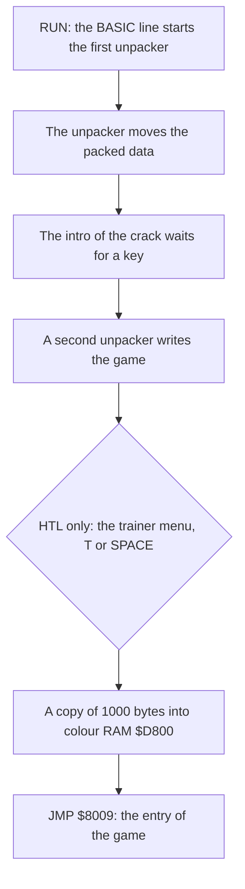

# The releases

This page tells about the three cracked releases of "Barbarian: The Ultimate Warrior" (Palace Software, 1987) in the group folder. It gives the files of each release, the chain of each crack and the parts of memory that the captures leave out. It also tells about the Hotline trainer, the other Hotline changes and how the switches of the rebuild separate the releases. The differences between the two builds of the game are on [versions.md](versions.md), and the development is on [development.md](development.md).

**Conventions.**
- Addresses are C64 addresses. Names are the names of the knowledge, with the label of their project: `game_v1:`, `game_v2:`, `practice_v1:` or `practice_v2:`.
- *Part 1* is Combat Practice, and *part 2* is the story game. Each release has the two parts as two files.
- A *build* is one version of the game by Palace: V 05 05 87 or V 05 10 87. The version text of the game (CTRL+V) gives the build.
- A *release* is the set of files of one crack. Its *capture* is the memory at the game entry `$8009`, after the intro and the unpacker of the crack.
- **Observed** marks a fact that a run, a byte compare or the bytes of a file showed. **Code** marks a fact from the code only. **Conclusion** marks an interpretation.

## The three releases

Each release is a crack. The project has no original Palace disk. The three releases hold the two builds of the game (**Observed**: the version texts in the captures).

| Label | Group, date | CSDb | Build | Projects |
|---|---|---|---|---|
| RDI | Raw Deal Inc., 19 May 1987 | 22600 | V 05 05 87 | `practice_v1`, `game_v1` (base release) |
| HTL | Hotline, trainer, 1 June 1987 | 94591 | V 05 05 87 | `practice_v1`, `game_v1` |
| FLT | Fairlight, crack by Strider, 21 May 1987 | 21950 | V 05 10 87 | `practice_v2`, `game_v2` (base release) |

The files are in the folder `original/` of each project. The SHA-256 values come from sha256sum (**Observed**).

| Release | File | SHA-256 |
|---|---|---|
| RDI | `Barbarian (Palace) [Raw Deal Inc.].t64` | `3dd5163e552a0992ee6ab2158e8056a58301dbf52588987864384452e77e09d4` |
| RDI | `BARBARIAN.d64` | `190eba60b94c7099135e30500cb27be9ba9d5e80c431be492bd86a53f84f02f9` |
| RDI | `barbarian_part1_rdi.prg` | `be23d11d9c2fd24241ff5607f82d871ece4af1cf8e7576972c7e8d8d7c787c1e` |
| RDI | `barbarian_part2_rdi.prg` | `ba39ad343eaeef9ed43fda3dc6abcd99d20834cbb9ca4ec877bf10d0552da491` |
| HTL | `Barbarian.D64` | `b24e7f4156b35c1a2b8884a4813fb104e55e0d3a2e51ae41f2e0f290fe9685a2` |
| HTL | `barbarian_i_hotline.prg` | `bb9559a7cf6563d5fead1e8f13b1331d45753a5a377367f573879abc55a9037a` |
| HTL | `barbarian_ii_hotline.prg` | `2f9b267c7f9abbeae8f990a01a12242cec39626e97df37465ead9c3669e1bedf` |
| FLT | `flt-barbarianpart1-2.d64` | `abf6320286ee4c60d37d0491bd4a505cac0f94a526092cfd3e874150660d8a34` |
| FLT | `flt-barbarianpart1-2.zip` | `9403181e5caec190fe2d975af763f87a6071bf645d273b38e18d8703fb8e0dbb` |
| FLT | `flt-barbarianpart1-2.nfo` | `1ad8a85237d636a90d8fee169578f4e4347798be9fa32639577a816a604a9495` |
| FLT | `barbarian_p1_flt.prg` | `cb0f51b0b8a3f2d5ae08a064d776872ffc823c227e721724f2137a1506f99a99` |
| FLT | `barbarian_p2_flt.prg` | `637197f7f392a78be2225362f8ffca022ca8146deddef24fe5732a9358132285` |

Each PRG file in `original/` has the same bytes as its entry in the T64 file or the disk image (**Observed**: a byte compare).

## The files of each release

All game files load at `$0801` and start with a BASIC line and a SYS (**Observed**).

| Release | Image | Disk name | File | Size |
|---|---|---|---|---|
| RDI | T64 | RAW DEAL | BARBARIAN PART 1 | 42086 bytes |
| RDI | T64 | RAW DEAL | BARBARIAN PART 2 | 41188 bytes |
| RDI | D64 | (none), id 00 | BARBARIAN CP/RDI | 166 blocks |
| HTL | D64 | DIGITAL DUNGEON, id TD | BARBARIAN I  + | 148 blocks |
| HTL | D64 | DIGITAL DUNGEON, id TD | BARBARIAN II + | 147 blocks |
| FLT | D64 | FLT PRESENTS:, id FL | BARBARIAN P1/FLT | 161 blocks |
| FLT | D64 | FLT PRESENTS:, id FL | BARBARIAN P2/FLT | 158 blocks |

The file BARBARIAN CP/RDI of the D64 has the same bytes as PART 1 of the T64 (**Observed**). CP means Combat Practice. A CSDb comment tells that a user added this D64 in 2016 to show the original file name of part 1. The comment also tells that many copies of the game had no part 2 (**Observed** on the CSDb page of the release).

The FLT disk has DEL entries that make a picture in the directory. One entry is "FLT ARCHIVE 2019". The .nfo file says "Repacked for FairLight Archive 2019 November" (**Observed**). Thus the FLT files are a new pack of 2019, and the 1987 files can have other bytes outside the game (**Conclusion**). The game bytes come from 1987, because the intro text has the date 870521 (**Observed** in the file).

## The chain of a crack

Each release starts the game in the same way. A run of each release went through these stages until the CPU arrived at `$8009` (**Observed**: the stages of each capture).



1. RDI: the intro runs at `$CBE7`. The colour copy runs at `$0810` and reads `$B000-$B3E7` (**Observed**).
2. FLT: the intro runs at `$C000`. The colour copy runs at `$CF80` in part 2 and at `$CF00` in part 1. It reads `$0400-$07E7` (**Observed**).
3. HTL: the intro runs at `$0C00`, and the trainer menu runs at `$B400`. The colour copy runs at `$A900` and reads `$B000-$B3E7` (**Observed**).

All three cracks copy a full colour RAM before the entry. The game itself writes only some areas of colour RAM, for example the fight area and the texts (**Code**). Thus the original Palace loader most likely loaded the colours into colour RAM, and each crack must do the same (**Conclusion**).

In part 2, the 1000 colours of RDI and of FLT have the same low nibbles (**Observed**: a byte compare). HTL has the same 1000 bytes as RDI, also in the high nibbles that colour RAM does not keep (**Observed**). Thus Hotline copied the colour block of the RDI file and did not read colour RAM again (**Conclusion**).

## What the captures leave out

Each capture keeps the game and leaves out the bytes of the crack. The entry state of each capture keeps `$0000-$03FF`, the I/O registers and the colour RAM (**Observed**).

| Release | Part | Segments of the knowledge | Areas left out |
|---|---|---|---|
| RDI | 2 | `$0800-$080F`, `$0838-$AFFF`, `$B3E8-$FFFF` | `$0400-$07E7` (intro screen), `$0810-$0837` (colour copy code), `$B000-$B3E7` (colours) |
| RDI | 1 | `$0800-$080F`, `$083F-$AFFF`, `$B3E8-$FFFF` | `$0400-$07E7`, `$0810-$083E`, `$B000-$B3E7` |
| HTL | 2 | release bytes only | `$0334-$07FF`, `$0800-$0837`, `$A900-$A918`, `$B000-$B3E7`, `$B400-$B6FF`, `$CF2C-$CFFF`, `$FFFA-$FFFF` |
| HTL | 1 | release bytes only | `$0334-$07FF`, `$0800-$083E`, `$A600-$A614`, `$A900-$A918`, `$B000-$B3E7`, `$B400-$B6FF`, `$CDC1-$CDFF`, `$CE0C-$CFFF`, `$FFFA-$FFFF` |
| FLT | 2 | `$07E8-$CF7F`, `$CFA2-$FFFF` | `$0400-$07E7` (colours), `$CF80-$CFA1` (colour copy code) |
| FLT | 1 | `$07E8-$CEFF`, `$CF22-$FFFF` | `$0400-$07E7`, `$CF00-$CF21` |

The HTL areas hold the code of the crack, the trainer menu and RAM that the crack cleared. `$FFFA-$FFFF` holds the CPU vectors, and the game writes them at its start (**Code**). The HTL code at `$A900` and at `$B400` is in work areas of the game, and the game writes over them (**Code**: the regions of the knowledge).

The colour copy code of RDI at `$0810-$0837` is a part of the crack. FLT has zero bytes there (**Observed**). The source of `game_v1` does not build `$0810-$0837`.

## RDI: the base release of V 05 05 87

Raw Deal Inc. released the crack on 19 May 1987. CSDb gives the crack to 3469 of Raw Deal Inc. and Wico Cracking Group (**Observed** on the CSDb page). The version text of both parts is "V 05 05 87" (**Observed**).

RDI is the base release of `practice_v1` and `game_v1`. RDI changed no byte of the game (**Conclusion**: the capture is the program of the knowledge, and no switch holds an RDI change). The cartridge header CBM80 at `$8000-$8008` is in RDI and in FLT. Thus it is a part of the game and not of a crack (**Observed**). The [development page](development.md) tells about it.

## HTL: the Hotline trainer

Hotline made its release from the RDI files (**Conclusion**). The game bytes of part 2 differ from RDI in only 26 bytes. All 26 bytes belong to the two switches of Hotline (**Observed**: a byte compare of the captures). The colour block is also the RDI block, as the section about the crack chain tells.

CSDb gives the trainer to The Silver Surfer of Hotline (**Observed** on the CSDb page). The intro text says "BARBARIAN 2 TRAINER!", "TRAINED ON: 01-06-87", "INTRO BY TSS" and "TRAINED BY TSS" (**Observed** in the file). It also says: "ONLY PLAYER ONE HAS UNLIMITED ENERGY AND YOU CAN ONLY LOOSE IF YOUR OPPONENT CHOPS YOUR HEAD OFF".

### The trainer menu

The menu runs at `$B400`. It reads the keyboard with GETIN `$FFE4`, so it waits for a typed key and not for a key in the matrix (**Code**):

- The key T writes `JSR $CF20` and `NOP` at `$8880-$8883` in part 2. In part 1, it writes `JSR $CE00` and `NOP` at `$8714-$8717`.
- The key SPACE starts the game without the trainer.
- Each other key does nothing.

Then the colour copy at `$A900` jumps to `$8009` (**Code**).

### The trainer routine

The trainer changes the energy loss in [`game_v1:apply_hit_damage` `$8845`](../game_v1/src/combat/hits.asm#L109). The game does `STA $5D,X` and `DEC $93,X` there, so the hit fighter loses 1 energy. The trainer routine does the store, but skips the DEC for fighter 0, player 1 (**Code**):

```text
$CF20  STA $5D,X
       CPX #$00
       BEQ +
       DEC $93,X     ; fighter_energy
+      LDA $93,X
       RTS
```

The routine is at [`game_v1:unused_cf20` `$CF20`](../game_v1/src/data/unused_cf20.asm#L6), in RAM that nothing reads. Part 1 has it at `$CE00`. The energy of player 1 stays at 12, so player 1 never loses by energy (**Code**). The decapitation does not use the energy. [`game_v1:check_decapitation` `$90F0`](../game_v1/src/combat/bout_end.asm#L6) sets the loser when a fighter starts the decapitation move `$88` (**Code**). Thus the text of the intro is correct: with the trainer, player 1 loses a bout only by a decapitation (**Conclusion**).

### A bug of the trainer

The patch writes over two instructions, but the game also jumps into the second instruction. When the hit animation of a fighter runs already, `BMI` at `$8877` goes to the DEC at `$8882` (**Code**). With the trainer, `$8882` holds `$CF`, the high byte of the JSR. The CPU then runs other instructions from these bytes (**Code**):

| Address | Bytes | Instruction |
|---|---|---|
| `$8882` | `CF EA D0` | DCP `$D0EA` (illegal opcode, part 2) |
| `$8885` | `0D 8A 09` | ORA `$098A` |
| `$8888` | `80 85` | NOP #`$85` (illegal opcode) |
| `$888A` | `AF A9 9B` | LAX `$9BA9` (illegal opcode) |
| `$888D` | `95 67` | STA `$67,X` |

In part 1 the same path starts at `$8716` with `CE EA D0`, a legal DEC `$D0EA`, and then runs the same bytes. In both parts, the path changes `$D0EA`, a mirror of the VIC register `$D02A`. It loads A and X from `$9BA9`. Thus neither fighter loses energy from a hit in that state, also the computer. After the return, X does not hold the fighter index (**Code**). The effect that a player sees is not known (see **Still open**).

### The cartridge header and the run-time byte

The switch CRACK_HOTLINE holds the other changes of Hotline (**Observed**: a byte compare):

- In part 2, Hotline wrote 0 over the cartridge header [`game_v1:cart_cold_start_vector` `$8000`](../game_v1/src/init/cartridge_header.asm#L6), all 9 bytes. In part 1, Hotline wrote `$0838` into the two vectors and 0 over the letters CBM. The bytes "80" stay.
- In part 2, the byte `$D5A8` changed from `$FA` to `$80`. In part 1, the byte `$D6EF` changed from `$59` to `$80`.

Without the letters CBM, the KERNAL does not find the signature at a reset. Thus a reset does not start the game again, and it goes to BASIC (**Code**). The RESTORE key does not change: the game runs with the KERNAL off, and its NMI handler is only an RTI (**Code**).

The changed byte is in [`game_v1:arena2_bitmap` `$D000`](../game_v1/src/graphics/arena2_bitmap.asm#L6), the bitmap of the arena that is not on screen. The game swaps this bitmap into the picture at a scene change (**Code**). Thus the `$80` can come on the screen in the second arena (**Conclusion**). Why Hotline changed this byte is not known.

## FLT: the Fairlight crack of V 05 10 87

Strider of Fairlight cracked the game, and Fairlight released it on 21 May 1987 (**Observed** in the .nfo file). The version text is "V 05 10 87", and the second version line is "WHY DID YOU PRESS ME" (**Observed**). FLT is the base release of `practice_v2` and `game_v2`. FLT changed no byte of the game (**Conclusion**: no switch of these projects holds a change).

The intro text of part 2 says "SPECIAL SALUTE TO RDI FOR CRACKING THIS GAME VERY EARLY" (**Observed** in the file). Fairlight thus knew the RDI crack two days later. But FLT has a different build, so Fairlight did not use the RDI files (**Conclusion**).

The .nfo gives the keys "F1 for 1 or 2 Players", "F3 for Music/SFX" and "F7 to start the game". In part 2, F1 does not give two players (**Observed** in the runs of the project). Thus the line about F1 is correct only for part 1 (**Conclusion**).

## No copy protection in the game programs

No release has a protection check in the game. The project found no code that reads a loader value, a disk or a special memory state (**Conclusion**). The original Palace disk most likely held the protection in its loader, and each crack replaced that loader (**Conclusion**). Thus no project has a switch PROTECTION.

No release shows a Palace loading picture or a Palace title picture. The game has no title screen. Its demo is the title (**Observed**).

## How the rebuild separates the releases

RDI is the base release of `practice_v1` and `game_v1`, and FLT is the base release of `practice_v2` and `game_v2`. Each change of a crack is a switch. Each switch is 0 by default, so the default build gives the clean program of the base release (**Code**: `src/config.asm` of each project).

| Switch | Kind | Default | Projects | On in |
|---|---|---|---|---|
| TRAINER | trainer | 0 | `practice_v1`, `game_v1` | HTL |
| CRACK_HOTLINE | crack | 0 | `practice_v1`, `game_v1` | HTL |
| LEFTOVERS | leftovers | 0 | all four | RDI, HTL, FLT |

The patches of the two Hotline switches are at these addresses (**Code**):

| Switch | Part 2 (`game_v1`) | Part 1 (`practice_v1`) |
|---|---|---|
| TRAINER | `$8880-$8883`, `$CF20-$CF2B` | `$8714-$8717`, `$CE00-$CE0B` |
| CRACK_HOTLINE | `$8000-$8008`, `$D5A8` | `$8000-$8006`, `$D6EF` |

LEFTOVERS builds the bytes that nothing uses: 285 bytes in `game_v1`, 496 in `practice_v1`, 482 in `game_v2` and 1006 in `practice_v2`. Each release has them, but the default build leaves them out (**Code**).

The build option `--release <label>` sets the switches of one release, and the build does not read `src/config.asm`. Each release build gives the same bytes as its capture in all segments, in each project (**Observed**: an ACME build and a byte compare).

The default build of each project is `build/clean_loader.prg`. Its loader writes the game into memory, sets the entry state and jumps to `$8009`. The tests of each project are recordings with scripted input in `tests/record/`, for example `tests/record/final_win.json`. Each recording replays on the default build with the same state at each checkpoint (**Observed**). Each `tests/README.md` gives the list.

## Other cracks

CSDb lists many other releases of Barbarian with cracks and trainers of other groups. The project holds only RDI, HTL and FLT (**Observed**). The CSDb page of HTL gives no credit for a crack. This agrees with a recrack of the RDI files (**Conclusion**).

## Still open

- What does a player see after the trainer bug at `$8882`? — A run of HTL with the trainer and a second hit during a hit animation, with a trace of the code after `$8882`.
- Does a player see the HTL byte `$80` at `$D5A8` in the second arena? — A run of HTL and RDI to the first scene change, with a compare of the screens.
- Why did Hotline write `$80` into one byte of the stored arena bitmap in each part? — A trace of the writes to `$D5A8` while the HTL unpacker runs.
- What does the HTL trainer do when the bout time ends? — A run of the HTL release with the trainer until the time out.
- The loader of c64-re-tools 2.6.0-rc.20 does not restore colour RAM, so the default build shows wrong colours (**Observed**).
- Do the FLT files of 1987 and the 2019 repack hold the same game bytes? — A compare with an FLT disk of 1987.
- Which of the other releases on CSDb have a third build of the game? — A capture and a compare of the version text of each release.
