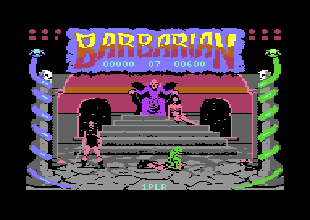
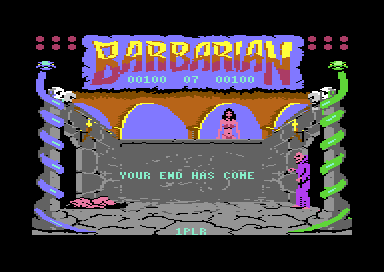
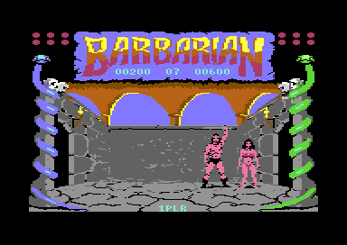

# The game flow (Part 2, V 05 05 87)

The game flow connects the fights of Part 2, the story game. After the start, the program shows a demo: two computer fighters fight in the arena. F1 starts the set-up of a one-player game, and F7 starts the game. The player fights opponents 0 to 7, one bout each. A lost bout ends the game. After the win against opponent 7, the final stage with Drax and the princess starts. The flow selects the scene, starts the walk-in of each bout, ends each bout and selects the next opponent. It also reads the keys for the music, the pause, the version text and the quit. (**Code**)

**Conventions.**
- Addresses are C64 addresses. Names are the names of the knowledge of `game_v1`.
- A *frame* is one PAL screen, 1/50 of a second. The raster interrupt runs one time in each frame.
- A *pass* is one run of `main_loop`. A pass has no frame wait, so it takes as many frames as its work needs.
- A *bout* is one fight against one opponent, from the walk-in to the kill. The *walk-in* is the start of a bout: the two fighters walk to each other.
- The *opponent* is [`opponent_index` `$BE`](../src/constants.asm#L99), 0-7. The demo uses opponent 4.
- The *scene* is [`scene_index` `$C4`](../src/constants.asm#L105): 0 is the throne room, 1 is the dungeon arena.
- A *flag* is a byte in which bit 7 set means "on". Many routines do nothing while a flag is on.
- Player 1 is fighter 0, joystick port 2. The computer is fighter 1. In the demo, the computer moves both fighters.
- **Observed** marks a fact that a run showed. **Code** marks a fact from the code only. **Conclusion** marks an interpretation.

## How it works

The program has no title screen. The demo is the title, and the game returns to the demo after each game. Each game mode uses the same main loop. Flags tell each routine of the loop if it must work in this pass. (**Code**)

~~~mermaid
flowchart TB
  A["Start: memory, VIC, interrupts, sound (start)"] --> B["Demo: computer against computer, opponent 4"]
  B -->|F1| C["Set-up: opponent 0, 1PLR"]
  C -->|F7| D["Walk-in of a bout"]
  D --> E["Bout: one pass of the main loop for each step"]
  E --> F["Kill: the goblin drags the loser away"]
  F --> G["Winner walks back, both fighters reset"]
  G -->|player won, opponent 0-6| H["Next opponent, other scene"]
  H --> D
  G -->|player won, opponent 7| I["Final stage: Drax and the princess"]
  G -->|player lost| J["Wait 200 frames, quit to the demo"]
  I --> J
  J --> B
~~~

[`start` `$8009`](../src/init/init.asm#L6) prepares the machine and runs into [`main_loop` `$80BB`](../src/main/main_loop.asm#L6). The main loop never returns. Each end of a game goes through [`quit_to_demo` `$94AB`](../src/main/quit_to_demo.asm#L6), which resets the stack and jumps to `restart`. The state machine at the end of the page gives each change of state. (**Code**)

### The start and the initialisation

Each crack jumps to `start` after its own code. The cartridge header CBM80 at `$8000` also points to `start`, so a hardware reset starts the game again. RESTORE does nothing in the game, because the NMI vector points to an RTI. The page [../../docs/releases.md](../../docs/releases.md) tells how the Hotline release removed the header. (**Code**)

`start` writes 0 into `sound_off`, so the game starts with the sound effects. Then [`restart` `$800E`](../src/init/init.asm#L11) does these steps in this order (**Code**):

1. [`init_game_state` `$9272`](../src/init/state.asm#L6) clears all flags of the story and the game. It writes 1 into `demo_mode` and 4 into `opponent_index`, so the demo starts.
2. It writes `$25` into `$01`: RAM at `$A000` and `$E000`, I/O at `$D000`, no BASIC and no KERNAL.
3. It selects VIC bank 1, the screen at `$4400` and the bitmap at `$6000`, in multicolour bitmap mode.
4. It writes the IRQ vector (`$94E8`) and the NMI vector (`$9519`, an RTI). The raster interrupt comes at line `$FA`.
5. It clears the sprites, saves the clean fight background and resets the colours and the sprite scripts.
6. `init_fighters` puts both fighters at their start columns 0 and `$1F` with energy 12 and score 0. It sets `walk_in_active`, so the first bout starts with a walk-in.
7. It builds the mirror table at `$02AA` and the mask table at `$03AA`.
8. With the sound effects, it starts the CIA 1 timers A and B, silences the SID and fades the volume in. With the music, it keeps the timers and the music runs on. The page [sound.md](sound.md) explains the two timer interrupts.
9. It enables the interrupts and continues into `main_loop`.

A restart thus keeps the choice of F3, but it clears each other state of the game. The scores of both fighters go back to 0. (**Code**)

### The main loop

`main_loop` calls 23 routines and jumps back. Each routine tests its own flags. The calls come in this order (**Code**):

1. **The status texts.** It animates the corner blocks at the top of the screen and prints the mode text, the counter, the energy bars and the scores. The texts are bitmap characters, so the loop prints them again in each pass.
2. **The time-out.** [`check_time_out` `$830D`](../src/combat/time_out.asm#L6) ends a two-player bout at time 0. Part 2 has no two-player game, see "The bout clock".
3. **The input.** `read_joysticks` reads port 2 for the player. [`ai_choose_moves` `$870C`](../src/ai/computer_moves.asm#L6) gives a joystick value to each computer fighter. The page [ai.md](ai.md) explains the choice.
4. **The fighters.** It copies the clean background into the work bitmap, steps the move of each fighter and draws both fighters into the work bitmap. Between these steps, it starts the decapitation and the goblin. Then it copies the work bitmap to the screen. The page [fighters.md](fighters.md) explains the drawing.
5. **The rules.** It calculates the distance, turns the fighters after they pass each other and finds the hits. The page [combat.md](combat.md) explains the hits.
6. **The flow.** `update_walk_in` runs the walk-in, `end_bout` ends a bout after a kill, and `check_player_idle` starts the idle move of a player who does nothing.
7. **The keys.** `read_keys` reads the function keys, Q and CTRL+V.
8. **The final stage.** `final_stage_attack` moves the bolt of Drax, and `set_end_figure` sets the sprites of the end scene. Both do nothing before the final stage.

The main loop has no frame wait. A pass takes as long as its work, and the bitmap copies and the fighter drawing are slow. In the attract recording, `read_keys` ran 1495 times in about 15500 frames after the key of the cracktro. A pass thus takes about 10 frames on average, about 5 passes each second. (**Observed**)

The raster interrupt does the work that needs a fixed pace. At line `$FA`, [`raster_irq` `$951A`](../src/irq/irq_handler.asm#L42) moves the sprites, runs the sprite scripts and calls `count_down_timers`. This routine counts down the idle timers, `wait_counter` and the bout clock in each frame. The page [graphics.md](graphics.md) explains the raster interrupt. (**Code**)

### The attract demo

The demo starts after each start and after each game. `demo_mode` is 1, so `read_joysticks` reads no joystick and `ai_choose_moves` moves both fighters. Both fighters use the tables of opponent 4, and the counter shows `04`. The mode text shows DEMO. (**Code**) The screenshots show DEMO and `04` (**Observed**).

The demo in the throne room: Drax sits on the throne, the princess sits beside him, and one fighter lies on the floor.

In the demo, the random number of the computer comes from the CIA 1 timers: timer B low EOR timer A low. These timers drive the sound interrupts and run all the time. Thus the demo fights depend on the cycle of each read, not only on the frames. (**Code**) The recordings record each read of `$DC04` and `$DC06` for this reason. The attract recording has 2448 such read pairs. (**Observed**)

A demo bout ends only with a kill, because `check_time_out` returns at once when `demo_mode` is not 0. After each kill, `end_bout` changes the scene and the next demo bout starts with a walk-in. `opponent_index` stays 4. The demo has no end, and the scores of both fighters grow from bout to bout. (**Code**)

The demo in the dungeon arena: Drax and the princess stand in the two right windows, and two fighters fight at the right.

### The keys

[`read_keys` `$939B`](../src/input/keyboard.asm#L6) reads the keyboard matrix one time in each pass. CIA 1 port A selects a row, and port B gives the columns. The routine has no edge test, so a key acts in each pass that finds it pressed. (**Code**) A pass takes about 10 frames, so a short press acts one time (**Conclusion**). In the keys recording, a press of F3 for 10 frames reached only one pass (**Observed**).

| Key | Row, bit | Effect | Condition |
|---|---|---|---|
| CTRL+V | 7 bit 2, 3 bit 7 | Shows "V 05 05 87" while V stays pressed | Always |
| F1 | 0 bit 4 | Starts the set-up: opponent 0, one player, demo off | No set-up, no started game, no turn, no loser |
| F3 | 0 bit 5 | Changes between the sound effects and the music | Always |
| F5 | 0 bit 6 | Pauses until the next F5 | Not during the set-up |
| F7 | 0 bit 3 | Starts the game | Only during the set-up |
| Q | 7 bit 6 | Quits to the demo | Always |

F1 writes 0 into `two_players`. No code of Part 2 writes another value, so Part 2 has only the one-player game. Part 1 changes `two_players` with F1. (**Code**) The page [../../docs/versions.md](../../docs/versions.md) compares the two parts.

F3 first fades out the sound with `stop_sound`. Then it changes bit 7 of `sound_off`. With bit 7 set, it requests the tunes `$80`, `$81` and `$82` on the three voices, and `start_sound_request` drops each request of `$83` and higher. Thus bit 7 set means "music, no effects", and bit 7 clear means "effects, no music". (**Code**)

Q jumps to `quit_to_demo` from each state, also from the demo and the set-up (**Code**). No recording executed the Q path (**Observed**, coverage).

### The pause and the version text

Both keys stop the main loop inside `read_keys`. The raster interrupt continues, so the music, the sprites and the frame counters continue. (**Code**)

F5 calls `busy_wait`, a loop of 65536 passes of 13 cycles, about 0.86 seconds. This wait lets the player release F5. Then [`read_keys_pause_wait` `$944D`](../src/input/keyboard.asm#L95) reads F5 until the next press. Other keys have no effect during the pause. (**Code**)

The pause writes A into `sprites_frozen` before and after the wait, but A is 0 at both stores. Thus the sprites do not stop: the goblin and the bolt of Drax move during the pause. The text PAUSED is in the text table as text `$85`, but no code prints it. (**Code**) The authors wanted a pause with frozen sprites and a text (**Conclusion**). V 05 10 87 freezes the sprites, see [../../docs/versions.md](../../docs/versions.md).

A press of F5 longer than `busy_wait` causes a problem. After the wait, F5 is still pressed, so the pause ends at once. When F5 is still pressed in the next pass, a new pause starts. (**Code**) The keys recording shows the two cases (**Observed**):

- F5 for 40 frames in the demo starts the pause. F1, F3, F3 and F7 come during the pause and have no effect.
- F5 for 60 frames ends the pause. The key is still pressed in the next pass, so a second pause starts. F3 and Q come during this pause, and the recording ends in the pause.

CTRL+V calls `print_text` with text `$81` in a loop while V stays pressed. When the player releases V, `reset_fight_colours` removes the text. (**Code**) In the keys recording, the loop read V 136 times during a press of 40 frames (**Observed**).

### The set-up and the start of a game

F1 in the demo starts the set-up. `read_keys` writes `$80` into `setup_active` and 0 into `opponent_index`, `game_started` and `demo_mode`. When the dungeon shows, it calls `change_scene`, so each game starts in the throne room. Then it calls `init_fighters`, resets the sprite scripts, the bout clock and `two_players`. (**Code**) The scores go back to 0 and the mode text shows 1PLR (**Code**).

During the set-up, the main loop runs, but most routines do nothing. `animate_fighters`, the joystick, the computer, the hits and the walk-in all test `setup_active`. F5 has no effect. (**Code**)

F7 during the set-up writes `$80` into `game_started` and 0 into `setup_active`, and resets the bout clock. Now F1 has no effect until the end of the game. `walk_in_active` is still set from `init_fighters`, so the walk-in of the first bout starts in the next pass. (**Code**) The fight, win and final recordings press F1, wait 30 frames and press F7 (**Observed**).

### The walk-in

[`update_walk_in` `$8358`](../src/combat/walk_in.asm#L6) runs while bit 7 of `walk_in_active` is 1. It gives move `$01`, walk forward, to both fighters. It also requests the sound effects `$89`, `$8A` and `$8B` when bit 7 of `sound_request` and of `voice_tune` of voice 0 is 0. (**Code**)

When `fighter_distance` is less than 6 columns, the walk-in ends. The routine clears `walk_in_active` and starts the idle timers of both fighters. With the sound effects, it stops the sound and fades the volume in again. Now the joystick, the computer and the hit test work. (**Code**) The fighters start at columns 0 and `$1F`, so each fighter walks about 13 columns (**Conclusion**).

### A bout

A bout has no time limit in Part 2. It ends only when one fighter dies: the energy reaches 0, or a decapitation hits. Each fighter starts a bout with energy 12. The score stays from bout to bout. (**Code**) The page [combat.md](combat.md) explains the hits, the energy and the score.

`check_player_idle` starts the idle move when the player gives no joystick input until the idle timer is 0. The timer starts at `$FF`, so the wait is about 5 seconds. The computer can decapitate an idle player. (**Code**) The decapitation recording shows this case: the player does nothing, and opponent 7 cuts off his head (**Observed**).

### The bout clock and the time bonus

The bout clock exists in Part 2, but it has no effect. `reset_timer` writes 60 into `time_left` at each walk-in. [`count_down_timers` `$98F7`](../src/irq/timers.asm#L6) decrements it after each 50 frames, outside the walk-in and after a kill. (**Code**)

Only two-player code reads the value of the clock (**Code**):

- `check_time_out` ends a bout at time 0 only when `two_players` is not 0.
- `show_counter` shows the time only in a two-player game. Else it shows the opponent number.
- [`add_time_bonus` `$83A9`](../src/score/time_bonus.asm#L6) adds 10 points for each second only in a two-player game.

Part 2 cannot start a two-player game, so this code is dead in Part 2. No recording executed it (**Observed**, coverage). The authors kept the two-player code of the shared source and changed only F1 (**Conclusion**). The page [../../docs/development.md](../../docs/development.md) tells more about the shared source.

### The end of a bout

A kill sets `bout_loser` to `$80` + the number of the loser. `start_winner_move` gives a winner move to the other fighter. When the loser lies on the floor, [`start_goblin` `$91A7`](../src/combat/bout_end.asm#L113) starts the goblin as sprites 3 and 4. The goblin drags the body to the right. (**Code**) The page [combat.md](combat.md) explains the decapitation and the goblin.

After a decapitation in the throne room, the green goblin drags the body away, and the winner stands at the left.

[`end_bout` `$83F8`](../src/combat/end_of_bout.asm#L6) waits until the loser is at column `$28` or more, outside the screen. Then the winner turns to its start direction and walks back to its home column: 3 for fighter 0, `$1C` for fighter 1. At the home column, `end_bout_reset` resets both fighters for the next bout (**Code**):

1. The loser goes to its start column, and both fighters stand in move `$00`, face to face.
2. Each fighter gets energy 12 and a full idle timer. The routine sets `walk_in_active` again.
3. It clears `bout_loser` and the goblin flags.
4. When the computer lost and `sprite_mirror_state` is not 0, it requests the mirror back.

Then `end_bout` selects the next step (**Code**):

- **Demo.** It changes the scene. The next demo bout starts.
- **The player lost.** It waits 200 frames, 4 seconds, and jumps to `quit_to_demo`.
- **The player won against opponent 0-6.** It increments `opponent_index` and changes the scene.
- **The player won against opponent 7.** It starts the final stage.

### The next opponent and the scenes

[`change_scene` `$8E73`](../src/screen/scene.asm#L6) changes the centre of the picture to the other stored picture. It fades the sound out, swaps the bitmap and the colours with the store at `$D000` and `$E000`, and fades the sound in. `scene_index` changes from 0 to 1 or from 1 to 0. The page [graphics.md](graphics.md) explains the stored picture. (**Code**)

Each game starts in the throne room, and each won bout changes the scene. Thus opponents 0, 2, 4 and 6 fight in the throne room, and opponents 1, 3, 5 and 7 fight in the dungeon. (**Code**) In the win recording, the scene changes after the win against opponent 0 (**Observed**).

The counter between the scores shows the opponent number, from `00` to `07`. Each opponent uses its own table of the computer moves. The page [ai.md](ai.md) gives the level of each opponent. (**Code**)

### The final stage

After the win against opponent 7, [`end_bout_final_stage` `$848D`](../src/combat/end_of_bout.asm#L93) starts the final stage. It always shows the dungeon: it calls `change_scene` only when the throne room shows. It writes `scene_index` into `walk_in_active`. Bit 7 of this value is clear, so the final stage has no walk-in. Then it sets `final_stage`, waits 50 frames and changes the end scene blocks. (**Code**)

In the final stage, the computer does not move, the hit test does not run and only fighter 0 moves. Drax throws bolts. The player must pass them and walk to the princess. (**Code**) The page [final_stage.md](final_stage.md) explains the bolts.

The final stage in the dungeon: a bolt killed the player, and the text YOUR END HAS COME shows.

The final stage has two ends. Both end at `quit_to_demo` (**Code**):

- A bolt hits the player. The player falls, and after 150 frames the text YOUR END HAS COME shows. After 200 more frames, the demo starts.
- The player reaches column `$1C`. The end scene plays, and the text THANKS BIG BOY shows. After 250 more frames, the demo starts.

The final recordings show both ends (**Observed**).

The end of the story: the barbarian raises his arm beside the princess.

### Quit to the demo

`quit_to_demo` switches off the sprites and removes the fighters from the screen. It mirrors the sprite images back and restores the blocks of the end scene when the final stage ran. When the dungeon shows, it changes back to the throne room. Then it resets the stack pointer to `$FF` and jumps to `restart`. (**Code**)

`restart` calls `init_game_state` again, so the demo starts with opponent 4 and new scores. A quit from inside a subroutine thus leaves no return addresses on the stack. (**Code**) The decapitation and final recordings return to the demo (**Observed**).

## The data

### The flags of the flow

Most routines of the main loop start with a test of some of these flags. A flag with bit 7 set stops the routine. The flags are zero page bytes from [`bout_loser` `$AF`](../src/constants.asm#L84) to [`final_stage` `$BB`](../src/constants.asm#L96). (**Code**)

| Flag | Set by | Cleared by | Stops |
|---|---|---|---|
| `setup_active` | F1 | F7 | Fighter animation, joystick, computer, hits, walk-in, idle move, F5 |
| `game_started` | F7 | `init_game_state` | F1 |
| `walk_in_active` | `init_fighters`, `end_bout_reset` | `update_walk_in` | Joystick, computer, hits, idle move, clock |
| `turn_request` | The fighters pass each other | The turn move | Joystick, computer, hits, F1 |
| `bout_loser` | A kill (energy 0 or decapitation) | `end_bout_reset` | Joystick, computer, hits, idle move, clock, F1 |
| `time_out_active` | Time 0, two players only | Both fighters at home | Joystick, computer, hits, idle move, clock |
| `final_stage` | The win against opponent 7 | `init_game_state` | Computer, hits, walk-in |

[`demo_mode` `$B3`](../src/constants.asm#L88) is not a bit 7 flag. A value that is not 0 means the demo. It stops the joystick and the idle move, and it gives both fighters to the computer. (**Code**)

### The status texts

`print_text` draws each text into the bitmap. A text record has a column, a row, a colour byte and the characters, and `$24` ends it. (**Code**)

| Text | Column, row | Content | Printed by |
|---|---|---|---|
| `$81` | 15, 17 | `V 05 05 87` | CTRL+V |
| `$82`, `$83`, `$84` | 18, 24 | `1PLR`, `2PLR`, `DEMO` | `show_mode_text` |
| `$85` | 17, 17 | `PAUSED` | No code |
| `$86` | 19, 5 | Two digits: opponent or time | `show_counter` |
| `$87`, `$88` | 12, 5 and 23, 5 | Score of fighter 0 and fighter 1, 5 digits | `show_energy_scores` |
| `$89` | 11, 17 | `YOUR END HAS COME` | The bolt contact |
| `$8A` | 9, 17 | `THANKS BIG BOY` | The end of the story |
| `$8B-$97` | 0 and 34, rows 0-1 | The energy bar for energy 0-12 | `show_energy_scores` |

Text `$80` is `000` at row 22, and no code prints it (**Code**).

## The state machine of the game

The state is a set of flags, not one byte. The diagram gives the states that a player sees. (**Code**)

~~~mermaid
stateDiagram-v2
  state "Demo (demo_mode 1)" as Demo
  state "Set-up (setup_active)" as Setup
  state "Walk-in (walk_in_active)" as Walk
  state "Bout" as Bout
  state "End of a bout (bout_loser)" as End
  state "Final stage (final_stage)" as Final
  [*] --> Demo
  Demo --> Setup: F1
  Demo --> Demo: Q
  Setup --> Walk: F7
  Setup --> Demo: Q
  Walk --> Bout: distance less than 6
  Bout --> End: kill
  End --> Walk: player won, opponent 0-6, or demo
  End --> Final: player won, opponent 7
  End --> Demo: player lost
  Final --> Demo: bolt contact, or princess reached
  Bout --> Demo: Q
~~~

| State | Condition | Next state | Code |
|---|---|---|---|
| Start | Always | Demo | `start` |
| Demo | F1 | Set-up | `read_keys` |
| Demo | Kill | End of a bout | `check_hits`, `check_decapitation` |
| Set-up | F7 | Walk-in | `read_keys` |
| Walk-in | `fighter_distance` less than 6 | Bout | `update_walk_in` |
| Bout | Energy 0 or decapitation | End of a bout | `check_hits`, `check_decapitation` |
| End of a bout | Demo, loser at column `$28`, winner at home | Walk-in, other scene | `end_bout` |
| End of a bout | Player won, opponent 0-6 | Walk-in, next opponent, other scene | `end_bout` |
| End of a bout | Player won, opponent 7 | Final stage | `end_bout_final_stage` |
| End of a bout | Player lost | Demo, after 200 frames | `end_bout` |
| Final stage | Bolt contact without the right move | Demo, after 350 frames | `check_attack_contact_hit` |
| Final stage | Fighter 0 at column `$1C` or more | Demo, after the end scene | `check_final_goal` |
| Each state | Q | Demo | `quit_to_demo` |
| Each state but the set-up | F5 | Same state, paused until F5 | `read_keys` |

## The worked example: the opponent counter

This example decodes text `$86` and the change that `show_counter` makes to it. The bytes come from `text_counter` at `$BADF`. (**Code**)

| Offset | Byte | Meaning |
|---|---|---|
| 0 | `$13` | Column 19 |
| 1 | `$05` | Row 5 |
| 2 | `$E3` | Colour byte |
| 3 | `$30` | Digit 1: `show_counter` writes `$30`, the character 0 |
| 4 | `$30` | Digit 2: `show_counter` writes `opponent_index` OR `$30` |
| 5 | `$24` | End of the text |

With opponent 7, digit 2 is `$37`, the character 7, and the counter shows `07`. In the demo, `opponent_index` is 4 and the counter shows `04`. (**Code**) The goblin screenshot shows `07` between the scores, and the demo screenshots show `04` (**Observed**).

In a two-player game, `show_counter` writes the two digits of `time_left` into offsets 3 and 4. It subtracts 10 until the value is negative and counts the tens. Part 2 never runs this path. (**Code**)

## Still open

- What does the screen show during the set-up? `animate_fighters` does nothing, so the fighters can stay away from the screen. A run that stops between F1 and F7 can capture the screen.
- Does a pause during the final stage change the bolt contact? The bolt moves during the pause, and the contact test runs in the main loop. A run that presses F5 while a bolt flies can show it.
- What does Q do in each state? No recording executed the Q path. A run that presses Q for less than one pass in the demo, the set-up, a bout and the final stage can show it.
- How long does a pass take in each state? The attract recording gives only the average. A run that counts the frames between two passes in the walk-in, a bout and the end of a bout can measure it.
