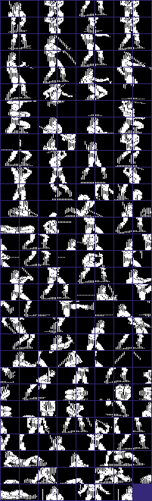
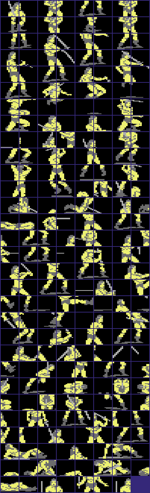
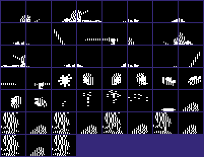
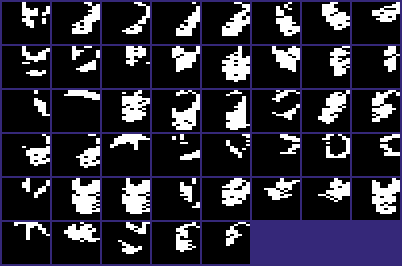
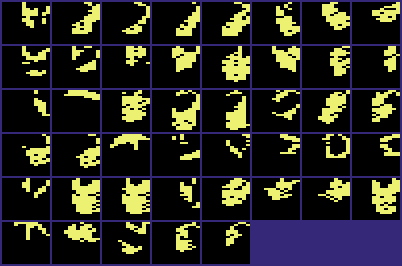
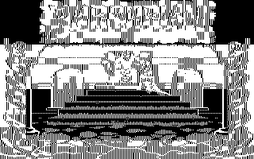
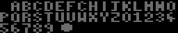
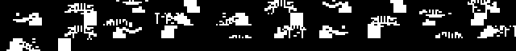
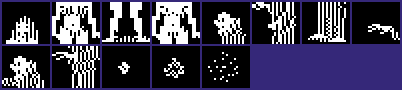
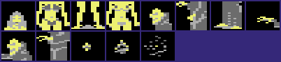

<!-- Generated by c64-docs from knowledge revision 20261029T165719.607-qgx52f and .c64-re-tools/local/generated/src/source-map.json. Do not edit: change the knowledge, generate the source again, then run docs.ts generate. -->
# Graphics

Each sprite, bitmap, charset and screen region of the knowledge. The knowledge gives no display mode and no colours, so a sprite, bitmap or charset shows in hires and in multicolour, in pattern colours: black is pixel value 0, white is 1 in hires; in multicolour light grey is 1, grey is 2 and yellow is 3. Index: [the reference](index.md).

## [`fighter_pieces` `$0840`](../../src/graphics/fighter_pieces.asm#L9) `$0840-$43FF`

*sprite*

Fighter body pieces 1-$ef: 64 bytes each, at $0800 + 64 * piece number. Each piece has the sprite format: 21 rows of 3 bytes, multicolour. The 64th byte is not used. A frame record ($bd80) gives 9 piece numbers for a grid of 3 x 3 pieces. $8a2c copies the non-zero bytes of each piece into the composition buffer at $05ca.

## [`sprite_frames` `$4800`](../../src/graphics/sprite_frames.asm#L6) `$4800-$54BF`

*sprite*

Hardware sprite frames $20-$52 (51 frames of 64 bytes). Only the VIC-II reads them. A frame record ($bd80) adds $20 to its sprite numbers 0-$32. $8fcc adds $0d more when the fighter faces left. The sprite animations ($cbe8, $9735) also add $20 to each frame number.

## [`sprite_frames_mirrored` `$54C0`](../../src/graphics/sprite_frames.asm#L1096) `$54C0-$5FFF`

*sprite*

Hardware sprite frames $53-$7f (45 frames). The frames for fighter 1 have no copy for the other side. $8ce3 mirrors all 45 frames in place when $b7 bit 7 is set (fighter 1 turns). $8ddc exchanges frames $53-$5f with the 13 frames at $fc40 when $be reaches 7 ($848d).

## [`bitmap` `$6000`](../../src/graphics/background_bitmap.asm#L6) `$6000-$7F3F`

*bitmap*

Multicolour bitmap of VIC bank 1: the background picture of the throne room (8000 bytes). $92df draws the texts into it. $81be draws the corner pictures at rows 2-5. $8ea8 and $8edb exchange rows 7-22, columns 4-35 with a second picture at $d000 when the scene changes.

## [`arena2_bitmap` `$D000`](../../src/graphics/arena2_bitmap.asm#L6) `$D000-$DFFF`

*bitmap*

Bitmap of the arena that is not on screen: character rows 7-22, columns 4-35, 256 bytes for each row. $8f49 swaps it with $a678-$b677 when the arena changes. The code sets $01 to $20 to read it.

## [`font` `$E800`](../../src/graphics/font.asm#L6) `$E800-$E937`

*charset*

Font of the text printer, 8 bytes for each glyph (39 glyphs): space, A-Z, 0-9, "(" and ")". $9381 gives the glyph address $e800+8n. $92df makes multicolour cells from each glyph.

## [`corner_frames` `$E980`](../../src/graphics/corner_frames.asm#L6) `$E980-$ED7F`

*bitmap*

8 frames of the corner animations, 4 x 4 cells each (128 bytes), cell by cell and row by row. $e980-$eb7f are the right corner frames, $eb80-$ed7f the left corner frames.

## [`end_story_sprites` `$FC40`](../../src/graphics/end_story_sprites.asm#L6) `$FC40-$FF7F`

*sprite*

13 sprites. $8ddc swaps them with the sprites at $54c0-$57ff (pointers $53-$5f). $848d calls it after a won bout at level 7.

