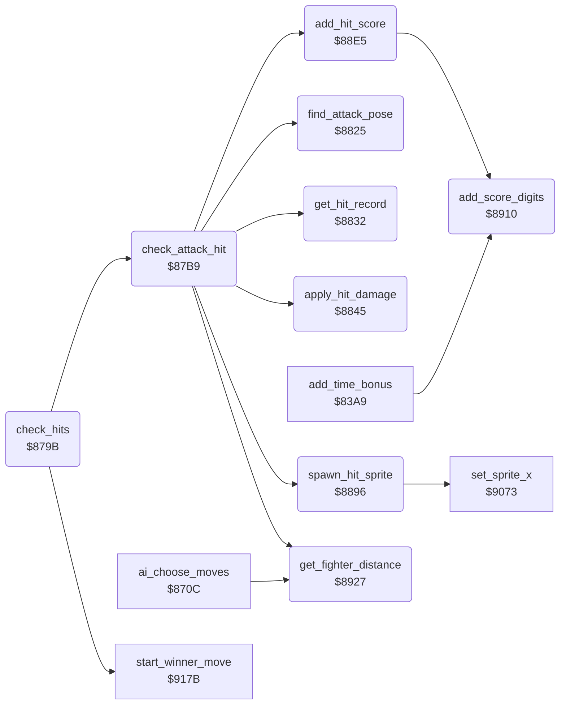

<!-- Generated by c64-docs from knowledge revision 20261029T165719.607-qgx52f and .c64-re-tools/local/generated/src/source-map.json. Do not edit: change the knowledge, generate the source again, then run docs.ts generate. -->
# combat/hits.asm: Hit detection, damage, hit sprites and score

Range `$879B-$8939`. Source: [combat/hits.asm](../../../../src/combat/hits.asm). Index: [the reference](../../index.md).

## Routines

| Routine | Address | Reached from | Summary |
|---|---|---|---|
| [`check_hits`](hits.md#check_hits) | `$879B` | [`$80E8`](../../../../src/main/main_loop.asm#L22) | Examines the attacks of fighter 1 and of fighter 0 for a hit. |
| [`check_attack_hit`](hits.md#check_attack_hit) | `$87B9` | [`check_hits`](hits.md#check_hits) | Examines the attack of fighter X (the attacker) against the pose of the other fighter (the defender). |
| [`find_attack_pose`](hits.md#find_attack_pose) | `$8825` | [`check_attack_hit`](hits.md#check_attack_hit) | Finds the pose of fighter X in the 12 attack poses at $c2c6. |
| [`get_hit_record`](hits.md#get_hit_record) | `$8832` | [`check_attack_hit`](hits.md#check_attack_hit) | Reads the hit record number at ($8b),y. |
| [`apply_hit_damage`](hits.md#apply_hit_damage) | `$8845` | [`check_attack_hit`](hits.md#check_attack_hit) | Uses byte 2 of the hit record at ($87). |
| [`spawn_hit_sprite`](hits.md#spawn_hit_sprite) | `$8896` | [`check_attack_hit`](hits.md#check_attack_hit) | Uses byte 3 of the hit record. |
| [`add_hit_score`](hits.md#add_hit_score) | `$88E5` | [`check_attack_hit`](hits.md#check_attack_hit) | Adds the 5 digits at $c86c + 5 * $c7 to the score of the attacker in $9d. |
| [`add_score_digits`](hits.md#add_score_digits) | `$8910` | [`add_time_bonus`](../score/time_bonus.md#add_time_bonus), [`add_hit_score`](hits.md#add_hit_score) | Adds 5 decimal digits at ($5f) to the 5 digit characters ($30-$39) at ($7f). |
| [`get_fighter_distance`](hits.md#get_fighter_distance) | `$8927` | [`ai_choose_moves`](../ai/computer_moves.md#ai_choose_moves), [`check_attack_hit`](hits.md#check_attack_hit), [`$80E2`](../../../../src/main/main_loop.asm#L20) | Calculates the distance between the two fighters in columns. |

## Call graph

A solid arrow is a call, a thick arrow a table entry. Rounded nodes are in this file.

## Details

### [`check_hits`](../../../../src/combat/hits.asm#L6) `$879B`

*routine*

Examines the attacks of fighter 1 and of fighter 0 for a hit. Then it calls $917b when a fighter has no energy. It does nothing when a flag in $af, $b2, $b4, $b5, $ba or $bb has bit 7 set.

- **Called from:** [`$80E8`](../../../../src/main/main_loop.asm#L22)
- **Calls:** [`check_attack_hit`](hits.md#check_attack_hit), [`start_winner_move`](bout_end.md#start_winner_move)
- **Reads:** [`turn_request`](../../memory-map.md#turn_request), [`bout_loser`](../../memory-map.md#bout_loser), [`walk_in_active`](../../memory-map.md#walk_in_active), [`setup_active`](../../memory-map.md#setup_active), [`time_out_active`](../../memory-map.md#time_out_active), [`final_stage`](../../memory-map.md#final_stage)

| Label | Address | Comment |
|---|---|---|
| [`check_hits_loop`](../../../../src/combat/hits.asm#L15) | `$87AB` | No test of bout_loser between the 2 fighters: when both lose their last energy in one pass, bout_loser ends as $81. |
| [`check_hits_done`](../../../../src/combat/hits.asm#L22) | `$87B8` |  |

### [`check_attack_hit`](../../../../src/combat/hits.asm#L25) `$87B9`

*routine*

Examines the attack of fighter X (the attacker) against the pose of the other fighter (the defender). An attack pose from $c2c6 selects a list at $c2d2 of 2-byte entries: defender pose, hit record number. $ff ends the list. A hit needs a matching entry and the distance bit. Then it starts the reaction move, the sounds, the damage, a hit sprite and the score. Input: X = attacker. Output: X = attacker. Only one hit for each call.

- **Called from:** [`check_hits`](hits.md#check_hits)
- **Calls:** [`find_attack_pose`](hits.md#find_attack_pose), [`get_hit_record`](hits.md#get_hit_record), [`get_fighter_distance`](hits.md#get_fighter_distance), [`apply_hit_damage`](hits.md#apply_hit_damage), [`spawn_hit_sprite`](hits.md#spawn_hit_sprite), [`add_hit_score`](hits.md#add_hit_score)
- **Reads:** [`hit_list_ptrs`](hit_tables.md#hit_list_ptrs), [`fighter_pose`](../../memory-map.md#fighter_pose), [`hit_list_ptr`](../../memory-map.md#hit_list_ptr), [`fighter_distance`](../../memory-map.md#fighter_distance), [`bit_masks`](../data/bit_masks.md#bit_masks), [`move_ptr`](../../memory-map.md#move_ptr), [`arena2_screen`](../graphics/arena2_screen.md#arena2_screen), [`arena2_screen_tail`](../graphics/arena2_screen.md#arena2_screen_tail), [`arena2_colours`](../graphics/arena2_screen.md#arena2_colours), [`arena2_colours_tail`](../graphics/arena2_screen.md#arena2_colours_tail), [`cur_fighter`](../../memory-map.md#cur_fighter)
- **Writes:** [`cur_fighter`](../../memory-map.md#cur_fighter), [`hit_list_ptr`](../../memory-map.md#hit_list_ptr), [`move_ptr`](../../memory-map.md#move_ptr), [`fighter_move`](../../memory-map.md#fighter_move), [`fighter_move_lock`](../../memory-map.md#fighter_move_lock), [`fighter_move_step`](../../memory-map.md#fighter_move_step)
- **Refers to:** [`hit_list_ptr`](../../memory-map.md#hit_list_ptr), [`move_ptr`](../../memory-map.md#move_ptr)

| Label | Address | Comment |
|---|---|---|
| [`check_attack_hit_entry`](../../../../src/combat/hits.asm#L41) | `$87D5` | Compares the defender pose with the pose of the list entry. |
| [`check_attack_hit_apply`](../../../../src/combat/hits.asm#L64) | `$8802` |  |
| [`check_attack_hit_next`](../../../../src/combat/hits.asm#L69) | `$880E` | Next 2-byte entry of the list. |
| [`check_attack_hit_done`](../../../../src/combat/hits.asm#L81) | `$8822` |  |

### [`find_attack_pose`](../../../../src/combat/hits.asm#L85) `$8825`

*routine*

Finds the pose of fighter X in the 12 attack poses at $c2c6. Output: Y = index 0-11, or $ff (N set) when not found.

- **Called from:** [`check_attack_hit`](hits.md#check_attack_hit)
- **Reads:** [`fighter_pose`](../../memory-map.md#fighter_pose), [`attack_poses`](hit_tables.md#attack_poses)

| Label | Address | Comment |
|---|---|---|
| [`find_attack_pose_loop`](../../../../src/combat/hits.asm#L88) | `$8829` |  |
| [`find_attack_pose_done`](../../../../src/combat/hits.asm#L93) | `$8831` |  |

### [`get_hit_record`](../../../../src/combat/hits.asm#L96) `$8832`

*routine*

Reads the hit record number at ($8b),y. Output: $87/$88 = $c7ac + 4 * number. Hit record: mask of distances, reaction move, sound and damage, hit sprite and score.

- **Called from:** [`check_attack_hit`](hits.md#check_attack_hit)
- **Reads:** [`hit_list_ptr`](../../memory-map.md#hit_list_ptr), [`move_ptr`](../../memory-map.md#move_ptr)
- **Writes:** [`move_ptr`](../../memory-map.md#move_ptr)
- **Refers to:** [`move_ptr`](../../memory-map.md#move_ptr), [`hit_records`](hit_tables.md#hit_records)

### [`apply_hit_damage`](../../../../src/combat/hits.asm#L109) `$8845`

*routine*

Uses byte 2 of the hit record at ($87). High nibble: sound triplet at $c848 for the 3 SID voices. Low nibble not 0: fighter X loses 1 energy and starts the hit animation $82 + X. At 0 energy: sets $af = $80 + X and starts the move $9b of fighter X. Input: X = defender, Y = 1.

- **Called from:** [`check_attack_hit`](hits.md#check_attack_hit)
- **Reads:** [`move_ptr`](../../memory-map.md#move_ptr), [`arena2_screen`](../graphics/arena2_screen.md#arena2_screen), [`arena2_screen_tail`](../graphics/arena2_screen.md#arena2_screen_tail), [`arena2_colours`](../graphics/arena2_screen.md#arena2_colours), [`arena2_colours_tail`](../graphics/arena2_screen.md#arena2_colours_tail), [`hit_sfx_ptr`](../../memory-map.md#hit_sfx_ptr), [`hit_damage`](../../memory-map.md#hit_damage), [`corner_anim`](../../memory-map.md#corner_anim), [`fighter_energy`](../../memory-map.md#fighter_energy), [`saved_y`](../../memory-map.md#saved_y)
- **Writes:** [`saved_y`](../../memory-map.md#saved_y), [`hit_damage`](../../memory-map.md#hit_damage), [`hit_sfx_ptr`](../../memory-map.md#hit_sfx_ptr), [`sound_request`](../../memory-map.md#sound_request), [`corner_anim`](../../memory-map.md#corner_anim), [`corner_anim_pos`](../../memory-map.md#corner_anim_pos), [`fighter_energy`](../../memory-map.md#fighter_energy), [`bout_loser`](../../memory-map.md#bout_loser), [`fighter_move`](../../memory-map.md#fighter_move), [`fighter_move_step`](../../memory-map.md#fighter_move_step)
- **Refers to:** [`hit_sounds`](hit_tables.md#hit_sounds), [`hit_sfx_ptr`](../../memory-map.md#hit_sfx_ptr)

| Label | Address | Comment |
|---|---|---|
| [`apply_hit_damage_sfx_loop`](../../../../src/combat/hits.asm#L131) | `$8866` | A 0 byte does not change the request of that voice. |
| [`apply_hit_damage_sfx_next`](../../../../src/combat/hits.asm#L135) | `$886D` |  |
| [`apply_hit_damage_energy`](../../../../src/combat/hits.asm#L147) | `$8882` | The fighter loses 1 energy, whatever the value of the low nibble. |
| [`apply_hit_damage_done`](../../../../src/combat/hits.asm#L169) | `$8893` |  |

### [`spawn_hit_sprite`](../../../../src/combat/hits.asm#L173) `$8896`

*routine*

Uses byte 3 of the hit record. Low nibble: score number for $88e5, kept in $c7. High nibble not 0: starts sprite animation in the first free sprite slot. The record at $c857 + 3 * nibble gives animation, Y and X offset. The X position comes from the position and the facing of the attacker in $9d.

- **Called from:** [`check_attack_hit`](hits.md#check_attack_hit)
- **Calls:** [`set_sprite_x`](../sprites/fighter_sprites.md#set_sprite_x)
- **Reads:** [`move_ptr`](../../memory-map.md#move_ptr), [`arena2_screen`](../graphics/arena2_screen.md#arena2_screen), [`arena2_screen_tail`](../graphics/arena2_screen.md#arena2_screen_tail), [`arena2_colours`](../graphics/arena2_screen.md#arena2_colours), [`arena2_colours_tail`](../graphics/arena2_screen.md#arena2_colours_tail), [`record_ptr`](../../memory-map.md#record_ptr), [`sprite_anim`](../../memory-map.md#sprite_anim)
- **Writes:** [`hit_score`](../../memory-map.md#hit_score), [`record_ptr`](../../memory-map.md#record_ptr), [`sprite_slot`](../../memory-map.md#sprite_slot), [`sprite_anim`](../../memory-map.md#sprite_anim), [`sprite_anim_timer`](../../memory-map.md#sprite_anim_timer), [`sprite_path`](../../memory-map.md#sprite_path), [`sprite_anim_pos`](../../memory-map.md#sprite_anim_pos), [`sprite_y_shadow`](../../memory-map.md#sprite_y_shadow)
- **Refers to:** [`hit_sprite_effects`](hit_tables.md#hit_sprite_effects), [`record_ptr`](../../memory-map.md#record_ptr)

| Label | Address | Comment |
|---|---|---|
| [`spawn_hit_sprite_find`](../../../../src/combat/hits.asm#L195) | `$88B7` | A slot with bit 7 clear is free. |
| [`spawn_hit_sprite_slot`](../../../../src/combat/hits.asm#L203) | `$88C2` |  |
| [`spawn_hit_sprite_done`](../../../../src/combat/hits.asm#L222) | `$88E4` |  |

### [`add_hit_score`](../../../../src/combat/hits.asm#L225) `$88E5`

*routine*

Adds the 5 digits at $c86c + 5 * $c7 to the score of the attacker in $9d. $c7 = 0 adds nothing.

- **Called from:** [`check_attack_hit`](hits.md#check_attack_hit)
- **Calls:** [`add_score_digits`](hits.md#add_score_digits)
- **Reads:** [`hit_score`](../../memory-map.md#hit_score), [`cur_fighter`](../../memory-map.md#cur_fighter), [`text_ptrs`](../text/texts.md#text_ptrs)
- **Writes:** [`score_add_ptr`](../../memory-map.md#score_add_ptr), [`text_ptr`](../../memory-map.md#text_ptr)
- **Refers to:** [`score_values`](hit_tables.md#score_values), [`score_add_ptr`](../../memory-map.md#score_add_ptr), [`text_ptr`](../../memory-map.md#text_ptr)

| Label | Address | Comment |
|---|---|---|
| [`add_hit_score_done`](../../../../src/combat/hits.asm#L248) | `$890F` |  |

### [`add_score_digits`](../../../../src/combat/hits.asm#L251) `$8910`

*routine*

Adds 5 decimal digits at ($5f) to the 5 digit characters ($30-$39) at ($7f). It carries from the right digit to the left digit.

- **Called from:** [`add_time_bonus`](../score/time_bonus.md#add_time_bonus), [`add_hit_score`](hits.md#add_hit_score)
- **Reads:** [`text_ptr`](../../memory-map.md#text_ptr), [`score_add_ptr`](../../memory-map.md#score_add_ptr)

| Label | Address | Comment |
|---|---|---|
| [`add_score_digits_loop`](../../../../src/combat/hits.asm#L254) | `$8913` |  |
| [`add_score_digits_store`](../../../../src/combat/hits.asm#L261) | `$891F` |  |

### [`get_fighter_distance`](../../../../src/combat/hits.asm#L268) `$8927`

*routine*

Calculates the distance between the two fighters in columns. Output: A and $aa = |$71 - $72|.

- **Called from:** [`$80E2`](../../../../src/main/main_loop.asm#L20), [`ai_choose_moves`](../ai/computer_moves.md#ai_choose_moves), [`check_attack_hit`](hits.md#check_attack_hit)
- **Reads:** [`fighter_x`](../../memory-map.md#fighter_x)
- **Writes:** [`fighter_distance`](../../memory-map.md#fighter_distance)
- **Refers to:** [`fighter_x`](../../memory-map.md#fighter_x)

| Label | Address | Comment |
|---|---|---|
| [`get_fighter_distance_neg`](../../../../src/combat/hits.asm#L274) | `$8932` |  |
| [`get_fighter_distance_store`](../../../../src/combat/hits.asm#L278) | `$8937` |  |
