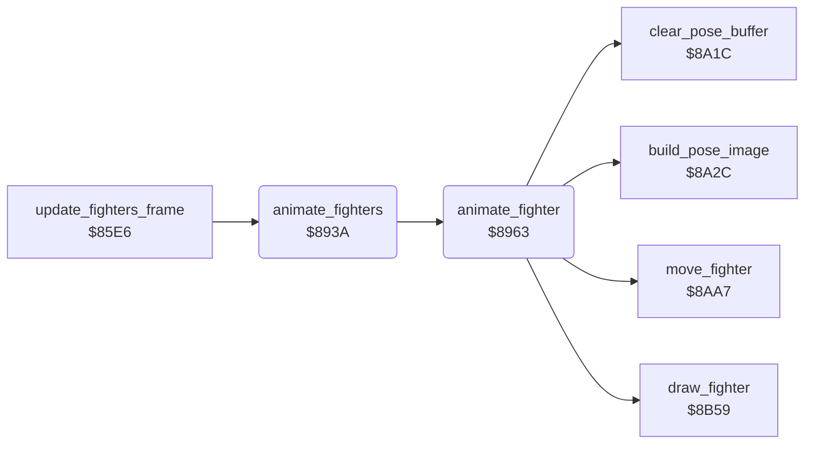

<!-- Generated by c64-docs from knowledge revision 20261025T232349.343-u0up13 and .c64-re-tools/local/generated/src/source-map.json. Do not edit: change the knowledge, generate the source again, then run docs.ts generate. -->
# fighter/animate.asm: Move sequences and poses of the fighters

Range `$893A-$8A1B`. Source: [fighter/animate.asm](../../../../src/fighter/animate.asm). Index: [the reference](../../index.md).

## Routines

| Routine | Address | Reached from | Summary |
|---|---|---|---|
| [`animate_fighters`](animate.md#animate_fighters) | `$893A` | [`update_fighters_frame`](../story/final_stage.md#update_fighters_frame), [`$80D3`](../../../../src/main/main_loop.asm#L15) | Animates both fighters and draws them into the work bitmap. |
| [`animate_fighter`](animate.md#animate_fighter) | `$8963` | [`animate_fighters`](animate.md#animate_fighters) | Steps the move sequence of fighter X by one byte and draws the new pose. |

## Call graph

A solid arrow is a call, a thick arrow a table entry. Rounded nodes are in this file.

## Details

### [`animate_fighters`](../../../../src/fighter/animate.asm#L6) `$893A`

*routine*

Animates both fighters and draws them into the work bitmap. The drawing order sets which fighter is in front. When fighter 1 does one of the 4 moves at $bd79, fighter 0 goes first. During set-up ($ba bit 7) it does nothing. When $bb bit 7 is set, it animates only fighter 0.

- **Called from:** [`$80D3`](../../../../src/main/main_loop.asm#L15), [`update_fighters_frame`](../story/final_stage.md#update_fighters_frame)
- **Calls:** [`animate_fighter`](animate.md#animate_fighter)
- **Jumps to:** [`animate_fighter`](animate.md#animate_fighter)
- **Reads:** [`final_stage`](../../memory-map.md#final_stage), [`setup_active`](../../memory-map.md#setup_active), [`moves_fighter0_first`](move_sequences.md#moves_fighter0_first), [`fighter_move`](../../memory-map.md#fighter_move)
- **Refers to:** [`fighter_move`](../../memory-map.md#fighter_move)

| Label | Address | Comment |
|---|---|---|
| [`animate_fighters_order`](../../../../src/fighter/animate.asm#L13) | `$8945` |  |
| [`animate_fighters_check`](../../../../src/fighter/animate.asm#L15) | `$8947` |  |
| [`animate_fighters_next`](../../../../src/fighter/animate.asm#L23) | `$8957` |  |
| [`animate_fighters_single`](../../../../src/fighter/animate.asm#L29) | `$8960` |  |

### [`animate_fighter`](../../../../src/fighter/animate.asm#L32) `$8963`

*routine*

Steps the move sequence of fighter X by one byte and draws the new pose. The sequence of move $67,x comes from the pointers at $bc87. A byte below $ff is a pose number. $ff is a command. The next byte: 0 = start again, 1 = set fighter_move to $01 and return, 2 = go to an index. No sequence uses 1 or 2. Command 3 starts the next move. A higher command holds the last pose. At move $9d (turn), command 3 also changes the facing and moves the fighter by $7f4a.

- **Called from:** [`animate_fighters`](animate.md#animate_fighters)
- **Jumped to from:** [`animate_fighters`](animate.md#animate_fighters)
- **Calls:** [`clear_pose_buffer`](pose_image.md#clear_pose_buffer), [`move_fighter`](move.md#move_fighter), [`build_pose_image`](pose_image.md#build_pose_image), [`draw_fighter`](draw.md#draw_fighter)
- **Reads:** [`fighter_move`](../../memory-map.md#fighter_move), [`move_seq_ptrs`](move_sequences.md#move_seq_ptrs), [`swing_sound_moves`](../combat/hit_tables.md#swing_sound_moves), [`swing_sound_steps`](../combat/hit_tables.md#swing_sound_steps), [`fighter_move_step`](../../memory-map.md#fighter_move_step), [`swing_sounds`](../combat/hit_tables.md#swing_sounds), [`move_seq_ptr`](../../memory-map.md#move_seq_ptr), [`pose_ptrs`](poses.md#pose_ptrs), [`anim_fighter`](../../memory-map.md#anim_fighter), [`fighter_facing`](../../memory-map.md#fighter_facing), [`turn_column_adjust`](../data/fighter_constants.md#turn_column_adjust), [`cur_fighter`](../../memory-map.md#cur_fighter) and 1 more
- **Writes:** [`move_seq_ptr`](../../memory-map.md#move_seq_ptr), [`sound_request`](../../memory-map.md#sound_request), [`fighter_move_step`](../../memory-map.md#fighter_move_step), [`fighter_move_lock`](../../memory-map.md#fighter_move_lock), [`fighter_pose`](../../memory-map.md#fighter_pose), [`record_ptr`](../../memory-map.md#record_ptr), [`anim_fighter`](../../memory-map.md#anim_fighter), [`fighter_move`](../../memory-map.md#fighter_move), [`fighter_facing`](../../memory-map.md#fighter_facing), [`turn_request`](../../memory-map.md#turn_request), [`cur_fighter`](../../memory-map.md#cur_fighter), [`fighter_x`](../../memory-map.md#fighter_x) and 1 more
- **Refers to:** [`move_seq_ptr`](../../memory-map.md#move_seq_ptr), [`sound_request`](../../memory-map.md#sound_request), [`record_ptr`](../../memory-map.md#record_ptr), [`fighter_facing`](../../memory-map.md#fighter_facing)

| Label | Address | Comment |
|---|---|---|
| [`animate_fighter_step`](../../../../src/fighter/animate.asm#L40) | `$8971` |  |
| [`animate_fighter_sfx_loop`](../../../../src/fighter/animate.asm#L42) | `$8973` | 7 pairs of move and frame at $c885/$c88c start the sound at $c893. |
| [`animate_fighter_sfx_next`](../../../../src/fighter/animate.asm#L52) | `$8988` |  |
| [`animate_fighter_pose`](../../../../src/fighter/animate.asm#L67) | `$89A1` |  |
| [`animate_fighter_command`](../../../../src/fighter/animate.asm#L83) | `$89C1` |  |
| [`animate_fighter_cmd_stop`](../../../../src/fighter/animate.asm#L89) | `$89CB` |  |
| [`animate_fighter_cmd_goto`](../../../../src/fighter/animate.asm#L95) | `$89D2` |  |
| [`animate_fighter_cmd_chain`](../../../../src/fighter/animate.asm#L103) | `$89DE` |  |
| [`animate_fighter_next_move`](../../../../src/fighter/animate.asm#L125) | `$8A07` |  |
| [`animate_fighter_hold`](../../../../src/fighter/animate.asm#L134) | `$8A17` | Shows the last pose again. |
