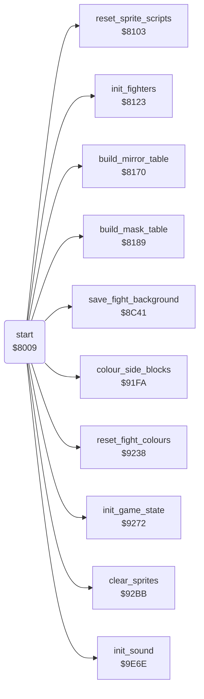

<!-- Generated by c64-docs from knowledge revision 20261029T165719.607-qgx52f and .c64-re-tools/local/generated/src/source-map.json. Do not edit: change the knowledge, generate the source again, then run docs.ts generate. -->
# init/init.asm: Start and initialisation

Range `$8009-$80BA`. Source: [init/init.asm](../../../../src/init/init.asm). Index: [the reference](../../index.md).

## Routines

| Routine | Address | Reached from | Summary |
|---|---|---|---|
| [`start`](init.md#start) | `$8009` |  | Starts the game. |
| [`restart`](init.md#restart) | `$800E` | [`quit_to_demo`](../main/quit_to_demo.md#quit_to_demo) | Restarts the game in the demo. |

## Call graph

A solid arrow is a call, a thick arrow a table entry. Rounded nodes are in this file.

## Details

### [`start`](../../../../src/init/init.asm#L6) `$8009`

*routine*

Starts the game. Sets the sound effects mode, then continues at restart. A hardware reset comes here through the cartridge header.

- **Entry of:** [`cart_cold_start_vector`](../../tables.md#cart_cold_start_vector)
- **Calls:** [`init_game_state`](state.md#init_game_state), [`clear_sprites`](state.md#clear_sprites), [`save_fight_background`](../screen/fight_area.md#save_fight_background), [`colour_side_blocks`](../screen/colours.md#colour_side_blocks), [`reset_fight_colours`](../screen/colours.md#reset_fight_colours), [`reset_sprite_scripts`](../sprites/sprite_reset.md#reset_sprite_scripts), [`init_fighters`](../fighter/fighter_init.md#init_fighters), [`build_mirror_table`](../graphics/pixel_tables.md#build_mirror_table), [`build_mask_table`](../graphics/pixel_tables.md#build_mask_table), [`init_sound`](../sound/sid.md#init_sound)
- **Reads:** [`CI2PRA`](../../memory-map.md#CI2PRA), [`sound_off`](../../memory-map.md#sound_off), [`CI2ICR`](../../memory-map.md#CI2ICR), [`CIAICR`](../../memory-map.md#CIAICR)
- **Writes:** [`sound_off`](../../memory-map.md#sound_off), [`D6510`](../../memory-map.md#D6510), [`R6510`](../../memory-map.md#R6510), [`CI2DDRA`](../../memory-map.md#CI2DDRA), [`CI2PRA`](../../memory-map.md#CI2PRA), [`irq_vector`](../irq/vectors.md#irq_vector), [`nmi_vector`](../irq/vectors.md#nmi_vector), [`SCROLX`](../../memory-map.md#SCROLX), [`VMCSB`](../../memory-map.md#VMCSB), [`SPMC0`](../../memory-map.md#SPMC0), [`SPMC1`](../../memory-map.md#SPMC1), [`SCROLY`](../../memory-map.md#SCROLY) and 14 more

| Label | Address | Comment |
|---|---|---|
| [`restart_enable_irq`](../../../../src/init/init.asm#L79) | `$80BA` |  |

### [`restart`](../../../../src/init/init.asm#L11) `$800E`

*label*

Restarts the game in the demo. Sets the memory map, the VIC bank, the vectors, the VIC, the tables and the timers. The game over code at $94e1 jumps here.
Resets the game state: demo on, opponent 4, all flags clear.

- **Jumped to from:** [`quit_to_demo`](../main/quit_to_demo.md#quit_to_demo)
