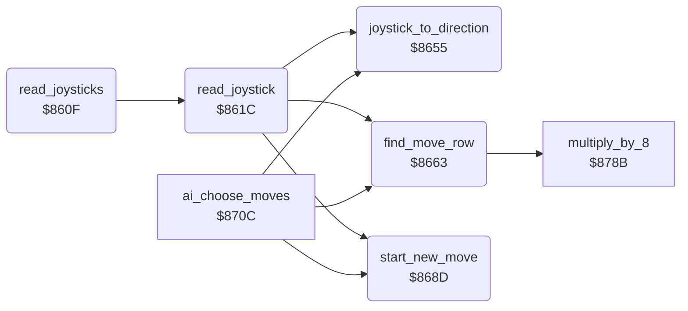

<!-- Generated by c64-docs from knowledge revision 20261029T165719.607-qgx52f and .c64-re-tools/local/generated/src/source-map.json. Do not edit: change the knowledge, generate the source again, then run docs.ts generate. -->
# input/joystick.asm: Joystick input of the human fighters

Range `$860F-$86C1`. Source: [input/joystick.asm](../../../../src/input/joystick.asm). Index: [the reference](../../index.md).

## Routines

| Routine | Address | Reached from | Summary |
|---|---|---|---|
| [`read_joysticks`](joystick.md#read_joysticks) | `$860F` | [`$80CA`](../../../../src/main/main_loop.asm#L12) | Reads the joystick of each human fighter, from fighter two_players down to fighter 0. |
| [`read_joystick`](joystick.md#read_joystick) | `$861C` | [`read_joysticks`](joystick.md#read_joysticks) | Reads the joystick of fighter X and selects the next move. |
| [`joystick_to_direction`](joystick.md#joystick_to_direction) | `$8655` | [`read_joystick`](joystick.md#read_joystick), [`ai_choose_moves`](../ai/computer_moves.md#ai_choose_moves) | Stores the input A in fighter_input. |
| [`find_move_row`](joystick.md#find_move_row) | `$8663` | [`read_joystick`](joystick.md#read_joystick), [`ai_choose_moves`](../ai/computer_moves.md#ai_choose_moves) | Sets move_ptr to the row of 9 next moves for the current move. |
| [`start_new_move`](joystick.md#start_new_move) | `$868D` | [`read_joystick`](joystick.md#read_joystick), [`ai_choose_moves`](../ai/computer_moves.md#ai_choose_moves) | Starts the move of row entry Y unless the current move is locked or is the same. |

## Call graph

A solid arrow is a call, a thick arrow a table entry. Rounded nodes are in this file.

## Details

### [`read_joysticks`](../../../../src/input/joystick.asm#L6) `$860F`

*routine*

Reads the joystick of each human fighter, from fighter two_players down to fighter 0. Not in the demo.

- **Called from:** [`$80CA`](../../../../src/main/main_loop.asm#L12)
- **Calls:** [`read_joystick`](joystick.md#read_joystick)
- **Reads:** [`demo_mode`](../../memory-map.md#demo_mode), [`two_players`](../../memory-map.md#two_players)

| Label | Address | Comment |
|---|---|---|
| [`read_joysticks_loop`](../../../../src/input/joystick.asm#L10) | `$8615` |  |
| [`read_joysticks_done`](../../../../src/input/joystick.asm#L14) | `$861B` |  |

### [`read_joystick`](../../../../src/input/joystick.asm#L17) `$861C`

*routine*

Reads the joystick of fighter X and selects the next move. Fighter 0 uses port 2 ($dc00), fighter 1 port 1 ($dc01).

- **Called from:** [`read_joysticks`](joystick.md#read_joysticks)
- **Calls:** [`joystick_to_direction`](joystick.md#joystick_to_direction), [`find_move_row`](joystick.md#find_move_row), [`start_new_move`](joystick.md#start_new_move)
- **Reads:** [`bout_loser`](../../memory-map.md#bout_loser), [`time_out_active`](../../memory-map.md#time_out_active), [`turn_request`](../../memory-map.md#turn_request), [`walk_in_active`](../../memory-map.md#walk_in_active), [`setup_active`](../../memory-map.md#setup_active), [`moves_no_control`](../fighter/move_sequences.md#moves_no_control), [`fighter_move`](../../memory-map.md#fighter_move), [`fighter_facing`](../../memory-map.md#fighter_facing), [`joystick_dir_ptrs`](move_select.md#joystick_dir_ptrs), [`CIAPRA`](../../memory-map.md#CIAPRA)
- **Writes:** [`direction_table_ptr`](../../memory-map.md#direction_table_ptr)
- **Refers to:** [`direction_table_ptr`](../../memory-map.md#direction_table_ptr)

| Label | Address | Comment |
|---|---|---|
| [`read_joystick_check_move`](../../../../src/input/joystick.asm#L25) | `$862A` |  |
| [`read_joystick_done`](../../../../src/input/joystick.asm#L45) | `$8654` |  |

### [`joystick_to_direction`](../../../../src/input/joystick.asm#L48) `$8655`

*routine*

Stores the input A in fighter_input. Returns Y = 0-8: none, forward, back, down, up, down-forward, up-forward, down-back, up-back. Y = $ff for no match.

- **Called from:** [`read_joystick`](joystick.md#read_joystick), [`ai_choose_moves`](../ai/computer_moves.md#ai_choose_moves)
- **Reads:** [`direction_table_ptr`](../../memory-map.md#direction_table_ptr)
- **Writes:** [`fighter_input`](../../memory-map.md#fighter_input)

| Label | Address | Comment |
|---|---|---|
| [`joystick_to_direction_loop`](../../../../src/input/joystick.asm#L52) | `$865B` |  |
| [`joystick_to_direction_done`](../../../../src/input/joystick.asm#L57) | `$8662` |  |

### [`find_move_row`](../../../../src/input/joystick.asm#L60) `$8663`

*routine*

Sets move_ptr to the row of 9 next moves for the current move. Uses table $ce1e with fire, $ce02 without fire. Keeps Y.

- **Called from:** [`read_joystick`](joystick.md#read_joystick), [`ai_choose_moves`](../ai/computer_moves.md#ai_choose_moves)
- **Calls:** [`multiply_by_8`](../ai/computer_moves.md#multiply_by_8)
- **Reads:** [`fighter_move`](../../memory-map.md#fighter_move), [`fighter_input`](../../memory-map.md#fighter_input), [`move_rows_no_fire`](move_select.md#move_rows_no_fire), [`move_rows_fire`](move_select.md#move_rows_fire), [`move_ptr`](../../memory-map.md#move_ptr), [`saved_y`](../../memory-map.md#saved_y)
- **Writes:** [`saved_y`](../../memory-map.md#saved_y), [`move_ptr`](../../memory-map.md#move_ptr)
- **Refers to:** [`move_select_rows`](move_select.md#move_select_rows), [`move_ptr`](../../memory-map.md#move_ptr)

| Label | Address | Comment |
|---|---|---|
| [`find_move_row_fire`](../../../../src/input/joystick.asm#L70) | `$8676` |  |
| [`find_move_row_calc`](../../../../src/input/joystick.asm#L72) | `$8679` |  |

### [`start_new_move`](../../../../src/input/joystick.asm#L84) `$868D`

*routine*

Starts the move of row entry Y unless the current move is locked or is the same. Sets the first pose.

- **Called from:** [`read_joystick`](joystick.md#read_joystick), [`ai_choose_moves`](../ai/computer_moves.md#ai_choose_moves)
- **Reads:** [`fighter_move_lock`](../../memory-map.md#fighter_move_lock), [`fighter_move`](../../memory-map.md#fighter_move), [`move_ptr`](../../memory-map.md#move_ptr), [`move_seq_ptrs`](../fighter/move_sequences.md#move_seq_ptrs)
- **Writes:** [`fighter_move`](../../memory-map.md#fighter_move), [`fighter_move_lock`](../../memory-map.md#fighter_move_lock), [`move_ptr`](../../memory-map.md#move_ptr), [`fighter_move_step`](../../memory-map.md#fighter_move_step), [`fighter_pose`](../../memory-map.md#fighter_pose)
- **Refers to:** [`move_ptr`](../../memory-map.md#move_ptr)

| Label | Address | Comment |
|---|---|---|
| [`start_new_move_check`](../../../../src/input/joystick.asm#L95) | `$869F` | With Y = $ff (no direction found, for example up and down together), this reads (move_ptr)+255. |
| [`start_new_move_done`](../../../../src/input/joystick.asm#L113) | `$86C1` |  |
