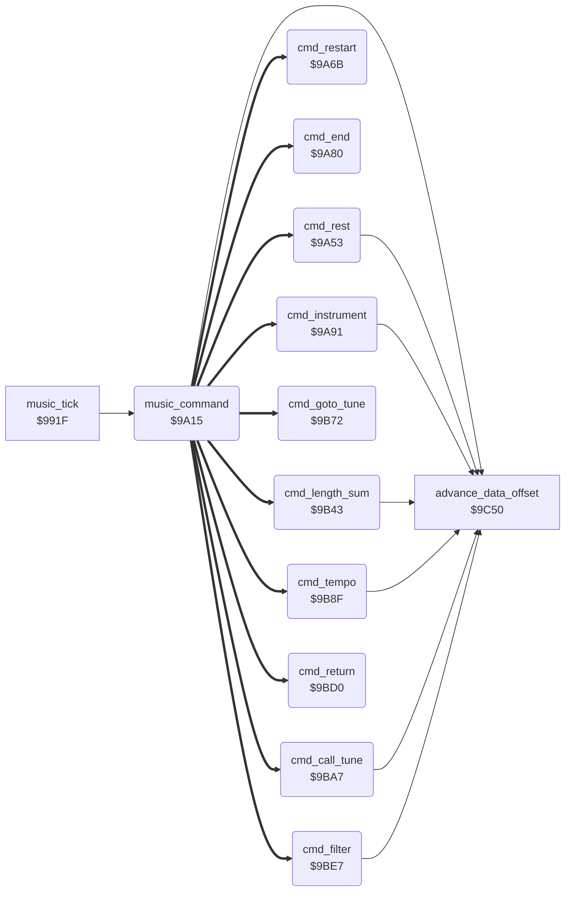

<!-- Generated by c64-docs from knowledge revision 20261029T165719.607-qgx52f and .c64-re-tools/local/generated/src/source-map.json. Do not edit: change the knowledge, generate the source again, then run docs.ts generate. -->
# music/commands.asm: Music commands

Range `$9A15-$9C4F`. Source: [music/commands.asm](../../../../src/music/commands.asm). Index: [the reference](../../index.md).

## Routines

| Routine | Address | Reached from | Summary |
|---|---|---|---|
| [`music_command`](commands.md#music_command) | `$9A15` | [`music_tick`](tick.md#music_tick) | Does the command byte A of the music data. |
| [`cmd_rest`](commands.md#cmd_rest) | `$9A53` | [`music_command`](commands.md#music_command) | Command $f0: rest. |
| [`cmd_restart`](commands.md#cmd_restart) | `$9A6B` | [`music_command`](commands.md#music_command) | Command $f1: sets the read offset of the voice to 0 and clears the gate. |
| [`cmd_end`](commands.md#cmd_end) | `$9A80` | [`music_command`](commands.md#music_command) | Command $f2: ends the tune of the voice. |
| [`cmd_instrument`](commands.md#cmd_instrument) | `$9A91` | [`music_command`](commands.md#music_command) | Command $f3 n: loads instrument n, 12 bytes at $a384 + n * 12. |
| [`cmd_length_sum`](commands.md#cmd_length_sum) | `$9B43` | [`music_command`](commands.md#music_command) | Command $f4 a b: note length = duration a + duration b (low nibbles, table at $a03b). |
| [`cmd_goto_tune`](commands.md#cmd_goto_tune) | `$9B72` | [`music_command`](commands.md#music_command) | Command $f5 n: the voice continues with tune n from its start. |
| [`cmd_tempo`](commands.md#cmd_tempo) | `$9B8F` | [`music_command`](commands.md#music_command) | Command $f6 n: sets CIA 1 timer B (the music tick rate) to entry n of the tempo table at $a05b. |
| [`cmd_call_tune`](commands.md#cmd_call_tune) | `$9BA7` | [`music_command`](commands.md#music_command) | Command $f7 n: plays tune n on the voice, then returns after this command (see cmd_return). |
| [`cmd_return`](commands.md#cmd_return) | `$9BD0` | [`music_command`](commands.md#music_command) | Command $f8: returns to the tune and read offset that cmd_call_tune saved. |
| [`cmd_filter`](commands.md#cmd_filter) | `$9BE7` | [`music_command`](commands.md#music_command) | Command $f9 n: loads filter setting n (11 bytes, pointer table at $a0a1) and starts the filter on this voice. |

## Call graph

A solid arrow is a call, a thick arrow a table entry. Rounded nodes are in this file.

## Details

### [`music_command`](../../../../src/music/commands.asm#L6) `$9A15`

*routine*

Does the command byte A of the music data. $c0-$cf set the note length. $f0-$f9 go through the handler table at $a08d.

- **Called from:** [`music_tick`](tick.md#music_tick)
- **Calls:** [`advance_data_offset`](note_time.md#advance_data_offset)
- **Jumps to:** [`sprite_enable_shadow`](../../memory-map.md#sprite_enable_shadow)
- **Reads:** [`music_data_ptr`](../../memory-map.md#music_data_ptr), [`music_voice_x2`](../../memory-map.md#music_voice_x2), [`note_lengths`](driver_tables.md#note_lengths), [`music_cmd_bytes`](driver_tables.md#music_cmd_bytes), [`music_cmd_handlers`](driver_tables.md#music_cmd_handlers), [`cmd_handler_ptr`](../../memory-map.md#cmd_handler_ptr)
- **Writes:** [`note_length`](../../memory-map.md#note_length), [`note_length_hi`](../../memory-map.md#note_length_hi), [`cmd_handler_ptr`](../../memory-map.md#cmd_handler_ptr)
- **Refers to:** [`cmd_handler_ptr`](../../memory-map.md#cmd_handler_ptr)

| Label | Address | Comment |
|---|---|---|
| [`music_command_find`](../../../../src/music/commands.asm#L23) | `$9A35` | Finds the command byte in the table at $a083. Y = 1 points to the argument. |
| [`music_command_find_loop`](../../../../src/music/commands.asm#L26) | `$9A39` |  |
| [`music_command_find_next`](../../../../src/music/commands.asm#L38) | `$9A4F` |  |

### [`cmd_rest`](../../../../src/music/commands.asm#L44) `$9A53`

*routine*

Command $f0: rest. Waits for one note length without a new gate.
Stops the read of the voice for this tick.

- **Entry of:** [`music_cmd_handlers`](../../tables.md#music_cmd_handlers)
- **Calls:** [`advance_data_offset`](note_time.md#advance_data_offset)
- **Reads:** [`music_voice_x2`](../../memory-map.md#music_voice_x2), [`note_length`](../../memory-map.md#note_length), [`note_length_hi`](../../memory-map.md#note_length_hi)
- **Writes:** [`music_stop_read`](../../memory-map.md#music_stop_read), [`note_time`](../../memory-map.md#note_time), [`note_time_hi`](../../memory-map.md#note_time_hi)

### [`cmd_restart`](../../../../src/music/commands.asm#L56) `$9A6B`

*routine*

Command $f1: sets the read offset of the voice to 0 and clears the gate. The tune starts again.

- **Entry of:** [`music_cmd_handlers`](../../tables.md#music_cmd_handlers)
- **Reads:** [`music_voice_x2`](../../memory-map.md#music_voice_x2), [`music_voice_sid_offset`](../../memory-map.md#music_voice_sid_offset), [`sid_shadow_control`](../../memory-map.md#sid_shadow_control)
- **Writes:** [`voice_data_offset`](../../memory-map.md#voice_data_offset), [`voice_data_offset_hi`](../../memory-map.md#voice_data_offset_hi), [`sid_shadow_control`](../../memory-map.md#sid_shadow_control)

### [`cmd_end`](../../../../src/music/commands.asm#L68) `$9A80`

*routine*

Command $f2: ends the tune of the voice. Stops the voice, its effects and the filter sweep.

- **Entry of:** [`music_cmd_handlers`](../../tables.md#music_cmd_handlers)
- **Reads:** [`music_voice`](../../memory-map.md#music_voice)
- **Writes:** [`voice_tune`](../../memory-map.md#voice_tune), [`effect_flags`](../../memory-map.md#effect_flags), [`filter_speed`](../../memory-map.md#filter_speed), [`music_stop_read`](../../memory-map.md#music_stop_read)

### [`cmd_instrument`](../../../../src/music/commands.asm#L78) `$9A91`

*routine*

Command $f3 n: loads instrument n, 12 bytes at $a384 + n * 12. Sets ADSR, waveform, pulse width and the effect steps.

- **Entry of:** [`music_cmd_handlers`](../../tables.md#music_cmd_handlers)
- **Calls:** [`advance_data_offset`](note_time.md#advance_data_offset)
- **Reads:** [`music_data_ptr`](../../memory-map.md#music_data_ptr), [`sound_table_ptr`](../../memory-map.md#sound_table_ptr), [`music_voice_sid_offset`](../../memory-map.md#music_voice_sid_offset), [`music_voice_x2`](../../memory-map.md#music_voice_x2), [`music_voice`](../../memory-map.md#music_voice), [`voice_effect_offsets`](driver_tables.md#voice_effect_offsets), [`instrument_effect_flags`](../../memory-map.md#instrument_effect_flags), [`sid_shadow_control`](../../memory-map.md#sid_shadow_control)
- **Writes:** [`sound_table_ptr`](../../memory-map.md#sound_table_ptr), [`sid_shadow_attack_decay`](../../memory-map.md#sid_shadow_attack_decay), [`sid_shadow_sustain_release`](../../memory-map.md#sid_shadow_sustain_release), [`sid_shadow_control`](../../memory-map.md#sid_shadow_control), [`voice_pulse_width`](../../memory-map.md#voice_pulse_width), [`voice_pulse_width_hi`](../../memory-map.md#voice_pulse_width_hi), [`effect_speed`](../../memory-map.md#effect_speed), [`instrument_effect_flags`](../../memory-map.md#instrument_effect_flags), [`effect_step_values`](../../memory-map.md#effect_step_values), [`effect_step_lengths`](../../memory-map.md#effect_step_lengths)
- **Refers to:** [`sound_table_ptr`](../../memory-map.md#sound_table_ptr), [`instruments`](instruments.md#instruments)

| Label | Address | Comment |
|---|---|---|
| [`cmd_instrument_check_ring`](../../../../src/music/commands.asm#L167) | `$9B34` | Flag bit 2: sets triangle with ring modulation ($14). |
| [`cmd_instrument_done`](../../../../src/music/commands.asm#L174) | `$9B3D` |  |

### [`cmd_length_sum`](../../../../src/music/commands.asm#L179) `$9B43`

*routine*

Command $f4 a b: note length = duration a + duration b (low nibbles, table at $a03b).

- **Entry of:** [`music_cmd_handlers`](../../tables.md#music_cmd_handlers)
- **Calls:** [`advance_data_offset`](note_time.md#advance_data_offset)
- **Reads:** [`music_data_ptr`](../../memory-map.md#music_data_ptr), [`note_lengths`](driver_tables.md#note_lengths), [`music_voice_x2`](../../memory-map.md#music_voice_x2), [`length_sum_first`](../../memory-map.md#length_sum_first)
- **Writes:** [`length_sum_first`](../../memory-map.md#length_sum_first), [`note_length`](../../memory-map.md#note_length), [`note_length_hi`](../../memory-map.md#note_length_hi)
- **Refers to:** [`length_sum_first`](../../memory-map.md#length_sum_first)

### [`cmd_goto_tune`](../../../../src/music/commands.asm#L204) `$9B72`

*routine*

Command $f5 n: the voice continues with tune n from its start. Clears the filter routing bit of the voice.

- **Entry of:** [`music_cmd_handlers`](../../tables.md#music_cmd_handlers)
- **Reads:** [`music_data_ptr`](../../memory-map.md#music_data_ptr), [`music_voice`](../../memory-map.md#music_voice), [`sid_shadow_res_filt`](../../memory-map.md#sid_shadow_res_filt), [`bit_masks_inverted`](../data/bit_masks.md#bit_masks_inverted), [`music_voice_x2`](../../memory-map.md#music_voice_x2)
- **Writes:** [`voice_tune`](../../memory-map.md#voice_tune), [`sid_shadow_res_filt`](../../memory-map.md#sid_shadow_res_filt), [`voice_data_offset`](../../memory-map.md#voice_data_offset), [`voice_data_offset_hi`](../../memory-map.md#voice_data_offset_hi)

### [`cmd_tempo`](../../../../src/music/commands.asm#L219) `$9B8F`

*routine*

Command $f6 n: sets CIA 1 timer B (the music tick rate) to entry n of the tempo table at $a05b.

- **Entry of:** [`music_cmd_handlers`](../../tables.md#music_cmd_handlers)
- **Calls:** [`advance_data_offset`](note_time.md#advance_data_offset)
- **Reads:** [`music_data_ptr`](../../memory-map.md#music_data_ptr), [`tempo_latches`](driver_tables.md#tempo_latches)
- **Writes:** [`CIATBLO`](../../memory-map.md#CIATBLO), [`CIATBHI`](../../memory-map.md#CIATBHI)

### [`cmd_call_tune`](../../../../src/music/commands.asm#L233) `$9BA7`

*routine*

Command $f7 n: plays tune n on the voice, then returns after this command (see cmd_return).

- **Entry of:** [`music_cmd_handlers`](../../tables.md#music_cmd_handlers)
- **Calls:** [`advance_data_offset`](note_time.md#advance_data_offset)
- **Reads:** [`music_voice`](../../memory-map.md#music_voice), [`voice_tune`](../../memory-map.md#voice_tune), [`music_data_ptr`](../../memory-map.md#music_data_ptr), [`voice_data_offset`](../../memory-map.md#voice_data_offset), [`voice_data_offset_hi`](../../memory-map.md#voice_data_offset_hi)
- **Writes:** [`return_tune`](../../memory-map.md#return_tune), [`voice_tune`](../../memory-map.md#voice_tune), [`return_data_offset`](../../memory-map.md#return_data_offset), [`return_data_offset_hi`](../../memory-map.md#return_data_offset_hi), [`voice_data_offset`](../../memory-map.md#voice_data_offset), [`voice_data_offset_hi`](../../memory-map.md#voice_data_offset_hi)

### [`cmd_return`](../../../../src/music/commands.asm#L251) `$9BD0`

*routine*

Command $f8: returns to the tune and read offset that cmd_call_tune saved.

- **Entry of:** [`music_cmd_handlers`](../../tables.md#music_cmd_handlers)
- **Reads:** [`music_voice`](../../memory-map.md#music_voice), [`return_tune`](../../memory-map.md#return_tune), [`music_voice_x2`](../../memory-map.md#music_voice_x2), [`return_data_offset`](../../memory-map.md#return_data_offset), [`return_data_offset_hi`](../../memory-map.md#return_data_offset_hi)
- **Writes:** [`voice_tune`](../../memory-map.md#voice_tune), [`voice_data_offset`](../../memory-map.md#voice_data_offset), [`voice_data_offset_hi`](../../memory-map.md#voice_data_offset_hi)

### [`cmd_filter`](../../../../src/music/commands.asm#L262) `$9BE7`

*routine*

Command $f9 n: loads filter setting n (11 bytes, pointer table at $a0a1) and starts the filter on this voice.

- **Entry of:** [`music_cmd_handlers`](../../tables.md#music_cmd_handlers)
- **Calls:** [`advance_data_offset`](note_time.md#advance_data_offset)
- **Reads:** [`music_data_ptr`](../../memory-map.md#music_data_ptr), [`filter_setting_ptrs`](driver_tables.md#filter_setting_ptrs), [`sound_table_ptr`](../../memory-map.md#sound_table_ptr), [`music_voice`](../../memory-map.md#music_voice), [`bit_masks`](../data/bit_masks.md#bit_masks), [`sid_shadow_mode_vol`](../../memory-map.md#sid_shadow_mode_vol), [`filter_steps`](../../memory-map.md#filter_steps), [`filter_steps_hi`](../../memory-map.md#filter_steps_hi)
- **Writes:** [`sound_table_ptr`](../../memory-map.md#sound_table_ptr), [`filter_speed`](../../memory-map.md#filter_speed), [`filter_cutoff_start`](../../memory-map.md#filter_cutoff_start), [`sid_shadow_res_filt`](../../memory-map.md#sid_shadow_res_filt), [`sid_shadow_mode_vol`](../../memory-map.md#sid_shadow_mode_vol), [`filter_steps`](../../memory-map.md#filter_steps), [`filter_steps_hi`](../../memory-map.md#filter_steps_hi), [`filter_phase_lengths`](../../memory-map.md#filter_phase_lengths)
- **Refers to:** [`sound_table_ptr`](../../memory-map.md#sound_table_ptr), [`filter_cutoff_start`](../../memory-map.md#filter_cutoff_start)

| Label | Address | Comment |
|---|---|---|
| [`cmd_filter_phase_loop`](../../../../src/music/commands.asm#L292) | `$9C1C` | Bytes 5-10: step (times 8) and length of the 3 sweep phases. |
