<!-- Generated by c64-docs from knowledge revision 20261025T232349.343-u0up13 and .c64-re-tools/local/generated/src/source-map.json. Do not edit: change the knowledge, generate the source again, then run docs.ts generate. -->
# music/tick.asm: Music tick: reads the music data of each voice

Range `$991F-$9A14`. Source: [music/tick.asm](../../../../src/music/tick.asm). Index: [the reference](../../index.md).

## Routines

| Routine | Address | Reached from | Summary |
|---|---|---|---|
| [`music_tick`](tick.md#music_tick) | `$991F` | [`irq_handler`](../irq/irq_handler.md#irq_handler) | Music tick on CIA 1 timer B. |
| [`start_note`](tick.md#start_note) | `$9992` | [`music_tick`](tick.md#music_tick) | Starts a note on voice music_voice. |

## Call graph

A solid arrow is a call, a thick arrow a table entry. Rounded nodes are in this file.

```mermaid
flowchart LR
  n94e8["irq_handler<br/>$94E8"]
  n991f("music_tick<br/>$991F")
  n9992("start_note<br/>$9992")
  n9a15["music_command<br/>$9A15"]
  n9c50["advance_data_offset<br/>$9C50"]
  n9c5f["count_note_lengths<br/>$9C5F"]
  n9deb["set_filter_cutoff<br/>$9DEB"]
  n9e05["start_sound_request<br/>$9E05"]
  n9e46["update_volume_fade<br/>$9E46"]
  n94e8 --> n991f
  n991f --> n9992
  n991f --> n9a15
  n991f --> n9c5f
  n991f --> n9e05
  n991f --> n9e46
  n9992 --> n9c50
  n9992 --> n9deb
```

## Details

### [`music_tick`](../../../../src/music/tick.asm#L6) `$991F`

*routine*

Music tick on CIA 1 timer B. For each voice, starts a request and reads the music data when the note ends.

- **Called from:** [`irq_handler`](../irq/irq_handler.md#irq_handler)
- **Calls:** [`start_sound_request`](requests.md#start_sound_request), [`start_note`](tick.md#start_note), [`count_note_lengths`](note_time.md#count_note_lengths), [`update_volume_fade`](requests.md#update_volume_fade), [`music_command`](commands.md#music_command)
- **Reads:** [`sound_request`](../../memory-map.md#sound_request), [`voice_tune`](../../memory-map.md#voice_tune), [`voice_sid_offsets`](driver_tables.md#voice_sid_offsets), [`note_time`](../../memory-map.md#note_time), [`note_time_hi`](../../memory-map.md#note_time_hi), [`music_voice_x2`](../../memory-map.md#music_voice_x2), [`tune_ptrs`](tunes.md#tune_ptrs), [`voice_data_offset`](../../memory-map.md#voice_data_offset), [`voice_data_offset_hi`](../../memory-map.md#voice_data_offset_hi), [`music_data_ptr`](../../memory-map.md#music_data_ptr), [`music_voice`](../../memory-map.md#music_voice), [`sid_shadow_mode_vol`](../../memory-map.md#sid_shadow_mode_vol) and 2 more
- **Writes:** [`music_tick_busy`](../../memory-map.md#music_tick_busy), [`music_voice`](../../memory-map.md#music_voice), [`music_voice_x2`](../../memory-map.md#music_voice_x2), [`music_voice_sid_offset`](../../memory-map.md#music_voice_sid_offset), [`music_data_ptr`](../../memory-map.md#music_data_ptr), [`music_stop_read`](../../memory-map.md#music_stop_read), [`voice_pitch`](../../memory-map.md#voice_pitch), [`sid_shadow_mode_vol`](../../memory-map.md#sid_shadow_mode_vol)
- **Refers to:** [`music_data_ptr`](../../memory-map.md#music_data_ptr)

| Label | Address | Comment |
|---|---|---|
| [`music_tick_voice`](../../../../src/music/tick.asm#L9) | `$9923` | Bit 7 set: a new tune or sound waits for this voice. |
| [`music_tick_check_active`](../../../../src/music/tick.asm#L13) | `$992A` | Bit 7 clear: the voice plays nothing. |
| [`music_tick_read_event`](../../../../src/music/tick.asm#L27) | `$9943` | Points to the tune data at the read offset of the voice and reads one event. |
| [`music_tick_next_voice`](../../../../src/music/tick.asm#L49) | `$9970` |  |
| [`music_tick_command`](../../../../src/music/tick.asm#L61) | `$9986` |  |

### [`start_note`](../../../../src/music/tick.asm#L68) `$9992`

*routine*

Starts a note on voice music_voice. A = pitch (0-$bf). Sets the frequency, effects, note time, filter sweep, pulse width and gate.

- **Called from:** [`music_tick`](tick.md#music_tick)
- **Calls:** [`set_filter_cutoff`](../sound/effects.md#set_filter_cutoff), [`advance_data_offset`](note_time.md#advance_data_offset)
- **Reads:** [`sound_table_ptr`](../../memory-map.md#sound_table_ptr), [`music_voice_sid_offset`](../../memory-map.md#music_voice_sid_offset), [`music_voice`](../../memory-map.md#music_voice), [`effect_speed`](../../memory-map.md#effect_speed), [`instrument_effect_flags`](../../memory-map.md#instrument_effect_flags), [`voice_effect_offsets`](driver_tables.md#voice_effect_offsets), [`effect_step_values`](../../memory-map.md#effect_step_values), [`effect_step_lengths`](../../memory-map.md#effect_step_lengths), [`music_voice_x2`](../../memory-map.md#music_voice_x2), [`note_length`](../../memory-map.md#note_length), [`note_length_hi`](../../memory-map.md#note_length_hi), [`filter_speed`](../../memory-map.md#filter_speed) and 5 more
- **Writes:** [`sound_table_ptr`](../../memory-map.md#sound_table_ptr), [`sid_shadow_freq_lo`](../../memory-map.md#sid_shadow_freq_lo), [`sid_shadow_freq_hi`](../../memory-map.md#sid_shadow_freq_hi), [`effect_delay`](../../memory-map.md#effect_delay), [`effect_flags`](../../memory-map.md#effect_flags), [`effect_step_value`](../../memory-map.md#effect_step_value), [`effect_step_length`](../../memory-map.md#effect_step_length), [`effect_phase`](../../memory-map.md#effect_phase), [`effect_step_count`](../../memory-map.md#effect_step_count), [`note_time`](../../memory-map.md#note_time), [`note_time_hi`](../../memory-map.md#note_time_hi), [`filter_delay`](../../memory-map.md#filter_delay) and 7 more
- **Refers to:** [`sound_table_ptr`](../../memory-map.md#sound_table_ptr), [`freq_table`](freq_table.md#freq_table), [`filter_cutoff_start`](../../memory-map.md#filter_cutoff_start), [`filter_cutoff`](../../memory-map.md#filter_cutoff)
