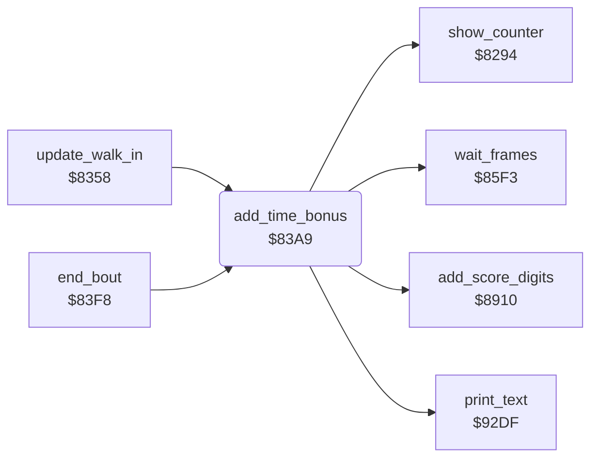

<!-- Generated by c64-docs from knowledge revision 20261029T165719.607-qgx52f and .c64-re-tools/local/generated/src/source-map.json. Do not edit: change the knowledge, generate the source again, then run docs.ts generate. -->
# score/time_bonus.asm: Time bonus of the winner

Range `$83A9-$83F7`. Source: [score/time_bonus.asm](../../../../src/score/time_bonus.asm). Index: [the reference](../../index.md).

## Routines

| Routine | Address | Reached from | Summary |
|---|---|---|---|
| [`add_time_bonus`](time_bonus.md#add_time_bonus) | `$83A9` | [`update_walk_in`](../combat/walk_in.md#update_walk_in), [`end_bout`](../combat/end_of_bout.md#end_bout) | Two-player game only: adds 10 points to the score of the winner for each second left. |

## Call graph

A solid arrow is a call, a thick arrow a table entry. Rounded nodes are in this file.

## Details

### [`add_time_bonus`](../../../../src/score/time_bonus.asm#L6) `$83A9`

*routine*

Two-player game only: adds 10 points to the score of the winner for each second left. Clears bout_winner.

- **Called from:** [`update_walk_in`](../combat/walk_in.md#update_walk_in), [`end_bout`](../combat/end_of_bout.md#end_bout)
- **Calls:** [`add_score_digits`](../combat/hits.md#add_score_digits), [`print_text`](../text/print_text.md#print_text), [`show_counter`](status_line.md#show_counter), [`wait_frames`](../main/wait_frames.md#wait_frames)
- **Reads:** [`two_players`](../../memory-map.md#two_players), [`demo_mode`](../../memory-map.md#demo_mode), [`bout_winner`](../../memory-map.md#bout_winner), [`time_left`](../../memory-map.md#time_left), [`text_ptrs`](../text/texts.md#text_ptrs)
- **Writes:** [`score_add_ptr`](../../memory-map.md#score_add_ptr), [`time_left`](../../memory-map.md#time_left), [`text_ptr`](../../memory-map.md#text_ptr), [`bout_winner`](../../memory-map.md#bout_winner)
- **Refers to:** [`time_bonus_points`](../text/texts.md#time_bonus_points), [`score_add_ptr`](../../memory-map.md#score_add_ptr), [`text_ptr`](../../memory-map.md#text_ptr)

| Label | Address | Comment |
|---|---|---|
| [`add_time_bonus_loop`](../../../../src/score/time_bonus.asm#L20) | `$83C1` |  |
| [`add_time_bonus_done`](../../../../src/score/time_bonus.asm#L45) | `$83F3` |  |
