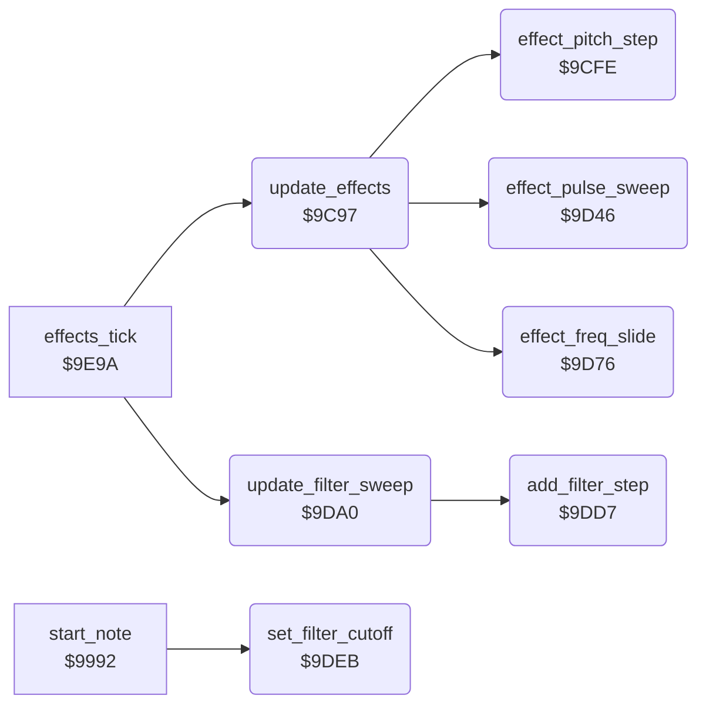

<!-- Generated by c64-docs from knowledge revision 20261025T232349.343-u0up13 and .c64-re-tools/local/generated/src/source-map.json. Do not edit: change the knowledge, generate the source again, then run docs.ts generate. -->
# sound/effects.asm: Effects: pitch steps, pulse sweep, frequency slide, filter sweep

Range `$9C97-$9E04`. Source: [sound/effects.asm](../../../../src/sound/effects.asm). Index: [the reference](../../index.md).

## Routines

| Routine | Address | Reached from | Summary |
|---|---|---|---|
| [`update_effects`](effects.md#update_effects) | `$9C97` | [`effects_tick`](sid.md#effects_tick) | Does one step of the effects of each voice: pitch steps, pulse sweep and frequency slide, in 3 phases. |
| [`effect_pitch_step`](effects.md#effect_pitch_step) | `$9CFE` | [`update_effects`](effects.md#update_effects) | Flag bit 6: adds the step value to the pitch of voice X and sets the frequency from the table at $9ebb. |
| [`effect_pulse_sweep`](effects.md#effect_pulse_sweep) | `$9D46` | [`update_effects`](effects.md#update_effects) | Flag bit 5: adds the step value times 16 to the pulse width of voice X. |
| [`effect_freq_slide`](effects.md#effect_freq_slide) | `$9D76` | [`update_effects`](effects.md#update_effects) | Flag bit 4: adds the step value to the frequency of voice X. |
| [`update_filter_sweep`](effects.md#update_filter_sweep) | `$9DA0` | [`effects_tick`](sid.md#effects_tick) | Does one step of the filter sweep: adds the step of the phase to the cutoff, in 3 phases. |
| [`add_filter_step`](effects.md#add_filter_step) | `$9DD7` | [`update_filter_sweep`](effects.md#update_filter_sweep) | Adds the step of the filter phase to the 11-bit cutoff, then sets the cutoff. |
| [`set_filter_cutoff`](effects.md#set_filter_cutoff) | `$9DEB` | [`start_note`](../music/tick.md#start_note) | Writes the 11-bit cutoff filter_cutoff to the SID shadow (low 3 bits, high 8 bits). |

## Call graph

A solid arrow is a call, a thick arrow a table entry. Rounded nodes are in this file.

## Details

### [`update_effects`](../../../../src/sound/effects.asm#L6) `$9C97`

*routine*

Does one step of the effects of each voice: pitch steps, pulse sweep and frequency slide, in 3 phases.

- **Called from:** [`effects_tick`](sid.md#effects_tick)
- **Calls:** [`effect_pitch_step`](effects.md#effect_pitch_step), [`effect_pulse_sweep`](effects.md#effect_pulse_sweep), [`effect_freq_slide`](effects.md#effect_freq_slide)
- **Reads:** [`effect_flags`](../../memory-map.md#effect_flags), [`effect_delay`](../../memory-map.md#effect_delay), [`effect_step_length`](../../memory-map.md#effect_step_length), [`effect_step_count`](../../memory-map.md#effect_step_count), [`effect_speed`](../../memory-map.md#effect_speed), [`effect_phase`](../../memory-map.md#effect_phase), [`voice_effect_offsets`](../music/driver_tables.md#voice_effect_offsets), [`effect_step_values`](../../memory-map.md#effect_step_values), [`effect_step_lengths`](../../memory-map.md#effect_step_lengths)
- **Writes:** [`effect_step_count`](../../memory-map.md#effect_step_count), [`effect_delay`](../../memory-map.md#effect_delay), [`effect_flags`](../../memory-map.md#effect_flags), [`effect_phase`](../../memory-map.md#effect_phase), [`effect_step_value`](../../memory-map.md#effect_step_value), [`effect_step_length`](../../memory-map.md#effect_step_length)

| Label | Address | Comment |
|---|---|---|
| [`update_effects_voice`](../../../../src/sound/effects.asm#L8) | `$9C99` | Bit 7 clear: the effects of the voice are off. |
| [`update_effects_next`](../../../../src/sound/effects.asm#L24) | `$9CC1` |  |
| [`update_effects_next_phase`](../../../../src/sound/effects.asm#L29) | `$9CC5` | Goes to the next of the 3 phases. After phase 2, loops only when flag bit 3 is set. |
| [`update_effects_loop_phases`](../../../../src/sound/effects.asm#L42) | `$9CDF` |  |
| [`update_effects_set_phase`](../../../../src/sound/effects.asm#L44) | `$9CE1` |  |

### [`effect_pitch_step`](../../../../src/sound/effects.asm#L58) `$9CFE`

*routine*

Flag bit 6: adds the step value to the pitch of voice X and sets the frequency from the table at $9ebb.

- **Called from:** [`update_effects`](effects.md#update_effects)
- **Reads:** [`effect_flags`](../../memory-map.md#effect_flags), [`voice_pitch`](../../memory-map.md#voice_pitch), [`effect_step_value`](../../memory-map.md#effect_step_value), [`sound_table_ptr`](../../memory-map.md#sound_table_ptr), [`voice_sid_offsets`](../music/driver_tables.md#voice_sid_offsets)
- **Writes:** [`voice_pitch`](../../memory-map.md#voice_pitch), [`sound_table_ptr`](../../memory-map.md#sound_table_ptr), [`sid_shadow_freq_hi`](../../memory-map.md#sid_shadow_freq_hi), [`sid_shadow_freq_lo`](../../memory-map.md#sid_shadow_freq_lo)
- **Refers to:** [`sound_table_ptr`](../../memory-map.md#sound_table_ptr), [`freq_table`](../music/freq_table.md#freq_table)

| Label | Address | Comment |
|---|---|---|
| [`effect_pitch_step_up`](../../../../src/sound/effects.asm#L73) | `$9D1C` |  |
| [`effect_pitch_step_set`](../../../../src/sound/effects.asm#L76) | `$9D1F` |  |
| [`effect_pitch_step_done`](../../../../src/sound/effects.asm#L97) | `$9D45` |  |

### [`effect_pulse_sweep`](../../../../src/sound/effects.asm#L100) `$9D46`

*routine*

Flag bit 5: adds the step value times 16 to the pulse width of voice X.

- **Called from:** [`update_effects`](effects.md#update_effects)
- **Reads:** [`effect_flags`](../../memory-map.md#effect_flags), [`effect_step_value`](../../memory-map.md#effect_step_value), [`pulse_sweep_step`](../../memory-map.md#pulse_sweep_step), [`voice_sid_offsets`](../music/driver_tables.md#voice_sid_offsets), [`sid_shadow_pw_lo`](../../memory-map.md#sid_shadow_pw_lo), [`sid_shadow_pw_hi`](../../memory-map.md#sid_shadow_pw_hi)
- **Writes:** [`pulse_sweep_step`](../../memory-map.md#pulse_sweep_step), [`sid_shadow_pw_lo`](../../memory-map.md#sid_shadow_pw_lo), [`sid_shadow_pw_hi`](../../memory-map.md#sid_shadow_pw_hi)
- **Refers to:** [`pulse_sweep_step`](../../memory-map.md#pulse_sweep_step)

| Label | Address | Comment |
|---|---|---|
| [`effect_pulse_sweep_shift`](../../../../src/sound/effects.asm#L109) | `$9D58` |  |
| [`effect_pulse_sweep_done`](../../../../src/sound/effects.asm#L123) | `$9D75` |  |

### [`effect_freq_slide`](../../../../src/sound/effects.asm#L126) `$9D76`

*routine*

Flag bit 4: adds the step value to the frequency of voice X. Bit 7 of the phase length makes the step negative.

- **Called from:** [`update_effects`](effects.md#update_effects)
- **Reads:** [`effect_flags`](../../memory-map.md#effect_flags), [`effect_step_length`](../../memory-map.md#effect_step_length), [`voice_sid_offsets`](../music/driver_tables.md#voice_sid_offsets), [`sid_shadow_freq_lo`](../../memory-map.md#sid_shadow_freq_lo), [`effect_step_value`](../../memory-map.md#effect_step_value), [`sid_shadow_freq_hi`](../../memory-map.md#sid_shadow_freq_hi), [`freq_slide_step_hi`](../../memory-map.md#freq_slide_step_hi)
- **Writes:** [`freq_slide_step_hi`](../../memory-map.md#freq_slide_step_hi), [`sid_shadow_freq_lo`](../../memory-map.md#sid_shadow_freq_lo), [`sid_shadow_freq_hi`](../../memory-map.md#sid_shadow_freq_hi)

| Label | Address | Comment |
|---|---|---|
| [`effect_freq_slide_add`](../../../../src/sound/effects.asm#L137) | `$9D8A` |  |
| [`effect_freq_slide_done`](../../../../src/sound/effects.asm#L146) | `$9D9F` |  |

### [`update_filter_sweep`](../../../../src/sound/effects.asm#L149) `$9DA0`

*routine*

Does one step of the filter sweep: adds the step of the phase to the cutoff, in 3 phases.

- **Called from:** [`effects_tick`](sid.md#effects_tick)
- **Calls:** [`add_filter_step`](effects.md#add_filter_step)
- **Reads:** [`filter_speed`](../../memory-map.md#filter_speed), [`filter_delay`](../../memory-map.md#filter_delay), [`filter_phase_length`](../../memory-map.md#filter_phase_length), [`filter_step_count`](../../memory-map.md#filter_step_count), [`filter_phase`](../../memory-map.md#filter_phase), [`filter_steps_hi`](../../memory-map.md#filter_steps_hi), [`filter_phase_lengths`](../../memory-map.md#filter_phase_lengths)
- **Writes:** [`filter_step_count`](../../memory-map.md#filter_step_count), [`filter_delay`](../../memory-map.md#filter_delay), [`filter_phase`](../../memory-map.md#filter_phase), [`filter_phase_length`](../../memory-map.md#filter_phase_length)
- **Refers to:** [`filter_steps`](../../memory-map.md#filter_steps)

| Label | Address | Comment |
|---|---|---|
| [`update_filter_sweep_step`](../../../../src/sound/effects.asm#L154) | `$9DA8` |  |
| [`update_filter_sweep_done`](../../../../src/sound/effects.asm#L163) | `$9DB9` |  |
| [`update_filter_sweep_next_phase`](../../../../src/sound/effects.asm#L166) | `$9DBA` | After phase 2, the sweep starts again only when the step of phase 1 is not 0. |
| [`update_filter_sweep_set_phase`](../../../../src/sound/effects.asm#L175) | `$9DC9` |  |

### [`add_filter_step`](../../../../src/sound/effects.asm#L183) `$9DD7`

*routine*

Adds the step of the filter phase to the 11-bit cutoff, then sets the cutoff.

- **Called from:** [`update_filter_sweep`](effects.md#update_filter_sweep)
- **Reads:** [`filter_phase`](../../memory-map.md#filter_phase), [`filter_cutoff`](../../memory-map.md#filter_cutoff), [`filter_steps`](../../memory-map.md#filter_steps), [`filter_steps_hi`](../../memory-map.md#filter_steps_hi)
- **Writes:** [`filter_cutoff`](../../memory-map.md#filter_cutoff)
- **Refers to:** [`filter_cutoff`](../../memory-map.md#filter_cutoff)

### [`set_filter_cutoff`](../../../../src/sound/effects.asm#L195) `$9DEB`

*routine*

Writes the 11-bit cutoff filter_cutoff to the SID shadow (low 3 bits, high 8 bits).

- **Called from:** [`start_note`](../music/tick.md#start_note)
- **Reads:** [`filter_cutoff`](../../memory-map.md#filter_cutoff)
- **Writes:** [`sid_shadow_cutoff_lo`](../../memory-map.md#sid_shadow_cutoff_lo), [`filter_cutoff`](../../memory-map.md#filter_cutoff), [`sid_shadow_cutoff_hi`](../../memory-map.md#sid_shadow_cutoff_hi)
- **Refers to:** [`filter_cutoff`](../../memory-map.md#filter_cutoff)
