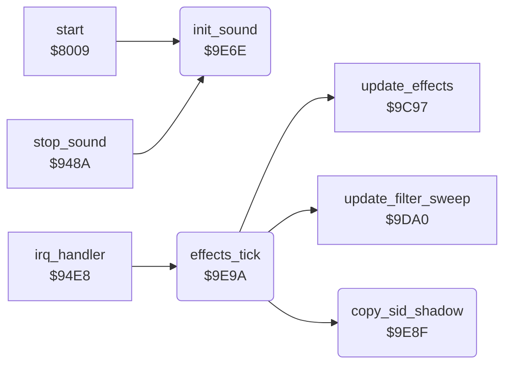

<!-- Generated by c64-docs from knowledge revision 20261025T232349.343-u0up13 and .c64-re-tools/local/generated/src/source-map.json. Do not edit: change the knowledge, generate the source again, then run docs.ts generate. -->
# sound/sid.asm: SID init, SID shadow and the effects tick

Range `$9E6E-$9EBA`. Source: [sound/sid.asm](../../../../src/sound/sid.asm). Index: [the reference](../../index.md).

## Routines

| Routine | Address | Reached from | Summary |
|---|---|---|---|
| [`init_sound`](sid.md#init_sound) | `$9E6E` | [`start`](../init/init.md#start), [`stop_sound`](stop_sound.md#stop_sound) | Silences the SID. |
| [`copy_sid_shadow`](sid.md#copy_sid_shadow) | `$9E8F` | [`effects_tick`](sid.md#effects_tick) | Copies the SID shadow ($31-$49) to the SID registers $d400-$d418. |
| [`effects_tick`](sid.md#effects_tick) | `$9E9A` | [`irq_handler`](../irq/irq_handler.md#irq_handler) | Effects tick on CIA 1 timer A. |

## Call graph

A solid arrow is a call, a thick arrow a table entry. Rounded nodes are in this file.

## Details

### [`init_sound`](../../../../src/sound/sid.asm#L6) `$9E6E`

*routine*

Silences the SID. Clears the SID shadow, the driver workspace $0200-$0259 and the driver variables $ce-$ed.

- **Called from:** [`start`](../init/init.md#start), [`stop_sound`](stop_sound.md#stop_sound)
- **Writes:** [`sid_shadow_freq_lo`](../../memory-map.md#sid_shadow_freq_lo), [`FRELO1`](../../memory-map.md#FRELO1), [`effect_step_values`](../../memory-map.md#effect_step_values), [`cmd_handler_ptr`](../../memory-map.md#cmd_handler_ptr)

| Label | Address | Comment |
|---|---|---|
| [`init_sound_clear_sid`](../../../../src/sound/sid.asm#L9) | `$9E72` |  |
| [`init_sound_clear_workspace`](../../../../src/sound/sid.asm#L16) | `$9E7D` |  |
| [`init_sound_clear_zp`](../../../../src/sound/sid.asm#L22) | `$9E87` |  |

### [`copy_sid_shadow`](../../../../src/sound/sid.asm#L29) `$9E8F`

*routine*

Copies the SID shadow ($31-$49) to the SID registers $d400-$d418.

- **Called from:** [`effects_tick`](sid.md#effects_tick)
- **Reads:** [`sid_shadow_freq_lo`](../../memory-map.md#sid_shadow_freq_lo)
- **Writes:** [`FRELO1`](../../memory-map.md#FRELO1)

| Label | Address | Comment |
|---|---|---|
| [`copy_sid_shadow_loop`](../../../../src/sound/sid.asm#L31) | `$9E91` |  |

### [`effects_tick`](../../../../src/sound/sid.asm#L38) `$9E9A`

*routine*

Effects tick on CIA 1 timer A. Updates the effects and the filter sweep, then writes the SID.

- **Called from:** [`irq_handler`](../irq/irq_handler.md#irq_handler)
- **Calls:** [`update_effects`](effects.md#update_effects), [`update_filter_sweep`](effects.md#update_filter_sweep), [`copy_sid_shadow`](sid.md#copy_sid_shadow)
- **Reads:** [`music_tick_busy`](../../memory-map.md#music_tick_busy), [`effect_delay`](../../memory-map.md#effect_delay), [`filter_delay`](../../memory-map.md#filter_delay)
- **Writes:** [`effect_delay`](../../memory-map.md#effect_delay), [`filter_delay`](../../memory-map.md#filter_delay)

| Label | Address | Comment |
|---|---|---|
| [`effects_tick_delay`](../../../../src/sound/sid.asm#L42) | `$9EA0` |  |
| [`effects_tick_next`](../../../../src/sound/sid.asm#L46) | `$9EA8` |  |
| [`effects_tick_update`](../../../../src/sound/sid.asm#L52) | `$9EB1` |  |
| [`effects_tick_done`](../../../../src/sound/sid.asm#L56) | `$9EBA` |  |
