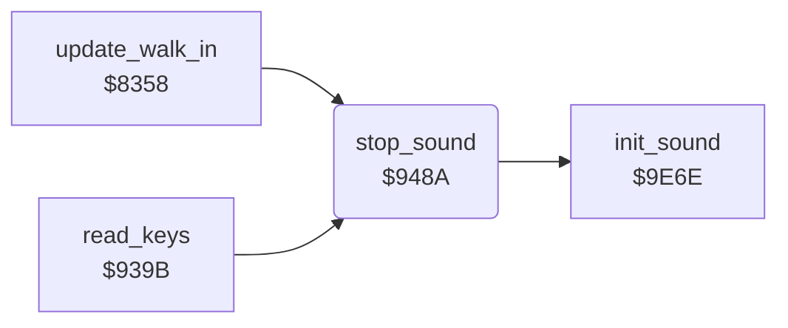

<!-- Generated by c64-docs from knowledge revision 20261025T232349.343-u0up13 and .c64-re-tools/local/generated/src/source-map.json. Do not edit: change the knowledge, generate the source again, then run docs.ts generate. -->
# sound/stop_sound.asm: Fade out and stop all sound

Range `$948A-$949B`. Source: [sound/stop_sound.asm](../../../../src/sound/stop_sound.asm). Index: [the reference](../../index.md).

## Routines

| Routine | Address | Reached from | Summary |
|---|---|---|---|
| [`stop_sound`](stop_sound.md#stop_sound) | `$948A` | [`update_walk_in`](../combat/walk_in.md#update_walk_in), [`read_keys`](../input/keyboard.md#read_keys) | Waits for the end of a fade-in, then fades out. |

## Call graph

A solid arrow is a call, a thick arrow a table entry. Rounded nodes are in this file.

## Details

### [`stop_sound`](../../../../src/sound/stop_sound.asm#L6) `$948A`

*routine*

Waits for the end of a fade-in, then fades out. Then it silences the SID and clears the sound state.

- **Called from:** [`update_walk_in`](../combat/walk_in.md#update_walk_in), [`read_keys`](../input/keyboard.md#read_keys)
- **Calls:** [`init_sound`](sid.md#init_sound)
- **Reads:** [`fade_in_request`](../../memory-map.md#fade_in_request), [`fade_out_request`](../../memory-map.md#fade_out_request)
- **Writes:** [`fade_out_request`](../../memory-map.md#fade_out_request)

| Label | Address | Comment |
|---|---|---|
| [`stop_sound_wait_fade_out`](../../../../src/sound/stop_sound.asm#L11) | `$9492` | The timer IRQ clears bit 7 when the volume is 0. |
