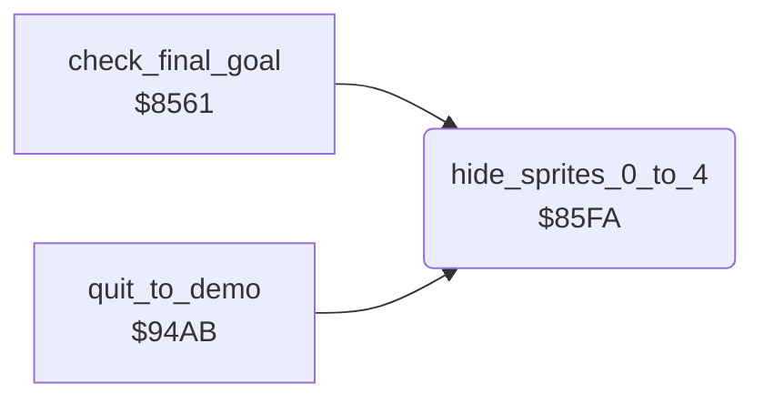

<!-- Generated by c64-docs from knowledge revision 20261029T165719.607-qgx52f and .c64-re-tools/local/generated/src/source-map.json. Do not edit: change the knowledge, generate the source again, then run docs.ts generate. -->
# sprites/hide_sprites.asm: Stop of sprites 0-4

Range `$85FA-$860E`. Source: [sprites/hide_sprites.asm](../../../../src/sprites/hide_sprites.asm). Index: [the reference](../../index.md).

## Routines

| Routine | Address | Reached from | Summary |
|---|---|---|---|
| [`hide_sprites_0_to_4`](hide_sprites.md#hide_sprites_0_to_4) | `$85FA` | [`check_final_goal`](../story/final_stage.md#check_final_goal), [`quit_to_demo`](../main/quit_to_demo.md#quit_to_demo) | Stops the animation and the path of sprite 4 and clears the bits of sprites 0-4 in sprite_enable_shadow. |

## Call graph

A solid arrow is a call, a thick arrow a table entry. Rounded nodes are in this file.

## Details

### [`hide_sprites_0_to_4`](../../../../src/sprites/hide_sprites.asm#L6) `$85FA`

*routine*

Stops the animation and the path of sprite 4 and clears the bits of sprites 0-4 in sprite_enable_shadow.

- **Called from:** [`check_final_goal`](../story/final_stage.md#check_final_goal), [`quit_to_demo`](../main/quit_to_demo.md#quit_to_demo)
- **Reads:** [`sprite_enable_shadow`](../../memory-map.md#sprite_enable_shadow), [`bit_masks_inverted`](../data/bit_masks.md#bit_masks_inverted)
- **Writes:** [`sprite_anim`](../../memory-map.md#sprite_anim), [`sprite_path`](../../memory-map.md#sprite_path), [`sprite_enable_shadow`](../../memory-map.md#sprite_enable_shadow)

| Label | Address | Comment |
|---|---|---|
| [`hide_sprites_0_to_4_loop`](../../../../src/sprites/hide_sprites.asm#L9) | `$85FE` |  |
