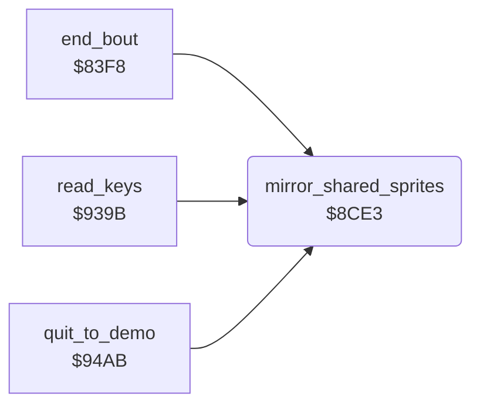

<!-- Generated by c64-docs from knowledge revision 20261029T165719.607-qgx52f and .c64-re-tools/local/generated/src/source-map.json. Do not edit: change the knowledge, generate the source again, then run docs.ts generate. -->
# sprites/mirror_shared.asm: Mirror of the shared sprite images

Range `$8CE3-$8D35`. Source: [sprites/mirror_shared.asm](../../../../src/sprites/mirror_shared.asm). Index: [the reference](../../index.md).

## Routines

| Routine | Address | Reached from | Summary |
|---|---|---|---|
| [`mirror_shared_sprites`](mirror_shared.md#mirror_shared_sprites) | `$8CE3` | [`end_bout`](../combat/end_of_bout.md#end_bout), [`read_keys`](../input/keyboard.md#read_keys), [`quit_to_demo`](../main/quit_to_demo.md#quit_to_demo), [`$80EB`](../../../../src/main/main_loop.asm#L23) | When $b7 bit 7 is set, clears bit 7 and mirrors the 45 sprite images at $54c0 horizontally. |

## Call graph

A solid arrow is a call, a thick arrow a table entry. Rounded nodes are in this file.

## Details

### [`mirror_shared_sprites`](../../../../src/sprites/mirror_shared.asm#L6) `$8CE3`

*routine*

When $b7 bit 7 is set, clears bit 7 and mirrors the 45 sprite images at $54c0 horizontally. Sprite pointers $53 and more have one copy for both facings ($9027). Fighter 1 turns: $b7 bit 7 is set.

- **Called from:** [`$80EB`](../../../../src/main/main_loop.asm#L23), [`end_bout`](../combat/end_of_bout.md#end_bout), [`read_keys`](../input/keyboard.md#read_keys), [`quit_to_demo`](../main/quit_to_demo.md#quit_to_demo)
- **Reads:** [`sprite_mirror_state`](../../memory-map.md#sprite_mirror_state), [`mirror_sprite_ptr`](../../memory-map.md#mirror_sprite_ptr), [`mirror_table`](../../memory-map.md#mirror_table), [`mirror_bytes`](../../memory-map.md#mirror_bytes), [`loop_count`](../../memory-map.md#loop_count)
- **Writes:** [`sprite_mirror_state`](../../memory-map.md#sprite_mirror_state), [`loop_count`](../../memory-map.md#loop_count), [`mirror_sprite_ptr`](../../memory-map.md#mirror_sprite_ptr), [`mirror_bytes`](../../memory-map.md#mirror_bytes)
- **Refers to:** [`mirror_sprite_ptr`](../../memory-map.md#mirror_sprite_ptr), [`mirror_bytes`](../../memory-map.md#mirror_bytes)

| Label | Address | Comment |
|---|---|---|
| [`mirror_shared_sprites_next`](../../../../src/sprites/mirror_shared.asm#L17) | `$8CF7` |  |
| [`mirror_shared_sprites_row`](../../../../src/sprites/mirror_shared.asm#L19) | `$8CF9` | Swaps the 3 bytes of a sprite line and mirrors each byte through $02aa. |
| [`mirror_shapes_next`](../../../../src/sprites/mirror_shared.asm#L52) | `$8D31` | Next sprite shape: $a1 counts 45 shapes down. |
| [`mirror_shapes_done`](../../../../src/sprites/mirror_shared.asm#L55) | `$8D35` |  |
