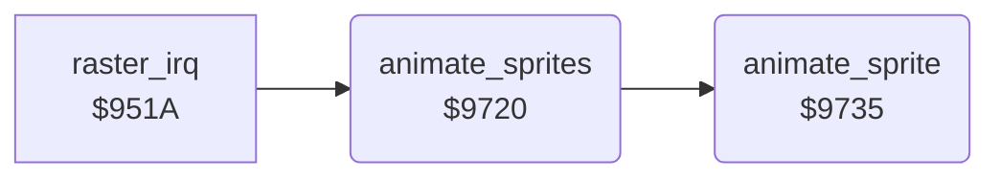

<!-- Generated by c64-docs from knowledge revision 20261029T165719.607-qgx52f and .c64-re-tools/local/generated/src/source-map.json. Do not edit: change the knowledge, generate the source again, then run docs.ts generate. -->
# sprites/sprite_anim.asm: Sprite animations: frames, colour and expansion

Range `$9720-$97F2`. Source: [sprites/sprite_anim.asm](../../../../src/sprites/sprite_anim.asm). Index: [the reference](../../index.md).

## Routines

| Routine | Address | Reached from | Summary |
|---|---|---|---|
| [`animate_sprites`](sprite_anim.md#animate_sprites) | `$9720` | [`raster_irq`](../irq/irq_handler.md#raster_irq) | Runs the animation of each sprite 7-0 with sprite_anim bit 7 set, and switches that sprite on. |
| [`animate_sprite`](sprite_anim.md#animate_sprite) | `$9735` | [`animate_sprites`](sprite_anim.md#animate_sprites) | Steps the animation of sprite X. |

## Call graph

A solid arrow is a call, a thick arrow a table entry. Rounded nodes are in this file.

## Details

### [`animate_sprites`](../../../../src/sprites/sprite_anim.asm#L6) `$9720`

*routine*

Runs the animation of each sprite 7-0 with sprite_anim bit 7 set, and switches that sprite on.

- **Called from:** [`raster_irq`](../irq/irq_handler.md#raster_irq)
- **Calls:** [`animate_sprite`](sprite_anim.md#animate_sprite)
- **Reads:** [`sprite_anim`](../../memory-map.md#sprite_anim), [`sprite_enable_shadow`](../../memory-map.md#sprite_enable_shadow), [`bit_masks`](../data/bit_masks.md#bit_masks)
- **Writes:** [`sprite_enable_shadow`](../../memory-map.md#sprite_enable_shadow)

| Label | Address | Comment |
|---|---|---|
| [`animate_sprites_loop`](../../../../src/sprites/sprite_anim.asm#L8) | `$9722` |  |
| [`animate_sprites_next`](../../../../src/sprites/sprite_anim.asm#L15) | `$9731` |  |

### [`animate_sprite`](../../../../src/sprites/sprite_anim.asm#L20) `$9735`

*routine*

Steps the animation of sprite X. Sets the frame, colour, multicolour and expansion when the delay ends.

- **Called from:** [`animate_sprites`](sprite_anim.md#animate_sprites)
- **Reads:** [`sprite_anim_timer`](../../memory-map.md#sprite_anim_timer), [`sprite_anim`](../../memory-map.md#sprite_anim), [`sprite_anim_ptrs`](sprite_anims.md#sprite_anim_ptrs), [`SPMC`](../../memory-map.md#SPMC), [`bit_masks_inverted`](../data/bit_masks.md#bit_masks_inverted), [`YXPAND`](../../memory-map.md#YXPAND), [`XXPAND`](../../memory-map.md#XXPAND), [`anim_ptr`](../../memory-map.md#anim_ptr), [`anim_flag_bits`](../../memory-map.md#anim_flag_bits), [`bit_masks`](../data/bit_masks.md#bit_masks), [`sprite_anim_pos`](../../memory-map.md#sprite_anim_pos), [`sprite_enable_shadow`](../../memory-map.md#sprite_enable_shadow)
- **Writes:** [`anim_ptr`](../../memory-map.md#anim_ptr), [`SPMC`](../../memory-map.md#SPMC), [`YXPAND`](../../memory-map.md#YXPAND), [`XXPAND`](../../memory-map.md#XXPAND), [`sprite_anim_timer`](../../memory-map.md#sprite_anim_timer), [`anim_flag_bits`](../../memory-map.md#anim_flag_bits), [`sprite_colour_shadow`](../../memory-map.md#sprite_colour_shadow), [`sprite_pointer_shadow`](../../memory-map.md#sprite_pointer_shadow), [`sprite_anim_pos`](../../memory-map.md#sprite_anim_pos), [`sprite_anim`](../../memory-map.md#sprite_anim), [`sprite_enable_shadow`](../../memory-map.md#sprite_enable_shadow)
- **Refers to:** [`anim_ptr`](../../memory-map.md#anim_ptr)

| Label | Address | Comment |
|---|---|---|
| [`animate_sprite_check_xexp`](../../../../src/sprites/sprite_anim.asm#L52) | `$9781` |  |
| [`animate_sprite_check_yexp`](../../../../src/sprites/sprite_anim.asm#L59) | `$978E` |  |
| [`animate_sprite_read_frame`](../../../../src/sprites/sprite_anim.asm#L66) | `$979B` | Bytes from offset 2: frame numbers, or $ff and a command. |
| [`animate_sprite_count_delay`](../../../../src/sprites/sprite_anim.asm#L75) | `$97AC` |  |
| [`animate_sprite_command`](../../../../src/sprites/sprite_anim.asm#L79) | `$97B0` | Command after $ff: 0 restarts, 1 ends, 2 n goes to frame n, other n starts animation n. |
| [`animate_sprite_cmd_end`](../../../../src/sprites/sprite_anim.asm#L86) | `$97BD` | Command 1: stops the animation and switches the sprite off. |
| [`animate_sprite_cmd_goto`](../../../../src/sprites/sprite_anim.asm#L95) | `$97D0` | Command 2: the next byte + 2 is the new offset. |
| [`animate_sprite_cmd_new_anim`](../../../../src/sprites/sprite_anim.asm#L105) | `$97E0` | Other command: the next byte is the new animation. |
