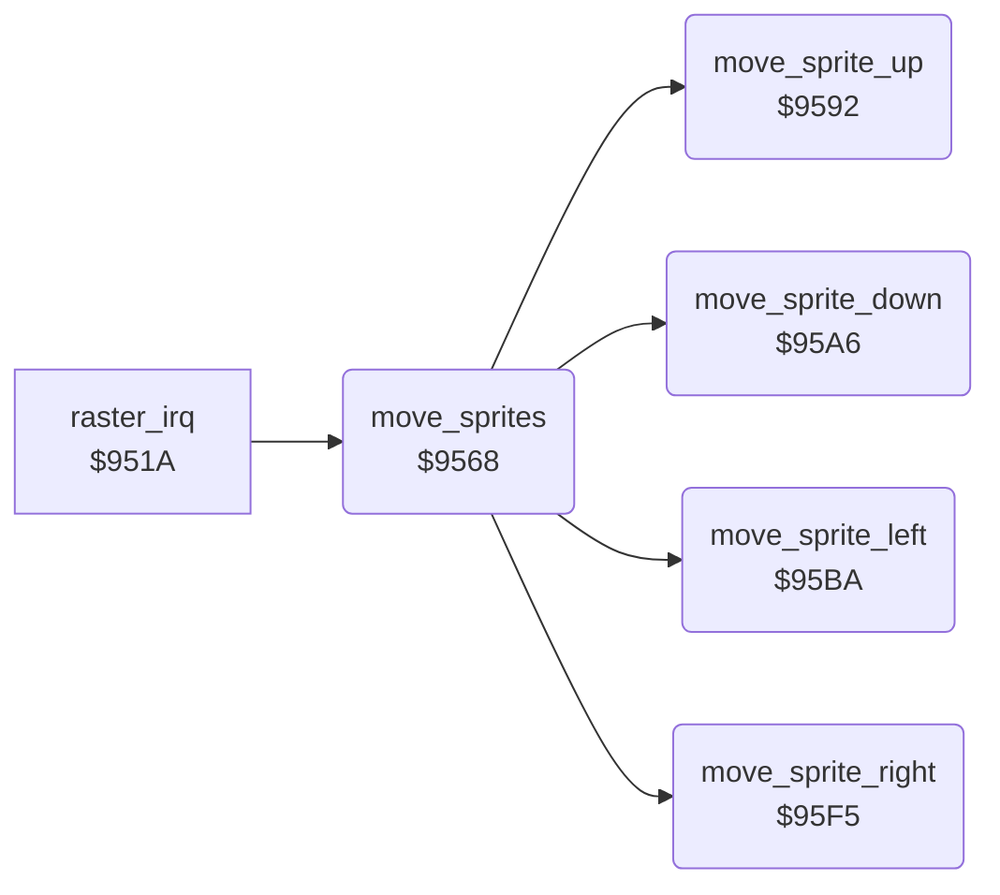

<!-- Generated by c64-docs from knowledge revision 20261025T232349.343-u0up13 and .c64-re-tools/local/generated/src/source-map.json. Do not edit: change the knowledge, generate the source again, then run docs.ts generate. -->
# sprites/sprite_move.asm: Move the sprites by their direction bits and speeds

Range `$9568-$9638`. Source: [sprites/sprite_move.asm](../../../../src/sprites/sprite_move.asm). Index: [the reference](../../index.md).

## Routines

| Routine | Address | Reached from | Summary |
|---|---|---|---|
| [`move_sprites`](sprite_move.md#move_sprites) | `$9568` | [`raster_irq`](../irq/irq_handler.md#raster_irq) | Moves sprites 7-0 by the direction bits in sprite_move_dirs: bit 0 up, 1 down, 2 left, 3 right. |
| [`move_sprite_up`](sprite_move.md#move_sprite_up) | `$9592` | [`move_sprites`](sprite_move.md#move_sprites) | Subtracts the Y speed from the Y of sprite X (Y = X * 2). |
| [`move_sprite_down`](sprite_move.md#move_sprite_down) | `$95A6` | [`move_sprites`](sprite_move.md#move_sprites) | Adds the Y speed to the Y of sprite X (Y = X * 2). |
| [`move_sprite_left`](sprite_move.md#move_sprite_left) | `$95BA` | [`move_sprites`](sprite_move.md#move_sprites) | Subtracts the X speed from the 9-bit X position of sprite X. |
| [`move_sprite_right`](sprite_move.md#move_sprite_right) | `$95F5` | [`move_sprites`](sprite_move.md#move_sprites) | Adds the X speed to the 9-bit X position of sprite X. |

## Data

| Range | Type | Name | Read by | Written by |
|---|---|---|---|---|
| [`$9608`](../../../../src/sprites/sprite_move.asm#L99)-`$9609` | dual-use |  |  |  |

## Call graph

A solid arrow is a call, a thick arrow a table entry. Rounded nodes are in this file.

## Details

### [`move_sprites`](../../../../src/sprites/sprite_move.asm#L6) `$9568`

*routine*

Moves sprites 7-0 by the direction bits in sprite_move_dirs: bit 0 up, 1 down, 2 left, 3 right.

- **Called from:** [`raster_irq`](../irq/irq_handler.md#raster_irq)
- **Calls:** [`move_sprite_up`](sprite_move.md#move_sprite_up), [`move_sprite_down`](sprite_move.md#move_sprite_down), [`move_sprite_left`](sprite_move.md#move_sprite_left), [`move_sprite_right`](sprite_move.md#move_sprite_right)
- **Reads:** [`sprite_dirs`](../../memory-map.md#sprite_dirs), [`sprite_move_bits`](../../memory-map.md#sprite_move_bits)
- **Writes:** [`sprite_move_bits`](../../memory-map.md#sprite_move_bits)

| Label | Address | Comment |
|---|---|---|
| [`move_sprites_loop`](../../../../src/sprites/sprite_move.asm#L8) | `$956A` | Y = X * 2, the index of the sprite position. |
| [`move_sprites_check_down`](../../../../src/sprites/sprite_move.asm#L17) | `$9579` |  |
| [`move_sprites_check_left`](../../../../src/sprites/sprite_move.asm#L21) | `$9580` |  |
| [`move_sprites_check_right`](../../../../src/sprites/sprite_move.asm#L25) | `$9587` |  |
| [`move_sprites_next`](../../../../src/sprites/sprite_move.asm#L29) | `$958E` |  |

### [`move_sprite_up`](../../../../src/sprites/sprite_move.asm#L34) `$9592`

*routine*

Subtracts the Y speed from the Y of sprite X (Y = X * 2). The lowest Y is $32.

- **Called from:** [`move_sprites`](sprite_move.md#move_sprites)
- **Reads:** [`sprite_y_shadow`](../../memory-map.md#sprite_y_shadow), [`sprite_speed_y`](../../memory-map.md#sprite_speed_y)
- **Writes:** [`sprite_y_shadow`](../../memory-map.md#sprite_y_shadow)

| Label | Address | Comment |
|---|---|---|
| [`move_sprite_up_exit`](../../../../src/sprites/sprite_move.asm#L44) | `$95A5` |  |

### [`move_sprite_down`](../../../../src/sprites/sprite_move.asm#L47) `$95A6`

*routine*

Adds the Y speed to the Y of sprite X (Y = X * 2). The highest Y is $e5.

- **Called from:** [`move_sprites`](sprite_move.md#move_sprites)
- **Reads:** [`sprite_y_shadow`](../../memory-map.md#sprite_y_shadow), [`sprite_speed_y`](../../memory-map.md#sprite_speed_y)
- **Writes:** [`sprite_y_shadow`](../../memory-map.md#sprite_y_shadow)

| Label | Address | Comment |
|---|---|---|
| [`move_sprite_down_exit`](../../../../src/sprites/sprite_move.asm#L57) | `$95B9` |  |

### [`move_sprite_left`](../../../../src/sprites/sprite_move.asm#L60) `$95BA`

*routine*

Subtracts the X speed from the 9-bit X position of sprite X. Stops the sprite at the left edge.

- **Called from:** [`move_sprites`](sprite_move.md#move_sprites)
- **Reads:** [`sprite_x_msb_shadow`](../../memory-map.md#sprite_x_msb_shadow), [`bit_masks`](../data/bit_masks.md#bit_masks), [`sprite_xy_shadow`](../../memory-map.md#sprite_xy_shadow), [`sprite_speed_x`](../../memory-map.md#sprite_speed_x), [`sprite_enable_shadow`](../../memory-map.md#sprite_enable_shadow), [`bit_masks_inverted`](../data/bit_masks.md#bit_masks_inverted)
- **Writes:** [`sprite_xy_shadow`](../../memory-map.md#sprite_xy_shadow), [`sprite_anim`](../../memory-map.md#sprite_anim), [`sprite_path`](../../memory-map.md#sprite_path), [`sprite_enable_shadow`](../../memory-map.md#sprite_enable_shadow), [`sprite_x_msb_shadow`](../../memory-map.md#sprite_x_msb_shadow)

| Label | Address | Comment |
|---|---|---|
| [`move_sprite_left_msb_set`](../../../../src/sprites/sprite_move.asm#L77) | `$95E1` | X position 256 or more. |
| [`move_sprite_left_exit`](../../../../src/sprites/sprite_move.asm#L87) | `$95F4` |  |

### [`move_sprite_right`](../../../../src/sprites/sprite_move.asm#L90) `$95F5`

*routine*

Adds the X speed to the 9-bit X position of sprite X. Stops the sprite at the right edge.

- **Called from:** [`move_sprites`](sprite_move.md#move_sprites)
- **Reads:** [`sprite_x_msb_shadow`](../../memory-map.md#sprite_x_msb_shadow), [`bit_masks`](../data/bit_masks.md#bit_masks), [`sprite_xy_shadow`](../../memory-map.md#sprite_xy_shadow), [`sprite_speed_x`](../../memory-map.md#sprite_speed_x), [`sprite_enable_shadow`](../../memory-map.md#sprite_enable_shadow), [`bit_masks_inverted`](../data/bit_masks.md#bit_masks_inverted), [`sprite_path`](../../memory-map.md#sprite_path)
- **Writes:** [`sprite_xy_shadow`](../../memory-map.md#sprite_xy_shadow), [`sprite_anim`](../../memory-map.md#sprite_anim), [`sprite_enable_shadow`](../../memory-map.md#sprite_enable_shadow), [`sprite_path`](../../memory-map.md#sprite_path), [`sprite_x_msb_shadow`](../../memory-map.md#sprite_x_msb_shadow)

| Label | Address | Comment |
|---|---|---|
| [`move_sprite_right_msb_clear`](../../../../src/sprites/sprite_move.asm#L111) | `$9625` | X position below 256. |
| [`move_sprite_right_exit`](../../../../src/sprites/sprite_move.asm#L120) | `$9638` |  |
