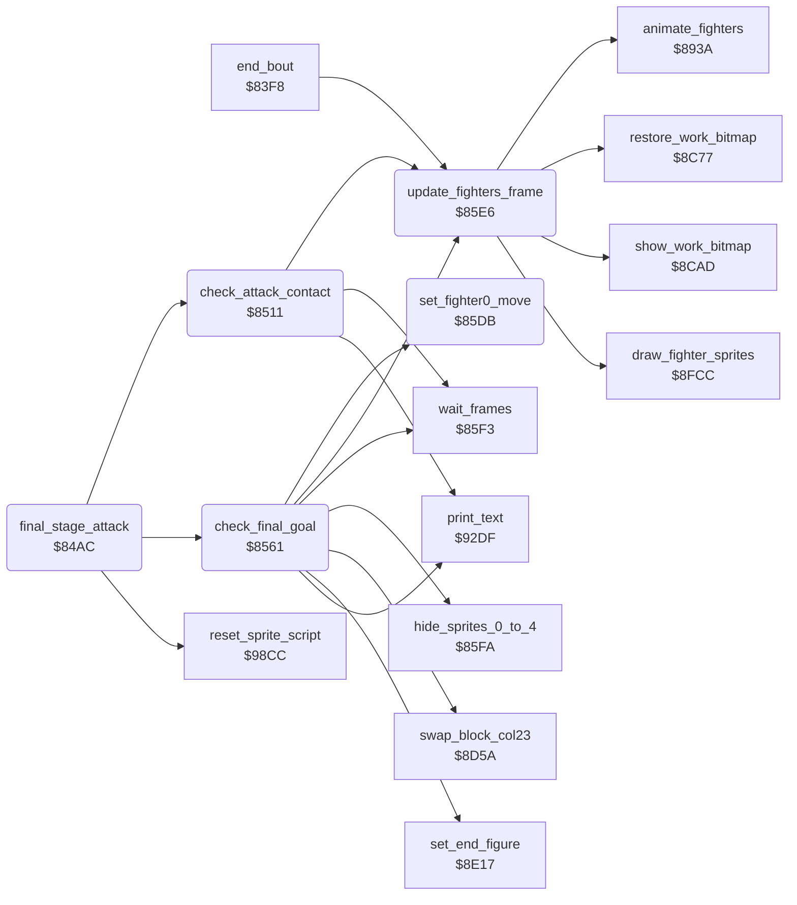

<!-- Generated by c64-docs from knowledge revision 20261025T232349.343-u0up13 and .c64-re-tools/local/generated/src/source-map.json. Do not edit: change the knowledge, generate the source again, then run docs.ts generate. -->
# story/final_stage.asm: Final stage and end of the story

Range `$84AC-$85F2`. Source: [story/final_stage.asm](../../../../src/story/final_stage.asm). Index: [the reference](../../index.md).

## Routines

| Routine | Address | Reached from | Summary |
|---|---|---|---|
| [`final_stage_attack`](final_stage.md#final_stage_attack) | `$84AC` | [`$80FA`](../../../../src/main/main_loop.asm#L28) | Final stage: starts sprite 4 at the right on path $8a or $8b (random). |
| [`check_attack_contact`](final_stage.md#check_attack_contact) | `$8511` | [`final_stage_attack`](final_stage.md#final_stage_attack) | Sprite 4 is at fighter 0. |
| [`check_final_goal`](final_stage.md#check_final_goal) | `$8561` | [`final_stage_attack`](final_stage.md#final_stage_attack) | When fighter 0 is at X $1c or more, plays the end of the story with THANKS BIG BOY. |
| [`set_fighter0_move`](final_stage.md#set_fighter0_move) | `$85DB` | [`check_final_goal`](final_stage.md#check_final_goal) | Starts move A for fighter 0: fighter_move_lock = A, fighter_move = A with bit 7, step 0. |
| [`update_fighters_frame`](final_stage.md#update_fighters_frame) | `$85E6` | [`end_bout`](../combat/end_of_bout.md#end_bout), [`check_attack_contact`](final_stage.md#check_attack_contact), [`check_final_goal`](final_stage.md#check_final_goal) | Updates and draws both fighters for one frame. |

## Call graph

A solid arrow is a call, a thick arrow a table entry. Rounded nodes are in this file.

## Details

### [`final_stage_attack`](../../../../src/story/final_stage.asm#L6) `$84AC`

*routine*

Final stage: starts sprite 4 at the right on path $8a or $8b (random). When it reaches fighter 0, checks the move of fighter 0.

- **Called from:** [`$80FA`](../../../../src/main/main_loop.asm#L28)
- **Calls:** [`reset_sprite_script`](../sprites/sprite_script.md#reset_sprite_script), [`check_attack_contact`](final_stage.md#check_attack_contact), [`check_final_goal`](final_stage.md#check_final_goal)
- **Reads:** [`final_stage`](../../memory-map.md#final_stage), [`final_goal_reached`](../../memory-map.md#final_goal_reached), [`final_scene_pose`](../../memory-map.md#final_scene_pose), [`wait_counter`](../../memory-map.md#wait_counter), [`sprite_anim`](../../memory-map.md#sprite_anim), [`RASTER`](../../memory-map.md#RASTER), [`bolt_motions`](end_scene.md#bolt_motions), [`sprite_x_msb_shadow`](../../memory-map.md#sprite_x_msb_shadow), [`bit_masks_inverted`](../data/bit_masks.md#bit_masks_inverted), [`sprite_y_shadow`](../../memory-map.md#sprite_y_shadow), [`fighter_x`](../../memory-map.md#fighter_x)
- **Writes:** [`sprite_anim`](../../memory-map.md#sprite_anim), [`attack_path`](../../memory-map.md#attack_path), [`sprite_path`](../../memory-map.md#sprite_path), [`sprite_anim_timer`](../../memory-map.md#sprite_anim_timer), [`sprite_y_shadow`](../../memory-map.md#sprite_y_shadow), [`sprite_anim_pos`](../../memory-map.md#sprite_anim_pos), [`sprite_x_msb_shadow`](../../memory-map.md#sprite_x_msb_shadow), [`sound_request`](../../memory-map.md#sound_request), [`final_scene_pose`](../../memory-map.md#final_scene_pose)
- **Refers to:** [`sprite_xy_shadow`](../../memory-map.md#sprite_xy_shadow), [`sound_request`](../../memory-map.md#sound_request)

| Label | Address | Comment |
|---|---|---|
| [`final_stage_attack_pose`](../../../../src/story/final_stage.asm#L43) | `$84F8` | Changes the pose of sprites 0-3 between set 0 and set 1. |
| [`final_stage_attack_reach`](../../../../src/story/final_stage.asm#L48) | `$84FE` | Compares the X position of sprite 4 (in steps of 8 pixels, minus 6) with fighter 0. |
| [`final_stage_attack_done`](../../../../src/story/final_stage.asm#L59) | `$8510` |  |

### [`check_attack_contact`](../../../../src/story/final_stage.asm#L62) `$8511`

*routine*

Sprite 4 is at fighter 0. If fighter 0 does a move of the list for this path, sprite 4 stops. Else fighter 0 dies and the game ends.

- **Called from:** [`final_stage_attack`](final_stage.md#final_stage_attack)
- **Calls:** [`update_fighters_frame`](final_stage.md#update_fighters_frame), [`print_text`](../text/print_text.md#print_text), [`wait_frames`](../main/wait_frames.md#wait_frames)
- **Jumps to:** [`quit_to_demo`](../main/quit_to_demo.md#quit_to_demo)
- **Reads:** [`attack_path`](../../memory-map.md#attack_path), [`bolt_pass_move_ptrs`](end_scene.md#bolt_pass_move_ptrs), [`bitmap_ptr`](../../memory-map.md#bitmap_ptr), [`fighter_move`](../../memory-map.md#fighter_move), [`wait_counter`](../../memory-map.md#wait_counter), [`sprite_enable_shadow`](../../memory-map.md#sprite_enable_shadow), [`bit_masks_inverted`](../data/bit_masks.md#bit_masks_inverted)
- **Writes:** [`bitmap_ptr`](../../memory-map.md#bitmap_ptr), [`fighter_move`](../../memory-map.md#fighter_move), [`fighter_move_lock`](../../memory-map.md#fighter_move_lock), [`fighter_move_step`](../../memory-map.md#fighter_move_step), [`wait_counter`](../../memory-map.md#wait_counter), [`sprite_anim`](../../memory-map.md#sprite_anim), [`sprite_path`](../../memory-map.md#sprite_path), [`sprite_enable_shadow`](../../memory-map.md#sprite_enable_shadow), [`SPENA`](../../memory-map.md#SPENA)
- **Refers to:** [`bitmap_ptr`](../../memory-map.md#bitmap_ptr)

| Label | Address | Comment |
|---|---|---|
| [`check_attack_contact_loop`](../../../../src/story/final_stage.asm#L71) | `$8521` |  |
| [`check_attack_contact_hit`](../../../../src/story/final_stage.asm#L79) | `$852C` | Fighter 0 gets move $1b, waits 150 frames and shows YOUR END HAS COME. Then the demo starts. |
| [`check_attack_contact_wait`](../../../../src/story/final_stage.asm#L87) | `$853A` |  |
| [`check_attack_contact_avoided`](../../../../src/story/final_stage.asm#L97) | `$854E` | Stops sprite 4. |

### [`check_final_goal`](../../../../src/story/final_stage.asm#L107) `$8561`

*routine*

When fighter 0 is at X $1c or more, plays the end of the story with THANKS BIG BOY. Then the demo starts.

- **Called from:** [`final_stage_attack`](final_stage.md#final_stage_attack)
- **Calls:** [`hide_sprites_0_to_4`](../sprites/hide_sprites.md#hide_sprites_0_to_4), [`set_fighter0_move`](final_stage.md#set_fighter0_move), [`wait_frames`](../main/wait_frames.md#wait_frames), [`swap_block_col23`](end_swaps.md#swap_block_col23), [`set_end_figure`](end_figure.md#set_end_figure), [`update_fighters_frame`](final_stage.md#update_fighters_frame), [`print_text`](../text/print_text.md#print_text)
- **Jumps to:** [`quit_to_demo`](../main/quit_to_demo.md#quit_to_demo)
- **Reads:** [`fighter_x`](../../memory-map.md#fighter_x), [`fighter_home_column`](../data/fighter_constants.md#fighter_home_column), [`wait_counter`](../../memory-map.md#wait_counter)
- **Writes:** [`final_goal_reached`](../../memory-map.md#final_goal_reached), [`sound_request`](../../memory-map.md#sound_request), [`final_scene_pose`](../../memory-map.md#final_scene_pose), [`wait_counter`](../../memory-map.md#wait_counter)
- **Refers to:** [`sound_request`](../../memory-map.md#sound_request)

| Label | Address | Comment |
|---|---|---|
| [`check_final_goal_walk_back`](../../../../src/story/final_stage.asm#L120) | `$857D` |  |
| [`check_final_goal_walk_on`](../../../../src/story/final_stage.asm#L138) | `$85A4` |  |
| [`check_final_goal_wait`](../../../../src/story/final_stage.asm#L149) | `$85BB` |  |
| [`check_final_goal_back_step`](../../../../src/story/final_stage.asm#L158) | `$85CF` |  |
| [`check_final_goal_done`](../../../../src/story/final_stage.asm#L163) | `$85DA` |  |

### [`set_fighter0_move`](../../../../src/story/final_stage.asm#L166) `$85DB`

*routine*

Starts move A for fighter 0: fighter_move_lock = A, fighter_move = A with bit 7, step 0.

- **Called from:** [`check_final_goal`](final_stage.md#check_final_goal)
- **Writes:** [`fighter_move_lock`](../../memory-map.md#fighter_move_lock), [`fighter_move`](../../memory-map.md#fighter_move), [`fighter_move_step`](../../memory-map.md#fighter_move_step)

### [`update_fighters_frame`](../../../../src/story/final_stage.asm#L174) `$85E6`

*routine*

Updates and draws both fighters for one frame. The main loop does the same steps.

- **Called from:** [`end_bout`](../combat/end_of_bout.md#end_bout), [`check_attack_contact`](final_stage.md#check_attack_contact), [`check_final_goal`](final_stage.md#check_final_goal)
- **Calls:** [`restore_work_bitmap`](../screen/fight_area.md#restore_work_bitmap), [`animate_fighters`](../fighter/animate.md#animate_fighters), [`draw_fighter_sprites`](../sprites/fighter_sprites.md#draw_fighter_sprites), [`show_work_bitmap`](../screen/fight_area.md#show_work_bitmap)
