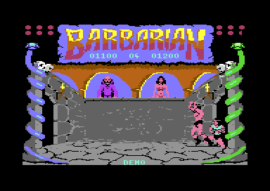

# Barbarian, part 2, V 05 10 87

Barbarian: The Ultimate Warrior is a sword-fighting game by Palace Software, 1987. This project is part 2 of the C64 game, the story game. The barbarian fights opponents 0 to 7, one bout each. Then the sorcerer Drax throws bolts at him, and the barbarian must reach princess Mariana. The program has the version text "V 05 10 87", the later of the two builds. The documentation is for the release FLT, the crack of Fairlight of 21 May 1987. This crack is the reference file. Nobody examined a Palace disk or tape. Thus "identical" on these pages means identical to the FLT capture, not to the commercial original. The parts that the four projects share are on [../README.md](../README.md).

**Evidence.** **Observed** marks a fact that a run, a byte compare or the coverage of the recordings showed. **Code** marks a fact from the code only. **Conclusion** marks an interpretation.

This screenshot comes from build V 05 05 87, the project `game_v1`. It shows the attract demo in the dungeon. Drax and the princess stand in the two right windows, and two computer fighters fight at the right (**Observed** in `game_v1`). This build has the same picture bytes (**Observed** byte compare), but no screenshot of this build exists.

**Conventions.**
- Addresses are C64 addresses. Names are the names of the knowledge of `game_v2`.
- A *frame* is one PAL screen, 1/50 of a second. A *pass* is one run of the main loop. The main loop has no frame wait, so a pass takes about 10 to 11 frames in the demo.
- A *bout* is one fight against one opponent. The *opponent* is `opponent_index`, 0-7. The *final stage* is the fight against the bolts of Drax after opponent 7.
- *Fighter 0* is player 1, with the joystick in port 2. *Fighter 1* is the computer. In the demo, the computer moves both fighters.
- *Part 1* is Combat Practice, the other program of the game. *V 05 05 87* is the earlier build of both parts, in the project `game_v1`.

## The development

The program has no credit text, no author name and no copyright line. The traces of the work are a version text, bytes from the RAM of the machines of the authors and unused code. Each trace is also in the other programs of the group, so the full story is on [../docs/development.md](../docs/development.md). (**Observed** byte search)

**The version text.** CTRL+V shows [`text_version` `$BAD1`](src/text/texts.asm#L17) while V stays pressed. The first line is "V 05 10 87" at column 15, row 17. A `$0D` byte starts a second line, "WHY DID YOU PRESS ME", at column 10, row 18 (**Code**). As month, day and year, the date is 10 May 1987. The RDI and HTL releases have "V 05 05 87", five days earlier.

**The later build.** This build has each part of V 05 05 87 and adds guards and corrections. It adds a new pose routine, new AI rows, changed hit lists and a bout clock of 90 seconds. No change goes in the other direction. Thus this program is the later build (**Code**, **Conclusion**). The graphics and the music data have the same bytes in both builds (**Observed** byte compare). The differences are on [../docs/versions.md](../docs/versions.md).

**The Commodore 128 code.** [`unused_ff80` `$FF80`](src/leftovers/leftover_ff80.asm#L6) holds 32 bytes of code at `$FFD0-$FFEF`. The first half is 6502 code that writes the C128 MMU registers `$FF00` and `$D505` and jumps to `$1100`. The second half is Z80 code that returns the bus to the 8502. No code of the game jumps there (**Code**). Part 2 of V 05 05 87 has the same 32 bytes, and another group cracked it (**Observed** byte compare). **Conclusion:** the bytes were in the file of part 2 before each group cracked it. Thus part 2 was in the memory of a C128 in C64 mode before the save.

**The cartridge header.** [`cart_cold_start_vector` `$8000`](src/init/cartridge_header.asm#L6) holds the address `$8009` two times and the signature "CBM80". At a hardware reset, the KERNAL finds the signature and starts the game again without a new load (**Code**). The game fills `$0800-$FFFF`, much more than a cartridge of 16 KB holds (**Code**). **Conclusion:** the authors used the header to restart a hung game fast during the tests.

**The RAM of the machine.** `$FC04-$FC3F` and `$FF80-$FFCF` hold the pattern `$00 $FF` of RAM after power-on. `$FFF0-$FFF9` hold a copy of bytes at `$9FF0`, inside `freq_table`. The stored arena at `$E000-$E7FF` is a copy of 1 KB of screen RAM and 1 KB of colour RAM. Its colours have random high nybbles (**Observed** byte compare). **Conclusion:** the authors saved memory ranges of a running machine, not the exact length of the code.

**Other bytes than in V 05 05 87.** The bytes after the last table, `$CF71-$CF7F` and [`unused_cfa2` `$CFA2`](src/leftovers/leftover_cfa2.asm#L6) to `$CFFF`, hold zeros. Only `$CF7F` and `$CFFF` hold `$FF`. V 05 05 87 has the RAM pattern after its last table. `$0801-$0837` hold 55 zero bytes, where the RDI file has its colour copier (**Observed** byte compare). Whether Palace or the FLT crack wrote these zeros is not known.

**The shared source.** Part 2 keeps the two-player code of part 1. Eight instructions read `two_players`, but part 2 writes only 0 there (**Code**). The text "PAUSED" and a text "000" are in the text table, but no code prints them. At `$84C4`, the bolt code loads `wait_counter`, and the next instruction loads A again (**Code**). **Conclusion:** the authors made both parts from one source and changed only a few lines for each part.

## The copy protection

Nobody examined a Palace disk or tape. FLT is a crack, and it starts the game with its own intro and unpacker. The game code reads no disk, no loader value and no special memory state (**Code**). Thus no project of the group has a PROTECTION switch. **Conclusion:** the loader of the commercial original held the protection, and the cracks replaced it. The chain of each crack is on [../docs/releases.md](../docs/releases.md).

The game needs one service of its loader: the colours. The game writes colour RAM in the fight area, the texts and the snake heads. A scene change also swaps the colours of the centre. Rows 0-1, row 6, rows 23-24, the side columns and the centre of the first picture keep the colours of the loader (**Code**).

FLT copies 1000 bytes from `$0400-$07E7` to colour RAM `$D800` and then jumps to `$8009` (**Observed**). The RDI and HTL cracks of V 05 05 87 read `$B000-$B3E7` in its place. After the start, this game uses `$0400-$07E7` as work RAM. The area holds the mask table, the block stores of the final stage and the composition buffer of the fighters (**Code**). **Conclusion:** the loader of the commercial original also filled colour RAM before the jump. No reference file has that loader.

The game also takes the phase of its CIA 1 timers from the loader. It starts the timers without a force load, so the timer values at the entry decide when the sound interrupts come (**Code**). The demo AI also reads these timers as its random source. A loader of rc.19 entered with other timer values, and its replays went one frame off after about 500 checkpoints (**Observed**, see [tests/README.md](tests/README.md)).

## Findings

- **The hit-record bug stays, at other addresses.** [`get_hit_record` `$8845`](src/combat/hits.asm#L99) shifts the record number into the high byte of a pointer. `check_attack_hit` clears that byte only once, before the loop over the hit list. Thus a second entry for the same defender pose reads 4 bytes at `$E422`, or at one of `$E81A`, `$E822` and `$E82E` in the font (**Code**). With fire + back at distance 3 or 7, the bytes can give a decapitation. Other bytes give the moves `$28` and `$71`, above the end of the move table (**Conclusion**). No recording read `$E422-$E425` (**Observed**). In this build, `$E3E8-$E3FF` and `$E7E8-$E7FF` are leftovers, because the bug no longer reads them. See [combat.md](docs/combat.md#a-bug-the-second-entry-for-a-defender-pose).

- **One loser for each pass, but not after a decapitation.** [`check_attack_hit` `$87C7`](src/combat/hits.asm#L25) now tests `bout_loser` before each attacker. Thus both fighters cannot lose their last energy in the same pass (**Code**). A decapitation sets `bout_loser` only in the next pass. **Conclusion:** after fighter 1 cuts off the head of fighter 0, fighter 0 can still kill fighter 1 in the same pass and win. No run showed the case. See [combat.md](docs/combat.md#one-loser-for-each-pass).

- **The pause stops the sprites and the timers.** [`read_keys` `$93A7`](src/input/keyboard.asm#L6) writes `$80` into `sprites_frozen` for F5 and CTRL+V. The raster interrupt then copies only the sprite registers, and it does not count the timers (**Code**). Thus the goblin, the bolt of Drax and the idle timer stop. A press of F5 longer than about 0.86 seconds ends the pause at once and starts a new one. The `keys` recording shows this case and ends in a pause (**Observed**). See [game_flow.md](docs/game_flow.md#the-pause-and-the-version-text).

- **One routine sets the poses, and the computer sees each move one pass later.** Only [`set_fighter_poses` `$878C`](src/fighter/pose_update.asm#L6) writes `fighter_pose`, after the drawing of the pass (**Code**). Thus `ai_choose_moves` reads the pose that the screen shows. **Conclusion:** the two demo fighters now have the same delay, and V 05 05 87 gave fighter 1 an advantage. See [ai.md](docs/ai.md#the-order-in-a-pass).

- **The end loops of the final stage do not set the pose.** [`update_fighters_frame` `$85F0`](src/story/final_stage.asm#L174) does not call `set_fighter_poses`. The sprite parts of the player thus keep the pose of the last pass during the death and the end of the story (**Code**). **Conclusion:** the end of the story can show move `$13` without its two sprite parts. The knowledge comment "The main loop does the same steps" is not correct for this build. See [final_stage.md](docs/final_stage.md#the-pose-of-the-player-in-the-end-loops).

- **A raster bit chooses the path of each bolt of Drax.** [`final_stage_attack` `$84B6`](src/story/final_stage.asm#L6) reads `$D012` and keeps bit 0. Path 0 needs a crouch or a roll, and path 1 needs a jump (**Code**). Down-back after a roll now gives the stance, so this input dies under a high bolt (**Conclusion**). The `final_win` record file of this build holds the crouch for 70 frames, and V 05 05 87 needs 25 frames (**Observed**). All replays pass with the same paths (**Observed**). See [final_stage.md](docs/final_stage.md#the-contact-and-how-to-pass-a-bolt).

- **A bout of part 2 has no time limit.** The bout clock now starts at 90 seconds, not 60. But only two-player code reads it: `check_time_out`, `show_counter` and `add_time_bonus`. Part 2 writes only 0 into `two_players`, so this code never runs (**Code**). No recording executed it (**Observed** coverage). Thus the new clock value changes nothing in part 2. See [game_flow.md](docs/game_flow.md#the-bout-clock-and-the-time-bonus).

- **The decapitation recording shows no decapitation.** Its record file lets opponent 7 fight an idle player, as in V 05 05 87. In this build, the computer kills the player with normal hits, and `check_decapitation_begin` does not run (**Observed**). The recordings `attract` and `fight` ran the decapitation code (**Observed**). The cause is not known. See [tests/README.md](tests/README.md) and [combat.md](docs/combat.md#the-decapitation).

- **The computer uses a counter, not a random number.** In a one-player game, [`ai_choose_moves` `$86FD`](src/ai/computer_moves.asm#L6) adds 1 to `ai_random` in each pass. The value selects 1 of 32 entries in a sorted column table. Thus opponent 7 uses column 0 for 14 passes in a row (**Code**). Only the demo reads the CIA timers. All 7 replays pass with no pins (**Observed**). See [ai.md](docs/ai.md#the-random-source).

- **Music or effects, and both in the wrong pitch for PAL.** Bit 7 of `sound_off` set means music on and effects off, in spite of the name. [`freq_table` `$9EDD`](src/music/freq_table.asm#L6) holds the NTSC values, so each note is 3.7 % low on a PAL C64 (**Code**). The driver and the tunes are the same as in V 05 05 87, but its variables are 1 byte higher (**Code**). See [sound.md](docs/sound.md#findings-in-the-code).

## How the program works

The crack jumps to `$8009`. The start code prepares the memory, the VIC-II, the interrupts and the sound. Then the demo starts: two computer fighters fight in the throne room and in the dungeon. The demo is the title of the game (**Code**).

F1 starts the set-up of a one-player game, and F7 starts the first bout. Each bout starts with a walk-in and ends with a kill. After a win, the next opponent fights in the other scene. A lost bout ends the game. After the win against opponent 7, the final stage starts. Each end of a game returns to the demo (**Code**).

~~~mermaid
flowchart TB
  S["Start: memory, VIC-II, interrupts, sound (start)"] --> M["Main loop: one pass, no frame wait (main_loop)"]
  M --> K["Status texts and keys (read_keys)"]
  M --> A["Joystick and computer (ai_choose_moves)"]
  A --> F["Moves and drawing in the work bitmap (animate_fighters)"]
  F --> P["Pose of the pass (set_fighter_poses)"]
  P --> H["Hits, energy, score, decapitation (check_hits)"]
  H --> E["End of a bout, goblin, next opponent (end_bout)"]
  E --> D["Final stage: bolts of Drax (final_stage_attack)"]
  D --> Q["Quit to the demo (quit_to_demo)"]
  I["Raster IRQ at line $FA: sprites and timers (raster_irq_bottom)"] -.-> M
  T["CIA 1 timers: music tick and effects tick"] -.-> M
~~~

1. **The start runs after each load and each quit.** [`start` `$8009`](src/init/init.asm#L6) selects the effects mode and continues into `restart`. That code removes BASIC and the KERNAL from the memory map, selects VIC bank 1 and sets the interrupts. `init_game_state` sets the demo with opponent 4 (**Code**).
2. **The main loop sets the pace.** [`main_loop` `$80BB`](src/main/main_loop.asm#L6) calls 24 routines in each pass and never returns. Each routine tests its own flags, so one loop serves the demo, the set-up, the bouts and the final stage. In the attract recording, `read_keys` ran 1426 times in about 15100 frames (**Code**, **Observed**).
3. **The player and the computer obey the same rules.** The joystick and `ai_choose_moves` give a joystick value. The same move tables change each value into a move. Thus the computer has the same moves as the player (**Code**).
4. **Each pass draws the fighters again.** [`animate_fighters` `$8956`](src/fighter/animate.asm#L6) builds each pose from 9 pieces and draws it into a work bitmap. Then `set_fighter_poses` stores the pose of the pass. The main loop copies the work bitmap to the screen in one copy, so the fighters do not flicker (**Code**, **Conclusion**).
5. **The hit test compares two poses.** [`check_hits` `$87A9`](src/combat/hits.asm#L6) looks up the pose of the attacker and the pose of the defender in tables. A hit record gives the distances, the reaction, the damage, the sound and the points (**Code**).
6. **The final stage runs inside the same loop.** `final_stage_attack` and `set_end_figure` do nothing before the final stage. Then they move the bolt and the figures of Drax and the princess (**Code**).
7. **The interrupts keep the time.** [`raster_irq_bottom` `$954F`](src/irq/irq_handler.asm#L57) copies the sprite registers, moves the sprites and counts the timers at line `$FA`. The busy flag `raster_irq_busy` stops a second update while one runs. CIA 1 timer B runs [`music_tick` `$9941`](src/music/tick.asm#L6), and timer A runs the effects and writes the SID (**Code**).

## The pages

| Page | Content |
|---|---|
| [docs/game_flow.md](docs/game_flow.md) | **The game flow.** The start, the main loop, the demo, the keys, the set-up, the bouts, the scenes, the final stage and the quit. |
| [docs/fighters.md](docs/fighters.md) | **The fighters.** The joystick, the 30 moves, the poses, the new pose routine, the work bitmap, the sprite parts, the turn and the idle move. |
| [docs/combat.md](docs/combat.md) | **Combat.** The hit lists and records, the new guards, the energy, the score, the decapitation, the goblin and the hit-record bug. |
| [docs/ai.md](docs/ai.md) | **The computer opponent.** The AI tables with the new rows, the level of each opponent, the counter and the CIA timers of the demo. |
| [docs/final_stage.md](docs/final_stage.md) | **The final stage.** Drax and his bolts, the two paths, the princess, the end scene and the lose path. |
| [docs/graphics.md](docs/graphics.md) | **The graphics.** The bitmap, the scene change, the work bitmap, the colours, the sprites, the raster IRQ with its busy flag and the text output. |
| [docs/sound.md](docs/sound.md) | **Sound and music.** The driver on two CIA timers, the tune format, the music, the effects and F3. |
| [tests/README.md](tests/README.md) | **The tests.** The recordings, the writes that are only for a test, and the replays on the default build. |
| [../docs/development.md](../docs/development.md) | **The development.** The traces of the work of the authors in the four programs. |
| [../docs/versions.md](../docs/versions.md) | **The versions.** Part 1 against part 2, and V 05 05 87 against V 05 10 87. |
| [../docs/releases.md](../docs/releases.md) | **The releases.** The three cracks, their files, the crack chain and the Hotline trainer. |

## The releases

| Label | File | SHA-256 |
|---|---|---|
| FLT | `releases/fairlight/flt-barbarianpart1-2.d64` | `abf6320286ee4c60d37d0491bd4a505cac0f94a526092cfd3e874150660d8a34` |
| FLT | `releases/fairlight/barbarian_p2_flt.prg` | `637197f7f392a78be2225362f8ffca022ca8146deddef24fe5732a9358132285` |
| FLT | `releases/fairlight/flt-barbarianpart1-2.zip` | `9403181e5caec190fe2d975af763f87a6071bf645d273b38e18d8703fb8e0dbb` |
| FLT | `releases/fairlight/flt-barbarianpart1-2.nfo` | `1ad8a85237d636a90d8fee169578f4e4347798be9fa32639577a816a604a9495` |

- **FLT** (Fairlight, 21 May 1987, crack by Strider, CSDb 21950): the D64 holds BARBARIAN P1/FLT and BARBARIAN P2/FLT. `barbarian_p2_flt.prg` is P2 of the D64. The .nfo file tells that Fairlight packed the files again for its archive in November 2019. The intro text has the date 870521, so the game bytes come from 1987. FLT changed no byte of the game (**Observed**, **Conclusion**).

The RDI and HTL releases hold the other build, V 05 05 87. Their part 2 is the project `game_v1` of the group, see [../README.md](../README.md#the-projects).

**The crack uses the screen area for the colours.** The FLT copier at `$CF80-$CFA1` reads the 1000 colour bytes from `$0400-$07E7`, the default screen of the C64 (**Observed**). The game uses this area as work RAM after the start, so the copy must come first (**Code**). The intro of part 2 salutes RDI "for cracking this game very early". FLT has another build, so Fairlight did not use the RDI files (**Conclusion**). The details are on [../docs/releases.md](../docs/releases.md#flt-the-fairlight-crack-of-v-05-10-87).

**The .nfo text is correct only for part 1.** The .nfo gives "F1 for 1 or 2 Players". In part 2, F1 always gives one player (**Observed** in the runs, **Code**).

## The rebuild

**The base release.** The knowledge holds the memory of FLT at the game entry `$8009`. It has two segments: `$07E8-$CF7F` and `$CFA2-$FFFF`, 63478 bytes. The capture leaves out two areas of the crack: the colour source `$0400-$07E7` and the colour copier `$CF80-$CFA1` (**Observed**). The game writes `$0400-$07E7` before it reads it, so it needs no bytes there (**Code**, **Conclusion**).

**The entry state.** `build/clean_loader.prg` is a packed program that starts with RUN. Its copier puts the segments into place and writes the entry state at `$0002-$03FF`. It sets the VIC-II registers of the entry state. Then it waits for a raster line, loads the CIA 1 timers and jumps to `$8009` (**Code**). The timer load keeps the phase of the timer interrupts of the capture. A loader without it made the replays go one frame off after about 500 checkpoints (**Observed**).

**The colour RAM defect.** The entry state in the knowledge holds the 1000 colours of colour RAM. The loader of c64-re-tools 2.7.0-rc.1 has no write to colour RAM (**Code**). Thus `build/clean_loader.prg` shows the pictures in wrong colours. The game itself writes colour RAM only in the fight area, the texts, the snake heads and the centre at a scene change. The replays compare RAM and not colour RAM, so they pass. This is a defect of the toolkit, not of the knowledge or the source.

**The switches.** FLT has no trainer and changed no byte of the game. Thus the knowledge holds no switch and no patch of a crack (**Code**). `src/config.asm` holds the value of each switch, and `src/switches.asm` holds the values of the release. The default build gives the clean FLT program without the leftovers (**Code**).

| Switch | Kind | Default | Releases with it on | What it changes |
|---|---|---|---|---|
| `LEFTOVERS` | leftovers | 0 | FLT | 482 bytes in 9 files of `src/leftovers/` that nothing uses |

**The builds.** From the project folder, with the scripts of the c64-source and c64-assembler skills:

1. `source.ts generate --out src --loader` writes the source and `build/clean_loader.prg`, the default build. It loads with `LOAD"...",8` and starts with RUN.
2. `assembler.ts build src main.asm --release FLT --compare` builds the FLT bytes. The release build has the same bytes as the capture in all segments (**Observed**).

**The tests.** Seven recordings with scripted input replay on `build/clean_loader.prg`: `attract`, `decapitation`, `fight`, `final_lose`, `final_win`, `keys` and `win_bout`. Claude wrote the steps, and no person played. Each replay stops at `main_loop` and compares the energy, the position and the move of both fighters. It also compares the opponent, the scene, the loser and the final stage flag. The rebuild gives the same values at all 3387 checkpoints, with no pins (**Observed**). The notes of each recording are on [tests/README.md](tests/README.md).

**The code that no run executed.** After all recordings, 31 code ranges with 201 instructions stayed unexecuted (**Observed** coverage). The main groups are:

- The two-player code of the bout clock, the time bonus and the end of a two-player game: 89 instructions in 4 ranges.
- The commands and options of the sprite motions, the sprite animations, the corner animations and the move sequences that no table uses. Examples are the sprite expansion and the Y limits of a sprite: 57 instructions in 11 ranges.
- The paths of the sound driver that no tune uses, for example the command `$F1` and the frequency slide. The drop of a request in music mode is also in this group: 33 instructions in 7 ranges.
- The key Q and two paths of F1 and of the quit: 8 instructions in 4 ranges. The paths change the scene and restore the torso sprites.
- Three rare cases: a second hit sprite, a head at X 256 or more, and the goblin at the head. They have 11 instructions in 3 ranges.
- The mirror back of the torso sprites in `end_bout`, and the carry of the new add in `find_move_row`: 3 instructions in 2 ranges.

## Still open

- What does the game do when the hit-record bug reads a record at `$E422` or in the font? — A fight with fire + back at distance 3 against an opponent in move `$8C`, with a breakpoint at `check_attack_hit_apply`.
- Can fighter 0 kill fighter 1 in the pass of his own decapitation, and keep his head? — A run with the energy of fighter 1 at 1 and two attacks in the same pass.
- Why does opponent 7 not decapitate the idle player in the `decapitation` recording? — A replay with a watch on `fighter_move` of fighter 0 and on `fighter_distance`.
- Does the end of the story show move `$13` without its sprite parts? — A run of `final_win` with a screen capture at the start of move `$13`.
- Does the bolt of Drax continue on the same path after a pause? — A run that presses F5 while a bolt flies.
- How many frames does a pass take in a bout, not in the demo? — A run that logs the frame at each `main_loop` in the recording `fight`.
- Do the two demo fighters now win about the same number of bouts? — A count of `bout_loser` at each bout end in the recording `attract`.
- Did the Palace disk have a loader with a copy protection? — No reference file has the Palace loader. Only an image of an authenticated Palace disk can tell.

## The reference

[docs/reference/index.md](docs/reference/index.md)
