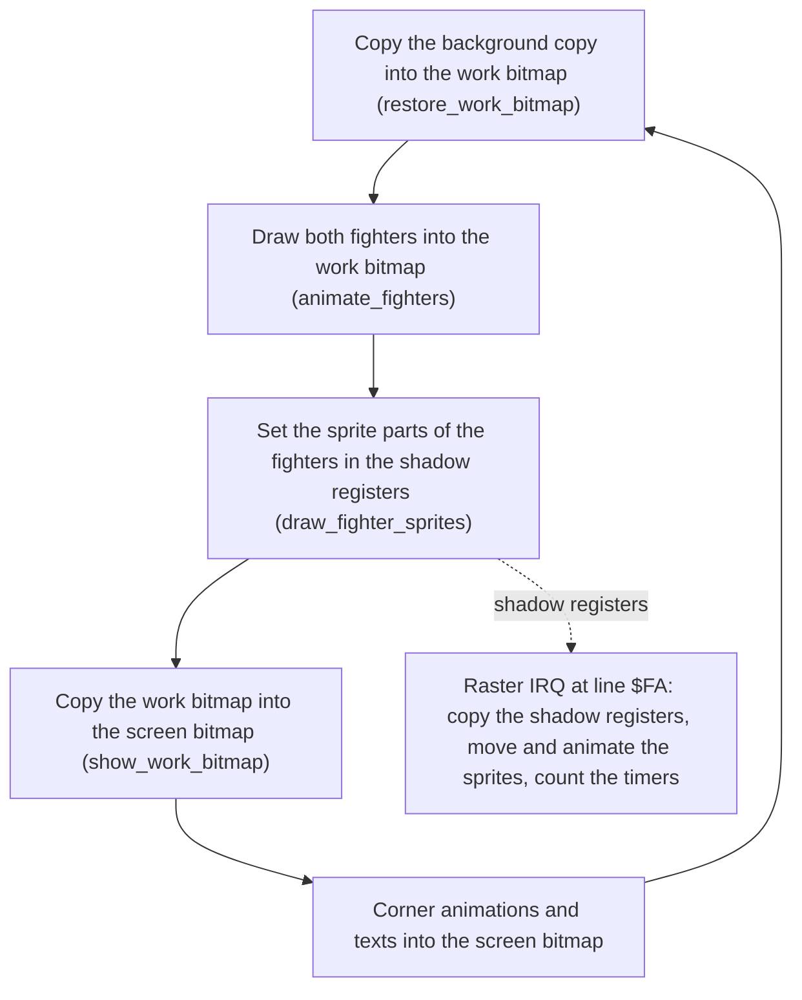
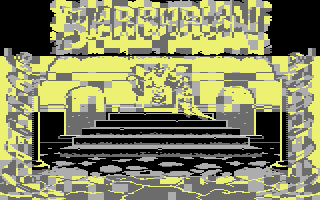
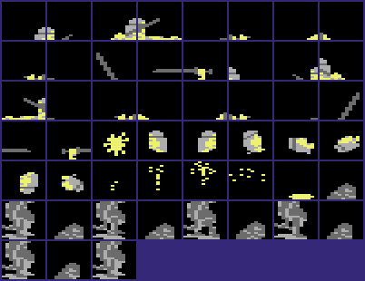
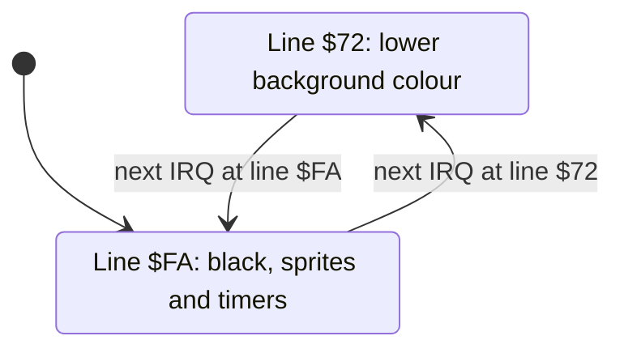
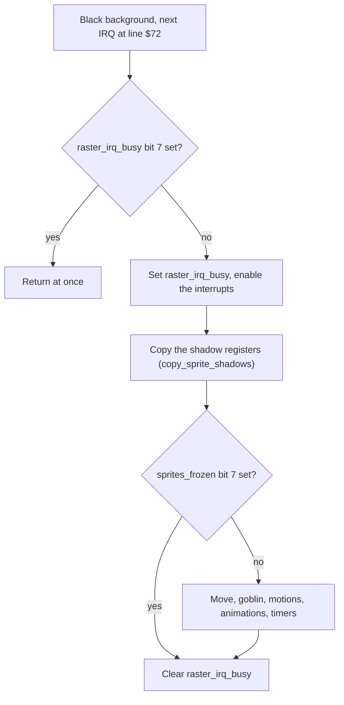
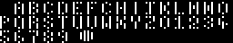

# The graphics of part 2 (V 05 10 87)

The screen of the story game is one multicolour bitmap. The upper part shows the BARBARIAN logo, the energy circles and the scores. Snakes and skulls frame the left side and the right side. The centre shows one of two pictures. One is the throne room with Drax on his throne. The other is the dungeon with Drax and the princess in two windows. The fighters are not hardware sprites. The program draws them into the bitmap in each pass, with the same three colours as the floor. Hardware sprites add small parts: the sprite parts of the poses, the hit sprites, the head, the goblin and the bolts of Drax. A raster interrupt splits the background colour and updates the sprites in each frame. This page tells how these parts work together in build V 05 10 87, and what changed from build V 05 05 87.

**Conventions.**
- Addresses are C64 addresses. Names are the names of the knowledge.
- A *pass* is one run of the main loop. A *frame* is one PAL screen of 312 raster lines, 50 frames each second. A *line* is a raster line, the value of `$D012`.
- A *row* is a text row of the screen (0-24, 8 lines each). A *column* is a cell column (0-39, 4 multicolour pixels).
- The *centre* is rows 7-22, columns 4-35. This part of the picture changes with the scene.
- The *fight area* is rows 14-21, columns 4-35. The program draws the fighters into this part of the bitmap.
- The *work bitmap* is the buffer where the program draws the fighters. The *background copy* is a clean copy of the fight area without the fighters.
- A *shadow register* is a zero-page copy of a VIC-II sprite register. The raster interrupt copies the shadow registers to the VIC-II.
- A *motion* is a list of 4-byte steps that move one sprite. An *animation* is a list of sprite images for one sprite.
- *Pattern colours* are the colours of the reference images: in multicolour, light grey is %01, grey is %10 and yellow is %11.
- *V 05 05 87* is the earlier build (`game_v1`). *V 05 10 87* is this build (`game_v2`).
- **Observed** marks a fact that a run showed. **Code** marks a fact from the code only. **Conclusion** marks an interpretation.

## How it works

The main loop does all the drawing in the bitmap. The raster interrupt does all the sprite work. The two parts share the sprite data through the shadow registers.

1. **The start sets the VIC-II one time.** [`start` `$8009`](../src/init/init.asm#L6) and `restart` select VIC bank 1, the multicolour bitmap mode and the raster interrupt. They also save the first background copy and build two pixel tables. (**Code**)
2. **Each pass draws the fighters again.** [`main_loop` `$80BB`](../src/main/main_loop.asm#L6) copies the background copy into the work bitmap. This step removes the fighters of the last pass. Then it draws both fighters and copies the result into the screen bitmap. (**Code**)
3. **Each pass also draws the status.** The corner animations, the energy circles, the scores, the opponent number and the mode text go directly into the screen bitmap. (**Code**)
4. **Each frame updates the sprites.** [`raster_irq` `$9530`](../src/irq/irq_handler.asm#L42) copies the shadow registers to the VIC-II at line `$FA`. Then it moves the sprites, steps their animations and counts the frame timers. A busy flag prevents a second update while one update runs. (**Code**)

The main loop has no wait for a frame. A pass takes as long as its work. The two copies of the fight area alone take about 42000 cycles. A frame has 19656 cycles, so the copies take more than two frames (**Code**, a cycle count of the two loops). **Conclusion**: the fighters change their pose less than 25 times each second. The sprites move in each frame, independently of the passes. The exact length of a pass is in **Still open**.

## The screen

`start` writes these values (**Code**):

| Register | Value | Effect |
|---|---|---|
| `$01` | `$25` | RAM at `$A000-$BFFF` and `$E000-$FFFF`, I/O at `$D000`. No BASIC and no KERNAL. |
| `$DD00` bits 0-1 | %10 | VIC bank 1, `$4000-$7FFF` |
| `$D018` | `$18` | Screen RAM at `$4400`, bitmap at `$6000` |
| `$D016` | `$18` | Multicolour, 40 columns |
| `$D011` | `$3B` | Bitmap mode, 25 rows, vertical scroll 3 |
| `$D025`, `$D026` | 0, `$0A` | Sprite multicolours black and light red |
| `$D012` | `$FA` | The first raster interrupt at line `$FA` |

The screen never changes its mode. Only the background colour `$D021` changes in each frame (see [the raster interrupt](#the-raster-interrupt-and-the-frame-counters)). (**Code**)

Some graphics data has the same bytes and the same addresses in both builds. This data is the bitmap, the screen RAM, the stores of the second picture, the font, the corner frames and the sprite images. (**Code**, a byte compare of the knowledge) Thus the images of build V 05 05 87 on this page show the same graphics.

### The memory of VIC bank 1 and the stores

| Range | Content |
|---|---|
| `$4000-$43FF` | The last fighter pieces. The VIC never reads them, because each sprite pointer is `$20` or more |
| `$4400-$47E7` | Screen RAM: the colours %01 (high nybble) and %10 (low nybble) of each cell |
| `$47E8-$47F7` | Not used |
| `$47F8-$47FF` | Sprite pointers |
| `$4800-$54BF` | Sprite images `$20-$52`: pose images with a second copy for the other facing, and the images of the animations |
| `$54C0-$5FFF` | Sprite images `$53-$7F`: one copy, mirrored in place when the opponent turns |
| `$6000-$7F3F` | The screen bitmap |
| `$7F40-$7FFF` | Tables of the program. The VIC does not show them |
| `$A69A-$B099` | Work bitmap: 8 rows of 320 bytes |
| `$B09A-$BA99` | Background copy: 8 rows of 320 bytes, only columns 4-35 used |
| `$D000-$DFFF` | The stored centre bitmap of the other picture, in the RAM under the I/O |
| `$E000-$E3E7` | The stored screen RAM of the other picture (the game uses only the centre) |
| `$E400-$E7E7` | The stored colour RAM of the other picture (the game uses only the centre) |
| `$E800-$E937` | Font of the text output |
| `$E980-$ED7F` | Frames of the corner animations |
| `$FC40-$FF7F` | Sprite images of the end of the story |
| `$02AA-$03A9` | Mirror table, built at the start |
| `$03AA-$04A9` | Mask table, built at the start |
| `$04AA-$05C9` | Stores of the two window blocks of the final stage and their colours |
| `$05CA-$0800` | Composition buffer of the fighter pieces |

The work bitmap and the background copy are `$22` bytes higher than in V 05 05 87, because the music before them grew. Their regions in the knowledge cover all 8 rows. (**Code**)

The FLT crack does not take its colours from `$B000-$B3E7` as the RDI and HTL cracks of V 05 05 87 do. Its colour copy reads `$0400-$07E7` before `JMP $8009` (see [the releases page](../../docs/releases.md)). The game uses this area for the mask table, the block stores and the composition buffer. `build_mask_table` and `fill_block_stores` write the first two at the start, and the pose code writes the composition buffer. (**Code**) **Conclusion**: after the colour copy, the game uses this space as work RAM.

### The parts of the screen

The throne room in the demo of build V 05 05 87: Drax on the throne, the princess beside him, one fighter on the floor.

The dungeon in the demo of build V 05 05 87: Drax and the princess in the two right windows, both fighters at the right.

The two images come from build V 05 05 87. They show the same frame around the centre. The logo, the snakes, the skulls and the bottom rows stay the same in both scenes. Only the centre changes. (**Observed** in V 05 05 87, the same picture bytes in V 05 10 87 by **Code**)

| Rows | Columns | Content | Written by |
|---|---|---|---|
| 0-1 | 0-5, 34-39 | Energy circles of fighter 0 and fighter 1 | `show_energy_scores` |
| 0-6 | Other columns | The logo and the top of the frame | No code (part of the picture) |
| 2-5 | 0-3, 36-39 | Snake heads, the corner animations | `animate_corners` |
| 5 | 12-16, 19-20, 23-27 | Score of fighter 0, opponent number, score of fighter 1 | `show_energy_scores`, `show_counter` |
| 7-22 | 4-35 | The centre: throne room or dungeon | `change_scene` |
| 14-21 | 4-35 | The fight area, inside the centre | `show_work_bitmap` |
| 17 | 9-27 | Messages: version, YOUR END HAS COME, THANKS BIG BOY | `print_text` |
| 18 | 10-29 | Second line of the version: WHY DID YOU PRESS ME | `print_text` |
| 24 | 18-21 | Mode text: DEMO, 1PLR or 2PLR | `show_mode_text` |

(**Code**, from the text records and the copy loops)

The bitmap at `$6000` in pattern colours: the throne room, the picture of scene 0.

## The colours

### The fixed colours of the fight area

The program draws the fighters into the bitmap. A multicolour cell has only three colours of its own, so a fighter in a cell must use the colours of that cell. The program solves this problem with fixed colours. [`reset_fight_colours` `$9242`](../src/screen/colours.asm#L33) writes `$C0` into the screen RAM and `$0A` into the colour RAM of the fight area. (**Code**)

| Pixel | Source | Colour in the fight area |
|---|---|---|
| %00 | `$D021` | `$0B` dark grey (lines `$72-$FA`) |
| %01 | Screen RAM, high nybble | `$0C` grey |
| %10 | Screen RAM, low nybble | 0 black |
| %11 | Colour RAM | `$0A` light red |

Each cell of the fight area thus has the same colours. A fighter can stand at each column without a colour clash. The sprite multicolours `$D025` and `$D026` are black and light red too. (**Code**) The fighters in the images of V 05 05 87 show black, grey and light red. The floor and the lower stairs use the same colours (**Observed**). **Conclusion**: the multicolour sprites mix with the fighters in the bitmap without a change of colour.

`reset_fight_colours` runs at the start, at each scene change, after a pause, after the version text and at the quit to the demo. A text in rows 14-21 writes its own colours into these cells. This routine removes them. (**Code**)

### The other colours

[`colour_side_blocks` `$9204`](../src/screen/colours.asm#L6) colours the snake heads in rows 2-5. The left side gets screen RAM `$73` and colour RAM `$0E`: yellow, cyan and light blue. The right side gets `$7D` and `$05`: yellow, light green and green. (**Code**) The left snake is blue and the right snake is green in the images of V 05 05 87 (**Observed**).

No code of the program writes the colour RAM of the other cells at the start. These are rows 0-1, row 6, rows 23-24, the side columns of rows 6-24 and the centre of the first picture. (**Code**) The FLT crack fills the full colour RAM from `$0400-$07E7` before the game starts (see [the releases page](../../docs/releases.md)). The generated loader does not restore the colour RAM, so the default build shows wrong colours (a reported defect of the toolkit). **Conclusion**: the original loader of Palace also filled the colour RAM before the jump to `$8009`. The scene change keeps the colour RAM of the centre of the other picture at `$E400`.

## The scene change

The game has two pictures. Scene 0 is the throne room, the picture in the bitmap at the start. Scene 1 is the dungeon. Its centre is in the stores at `$D000`, `$E000` and `$E400`. `scene_index` gives the picture on the screen. (**Code**)

[`change_scene` `$8E8D`](../src/screen/scene.asm#L6) exchanges the centre of the screen with the stores. It does these steps:

1. It asks the IRQ to fade the volume out, and waits until the volume is 0.
2. It disables the interrupts. It writes black to `$D021` and 0 to `$D015`, so no sprite shows.
3. It toggles `scene_index`.
4. It copies the background copy into the work bitmap and the work bitmap into the screen. This step removes the fighters from the screen.
5. [`save_clear_centre` `$8EC2`](../src/screen/scene.asm#L32) copies the centre of the bitmap into the buffer `$A69A-$B699` and writes 0 into the bitmap. The centre is now black, because %00 shows the black background.
6. `swap_centre_colours` exchanges the screen RAM and the colour RAM of the centre with the stores at `$E11C` and `$E51C`. Then `reset_fight_colours` sets the fixed colours of the fight area again.
7. [`swap_draw_centre` `$8EF5`](../src/screen/scene.asm#L64) exchanges the buffer with the store at `$D000`. Then it copies the buffer into the bitmap, from row 22 up to row 7.
8. It makes a new background copy and copies it into the work bitmap.
9. It asks the IRQ to fade the volume in, and enables the interrupts.

(**Code**)

The store at `$D000` holds the centre in 16 rows of 256 bytes: 32 columns of 8 bytes. The buffer `$A69A-$B699` uses the same form. It covers the work bitmap and the start of the background copy. Steps 4 and 8 make both buffers new, so the overlap does no damage. (**Code**)

The cleared centre hides the old picture before its colours change. The player sees a black centre and then the new picture from the bottom up. **Conclusion**: the order of steps 5 to 7 prevents a frame with the old bitmap in the new colours. A capture of part 1 of build V 05 05 87 shows this order. Part 1 has the same scene change code.

Part 1 of build V 05 05 87 in the scene change: the new picture in the lower half, black in the upper half (**Observed**).

The program calls `change_scene` at the end of each bout in the demo and after each win in a game. It also calls it at the start of the final stage when scene 0 shows. F1 and the quit to the demo call it when scene 1 shows. Thus a new game and the demo always start in the throne room. (**Code**) The recordings of the tests compare `scene_index` at each checkpoint, and the rebuild gives the same values as the original (**Observed**). The bouts and the order of the scenes are on [game_flow.md](game_flow.md).

The final stage changes two more blocks of the bitmap. `swap_block_col13` exchanges the 4 x 4 cells at row 9, column 13 with a store full of `$FF` bytes. `swap_block_col23` does the same at row 9, column 23 at the end of the story. `swap_end_shapes` exchanges 13 sprite images. (**Code**) **Conclusion**: the two blocks are the windows of Drax and the princess in the dungeon, and the swaps empty them. See [final_stage.md](final_stage.md).

## The fight area

### The work bitmap and the background copy

The fighters move over the picture, so the program must restore the picture behind them. It keeps a clean copy of the fight area and draws each pass in a work bitmap. Three routines move the bytes (**Code**):

| Routine | From | To | When |
|---|---|---|---|
| `save_fight_background` | Screen bitmap, rows 14-21 | Background copy | At the start and after a scene change |
| `restore_work_bitmap` | Background copy | Work bitmap | At the start of each pass |
| `show_work_bitmap` | Work bitmap | Screen bitmap, rows 14-21 | After the fighters are in the work bitmap |

Each of the three copies 8 rows of 256 bytes, columns 4-35, in one loop of 256 steps. The rows of the work bitmap and of the background copy are 320 bytes, the width of a full bitmap row. Thus row k of the work bitmap starts at `$A69A` + 320 * k, and its column 4 is at `$A6BA` + 320 * k. [`show_work_bitmap` `$8CC7`](../src/screen/fight_area.asm#L52) copies from [`work_strip0` `$A6BA`](../src/data/work_bitmap.asm#L9) into [`bitmap_arena_row14` `$71A0`](../src/graphics/background_bitmap.asm#L459). (**Code**)

The work bitmap is 40 columns wide, but the screen shows only columns 4-35. A fighter is 9 columns wide. At the walk-in, a fighter starts at column 0 or `$1F`, partly outside the fight area. The draw code writes all 9 columns into the work bitmap, and the copy shows only the visible part. **Conclusion**: the 4 columns at each side are a margin that clips the fighters at the edges of the fight area. The beaten fighter leaves the fight area up to column `$28`. For this fighter, the draw code uses a version that draws only the columns below 40. (**Code**)

The screen bitmap gets the fighters with the background in one copy. The screen never shows the fight area without the fighters. **Conclusion**: this is why the fighters do not flicker, although the program draws them again in each pass.

### Transparent pixels

[`draw_fighter` `$8B73`](../src/fighter/draw.asm#L6) writes the pose image of a fighter into the work bitmap. Pixel pairs %00 of the image are transparent. The mask table at `$03AA` gives the mask for each byte. [`build_mask_table` `$818C`](../src/graphics/pixel_tables.asm#L26) builds it at the start: each pixel pair %00 gives %11, each other pair gives %00. The draw code then writes (background AND mask) OR image. (**Code**)

[`build_mirror_table` `$8173`](../src/graphics/pixel_tables.asm#L6) builds the mirror table at `$02AA`. Each entry is its index with the four pixel pairs in the opposite order. The pose image and the shared sprite images use it for a fighter that looks to the left. (**Code**)

| Byte | Pixel pairs | Mask entry | Mirror entry |
|---|---|---|---|
| `$1B` | %00 %01 %10 %11 | `$C0` (%11 %00 %00 %00) | `$E4` (%11 %10 %01 %00) |
| `$A0` | %10 %10 %00 %00 | `$0F` | `$0A` |
| `$00` | %00 %00 %00 %00 | `$FF` | `$00` |

The poses, the fighter pieces and the pose image are on [fighters.md](fighters.md).

## The corner animations

The snake head in each top corner moves when its fighter loses energy. Each corner is a block of 4 x 4 cells in rows 2-5: columns 0-3 for fighter 0 and columns 36-39 for fighter 1. [`animate_corners` `$81B4`](../src/screen/corner_anim.asm#L6) runs in each pass. It steps the animation of each fighter with bit 7 set in `corner_anim`. (**Code**)

An animation record starts with 4 bytes: column, row, width and height in cells. Then 2-byte words follow, from offset 4. A word of 4 or more is the address of a frame. [`draw_corner_frame` `$824D`](../src/screen/corner_anim.asm#L103) copies the 128 bytes of the frame into the bitmap, one frame in each pass. A word below 4 is a command (**Code**):

| Word | Meaning |
|---|---|
| 0 | Start the list again at offset 4 |
| 1 | Continue at the offset in the next byte, plus 4 |
| 2 | Start the animation in the next byte |
| 3 | Stop the animation |

| Animation | Corner | Frames | Then |
|---|---|---|---|
| 0 | Left | `$EB80` | Animation 2 |
| 1 | Right | `$E980` | Animation 3 |
| 2 | Left | `$EC00`, `$EC80`, `$ED00`, `$ED00`, `$EC80`, `$EC00`, `$EB80` | Stop |
| 3 | Right | `$EA00`, `$EA80`, `$EB00`, `$EB00`, `$EA80`, `$EA00`, `$E980` | Stop |

`reset_fighter` starts animation 0 or 1 at the start of each bout. A hit with damage starts animation 2 or 3 for the fighter that gets the hit, if no animation runs. The start comes before the energy test, so it also comes for a fighter with 0 energy. Thus each corner plays its frames forward and back one time, and stops on its first frame. Commands 0 and 1 are in the code, but no record uses them. (**Code**)

The 8 corner frames in pattern colours, each one 4 x 4 cells in the order of the bytes.

The code of `animate_corner` reads byte 0 through `times8_table` as the column and byte 1 through `bitmap_row_addr` as the row. The records hold column 0 or `$24` and row 2. (**Code**)

## The sprites

### The shadow registers

The main loop and the interrupt both change the sprites. The main loop writes only the shadow registers. [`copy_sprite_shadows` `$98FA`](../src/sprites/sprite_shadow.asm#L6) copies them to the VIC-II at line `$FA` of each frame (**Code**):

| Shadow | Address | Bytes | VIC-II register |
|---|---|---|---|
| `sprite_xy_shadow` | `$02-$11` | X and Y of sprites 0-7 | `$D000-$D00F` |
| `sprite_x_msb_shadow` | `$12` | X bit 8 of each sprite | `$D010` |
| `sprite_enable_shadow` | `$17` | Enable bits | `$D015` |
| `sprite_colour_shadow` | `$29-$30` | Colour of sprites 0-7 | `$D027-$D02E` |
| `sprite_pointer_shadow` | `$4A-$51` | Pointers of sprites 0-7 | `$47F8-$47FF` |

The VIC thus gets all values of a frame at the same time, at the bottom of the screen. `draw_fighter_sprites` and `spawn_hit_sprite` disable the interrupts while they write. **Conclusion**: the IRQ never copies half of the sprite set of a pass. The multicolour bits and the expansion bits have no shadow. The code writes them directly into `$D01C`, `$D01D` and `$D017`.

### Which sprite shows what

| Sprites | Use | Set by |
|---|---|---|
| From 7 down | The sprite parts of the poses, fighter 1 first | `draw_fighter_sprites`, each pass |
| First slot without an animation, from 0 up | Hit flashes and other hit sprites | `spawn_hit_sprite` |
| 0-2 | The head and two more sprites at a decapitation | `check_decapitation` |
| 3, 4 | The goblin | `start_goblin`, `update_goblin` |
| 4 | The bolt of Drax in the final stage | `final_stage_attack` |
| 0-3 | The figures of the end of the story | `set_end_figure` |

(**Code**) [`draw_fighter_sprites` `$8FE6`](../src/sprites/fighter_sprites.asm#L6) reads the sprite entries of the pose of each fighter. An entry gives the image, the colour, Y and an X offset. A colour byte with bit 7 set gives a multicolour sprite in its own colour. Another colour byte gives a hires sprite in the colour of `fighter_colours` for the opponent. After the two fighters, the routine disables each lower sprite that has no running animation. (**Code**) The details of the sprite parts are on [fighters.md](fighters.md), and the hit sprites on [combat.md](combat.md).

The pose images below `$53` have a second copy for the other facing, `$0D` images higher. The images `$53-$7F` have one copy. When the opponent turns, [`mirror_shared_sprites` `$8CFD`](../src/sprites/mirror_shared.asm#L6) mirrors all 45 of them in place, through the mirror table. (**Code**)

The sprite images `$20-$52` in pattern colours. The goblin is in the last two lines.

### Motions

[`run_sprite_scripts` `$9815`](../src/sprites/sprite_script.asm#L6) runs the motion of each sprite with bit 7 set in `sprite_path`. [`motion_ptrs` `$CD34`](../src/sprites/sprite_motions.asm#L6) points to the 12 motions. A step has 4 bytes (**Code**):

| Byte | Meaning |
|---|---|
| 0 | Directions: bit 0 up, bit 1 down, bit 2 left, bit 3 right |
| 1 | Speeds in pixels for each frame: high nybble X, low nybble Y |
| 2 | Frames of the step |
| 3 | Command at the end of the step |

| Command | Meaning |
|---|---|
| 0 | Read the next step |
| 1 | The next two bytes: a new motion and a new animation |
| 2 | The next byte: a new motion |
| 3 | The next byte: go to step n |
| 4 | Stop the motion and the animation, and disable the sprite |
| Other | The next byte is a sound request for voice 1, then the next step |

[`move_sprites` `$958A`](../src/sprites/sprite_move.asm#L6) then moves each sprite by its direction bits and speeds. Y stays between `$32` and `$E5`. A sprite that moves left of X `$38` or right of X `$12C` stops, and the code disables it. Only motion 5 continues to the right of the edge. (**Code**)

Motion `$0B` is one of the two paths of the bolt of Drax. Its bytes are `$06,$44,$08,$00` and `$04,$40,$38,$04`. The bolt moves down and left by 4 pixels for 8 frames. Then it moves left by 4 pixels for 56 frames and stops. Motion `$0A` moves left by 4 pixels for 64 frames, without the step down. (**Code**) The paths of the bolt are on [final_stage.md](final_stage.md).

### Animations

[`animate_sprites` `$9742`](../src/sprites/sprite_anim.asm#L6) runs the animation of each sprite with bit 7 set in `sprite_anim`, and enables that sprite. [`sprite_anim_ptrs` `$CC39`](../src/sprites/sprite_anims.asm#L6) points to 22 animations. An animation has this layout (**Code**):

| Byte | Meaning |
|---|---|
| 0 | Frames for each image |
| 1 | Bit 7 multicolour, bit 6 double width, bit 5 double height, bits 0-3 colour |
| 2 and more | Image numbers. The pointer is the number plus `$20` |
| `$FF`, 0 | Start again at byte 2 |
| `$FF`, 1 | Stop the animation and disable the sprite |
| `$FF`, 2, n | Continue at byte n + 2 |
| `$FF`, n | Start animation n |

No animation sets bit 6 or bit 5. Entries 4 and 5 of the pointer table both point to `sprite_anim_04`. A second copy of its 5 bytes follows it, and no pointer points to the copy. (**Code**)

## The raster interrupt and the frame counters

The KERNAL ROM is off, so the CPU reads the vectors at `$FFFA-$FFFF` from RAM. The start writes the IRQ vector `$94FE` and the NMI vector `$952F`. [`nmi_handler` `$952F`](../src/irq/irq_handler.asm#L39) is one RTI byte, so the RESTORE key does nothing. (**Code**)

[`irq_handler` `$94FE`](../src/irq/irq_handler.asm#L6) serves three sources. It calls the raster routine when the VIC flags the raster interrupt. Then it reads `$DC0D` and calls the sound routines for CIA 1 timer B and timer A. The timers count `$5161` and `$2710` cycles. The sound is on [sound.md](sound.md). (**Code**)

The raster routine has two states. The value of `$D012` selects the state.

| State | Condition | Next state | Code |
|---|---|---|---|
| Line `$72` | `$D011` bit 7 is 0 and `$D012` is below `$FA` | Line `$FA` | `raster_irq` |
| Line `$FA` | `$D011` bit 7 is 1 or `$D012` is `$FA` or more | Line `$72` | `raster_irq_bottom` |

1. **Line `$72`.** It writes `scene_top_colour` of the scene into `$D021`. Both entries are `$0B`, dark grey, so the two scenes have the same colour. (**Code**)
2. **Line `$FA`.** It writes 0 (black) into `$D021` and sets line `$72` as the next interrupt. Then it does the sprite update of the next section. (**Code**)

The %00 pixels of rows 0-7 are thus black, and the %00 pixels of rows 8-24 are dark grey. The logo, the energy circles and the scores show on black. (**Code**, **Observed** in the images of V 05 05 87) The code writes `scene_top_colour` at line `$72` and black at line `$FA`. Thus, in spite of its name, this colour is the colour of the lower screen. (**Code**)

### The sprite update at line $FA

[`raster_irq_bottom` `$954F`](../src/irq/irq_handler.asm#L57) has two tests that build V 05 05 87 does not have in this form.

1. **The busy flag.** The routine enables the interrupts with CLI before the update, so a CIA interrupt of the sound can run. The routine sets bit 7 of [`raster_irq_busy` `$CE`](../src/constants.asm#L115) during the update. A second raster interrupt at line `$FA` in this time returns at once. `init_game_state` clears the flag. (**Code**)
2. **The frozen sprites.** When bit 7 of `sprites_frozen` is 1, the routine stops after the copy of the shadows. [`read_keys` `$93A7`](../src/input/keyboard.asm#L6) writes `$80` at F5 (pause) and while CTRL+V shows the version text. It writes 0 when the pause or the version text ends. (**Code**)
3. **The update.** Otherwise it calls `move_sprites`, `update_goblin`, `run_sprite_scripts`, `animate_sprites` and `count_down_timers`. Then it clears the busy flag. (**Code**)

**Conclusion**: during a pause, the hit sprites, the goblin and the bolts stop, and the bout clock stops too. The main loop stops in the pause, so the fighters also stop. Without the busy flag, a slow update can start a second update inside the first one.

### The frame counters

[`count_down_timers` `$9919`](../src/irq/timers.asm#L6) counts three timers in each frame (**Code**):

- `fighter_idle_timer` of each fighter counts down to 0. The idle move of a player uses it.
- `time_frame_count` counts 50 frames. Then `time_left` decreases by one second. The bout clock starts at 90 seconds. The clock stops during the walk-in, a time out and the end of a bout.
- `wait_counter` counts down to 0. [`wait_frames` `$85FD`](../src/main/wait_frames.asm#L6) waits on it, for example 200 frames before the demo starts again after a lost game.

The three timers stop while bit 7 of `sprites_frozen` is 1, because the IRQ does not call `count_down_timers` then. (**Code**)

The random counter [`ai_random` `$CD`](../src/constants.asm#L114) is not a frame counter. The AI code increments it once for each computer fighter in each pass. **Conclusion**: its rate depends on the length of the pass. See [ai.md](ai.md).

## The text output

[`print_text` `$92EB`](../src/text/print_text.asm#L6) draws text n into the bitmap when A is `$80` + n. `text_ptrs` holds 24 text pointers. A text is a list of records (**Code**):

| Byte | Meaning |
|---|---|
| 0 | Column |
| 1 | Row |
| 2 | Colour: high nybble to the screen RAM (%01), low nybble to the colour RAM (%11) |
| 3 and more | Characters: `$41-$5A` are A-Z, and `text_special_chars` gives 0-9, space, "(" and ")" |
| `$0D` | A new record: column, row and colour follow |
| Other | End of the text. The texts end with `$24` |

The font at `$E800` has 39 glyphs of 8 bytes: space, A-Z, 0-9, "(" and ")". [`get_glyph_ptr` `$938D`](../src/text/print_text.asm#L99) gives the address `$E800` + 8 * n. The glyphs use only the pixel values %00 and %10. The printer changes each byte: a pixel pair with bit 1 set gives %11, another pair gives %01. Thus a letter shows in the colour RAM colour on the screen RAM colour. (**Code**)

The font: space and A-Z, then 0-9, "(" and ")".

The printer writes directly into the screen bitmap. The texts of the status run in each pass: the energy circles, both scores, the opponent number and the mode text. The energy circles are text `$8B` + energy. Each "(" or ")" is half of a circle, so 12 energy show as 6 circles in 2 rows. `show_energy_scores` writes the column of the fighter into the record before it prints. (**Code**)

The messages in rows 17 and 18 are in the fight area. The next pass removes their pixels with the copy of the work bitmap. Thus a message stays only while the main loop does not run. (**Code**)

- **The version text.** [`text_version` `$BAD1`](../src/text/texts.asm#L17) has two records. The first gives "V 05 10 87" at column 15, row 17. The second gives "WHY DID YOU PRESS ME" at column 10, row 18. Both use the colour `$B1`: white letters on dark grey. CTRL+V prints the text in a loop while V stays pressed, and the sprites stay frozen. (**Code**)
- **The story messages.** YOUR END HAS COME and THANKS BIG BOY come before a wait of 200 or 250 frames. Then the quit to the demo calls `reset_fight_colours`, which removes the colours of the message. (**Code**)
- **No caller.** Text 5, PAUSED, and text 0, "000", have no caller (**Code**).

### Worked example: DEMO

[`text_demo` `$BB07`](../src/text/texts.asm#L28) holds `$12,$18,$C3,$44,$45,$4D,$4F,$24`. The record is column 18, row 24 and colour `$C3`. Then come D, E, M and O, and `$24` ends the text.

1. The bitmap address is `bitmap_row_addr` entry 24 plus `times8_table` entry 18: `$7E00` + `$90` = `$7E90`.
2. The screen RAM address is `$4400` + 960 + 18 = `$47D2`. It gets `$C0`, so %01 is grey (`$0C`).
3. The colour RAM address is `$47D2` + `$9400` = `$DBD2`. It gets `$03`, so %11 is cyan.
4. D is `$44`. `$44` AND `$3F` is 4, so the glyph is at `$E800` + 32 = `$E820`.

| Line | Font byte | Pixel pairs | Bitmap byte | Pixels |
|---|---|---|---|---|
| 0 | `$00` | %00 %00 %00 %00 | `$55` | grey x 4 |
| 1 | `$A0` | %10 %10 %00 %00 | `$F5` | cyan, cyan, grey, grey |
| 2-6 | `$88` | %10 %00 %10 %00 | `$DD` | cyan, grey, cyan, grey |
| 7 | `$A0` | %10 %10 %00 %00 | `$F5` | cyan, cyan, grey, grey |

The bytes go to `$7E90-$7E97`. E, M and O follow at `$7E98`, `$7EA0` and `$7EA8`, in columns 19-21. (**Code**)

## Changes from V 05 05 87

The graphics data and most of the graphics code are the same in both builds. These changes touch the graphics (**Code**). The full list is on [the versions page](../../docs/versions.md).

| Change | V 05 05 87 | V 05 10 87 |
|---|---|---|
| Busy flag of the raster IRQ | none | `raster_irq_busy` (`$CE`) stops a second sprite update |
| Frozen sprites | F5 writes the set-up flag (0), the IRQ tests BNE | F5 and CTRL+V write `$80`, the IRQ tests BMI |
| Sprites, goblin, bolts and clock during a pause | continue | stop |
| Version text | one line in row 17 | a second line in row 18 |
| Work bitmap and background copy | `$A678`, `$B078` | `$A69A`, `$B09A` |
| IRQ and NMI vectors | `$94E8`, `$9519` | `$94FE`, `$952F` |
| Bout clock | 60 seconds | 90 seconds |

The music variables of V 05 05 87 at `$CE-$EC` moved up by 1 to make space for the busy flag. The sprite variables and the shadow registers have the same addresses in both builds. (**Code**)

## Still open

- How many frames does a pass of the main loop take in a bout? Count the frames between two stops at `main_loop` during the fight recording of this project.
- Does the busy flag ever stop a second sprite update? Count the returns at the busy test of `raster_irq_bottom` in a full demo.
- On which line does the background colour change near line `$72`? The IRQ needs some cycles before its write to `$D021`, and line `$73` is a bad line. Stop at the write and read `$D012`.
- [`hide_sprites_0_to_4` `$8604`](../src/sprites/hide_sprites.asm#L6) writes 0 into `sprite_anim` and `sprite_path` of sprite 4 only. For sprites 3-0, it writes the new value of `sprite_enable_shadow`. When sprite 7 is on, bit 7 of these values is 1, and an animation and a motion can start. Does this show at the end of the story? Watch `sprite_anim` after `check_final_goal` in the final_win recording.
- Can a hit sprite and a sprite part of a fighter use the same slot? The hit sprite takes the first slot without an animation from 0 up. The fighters take slots from 7 down. Watch `sprite_slot` in a pass with many sprite parts.
