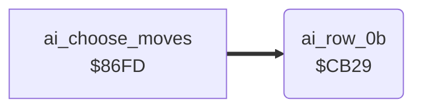

<!-- Generated by c64-docs from knowledge revision 20261025T232349.314-0mcm7w and .c64-re-tools/local/generated/src/source-map.json. Do not edit: change the knowledge, generate the source again, then run docs.ts generate. -->
# ai/ai_tables.asm: Tables of the computer opponent

Range `$C8E3-$CC38`. Source: [ai/ai_tables.asm](../../../../src/ai/ai_tables.asm). Index: [the reference](../../index.md).

## Routines

| Routine | Address | Reached from | Summary |
|---|---|---|---|
| [`ai_row_0b`](ai_tables.md#ai_row_0b) | `$CB29` | [`ai_choose_moves`](computer_moves.md#ai_choose_moves) |  |

## Data

| Range | Type | Name | Read by | Written by |
|---|---|---|---|---|
| [`$C8E3`](../../../../src/ai/ai_tables.asm#L7)-`$C8F2` | addresses | [`ai_column_ptrs`](../../../../src/ai/ai_tables.asm#L6) | [`ai_choose_moves`](computer_moves.md#ai_choose_moves) |  |
| [`$C8F3`](../../../../src/ai/ai_tables.asm#L11)-`$C9F2` | bytes of 32 | [`ai_columns_0`](../../../../src/ai/ai_tables.asm#L10) |  |  |
| [`$C9F3`](../../../../src/ai/ai_tables.asm#L52)-`$CA1A` | bytes | [`distance_bands`](../../../../src/ai/ai_tables.asm#L51) | [`ai_choose_moves`](computer_moves.md#ai_choose_moves) |  |
| [`$CA1B`](../../../../src/ai/ai_tables.asm#L57)-`$CAD0` | addresses | [`ai_row_ptrs`](../../../../src/ai/ai_tables.asm#L56) | [`ai_choose_moves`](computer_moves.md#ai_choose_moves) |  |
| [`$CAD1`](../../../../src/ai/ai_tables.asm#L82)-`$CB80` | bytes of 8 | [`ai_row_00`](../../../../src/ai/ai_tables.asm#L81) |  |  |
| [`$CB81`](../../../../src/ai/ai_tables.asm#L130)-`$CC38` | bytes of 8 | [`ai_joystick_rows`](../../../../src/ai/ai_tables.asm#L129) |  |  |

## Call graph

A solid arrow is a call, a thick arrow a table entry. Rounded nodes are in this file.

## Details

### [`ai_column_ptrs`](../../../../src/ai/ai_tables.asm#L6) `$C8E3-$C8F2`

*data*

Pointers to the AI column table of each level in $be (8 entries).

- **Read by:** [`ai_choose_moves`](computer_moves.md#ai_choose_moves)

### [`ai_columns_0`](../../../../src/ai/ai_tables.asm#L10) `$C8F3-$C912`

*data*

AI column tables, 32 bytes each. A random number (0-31) selects a column (0-7) of the AI joystick row.

- **Entry of:** [`ai_column_ptrs`](../../tables.md#ai_column_ptrs)

### [`ai_columns_1`](../../../../src/ai/ai_tables.asm#L15) `$C913-$C932`

*data*

- **Entry of:** [`ai_column_ptrs`](../../tables.md#ai_column_ptrs)

### [`ai_columns_2`](../../../../src/ai/ai_tables.asm#L20) `$C933-$C952`

*data*

- **Entry of:** [`ai_column_ptrs`](../../tables.md#ai_column_ptrs)

### [`ai_columns_3`](../../../../src/ai/ai_tables.asm#L25) `$C953-$C972`

*data*

- **Entry of:** [`ai_column_ptrs`](../../tables.md#ai_column_ptrs)

### [`ai_columns_4`](../../../../src/ai/ai_tables.asm#L30) `$C973-$C992`

*data*

- **Entry of:** [`ai_column_ptrs`](../../tables.md#ai_column_ptrs)

### [`ai_columns_5`](../../../../src/ai/ai_tables.asm#L35) `$C993-$C9B2`

*data*

- **Entry of:** [`ai_column_ptrs`](../../tables.md#ai_column_ptrs)

### [`ai_columns_6`](../../../../src/ai/ai_tables.asm#L40) `$C9B3-$C9D2`

*data*

- **Entry of:** [`ai_column_ptrs`](../../tables.md#ai_column_ptrs)

### [`ai_columns_7`](../../../../src/ai/ai_tables.asm#L45) `$C9D3-$C9F2`

*data*

- **Entry of:** [`ai_column_ptrs`](../../tables.md#ai_column_ptrs)

### [`distance_bands`](../../../../src/ai/ai_tables.asm#L51) `$C9F3-$CA1A`

*data*

Distance band (0-7) for each distance between the fighters in $aa (0-39).

- **Read by:** [`ai_choose_moves`](computer_moves.md#ai_choose_moves)

### [`ai_row_ptrs`](../../../../src/ai/ai_tables.asm#L56) `$CA1B-$CAD0`

*data*

Pointers to the AI row of each pose $00-$5a of the other fighter. Entries $1b and $1f point to ai_row_15. Build V 05 05 87 points them to ai_row_02 and ai_row_0b.

- **Read by:** [`ai_choose_moves`](computer_moves.md#ai_choose_moves)

### [`ai_row_00`](../../../../src/ai/ai_tables.asm#L81) `$CAD1-$CAD8`

*data*

AI rows, 8 bytes each: one byte for each distance band. The byte selects an AI joystick row.

- **Entry of:** [`ai_row_ptrs`](../../tables.md#ai_row_ptrs)

### [`ai_row_01`](../../../../src/ai/ai_tables.asm#L84) `$CAD9-$CAE0`

*data*

Byte 0 selects AI joystick row $16. Build V 05 05 87 has $13.

- **Entry of:** [`ai_row_ptrs`](../../tables.md#ai_row_ptrs)

### [`ai_row_02`](../../../../src/ai/ai_tables.asm#L86) `$CAE1-$CAE8`

*data*

- **Entry of:** [`ai_row_ptrs`](../../tables.md#ai_row_ptrs)

### [`ai_row_03`](../../../../src/ai/ai_tables.asm#L88) `$CAE9-$CAF0`

*data*

- **Entry of:** [`ai_row_ptrs`](../../tables.md#ai_row_ptrs)

### [`ai_row_04`](../../../../src/ai/ai_tables.asm#L90) `$CAF1-$CAF8`

*data*

- **Entry of:** [`ai_row_ptrs`](../../tables.md#ai_row_ptrs)

### [`ai_row_05`](../../../../src/ai/ai_tables.asm#L92) `$CAF9-$CB00`

*data*

- **Entry of:** [`ai_row_ptrs`](../../tables.md#ai_row_ptrs)

### [`ai_row_06`](../../../../src/ai/ai_tables.asm#L94) `$CB01-$CB08`

*data*

- **Entry of:** [`ai_row_ptrs`](../../tables.md#ai_row_ptrs)

### [`ai_row_07`](../../../../src/ai/ai_tables.asm#L96) `$CB09-$CB10`

*data*

- **Entry of:** [`ai_row_ptrs`](../../tables.md#ai_row_ptrs)

### [`ai_row_08`](../../../../src/ai/ai_tables.asm#L98) `$CB11-$CB18`

*data*

- **Entry of:** [`ai_row_ptrs`](../../tables.md#ai_row_ptrs)

### [`ai_row_09`](../../../../src/ai/ai_tables.asm#L100) `$CB19-$CB20`

*data*

- **Entry of:** [`ai_row_ptrs`](../../tables.md#ai_row_ptrs)

### [`ai_row_0a`](../../../../src/ai/ai_tables.asm#L103) `$CB21-$CB28`

*data*

Row $0a. No entry of ai_row_ptrs points to this row.

### [`ai_row_0b`](../../../../src/ai/ai_tables.asm#L105) `$CB29`

*label*

- **Entry of:** [`ai_row_ptrs`](../../tables.md#ai_row_ptrs)

### [`ai_row_0c`](../../../../src/ai/ai_tables.asm#L107) `$CB31-$CB38`

*data*

- **Entry of:** [`ai_row_ptrs`](../../tables.md#ai_row_ptrs)

### [`ai_row_0d`](../../../../src/ai/ai_tables.asm#L109) `$CB39-$CB40`

*data*

- **Entry of:** [`ai_row_ptrs`](../../tables.md#ai_row_ptrs)

### [`ai_row_0e`](../../../../src/ai/ai_tables.asm#L111) `$CB41-$CB48`

*data*

- **Entry of:** [`ai_row_ptrs`](../../tables.md#ai_row_ptrs)

### [`ai_row_0f`](../../../../src/ai/ai_tables.asm#L113) `$CB49-$CB50`

*data*

- **Entry of:** [`ai_row_ptrs`](../../tables.md#ai_row_ptrs)

### [`ai_row_10`](../../../../src/ai/ai_tables.asm#L115) `$CB51-$CB58`

*data*

- **Entry of:** [`ai_row_ptrs`](../../tables.md#ai_row_ptrs)

### [`ai_row_11`](../../../../src/ai/ai_tables.asm#L117) `$CB59-$CB68`

*data*

- **Entry of:** [`ai_row_ptrs`](../../tables.md#ai_row_ptrs)

### [`ai_row_13`](../../../../src/ai/ai_tables.asm#L121) `$CB69-$CB70`

*data*

- **Entry of:** [`ai_row_ptrs`](../../tables.md#ai_row_ptrs)

### [`ai_row_14`](../../../../src/ai/ai_tables.asm#L123) `$CB71-$CB78`

*data*

- **Entry of:** [`ai_row_ptrs`](../../tables.md#ai_row_ptrs)

### [`ai_row_15`](../../../../src/ai/ai_tables.asm#L126) `$CB79-$CB80`

*data*

Not in build V 05 05 87: a new AI row. Entries $1b and $1f of ai_row_ptrs point here.

- **Entry of:** [`ai_row_ptrs`](../../tables.md#ai_row_ptrs)

### [`ai_joystick_rows`](../../../../src/ai/ai_tables.asm#L129) `$CB81-$CC30`

*data*

AI joystick rows, 8 bytes each (23 rows). $86fd reads row n at $cb81+8n. Each byte is a joystick value: bits 0-3 up, down, left, right, bit 4 fire.

### [`ai_joystick_row_22`](../../../../src/ai/ai_tables.asm#L155) `$CC31-$CC38`

*data*

Not in build V 05 05 87: joystick row 22. Byte 0 of ai_row_01 selects it.
