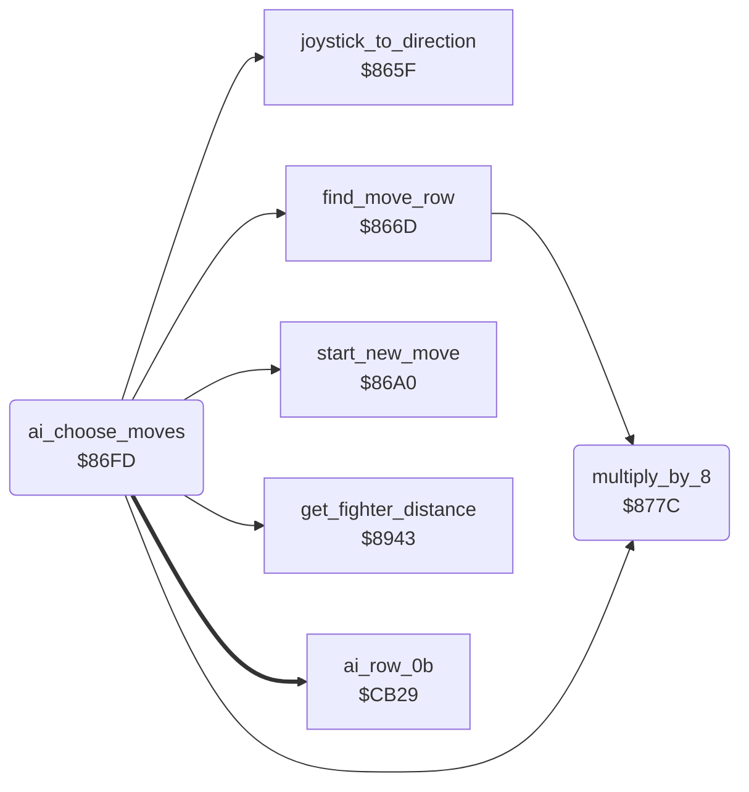

<!-- Generated by c64-docs from knowledge revision 20261029T165720.160-p83xh1 and .c64-re-tools/local/generated/src/source-map.json. Do not edit: change the knowledge, generate the source again, then run docs.ts generate. -->
# ai/computer_moves.asm: Move choice of the computer fighter

Range `$86FD-$878B`. Source: [ai/computer_moves.asm](../../../../src/ai/computer_moves.asm). Index: [the reference](../../index.md).

## Routines

| Routine | Address | Reached from | Summary |
|---|---|---|---|
| [`ai_choose_moves`](computer_moves.md#ai_choose_moves) | `$86FD` | [`$80CD`](../../../../src/main/main_loop.asm#L13) | Gives a joystick value to each fighter that the computer controls. |
| [`multiply_by_8`](computer_moves.md#multiply_by_8) | `$877C` | [`find_move_row`](../input/joystick.md#find_move_row), [`ai_choose_moves`](computer_moves.md#ai_choose_moves) | Multiplies A by 8. |

## Call graph

A solid arrow is a call, a thick arrow a table entry. Rounded nodes are in this file.

## Details

### [`ai_choose_moves`](../../../../src/ai/computer_moves.asm#L6) `$86FD`

*routine*

Gives a joystick value to each fighter that the computer controls. The value comes from the pose of the other fighter, the distance and a random column. It does nothing in a two-player game. It also does nothing when $af, $b2, $b4, $b5, $ba or $bb has bit 7 set. Demo ($b3 = 1): both fighters. One-player game: only fighter 1.

- **Called from:** [`$80CD`](../../../../src/main/main_loop.asm#L13)
- **Calls:** [`get_fighter_distance`](../combat/hits.md#get_fighter_distance), [`multiply_by_8`](computer_moves.md#multiply_by_8), [`joystick_to_direction`](../input/joystick.md#joystick_to_direction), [`find_move_row`](../input/joystick.md#find_move_row), [`start_new_move`](../input/joystick.md#start_new_move)
- **Reads:** [`turn_request`](../../memory-map.md#turn_request), [`bout_loser`](../../memory-map.md#bout_loser), [`walk_in_active`](../../memory-map.md#walk_in_active), [`setup_active`](../../memory-map.md#setup_active), [`time_out_active`](../../memory-map.md#time_out_active), [`final_stage`](../../memory-map.md#final_stage), [`opponent_index`](../../memory-map.md#opponent_index), [`ai_column_ptrs`](ai_tables.md#ai_column_ptrs), [`demo_mode`](../../memory-map.md#demo_mode), [`two_players`](../../memory-map.md#two_players), [`fighter_pose`](../../memory-map.md#fighter_pose), [`ai_row_ptrs`](ai_tables.md#ai_row_ptrs) and 8 more
- **Writes:** [`ai_level_ptr`](../../memory-map.md#ai_level_ptr), [`cur_fighter`](../../memory-map.md#cur_fighter), [`move_ptr`](../../memory-map.md#move_ptr), [`direction_table_ptr`](../../memory-map.md#direction_table_ptr), [`ai_random`](../../memory-map.md#ai_random)
- **Refers to:** [`ai_level_ptr`](../../memory-map.md#ai_level_ptr), [`move_ptr`](../../memory-map.md#move_ptr), [`direction_table_ptr`](../../memory-map.md#direction_table_ptr)

| Label | Address | Comment |
|---|---|---|
| [`ai_choose_loop`](../../../../src/ai/computer_moves.asm#L25) | `$8721` |  |
| [`ai_choose_pick`](../../../../src/ai/computer_moves.asm#L57) | `$8763` | Column 0-7 from the level table at a random position 0-31. |
| [`ai_choose_done`](../../../../src/ai/computer_moves.asm#L70) | `$877B` |  |

### [`multiply_by_8`](../../../../src/ai/computer_moves.asm#L73) `$877C`

*routine*

Multiplies A by 8. Output: low byte in A, high byte in $88, carry clear for A < $20.

- **Called from:** [`find_move_row`](../input/joystick.md#find_move_row), [`ai_choose_moves`](computer_moves.md#ai_choose_moves)
- **Reads:** [`move_ptr`](../../memory-map.md#move_ptr)
- **Writes:** [`move_ptr`](../../memory-map.md#move_ptr)
- **Refers to:** [`move_ptr`](../../memory-map.md#move_ptr)
