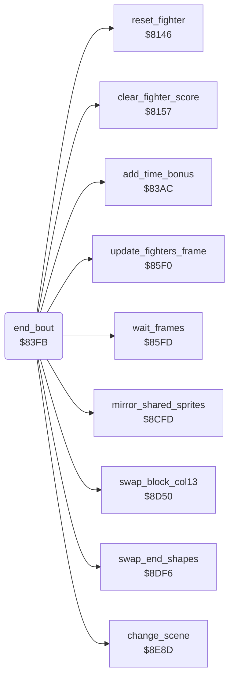

<!-- Generated by c64-docs from knowledge revision 20261025T232349.314-0mcm7w and .c64-re-tools/local/generated/src/source-map.json. Do not edit: change the knowledge, generate the source again, then run docs.ts generate. -->
# combat/end_of_bout.asm: End of a bout and the next opponent

Range `$83FB-$84B5`. Source: [combat/end_of_bout.asm](../../../../src/combat/end_of_bout.asm). Index: [the reference](../../index.md).

## Routines

| Routine | Address | Reached from | Summary |
|---|---|---|---|
| [`end_bout`](end_of_bout.md#end_bout) | `$83FB` | [`$80F4`](../../../../src/main/main_loop.asm#L26) | After a kill, waits until the loser is at X $28 or more. |

## Call graph

A solid arrow is a call, a thick arrow a table entry. Rounded nodes are in this file.

## Details

### [`end_bout`](../../../../src/combat/end_of_bout.asm#L6) `$83FB`

*routine*

After a kill, waits until the loser is at X $28 or more. Then the winner turns and walks back to its start position.

- **Called from:** [`$80F4`](../../../../src/main/main_loop.asm#L26)
- **Calls:** [`reset_fighter`](../fighter/fighter_init.md#reset_fighter), [`clear_fighter_score`](../fighter/fighter_init.md#clear_fighter_score), [`add_time_bonus`](../score/time_bonus.md#add_time_bonus), [`wait_frames`](../main/wait_frames.md#wait_frames), [`change_scene`](../screen/scene.md#change_scene), [`mirror_shared_sprites`](../sprites/mirror_shared.md#mirror_shared_sprites), [`update_fighters_frame`](../story/final_stage.md#update_fighters_frame), [`swap_block_col13`](../story/end_swaps.md#swap_block_col13), [`swap_end_shapes`](../story/end_swaps.md#swap_end_shapes)
- **Jumps to:** [`quit_to_demo`](../main/quit_to_demo.md#quit_to_demo)
- **Reads:** [`bout_loser`](../../memory-map.md#bout_loser), [`fighter_x`](../../memory-map.md#fighter_x), [`fighter_facing`](../../memory-map.md#fighter_facing), [`cur_fighter`](../../memory-map.md#cur_fighter), [`fighter_home_column`](../data/fighter_constants.md#fighter_home_column), [`fighter_move`](../../memory-map.md#fighter_move), [`fighter_start_column`](../data/fighter_constants.md#fighter_start_column), [`demo_mode`](../../memory-map.md#demo_mode), [`sprite_mirror_state`](../../memory-map.md#sprite_mirror_state), [`two_players`](../../memory-map.md#two_players), [`opponent_index`](../../memory-map.md#opponent_index), [`scene_index`](../../memory-map.md#scene_index)
- **Writes:** [`cur_fighter`](../../memory-map.md#cur_fighter), [`fighter_move`](../../memory-map.md#fighter_move), [`fighter_move_step`](../../memory-map.md#fighter_move_step), [`fighter_x`](../../memory-map.md#fighter_x), [`fighter_facing`](../../memory-map.md#fighter_facing), [`walk_in_active`](../../memory-map.md#walk_in_active), [`bout_loser`](../../memory-map.md#bout_loser), [`goblin_active`](../../memory-map.md#goblin_active), [`goblin_drags`](../../memory-map.md#goblin_drags), [`sprite_mirror_state`](../../memory-map.md#sprite_mirror_state), [`opponent_index`](../../memory-map.md#opponent_index), [`final_stage`](../../memory-map.md#final_stage)

| Label | Address | Comment |
|---|---|---|
| [`end_bout_check_position`](../../../../src/combat/end_of_bout.asm#L23) | `$8419` |  |
| [`end_bout_set_move`](../../../../src/combat/end_of_bout.asm#L28) | `$8422` |  |
| [`end_bout_done`](../../../../src/combat/end_of_bout.asm#L34) | `$842C` |  |
| [`end_bout_reset`](../../../../src/combat/end_of_bout.asm#L37) | `$842D` | The winner is at its start position: resets both fighters and starts the walk-in of the next bout. |
| [`end_bout_reset_loop`](../../../../src/combat/end_of_bout.asm#L45) | `$843B` |  |
| [`end_bout_reset_next`](../../../../src/combat/end_of_bout.asm#L56) | `$8450` |  |
| [`end_bout_next`](../../../../src/combat/end_of_bout.asm#L70) | `$8467` |  |
| [`end_bout_check_loser`](../../../../src/combat/end_of_bout.asm#L80) | `$847A` |  |
| [`end_bout_player_won`](../../../../src/combat/end_of_bout.asm#L86) | `$8486` |  |
| [`end_bout_next_opponent`](../../../../src/combat/end_of_bout.asm#L91) | `$848F` |  |
| [`end_bout_swap_background`](../../../../src/combat/end_of_bout.asm#L94) | `$8493` | Changes to the other background picture. |
| [`end_bout_final_stage`](../../../../src/combat/end_of_bout.asm#L98) | `$8497` | Starts the final stage. Shows background 1 and changes the sprite images and a bitmap block. |
| [`end_bout_final_stage_init`](../../../../src/combat/end_of_bout.asm#L103) | `$84A0` |  |
