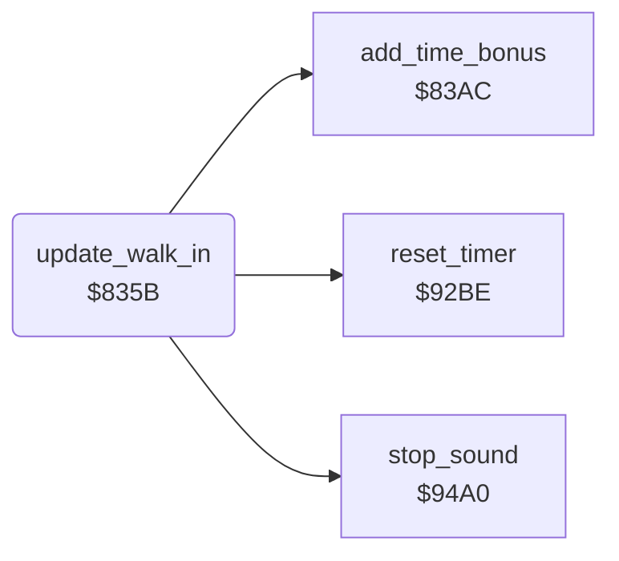

<!-- Generated by c64-docs from knowledge revision 20261025T232349.314-0mcm7w and .c64-re-tools/local/generated/src/source-map.json. Do not edit: change the knowledge, generate the source again, then run docs.ts generate. -->
# combat/walk_in.asm: Walk-in at the start of a bout

Range `$835B-$83AB`. Source: [combat/walk_in.asm](../../../../src/combat/walk_in.asm). Index: [the reference](../../index.md).

## Routines

| Routine | Address | Reached from | Summary |
|---|---|---|---|
| [`update_walk_in`](walk_in.md#update_walk_in) | `$835B` | [`$80F1`](../../../../src/main/main_loop.asm#L25) | At the start of a bout, walks both fighters in until the distance is less than 6. |

## Call graph

A solid arrow is a call, a thick arrow a table entry. Rounded nodes are in this file.

## Details

### [`update_walk_in`](../../../../src/combat/walk_in.asm#L6) `$835B`

*routine*

At the start of a bout, walks both fighters in until the distance is less than 6. Then the bout starts.

- **Called from:** [`$80F1`](../../../../src/main/main_loop.asm#L25)
- **Calls:** [`add_time_bonus`](../score/time_bonus.md#add_time_bonus), [`reset_timer`](../init/state.md#reset_timer), [`stop_sound`](../sound/stop_sound.md#stop_sound)
- **Reads:** [`setup_active`](../../memory-map.md#setup_active), [`final_stage`](../../memory-map.md#final_stage), [`walk_in_active`](../../memory-map.md#walk_in_active), [`fighter_distance`](../../memory-map.md#fighter_distance), [`fighter_move`](../../memory-map.md#fighter_move), [`sound_request`](../../memory-map.md#sound_request), [`voice_tune`](../../memory-map.md#voice_tune), [`sound_off`](../../memory-map.md#sound_off)
- **Writes:** [`fighter_move`](../../memory-map.md#fighter_move), [`fighter_move_step`](../../memory-map.md#fighter_move_step), [`sound_request`](../../memory-map.md#sound_request), [`walk_in_active`](../../memory-map.md#walk_in_active), [`fighter_idle_timer`](../../memory-map.md#fighter_idle_timer), [`fade_in_request`](../../memory-map.md#fade_in_request)
- **Refers to:** [`sound_request`](../../memory-map.md#sound_request), [`fighter_idle_timer`](../../memory-map.md#fighter_idle_timer)

| Label | Address | Comment |
|---|---|---|
| [`update_walk_in_loop`](../../../../src/combat/walk_in.asm#L17) | `$8370` | Move $01: walks forward. |
| [`update_walk_in_next`](../../../../src/combat/walk_in.asm#L25) | `$837F` |  |
| [`update_walk_in_end`](../../../../src/combat/walk_in.asm#L38) | `$8396` |  |
| [`update_walk_in_done`](../../../../src/combat/walk_in.asm#L49) | `$83AB` |  |
