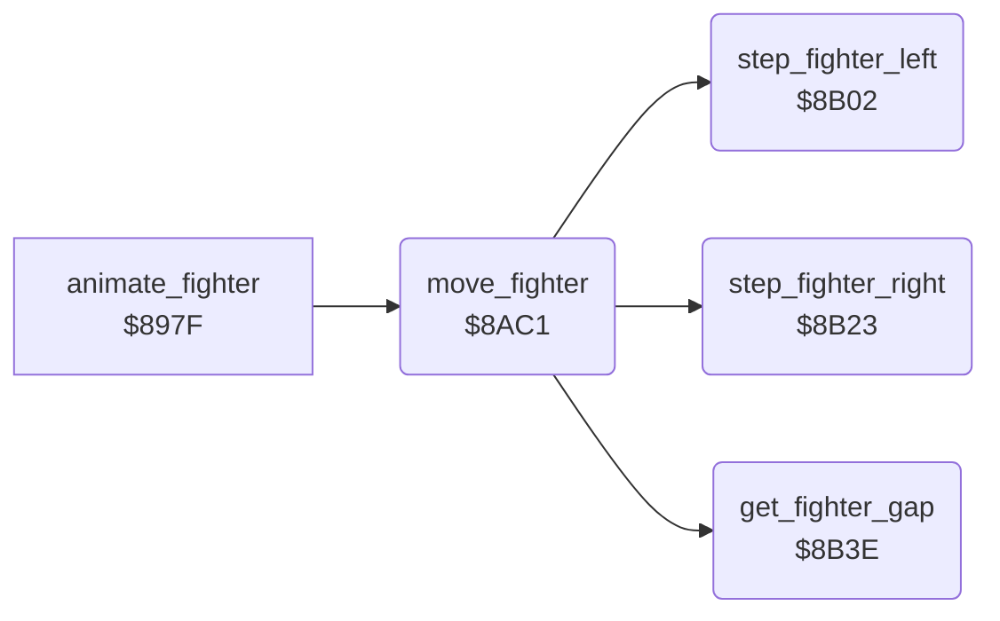

<!-- Generated by c64-docs from knowledge revision 20261025T232349.314-0mcm7w and .c64-re-tools/local/generated/src/source-map.json. Do not edit: change the knowledge, generate the source again, then run docs.ts generate. -->
# fighter/move.asm: Horizontal movement of a fighter

Range `$8AC1-$8B72`. Source: [fighter/move.asm](../../../../src/fighter/move.asm). Index: [the reference](../../index.md).

## Routines

| Routine | Address | Reached from | Summary |
|---|---|---|---|
| [`move_fighter`](move.md#move_fighter) | `$8AC1` | [`animate_fighter`](animate.md#animate_fighter) | Moves fighter $99 by the step in byte 10 of the pose record. |
| [`step_fighter_left`](move.md#step_fighter_left) | `$8B02` | [`move_fighter`](move.md#move_fighter) | Decreases $71,x by $ae. |
| [`step_fighter_right`](move.md#step_fighter_right) | `$8B23` | [`move_fighter`](move.md#move_fighter) | Increases $71,x by $ae. |
| [`get_fighter_gap`](move.md#get_fighter_gap) | `$8B3E` | [`move_fighter`](move.md#move_fighter) | Calculates the gap between the fighters from the facing of fighter 0 into $c3. |

## Call graph

A solid arrow is a call, a thick arrow a table entry. Rounded nodes are in this file.

## Details

### [`move_fighter`](../../../../src/fighter/move.asm#L6) `$8AC1`

*routine*

Moves fighter $99 by the step in byte 10 of the pose record. Byte 9 holds the direction bits. The facing swaps the bits (EOR $7f48). Bit 2: X decreases. Bit 3: X increases. Fighters that pass each other move back.

- **Called from:** [`animate_fighter`](animate.md#animate_fighter)
- **Calls:** [`step_fighter_left`](move.md#step_fighter_left), [`get_fighter_gap`](move.md#get_fighter_gap), [`step_fighter_right`](move.md#step_fighter_right)
- **Reads:** [`record_ptr`](../../memory-map.md#record_ptr), [`anim_fighter`](../../memory-map.md#anim_fighter), [`fighter_facing`](../../memory-map.md#fighter_facing), [`move_bits`](../../memory-map.md#move_bits), [`facing_step_mask`](../data/fighter_constants.md#facing_step_mask), [`fighter_x`](../../memory-map.md#fighter_x)
- **Writes:** [`move_bits`](../../memory-map.md#move_bits), [`move_step`](../../memory-map.md#move_step), [`fighter_x`](../../memory-map.md#fighter_x)

| Label | Address | Comment |
|---|---|---|
| [`move_fighter_right`](../../../../src/fighter/move.asm#L30) | `$8AF0` |  |
| [`move_fighter_done`](../../../../src/fighter/move.asm#L39) | `$8B01` |  |

### [`step_fighter_left`](../../../../src/fighter/move.asm#L42) `$8B02`

*routine*

Decreases $71,x by $ae. Minimum: 3 when the fighter faces right ($91,x = 0), else 0.

- **Called from:** [`move_fighter`](move.md#move_fighter)
- **Reads:** [`fighter_x`](../../memory-map.md#fighter_x), [`move_step`](../../memory-map.md#move_step), [`fighter_facing`](../../memory-map.md#fighter_facing)
- **Writes:** [`move_step`](../../memory-map.md#move_step), [`fighter_x`](../../memory-map.md#fighter_x)

| Label | Address | Comment |
|---|---|---|
| [`step_fighter_left_min`](../../../../src/fighter/move.asm#L53) | `$8B15` |  |
| [`step_fighter_left_clamp0`](../../../../src/fighter/move.asm#L56) | `$8B1A` |  |
| [`step_fighter_left_store`](../../../../src/fighter/move.asm#L60) | `$8B20` |  |

### [`step_fighter_right`](../../../../src/fighter/move.asm#L64) `$8B23`

*routine*

Increases $71,x by $ae. Maximum: $1c. When the fighter faces right, only a value of $20 or more becomes $1c.

- **Called from:** [`move_fighter`](move.md#move_fighter)
- **Reads:** [`fighter_x`](../../memory-map.md#fighter_x), [`move_step`](../../memory-map.md#move_step), [`fighter_facing`](../../memory-map.md#fighter_facing)
- **Writes:** [`fighter_x`](../../memory-map.md#fighter_x)

| Label | Address | Comment |
|---|---|---|
| [`step_fighter_right_clamp`](../../../../src/fighter/move.asm#L74) | `$8B35` |  |
| [`step_fighter_right_store`](../../../../src/fighter/move.asm#L78) | `$8B3B` |  |

### [`get_fighter_gap`](../../../../src/fighter/move.asm#L82) `$8B3E`

*routine*

Calculates the gap between the fighters from the facing of fighter 0 into $c3. Negative: the fighters passed each other. When fighter X does move $91 and the other fighter does move $84, it sets $b2 = $84 (turn request). Output: A = gap, N set only for a negative gap that must be corrected. After a beaten fighter ($af bit 7), N is clear.

- **Called from:** [`move_fighter`](move.md#move_fighter)
- **Reads:** [`bout_loser`](../../memory-map.md#bout_loser), [`fighter_facing`](../../memory-map.md#fighter_facing), [`fighter_x`](../../memory-map.md#fighter_x), [`turn_request`](../../memory-map.md#turn_request), [`fighter_move`](../../memory-map.md#fighter_move), [`fighter_gap`](../../memory-map.md#fighter_gap)
- **Writes:** [`fighter_gap`](../../memory-map.md#fighter_gap), [`turn_request`](../../memory-map.md#turn_request)
- **Refers to:** [`fighter_x`](../../memory-map.md#fighter_x)

| Label | Address | Comment |
|---|---|---|
| [`get_fighter_gap_swap`](../../../../src/fighter/move.asm#L91) | `$8B4E` |  |
| [`get_fighter_gap_check`](../../../../src/fighter/move.asm#L94) | `$8B52` |  |
| [`get_fighter_gap_positive`](../../../../src/fighter/move.asm#L109) | `$8B6D` |  |
| [`get_fighter_gap_negative`](../../../../src/fighter/move.asm#L112) | `$8B70` |  |
