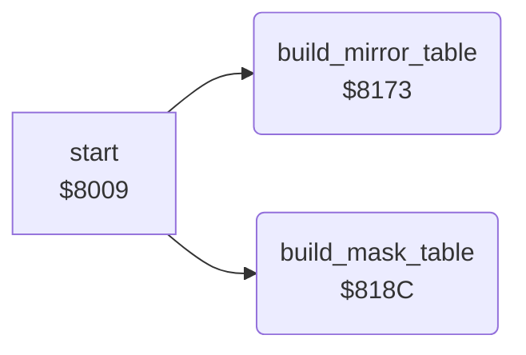

<!-- Generated by c64-docs from knowledge revision 20261025T232349.314-0mcm7w and .c64-re-tools/local/generated/src/source-map.json. Do not edit: change the knowledge, generate the source again, then run docs.ts generate. -->
# graphics/pixel_tables.asm: Mirror and mask tables for multicolour bytes

Range `$8173-$81B3`. Source: [graphics/pixel_tables.asm](../../../../src/graphics/pixel_tables.asm). Index: [the reference](../../index.md).

## Routines

| Routine | Address | Reached from | Summary |
|---|---|---|---|
| [`build_mirror_table`](pixel_tables.md#build_mirror_table) | `$8173` | [`start`](../init/init.md#start) | Builds the mirror table at $02aa. |
| [`build_mask_table`](pixel_tables.md#build_mask_table) | `$818C` | [`start`](../init/init.md#start) | Builds the mask table at $03aa. |

## Call graph

A solid arrow is a call, a thick arrow a table entry. Rounded nodes are in this file.

## Details

### [`build_mirror_table`](../../../../src/graphics/pixel_tables.asm#L6) `$8173`

*routine*

Builds the mirror table at $02aa. Each entry is its index with the order of the 4 pixel pairs reversed.

- **Called from:** [`start`](../init/init.md#start)
- **Reads:** [`mirror_result`](../../memory-map.md#mirror_result)
- **Writes:** [`mirror_result`](../../memory-map.md#mirror_result), [`mirror_table`](../../memory-map.md#mirror_table)

| Label | Address | Comment |
|---|---|---|
| [`build_mirror_table_byte`](../../../../src/graphics/pixel_tables.asm#L8) | `$8175` |  |
| [`build_mirror_table_pair`](../../../../src/graphics/pixel_tables.asm#L11) | `$8178` |  |

### [`build_mask_table`](../../../../src/graphics/pixel_tables.asm#L26) `$818C`

*routine*

Builds the mask table at $03aa. Each pixel pair %00 of the index gives %11, each other pair gives %00.

- **Called from:** [`start`](../init/init.md#start)
- **Reads:** [`mask_source`](../../memory-map.md#mask_source), [`mask_pair`](../../memory-map.md#mask_pair), [`mask_result`](../../memory-map.md#mask_result)
- **Writes:** [`mask_source`](../../memory-map.md#mask_source), [`mask_pair`](../../memory-map.md#mask_pair), [`mask_result`](../../memory-map.md#mask_result), [`mask_table`](../../memory-map.md#mask_table)

| Label | Address | Comment |
|---|---|---|
| [`build_mask_table_byte`](../../../../src/graphics/pixel_tables.asm#L28) | `$818E` |  |
| [`build_mask_table_pair`](../../../../src/graphics/pixel_tables.asm#L31) | `$8192` |  |
| [`build_mask_table_store`](../../../../src/graphics/pixel_tables.asm#L41) | `$81A2` |  |
