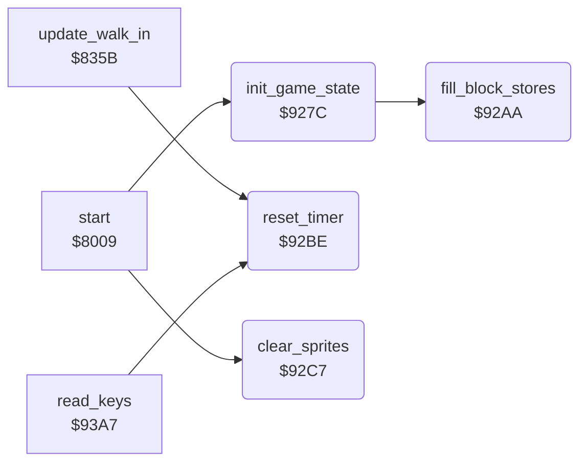

<!-- Generated by c64-docs from knowledge revision 20261029T165720.160-p83xh1 and .c64-re-tools/local/generated/src/source-map.json. Do not edit: change the knowledge, generate the source again, then run docs.ts generate. -->
# init/state.asm: Start state of the game

Range `$927C-$92EA`. Source: [init/state.asm](../../../../src/init/state.asm). Index: [the reference](../../index.md).

## Routines

| Routine | Address | Reached from | Summary |
|---|---|---|---|
| [`init_game_state`](state.md#init_game_state) | `$927C` | [`start`](init.md#start) | Clears the story and game flags. |
| [`fill_block_stores`](state.md#fill_block_stores) | `$92AA` | [`init_game_state`](state.md#init_game_state) | Fills block_store_a and block_store_b ($04aa-$05a9) with $ff and the 32 colour store bytes $05aa-$05c9 with $0e. |
| [`reset_timer`](state.md#reset_timer) | `$92BE` | [`update_walk_in`](../combat/walk_in.md#update_walk_in), [`read_keys`](../input/keyboard.md#read_keys) | Sets the bout time to 90 seconds of 50 frames. |
| [`clear_sprites`](state.md#clear_sprites) | `$92C7` | [`start`](init.md#start) | Clears the sprite positions $02-$12 and switches off all sprites. |

## Call graph

A solid arrow is a call, a thick arrow a table entry. Rounded nodes are in this file.

## Details

### [`init_game_state`](../../../../src/init/state.asm#L6) `$927C`

*routine*

Clears the story and game flags. Sets demo_mode = 1 and opponent_index = 4. Fills the block stores. The start and each restart call it.

- **Called from:** [`start`](init.md#start)
- **Calls:** [`fill_block_stores`](state.md#fill_block_stores)
- **Writes:** [`bout_loser`](../../memory-map.md#bout_loser), [`goblin_active`](../../memory-map.md#goblin_active), [`goblin_drags`](../../memory-map.md#goblin_drags), [`turn_request`](../../memory-map.md#turn_request), [`time_out_active`](../../memory-map.md#time_out_active), [`sprite_mirror_state`](../../memory-map.md#sprite_mirror_state), [`bout_winner`](../../memory-map.md#bout_winner), [`game_started`](../../memory-map.md#game_started), [`setup_active`](../../memory-map.md#setup_active), [`final_stage`](../../memory-map.md#final_stage), [`final_goal_reached`](../../memory-map.md#final_goal_reached), [`two_players`](../../memory-map.md#two_players) and 6 more

### [`fill_block_stores`](../../../../src/init/state.asm#L31) `$92AA`

*routine*

Fills block_store_a and block_store_b ($04aa-$05a9) with $ff and the 32 colour store bytes $05aa-$05c9 with $0e.

- **Called from:** [`init_game_state`](state.md#init_game_state)
- **Writes:** [`block_store_a`](../../memory-map.md#block_store_a), [`block_colours_a`](../../memory-map.md#block_colours_a)

| Label | Address | Comment |
|---|---|---|
| [`fill_block_stores_loop`](../../../../src/init/state.asm#L33) | `$92AC` |  |

### [`reset_timer`](../../../../src/init/state.asm#L45) `$92BE`

*routine*

Sets the bout time to 90 seconds of 50 frames. Build V 05 05 87 sets 60 seconds.

- **Called from:** [`update_walk_in`](../combat/walk_in.md#update_walk_in), [`read_keys`](../input/keyboard.md#read_keys)
- **Writes:** [`time_left`](../../memory-map.md#time_left), [`time_frame_count`](../../memory-map.md#time_frame_count)

### [`clear_sprites`](../../../../src/init/state.asm#L52) `$92C7`

*routine*

Clears the sprite positions $02-$12 and switches off all sprites. Clears the VIC sprite registers and sets a black border.

- **Called from:** [`start`](init.md#start)
- **Writes:** [`sprite_xy_shadow`](../../memory-map.md#sprite_xy_shadow), [`sprite_enable_shadow`](../../memory-map.md#sprite_enable_shadow), [`SPENA`](../../memory-map.md#SPENA), [`YXPAND`](../../memory-map.md#YXPAND), [`SPMC`](../../memory-map.md#SPMC), [`XXPAND`](../../memory-map.md#XXPAND), [`SPBGPR`](../../memory-map.md#SPBGPR), [`SPSPCL`](../../memory-map.md#SPSPCL), [`SPBGCL`](../../memory-map.md#SPBGCL), [`EXTCOL`](../../memory-map.md#EXTCOL)

| Label | Address | Comment |
|---|---|---|
| [`clear_sprites_loop`](../../../../src/init/state.asm#L55) | `$92CB` |  |
