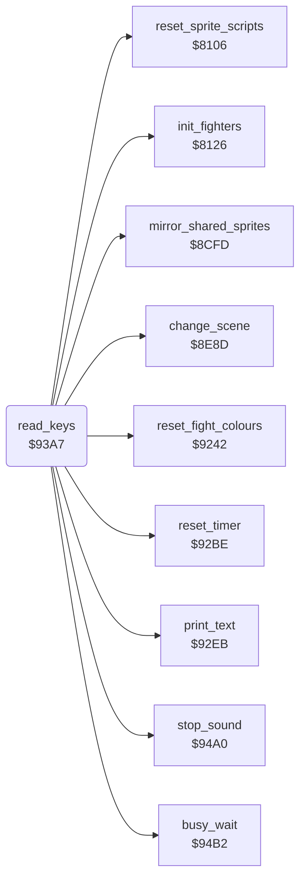

<!-- Generated by c64-docs from knowledge revision 20261029T165720.160-p83xh1 and .c64-re-tools/local/generated/src/source-map.json. Do not edit: change the knowledge, generate the source again, then run docs.ts generate. -->
# input/keyboard.asm: Keyboard: function keys, version text, pause and quit

Range `$93A7-$949F`. Source: [input/keyboard.asm](../../../../src/input/keyboard.asm). Index: [the reference](../../index.md).

## Routines

| Routine | Address | Reached from | Summary |
|---|---|---|---|
| [`read_keys`](keyboard.md#read_keys) | `$93A7` | [`$80FA`](../../../../src/main/main_loop.asm#L28) | Reads the keyboard once a pass. |

## Call graph

A solid arrow is a call, a thick arrow a table entry. Rounded nodes are in this file.

## Details

### [`read_keys`](../../../../src/input/keyboard.asm#L6) `$93A7`

*routine*

Reads the keyboard once a pass. F1 set-up, F7 start, F3 music or effects, F5 pause, CTRL+V version, Q quit.

- **Called from:** [`$80FA`](../../../../src/main/main_loop.asm#L28)
- **Calls:** [`print_text`](../text/print_text.md#print_text), [`reset_fight_colours`](../screen/colours.md#reset_fight_colours), [`change_scene`](../screen/scene.md#change_scene), [`init_fighters`](../fighter/fighter_init.md#init_fighters), [`reset_sprite_scripts`](../sprites/sprite_reset.md#reset_sprite_scripts), [`mirror_shared_sprites`](../sprites/mirror_shared.md#mirror_shared_sprites), [`reset_timer`](../init/state.md#reset_timer), [`stop_sound`](../sound/stop_sound.md#stop_sound), [`busy_wait`](delay.md#busy_wait)
- **Jumps to:** [`quit_to_demo`](../main/quit_to_demo.md#quit_to_demo)
- **Reads:** [`CIAPRB`](../../memory-map.md#CIAPRB), [`setup_active`](../../memory-map.md#setup_active), [`game_started`](../../memory-map.md#game_started), [`turn_request`](../../memory-map.md#turn_request), [`bout_loser`](../../memory-map.md#bout_loser), [`scene_index`](../../memory-map.md#scene_index), [`sprite_mirror_state`](../../memory-map.md#sprite_mirror_state), [`sound_off`](../../memory-map.md#sound_off)
- **Writes:** [`CIADDRA`](../../memory-map.md#CIADDRA), [`CIADDRB`](../../memory-map.md#CIADDRB), [`CIAPRA`](../../memory-map.md#CIAPRA), [`sprites_frozen`](../../memory-map.md#sprites_frozen), [`setup_active`](../../memory-map.md#setup_active), [`opponent_index`](../../memory-map.md#opponent_index), [`game_started`](../../memory-map.md#game_started), [`demo_mode`](../../memory-map.md#demo_mode), [`sprite_mirror_state`](../../memory-map.md#sprite_mirror_state), [`two_players`](../../memory-map.md#two_players), [`sound_off`](../../memory-map.md#sound_off), [`sound_request`](../../memory-map.md#sound_request) and 1 more
- **Refers to:** [`sound_request`](../../memory-map.md#sound_request)

| Label | Address | Comment |
|---|---|---|
| [`read_keys_show_version`](../../../../src/input/keyboard.asm#L24) | `$93CD` | Shows text $81 ("V 05 10 87") while CTRL and V stay pressed. |
| [`read_keys_check_f1`](../../../../src/input/keyboard.asm#L33) | `$93E0` | Row 0: bit 4 is F1. |
| [`read_keys_f1_reset`](../../../../src/input/keyboard.asm#L54) | `$9409` | Resets the fighters and the sprite tables. |
| [`read_keys_f1_clock`](../../../../src/input/keyboard.asm#L63) | `$941A` | Before F7, F1 also resets the bout clock and selects one player. |
| [`read_keys_check_f3`](../../../../src/input/keyboard.asm#L69) | `$9425` | Row 0: bit 5 is F3. |
| [`read_keys_f3_fade_in`](../../../../src/input/keyboard.asm#L86) | `$9448` | Starts a fade-in of the volume. |
| [`read_keys_check_f5`](../../../../src/input/keyboard.asm#L89) | `$944C` | Row 0: bit 6 is F5. |
| [`read_keys_pause_wait`](../../../../src/input/keyboard.asm#L100) | `$9463` | Halts the main loop until F5 is pressed again. |
| [`read_keys_check_f7`](../../../../src/input/keyboard.asm#L106) | `$946F` | Row 0: bit 3 is F7. |
| [`read_keys_check_q`](../../../../src/input/keyboard.asm#L118) | `$9488` | Row 7: bit 6 is Q. |
| [`read_keys_exit`](../../../../src/input/keyboard.asm#L126) | `$9497` | Sets both ports to input again for the joystick reads. |
