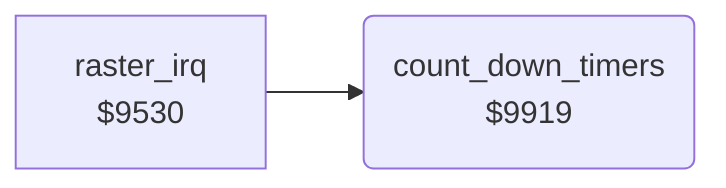

<!-- Generated by c64-docs from knowledge revision 20261025T232349.314-0mcm7w and .c64-re-tools/local/generated/src/source-map.json. Do not edit: change the knowledge, generate the source again, then run docs.ts generate. -->
# irq/timers.asm: Frame counters: idle timers, bout clock

Range `$9919-$9940`. Source: [irq/timers.asm](../../../../src/irq/timers.asm). Index: [the reference](../../index.md).

## Routines

| Routine | Address | Reached from | Summary |
|---|---|---|---|
| [`count_down_timers`](timers.md#count_down_timers) | `$9919` | [`raster_irq`](irq_handler.md#raster_irq) | Once a frame: counts down the idle timers of both fighters, the bout clock and the counter $ca. |

## Call graph

A solid arrow is a call, a thick arrow a table entry. Rounded nodes are in this file.

## Details

### [`count_down_timers`](../../../../src/irq/timers.asm#L6) `$9919`

*routine*

Once a frame: counts down the idle timers of both fighters, the bout clock and the counter $ca.

- **Called from:** [`raster_irq`](irq_handler.md#raster_irq)
- **Reads:** [`fighter_idle_timer`](../../memory-map.md#fighter_idle_timer), [`walk_in_active`](../../memory-map.md#walk_in_active), [`time_out_active`](../../memory-map.md#time_out_active), [`bout_loser`](../../memory-map.md#bout_loser), [`time_left`](../../memory-map.md#time_left), [`time_frame_count`](../../memory-map.md#time_frame_count), [`wait_counter`](../../memory-map.md#wait_counter)
- **Writes:** [`fighter_idle_timer`](../../memory-map.md#fighter_idle_timer), [`time_frame_count`](../../memory-map.md#time_frame_count), [`time_left`](../../memory-map.md#time_left), [`wait_counter`](../../memory-map.md#wait_counter)

| Label | Address | Comment |
|---|---|---|
| [`count_down_timers_loop`](../../../../src/irq/timers.asm#L8) | `$991B` |  |
| [`count_down_timers_next`](../../../../src/irq/timers.asm#L12) | `$9921` |  |
| [`update_timers_delay`](../../../../src/irq/timers.asm#L26) | `$993A` | Decrements the delay counter until it is 0. |
| [`update_timers_done`](../../../../src/irq/timers.asm#L30) | `$9940` |  |
