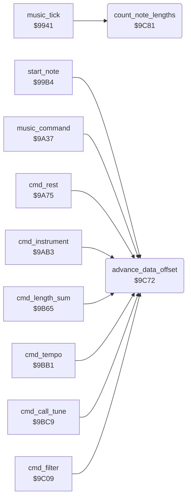

<!-- Generated by c64-docs from knowledge revision 20261029T165720.160-p83xh1 and .c64-re-tools/local/generated/src/source-map.json. Do not edit: change the knowledge, generate the source again, then run docs.ts generate. -->
# music/note_time.asm: Read offset and note time of the voices

Range `$9C72-$9CB8`. Source: [music/note_time.asm](../../../../src/music/note_time.asm). Index: [the reference](../../index.md).

## Routines

| Routine | Address | Reached from | Summary |
|---|---|---|---|
| [`advance_data_offset`](note_time.md#advance_data_offset) | `$9C72` | [`start_note`](tick.md#start_note), [`music_command`](commands.md#music_command), [`cmd_rest`](commands.md#cmd_rest), [`cmd_instrument`](commands.md#cmd_instrument), [`cmd_length_sum`](commands.md#cmd_length_sum), [`cmd_tempo`](commands.md#cmd_tempo), [`cmd_call_tune`](commands.md#cmd_call_tune), [`cmd_filter`](commands.md#cmd_filter) | Adds A to the read offset of voice music_voice. |
| [`count_note_lengths`](note_time.md#count_note_lengths) | `$9C81` | [`music_tick`](tick.md#music_tick) | Decrements the note time of each voice. |

## Call graph

A solid arrow is a call, a thick arrow a table entry. Rounded nodes are in this file.

## Details

### [`advance_data_offset`](../../../../src/music/note_time.asm#L6) `$9C72`

*routine*

Adds A to the read offset of voice music_voice. Returns X = music_voice * 2.

- **Called from:** [`start_note`](tick.md#start_note), [`music_command`](commands.md#music_command), [`cmd_rest`](commands.md#cmd_rest), [`cmd_instrument`](commands.md#cmd_instrument), [`cmd_length_sum`](commands.md#cmd_length_sum), [`cmd_tempo`](commands.md#cmd_tempo), [`cmd_call_tune`](commands.md#cmd_call_tune), [`cmd_filter`](commands.md#cmd_filter)
- **Reads:** [`music_voice_x2`](../../memory-map.md#music_voice_x2), [`voice_data_offset`](../../memory-map.md#voice_data_offset)
- **Writes:** [`voice_data_offset`](../../memory-map.md#voice_data_offset)
- **Refers to:** [`voice_data_offset`](../../memory-map.md#voice_data_offset)

| Label | Address | Comment |
|---|---|---|
| [`advance_data_offset_done`](../../../../src/music/note_time.asm#L14) | `$9C80` |  |

### [`count_note_lengths`](../../../../src/music/note_time.asm#L17) `$9C81`

*routine*

Decrements the note time of each voice. At 0, clears the gate. Also decrements the fade delay.

- **Called from:** [`music_tick`](tick.md#music_tick)
- **Reads:** [`note_time`](../../memory-map.md#note_time), [`voice_sid_offsets`](driver_tables.md#voice_sid_offsets), [`sid_shadow_control`](../../memory-map.md#sid_shadow_control), [`fade_delay`](../../memory-map.md#fade_delay)
- **Writes:** [`note_time`](../../memory-map.md#note_time), [`sid_shadow_control`](../../memory-map.md#sid_shadow_control), [`fade_delay`](../../memory-map.md#fade_delay)
- **Refers to:** [`note_time`](../../memory-map.md#note_time)

| Label | Address | Comment |
|---|---|---|
| [`count_note_lengths_voice`](../../../../src/music/note_time.asm#L19) | `$9C83` |  |
| [`count_note_lengths_next`](../../../../src/music/note_time.asm#L39) | `$9CAF` |  |
| [`count_note_lengths_done`](../../../../src/music/note_time.asm#L45) | `$9CB8` |  |
