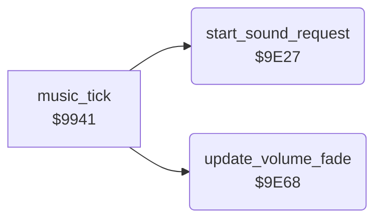

<!-- Generated by c64-docs from knowledge revision 20261025T232349.314-0mcm7w and .c64-re-tools/local/generated/src/source-map.json. Do not edit: change the knowledge, generate the source again, then run docs.ts generate. -->
# music/requests.asm: Tune requests and volume fade

Range `$9E27-$9E8F`. Source: [music/requests.asm](../../../../src/music/requests.asm). Index: [the reference](../../index.md).

## Routines

| Routine | Address | Reached from | Summary |
|---|---|---|---|
| [`start_sound_request`](requests.md#start_sound_request) | `$9E27` | [`music_tick`](tick.md#music_tick) | Starts the tune that sound_request,x asks for on voice X. |
| [`update_volume_fade`](requests.md#update_volume_fade) | `$9E68` | [`music_tick`](tick.md#music_tick) | Fades the master volume in (to 15) or out (to 0), one step after each fade delay. |

## Call graph

A solid arrow is a call, a thick arrow a table entry. Rounded nodes are in this file.

## Details

### [`start_sound_request`](../../../../src/music/requests.asm#L6) `$9E27`

*routine*

Starts the tune that sound_request,x asks for on voice X. When sound is off, drops requests of $83 and higher.

- **Called from:** [`music_tick`](tick.md#music_tick)
- **Reads:** [`sound_request`](../../memory-map.md#sound_request), [`sound_off`](../../memory-map.md#sound_off), [`voice_sid_offsets`](driver_tables.md#voice_sid_offsets), [`sid_shadow_control`](../../memory-map.md#sid_shadow_control), [`sid_shadow_res_filt`](../../memory-map.md#sid_shadow_res_filt), [`bit_masks_inverted`](../data/bit_masks.md#bit_masks_inverted)
- **Writes:** [`sound_request`](../../memory-map.md#sound_request), [`voice_tune`](../../memory-map.md#voice_tune), [`filter_speed`](../../memory-map.md#filter_speed), [`effect_flags`](../../memory-map.md#effect_flags), [`note_time`](../../memory-map.md#note_time), [`voice_data_offset`](../../memory-map.md#voice_data_offset), [`sid_shadow_control`](../../memory-map.md#sid_shadow_control), [`sid_shadow_res_filt`](../../memory-map.md#sid_shadow_res_filt)
- **Refers to:** [`note_time`](../../memory-map.md#note_time), [`voice_data_offset`](../../memory-map.md#voice_data_offset)

| Label | Address | Comment |
|---|---|---|
| [`start_sound_request_accept`](../../../../src/music/requests.asm#L19) | `$9E39` |  |

### [`update_volume_fade`](../../../../src/music/requests.asm#L40) `$9E68`

*routine*

Fades the master volume in (to 15) or out (to 0), one step after each fade delay.

- **Called from:** [`music_tick`](tick.md#music_tick)
- **Reads:** [`fade_delay`](../../memory-map.md#fade_delay), [`fade_in_request`](../../memory-map.md#fade_in_request), [`master_volume`](../../memory-map.md#master_volume), [`fade_out_request`](../../memory-map.md#fade_out_request)
- **Writes:** [`fade_delay`](../../memory-map.md#fade_delay), [`master_volume`](../../memory-map.md#master_volume), [`fade_in_request`](../../memory-map.md#fade_in_request), [`fade_out_request`](../../memory-map.md#fade_out_request)

| Label | Address | Comment |
|---|---|---|
| [`update_volume_fade_out`](../../../../src/music/requests.asm#L53) | `$9E81` |  |
| [`update_volume_fade_done`](../../../../src/music/requests.asm#L61) | `$9E8F` |  |
