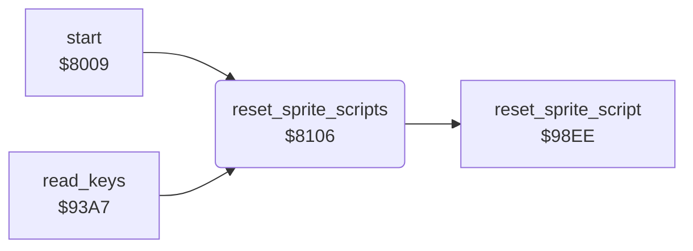

<!-- Generated by c64-docs from knowledge revision 20261029T165720.160-p83xh1 and .c64-re-tools/local/generated/src/source-map.json. Do not edit: change the knowledge, generate the source again, then run docs.ts generate. -->
# sprites/sprite_reset.asm: Reset of the sprite scripts

Range `$8106-$8125`. Source: [sprites/sprite_reset.asm](../../../../src/sprites/sprite_reset.asm). Index: [the reference](../../index.md).

## Routines

| Routine | Address | Reached from | Summary |
|---|---|---|---|
| [`reset_sprite_scripts`](sprite_reset.md#reset_sprite_scripts) | `$8106` | [`start`](../init/init.md#start), [`read_keys`](../input/keyboard.md#read_keys) | Stops the path and the animation of all 8 sprites. |

## Call graph

A solid arrow is a call, a thick arrow a table entry. Rounded nodes are in this file.

## Details

### [`reset_sprite_scripts`](../../../../src/sprites/sprite_reset.asm#L6) `$8106`

*routine*

Stops the path and the animation of all 8 sprites. Sets the animation position of each sprite to 2.

- **Called from:** [`start`](../init/init.md#start), [`read_keys`](../input/keyboard.md#read_keys)
- **Calls:** [`reset_sprite_script`](sprite_script.md#reset_sprite_script)
- **Writes:** [`sprite_dirs`](../../memory-map.md#sprite_dirs), [`sprite_path`](../../memory-map.md#sprite_path), [`sprite_anim`](../../memory-map.md#sprite_anim), [`sprite_anim_timer`](../../memory-map.md#sprite_anim_timer), [`sprite_speed_x`](../../memory-map.md#sprite_speed_x), [`sprite_speed_y`](../../memory-map.md#sprite_speed_y), [`sprite_anim_pos`](../../memory-map.md#sprite_anim_pos)

| Label | Address | Comment |
|---|---|---|
| [`reset_sprite_scripts_loop`](../../../../src/sprites/sprite_reset.asm#L8) | `$8108` |  |
