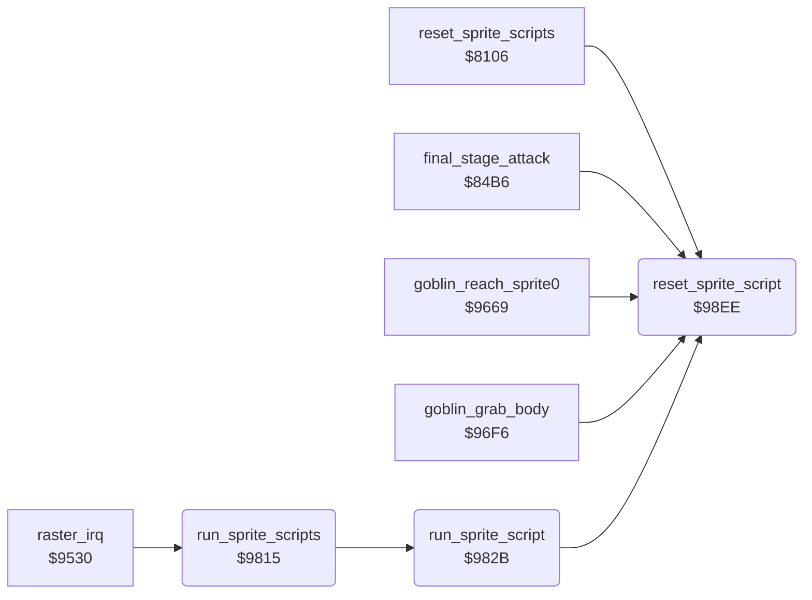

<!-- Generated by c64-docs from knowledge revision 20261025T232349.314-0mcm7w and .c64-re-tools/local/generated/src/source-map.json. Do not edit: change the knowledge, generate the source again, then run docs.ts generate. -->
# sprites/sprite_script.asm: Sprite scripts: movement steps and commands

Range `$9815-$98F9`. Source: [sprites/sprite_script.asm](../../../../src/sprites/sprite_script.asm). Index: [the reference](../../index.md).

## Routines

| Routine | Address | Reached from | Summary |
|---|---|---|---|
| [`run_sprite_scripts`](sprite_script.md#run_sprite_scripts) | `$9815` | [`raster_irq`](../irq/irq_handler.md#raster_irq) | Runs the script of each sprite 7-0 with sprite_script bit 7 set. |
| [`run_sprite_script`](sprite_script.md#run_sprite_script) | `$982B` | [`run_sprite_scripts`](sprite_script.md#run_sprite_scripts) | Steps the script of sprite X. |
| [`reset_sprite_script`](sprite_script.md#reset_sprite_script) | `$98EE` | [`reset_sprite_scripts`](sprite_reset.md#reset_sprite_scripts), [`final_stage_attack`](../story/final_stage.md#final_stage_attack), [`goblin_reach_sprite0`](../story/goblin.md#goblin_reach_sprite0), [`goblin_grab_body`](../story/goblin.md#goblin_grab_body), [`run_sprite_script`](sprite_script.md#run_sprite_script) | Sets the step frames, step command and script offset of sprite X to 0. |

## Call graph

A solid arrow is a call, a thick arrow a table entry. Rounded nodes are in this file.

## Details

### [`run_sprite_scripts`](../../../../src/sprites/sprite_script.asm#L6) `$9815`

*routine*

Runs the script of each sprite 7-0 with sprite_script bit 7 set. Other sprites stop moving.

- **Called from:** [`raster_irq`](../irq/irq_handler.md#raster_irq)
- **Calls:** [`run_sprite_script`](sprite_script.md#run_sprite_script)
- **Reads:** [`sprite_path`](../../memory-map.md#sprite_path)
- **Writes:** [`sprite_dirs`](../../memory-map.md#sprite_dirs)

| Label | Address | Comment |
|---|---|---|
| [`run_sprite_scripts_loop`](../../../../src/sprites/sprite_script.asm#L8) | `$9817` |  |
| [`run_sprite_scripts_next`](../../../../src/sprites/sprite_script.asm#L12) | `$981F` |  |
| [`run_sprite_scripts_idle`](../../../../src/sprites/sprite_script.asm#L16) | `$9823` | No script: clears the direction bits. |

### [`run_sprite_script`](../../../../src/sprites/sprite_script.asm#L21) `$982B`

*routine*

Steps the script of sprite X. A step has 4 bytes: directions, speeds, frames, command.

- **Called from:** [`run_sprite_scripts`](sprite_script.md#run_sprite_scripts)
- **Calls:** [`reset_sprite_script`](sprite_script.md#reset_sprite_script)
- **Reads:** [`sprite_path`](../../memory-map.md#sprite_path), [`motion_ptrs`](sprite_motions.md#motion_ptrs), [`sprite_path_timer`](../../memory-map.md#sprite_path_timer), [`sprite_path_cmd`](../../memory-map.md#sprite_path_cmd), [`sprite_path_pos`](../../memory-map.md#sprite_path_pos), [`script_ptr`](../../memory-map.md#script_ptr), [`sprite_enable_shadow`](../../memory-map.md#sprite_enable_shadow), [`bit_masks_inverted`](../data/bit_masks.md#bit_masks_inverted)
- **Writes:** [`script_ptr`](../../memory-map.md#script_ptr), [`sprite_path_pos`](../../memory-map.md#sprite_path_pos), [`sprite_path_cmd`](../../memory-map.md#sprite_path_cmd), [`sprite_path_timer`](../../memory-map.md#sprite_path_timer), [`sprite_speed_y`](../../memory-map.md#sprite_speed_y), [`sprite_speed_x`](../../memory-map.md#sprite_speed_x), [`sprite_dirs`](../../memory-map.md#sprite_dirs), [`sprite_path`](../../memory-map.md#sprite_path), [`sprite_anim`](../../memory-map.md#sprite_anim), [`sprite_anim_timer`](../../memory-map.md#sprite_anim_timer), [`sprite_anim_pos`](../../memory-map.md#sprite_anim_pos), [`sprite_enable_shadow`](../../memory-map.md#sprite_enable_shadow) and 1 more
- **Refers to:** [`script_ptr`](../../memory-map.md#script_ptr)

| Label | Address | Comment |
|---|---|---|
| [`run_sprite_script_count`](../../../../src/sprites/sprite_script.asm#L58) | `$9871` | Counts down the frames of the step. |
| [`run_sprite_script_command`](../../../../src/sprites/sprite_script.asm#L62) | `$9875` | At the end of a step, command 1 reads a new script and a new animation. |
| [`run_sprite_script_cmd_script`](../../../../src/sprites/sprite_script.asm#L78) | `$9898` | Command 2: the next byte is the new script. |
| [`run_sprite_script_cmd_goto`](../../../../src/sprites/sprite_script.asm#L87) | `$98AC` | Command 3: goes to step n of the script. |
| [`run_sprite_script_cmd_stop`](../../../../src/sprites/sprite_script.asm#L100) | `$98C5` | Command 4: stops the script and the animation and switches the sprite off. |
| [`run_sprite_script_cmd_sound`](../../../../src/sprites/sprite_script.asm#L110) | `$98D9` | Other command: the next byte is a sound request for driver voice 0 (SID voice 1). |

### [`reset_sprite_script`](../../../../src/sprites/sprite_script.asm#L120) `$98EE`

*routine*

Sets the step frames, step command and script offset of sprite X to 0. Out: A = 0.

- **Called from:** [`reset_sprite_scripts`](sprite_reset.md#reset_sprite_scripts), [`final_stage_attack`](../story/final_stage.md#final_stage_attack), [`goblin_reach_sprite0`](../story/goblin.md#goblin_reach_sprite0), [`goblin_grab_body`](../story/goblin.md#goblin_grab_body), [`run_sprite_script`](sprite_script.md#run_sprite_script)
- **Writes:** [`sprite_path_timer`](../../memory-map.md#sprite_path_timer), [`sprite_path_cmd`](../../memory-map.md#sprite_path_cmd), [`sprite_path_pos`](../../memory-map.md#sprite_path_pos)
