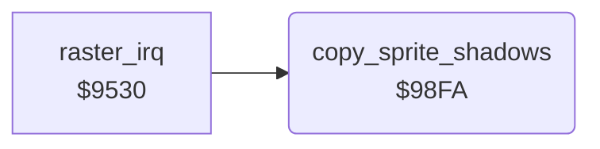

<!-- Generated by c64-docs from knowledge revision 20261025T232349.314-0mcm7w and .c64-re-tools/local/generated/src/source-map.json. Do not edit: change the knowledge, generate the source again, then run docs.ts generate. -->
# sprites/sprite_shadow.asm: Copy the sprite shadow registers to the VIC-II

Range `$98FA-$9918`. Source: [sprites/sprite_shadow.asm](../../../../src/sprites/sprite_shadow.asm). Index: [the reference](../../index.md).

## Routines

| Routine | Address | Reached from | Summary |
|---|---|---|---|
| [`copy_sprite_shadows`](sprite_shadow.md#copy_sprite_shadows) | `$98FA` | [`raster_irq`](../irq/irq_handler.md#raster_irq) | Copies the sprite positions, colours, pointers and enable bits from the zero page to the VIC-II. |

## Call graph

A solid arrow is a call, a thick arrow a table entry. Rounded nodes are in this file.

## Details

### [`copy_sprite_shadows`](../../../../src/sprites/sprite_shadow.asm#L6) `$98FA`

*routine*

Copies the sprite positions, colours, pointers and enable bits from the zero page to the VIC-II.

- **Called from:** [`raster_irq`](../irq/irq_handler.md#raster_irq)
- **Reads:** [`sprite_xy_shadow`](../../memory-map.md#sprite_xy_shadow), [`sprite_colour_shadow`](../../memory-map.md#sprite_colour_shadow), [`sprite_pointer_shadow`](../../memory-map.md#sprite_pointer_shadow), [`sprite_enable_shadow`](../../memory-map.md#sprite_enable_shadow)
- **Writes:** [`arena2_bitmap`](../graphics/arena2_bitmap.md#arena2_bitmap), [`SP0COL`](../../memory-map.md#SP0COL), [`sprite_pointers`](../screen/screen_ram_47f8.md#sprite_pointers), [`SPENA`](../../memory-map.md#SPENA)

| Label | Address | Comment |
|---|---|---|
| [`copy_sprite_shadows_pos`](../../../../src/sprites/sprite_shadow.asm#L8) | `$98FC` | $02-$12 to $d000-$d010. |
| [`copy_sprite_shadows_loop`](../../../../src/sprites/sprite_shadow.asm#L14) | `$9906` | Colours to $d027, pointers to $47f8. |
