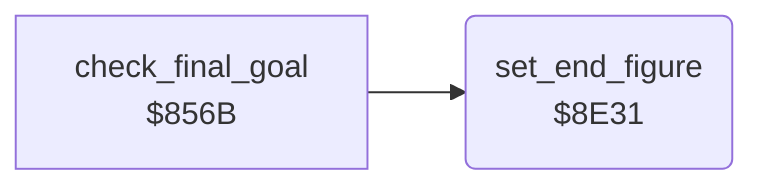

<!-- Generated by c64-docs from knowledge revision 20261029T165720.160-p83xh1 and .c64-re-tools/local/generated/src/source-map.json. Do not edit: change the knowledge, generate the source again, then run docs.ts generate. -->
# story/end_figure.asm: Sprite figure of the end sequence

Range `$8E31-$8E8C`. Source: [story/end_figure.asm](../../../../src/story/end_figure.asm). Index: [the reference](../../index.md).

## Routines

| Routine | Address | Reached from | Summary |
|---|---|---|---|
| [`set_end_figure`](end_figure.md#set_end_figure) | `$8E31` | [`check_final_goal`](final_stage.md#check_final_goal), [`$8100`](../../../../src/main/main_loop.asm#L30) | Runs only when final_stage bit 7 is set. |

## Call graph

A solid arrow is a call, a thick arrow a table entry. Rounded nodes are in this file.

## Details

### [`set_end_figure`](../../../../src/story/end_figure.asm#L6) `$8E31`

*routine*

Runs only when final_stage bit 7 is set. Starts sprites 0-3 from the figure record final_scene_pose of the table $ccee. The main loop calls it in each pass.

- **Called from:** [`$8100`](../../../../src/main/main_loop.asm#L30), [`check_final_goal`](final_stage.md#check_final_goal)
- **Reads:** [`final_stage`](../../memory-map.md#final_stage), [`final_scene_pose`](../../memory-map.md#final_scene_pose), [`end_scene_ptrs`](end_scene.md#end_scene_ptrs), [`bitmap_ptr`](../../memory-map.md#bitmap_ptr), [`sprite_enable_shadow`](../../memory-map.md#sprite_enable_shadow), [`bit_masks_inverted`](../data/bit_masks.md#bit_masks_inverted), [`saved_y`](../../memory-map.md#saved_y), [`cur_fighter`](../../memory-map.md#cur_fighter), [`sprite_x_msb_shadow`](../../memory-map.md#sprite_x_msb_shadow)
- **Writes:** [`bitmap_ptr`](../../memory-map.md#bitmap_ptr), [`sprite_anim`](../../memory-map.md#sprite_anim), [`sprite_enable_shadow`](../../memory-map.md#sprite_enable_shadow), [`SPENA`](../../memory-map.md#SPENA), [`sprite_anim_timer`](../../memory-map.md#sprite_anim_timer), [`sprite_anim_pos`](../../memory-map.md#sprite_anim_pos), [`saved_y`](../../memory-map.md#saved_y), [`cur_fighter`](../../memory-map.md#cur_fighter), [`sprite_xy_shadow`](../../memory-map.md#sprite_xy_shadow), [`sprite_y_shadow`](../../memory-map.md#sprite_y_shadow), [`sprite_x_msb_shadow`](../../memory-map.md#sprite_x_msb_shadow)
- **Refers to:** [`bitmap_ptr`](../../memory-map.md#bitmap_ptr)

| Label | Address | Comment |
|---|---|---|
| [`set_end_figure_loop`](../../../../src/story/end_figure.asm#L19) | `$8E48` | Animation of the sprite: 0 switches the sprite off. |
| [`set_end_figure_anim`](../../../../src/story/end_figure.asm#L27) | `$8E59` | Restarts the animation at its first step. |
| [`set_end_figure_done`](../../../../src/story/end_figure.asm#L60) | `$8E8C` |  |
