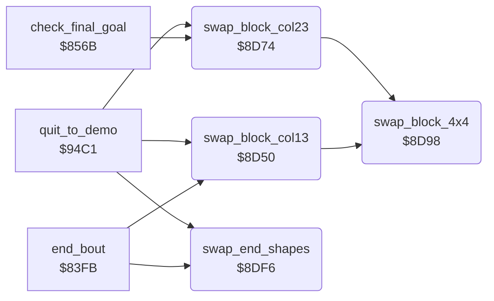

<!-- Generated by c64-docs from knowledge revision 20261025T232349.314-0mcm7w and .c64-re-tools/local/generated/src/source-map.json. Do not edit: change the knowledge, generate the source again, then run docs.ts generate. -->
# story/end_swaps.asm: Swaps of picture blocks and sprite shapes for the end of the story

Range `$8D50-$8E30`. Source: [story/end_swaps.asm](../../../../src/story/end_swaps.asm). Index: [the reference](../../index.md).

## Routines

| Routine | Address | Reached from | Summary |
|---|---|---|---|
| [`swap_block_col13`](end_swaps.md#swap_block_col13) | `$8D50` | [`end_bout`](../combat/end_of_bout.md#end_bout), [`quit_to_demo`](../main/quit_to_demo.md#quit_to_demo) | Swaps the 4x4-character picture block at row 9, column 13 with block_store_a. |
| [`swap_block_col23`](end_swaps.md#swap_block_col23) | `$8D74` | [`check_final_goal`](final_stage.md#check_final_goal), [`quit_to_demo`](../main/quit_to_demo.md#quit_to_demo) | Swaps the 4x4-character picture block at row 9, column 23 with block_store_b. |
| [`swap_block_4x4`](end_swaps.md#swap_block_4x4) | `$8D98` | [`swap_block_col13`](end_swaps.md#swap_block_col13), [`swap_block_col23`](end_swaps.md#swap_block_col23) | Swaps a 4x4-character bitmap block with a store. |
| [`swap_end_shapes`](end_swaps.md#swap_end_shapes) | `$8DF6` | [`end_bout`](../combat/end_of_bout.md#end_bout), [`quit_to_demo`](../main/quit_to_demo.md#quit_to_demo) | Swaps the 13 sprite shapes $53-$5f ($54c0-$57ff) with the store at $fc40-$ff7f. |

## Call graph

A solid arrow is a call, a thick arrow a table entry. Rounded nodes are in this file.

## Details

### [`swap_block_col13`](../../../../src/story/end_swaps.asm#L6) `$8D50`

*routine*

Swaps the 4x4-character picture block at row 9, column 13 with block_store_a. Also swaps its 16 colour RAM bytes with block_colours_a. A second call undoes the swap.
Bitmap $6ba8 = row 9, column 13.

- **Called from:** [`end_bout`](../combat/end_of_bout.md#end_bout), [`quit_to_demo`](../main/quit_to_demo.md#quit_to_demo)
- **Calls:** [`swap_block_4x4`](end_swaps.md#swap_block_4x4)
- **Writes:** [`copy_src_ptr`](../../memory-map.md#copy_src_ptr), [`copy_dst_ptr`](../../memory-map.md#copy_dst_ptr), [`screen_ptr`](../../memory-map.md#screen_ptr), [`bitmap_ptr`](../../memory-map.md#bitmap_ptr)
- **Refers to:** [`copy_src_ptr`](../../memory-map.md#copy_src_ptr), [`copy_dst_ptr`](../../memory-map.md#copy_dst_ptr), [`screen_ptr`](../../memory-map.md#screen_ptr), [`bitmap_ptr`](../../memory-map.md#bitmap_ptr)

### [`swap_block_col23`](../../../../src/story/end_swaps.asm#L26) `$8D74`

*routine*

Swaps the 4x4-character picture block at row 9, column 23 with block_store_b. Also swaps its 16 colour RAM bytes with block_colours_b. A second call undoes the swap.
Bitmap $6bf8 = row 9, column 23.

- **Called from:** [`check_final_goal`](final_stage.md#check_final_goal), [`quit_to_demo`](../main/quit_to_demo.md#quit_to_demo)
- **Calls:** [`swap_block_4x4`](end_swaps.md#swap_block_4x4)
- **Writes:** [`copy_src_ptr`](../../memory-map.md#copy_src_ptr), [`copy_dst_ptr`](../../memory-map.md#copy_dst_ptr), [`screen_ptr`](../../memory-map.md#screen_ptr), [`bitmap_ptr`](../../memory-map.md#bitmap_ptr)
- **Refers to:** [`copy_src_ptr`](../../memory-map.md#copy_src_ptr), [`copy_dst_ptr`](../../memory-map.md#copy_dst_ptr), [`screen_ptr`](../../memory-map.md#screen_ptr), [`bitmap_ptr`](../../memory-map.md#bitmap_ptr)

### [`swap_block_4x4`](../../../../src/story/end_swaps.asm#L46) `$8D98`

*routine*

Swaps a 4x4-character bitmap block with a store. Input: $75 bitmap, $77 store, $7b colour RAM, $79 colour store.
4 character rows.

- **Called from:** [`swap_block_col13`](end_swaps.md#swap_block_col13), [`swap_block_col23`](end_swaps.md#swap_block_col23)
- **Reads:** [`copy_src_ptr`](../../memory-map.md#copy_src_ptr), [`copy_dst_ptr`](../../memory-map.md#copy_dst_ptr), [`draw_row`](../../memory-map.md#draw_row), [`screen_ptr`](../../memory-map.md#screen_ptr), [`bitmap_ptr`](../../memory-map.md#bitmap_ptr)
- **Writes:** [`draw_row`](../../memory-map.md#draw_row), [`copy_src_ptr`](../../memory-map.md#copy_src_ptr), [`copy_dst_ptr`](../../memory-map.md#copy_dst_ptr), [`screen_ptr`](../../memory-map.md#screen_ptr), [`bitmap_ptr`](../../memory-map.md#bitmap_ptr)
- **Refers to:** [`copy_src_ptr`](../../memory-map.md#copy_src_ptr), [`copy_dst_ptr`](../../memory-map.md#copy_dst_ptr), [`screen_ptr`](../../memory-map.md#screen_ptr), [`bitmap_ptr`](../../memory-map.md#bitmap_ptr)

| Label | Address | Comment |
|---|---|---|
| [`swap_block_4x4_row`](../../../../src/story/end_swaps.asm#L49) | `$8D9C` |  |
| [`swap_block_4x4_byte`](../../../../src/story/end_swaps.asm#L51) | `$8D9E` | Swaps 32 bitmap bytes (4 characters) of one row. |
| [`swap_block_4x4_crow`](../../../../src/story/end_swaps.asm#L76) | `$8DCA` |  |
| [`swap_block_4x4_cbyte`](../../../../src/story/end_swaps.asm#L78) | `$8DCC` | Swaps 4 colour RAM bytes of one row. |

### [`swap_end_shapes`](../../../../src/story/end_swaps.asm#L104) `$8DF6`

*routine*

Swaps the 13 sprite shapes $53-$5f ($54c0-$57ff) with the store at $fc40-$ff7f. A second call undoes the swap.

- **Called from:** [`end_bout`](../combat/end_of_bout.md#end_bout), [`quit_to_demo`](../main/quit_to_demo.md#quit_to_demo)
- **Reads:** [`copy_src_ptr`](../../memory-map.md#copy_src_ptr), [`copy_dst_ptr`](../../memory-map.md#copy_dst_ptr)
- **Writes:** [`copy_src_ptr`](../../memory-map.md#copy_src_ptr), [`copy_dst_ptr`](../../memory-map.md#copy_dst_ptr)
- **Refers to:** [`end_story_sprites`](../graphics/end_story_sprites.md#end_story_sprites), [`copy_src_ptr`](../../memory-map.md#copy_src_ptr), [`sprite_frames_mirrored`](../graphics/sprite_frames.md#sprite_frames_mirrored), [`copy_dst_ptr`](../../memory-map.md#copy_dst_ptr)

| Label | Address | Comment |
|---|---|---|
| [`swap_end_shapes_shape`](../../../../src/story/end_swaps.asm#L114) | `$8E08` |  |
| [`swap_end_shapes_byte`](../../../../src/story/end_swaps.asm#L116) | `$8E0A` |  |
| [`swap_end_shapes_store`](../../../../src/story/end_swaps.asm#L132) | `$8E23` |  |
| [`swap_end_shapes_next`](../../../../src/story/end_swaps.asm#L138) | `$8E2D` |  |
