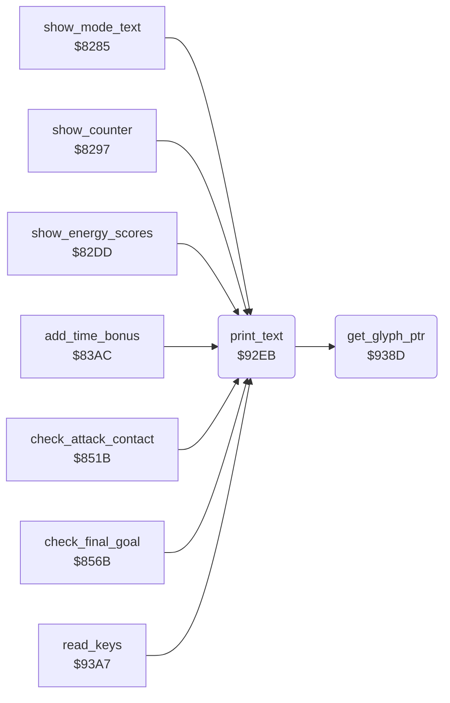

<!-- Generated by c64-docs from knowledge revision 20261029T165720.160-p83xh1 and .c64-re-tools/local/generated/src/source-map.json. Do not edit: change the knowledge, generate the source again, then run docs.ts generate. -->
# text/print_text.asm: Text output into the bitmap

Range `$92EB-$93A6`. Source: [text/print_text.asm](../../../../src/text/print_text.asm). Index: [the reference](../../index.md).

## Routines

| Routine | Address | Reached from | Summary |
|---|---|---|---|
| [`print_text`](print_text.md#print_text) | `$92EB` | [`show_mode_text`](../score/status_line.md#show_mode_text), [`show_counter`](../score/status_line.md#show_counter), [`show_energy_scores`](../score/status_line.md#show_energy_scores), [`add_time_bonus`](../score/time_bonus.md#add_time_bonus), [`check_attack_contact`](../story/final_stage.md#check_attack_contact), [`check_final_goal`](../story/final_stage.md#check_final_goal), [`read_keys`](../input/keyboard.md#read_keys) | Draws text A ($80 and up) from the pointer table $ba9a into the bitmap. |
| [`get_glyph_ptr`](print_text.md#get_glyph_ptr) | `$938D` | [`print_text`](print_text.md#print_text) | Sets glyph_ptr ($73/$74) to $e800 + A * 8, the glyph of character A in the font at $e800. |

## Call graph

A solid arrow is a call, a thick arrow a table entry. Rounded nodes are in this file.

## Details

### [`print_text`](../../../../src/text/print_text.asm#L6) `$92EB`

*routine*

Draws text A ($80 and up) from the pointer table $ba9a into the bitmap. A record: column, row, colour, characters, $0d starts a new record.
Text number * 2: the bit 7 of A drops out.

- **Called from:** [`show_mode_text`](../score/status_line.md#show_mode_text), [`show_counter`](../score/status_line.md#show_counter), [`show_energy_scores`](../score/status_line.md#show_energy_scores), [`add_time_bonus`](../score/time_bonus.md#add_time_bonus), [`check_attack_contact`](../story/final_stage.md#check_attack_contact), [`check_final_goal`](../story/final_stage.md#check_final_goal), [`read_keys`](../input/keyboard.md#read_keys)
- **Calls:** [`get_glyph_ptr`](print_text.md#get_glyph_ptr)
- **Reads:** [`text_ptrs`](texts.md#text_ptrs), [`text_ptr`](../../memory-map.md#text_ptr), [`times8_table`](../screen/address_tables.md#times8_table), [`times8_table_hi`](../screen/address_tables.md#times8_table_hi), [`screen_row_addr`](../screen/address_tables.md#screen_row_addr), [`screen_row_addr_hi`](../screen/address_tables.md#screen_row_addr_hi), [`bitmap_row_addr`](../screen/address_tables.md#bitmap_row_addr), [`bitmap_ptr`](../../memory-map.md#bitmap_ptr), [`bitmap_row_addr_hi`](../screen/address_tables.md#bitmap_row_addr_hi), [`data_ptr`](../../memory-map.md#data_ptr), [`text_column`](../../memory-map.md#text_column), [`text_color`](../../memory-map.md#text_color) and 4 more
- **Writes:** [`text_ptr`](../../memory-map.md#text_ptr), [`text_column`](../../memory-map.md#text_column), [`bitmap_ptr`](../../memory-map.md#bitmap_ptr), [`screen_ptr`](../../memory-map.md#screen_ptr), [`text_color`](../../memory-map.md#text_color), [`saved_y`](../../memory-map.md#saved_y)
- **Refers to:** [`text_ptr`](../../memory-map.md#text_ptr), [`bitmap_ptr`](../../memory-map.md#bitmap_ptr), [`screen_ptr`](../../memory-map.md#screen_ptr)

| Label | Address | Comment |
|---|---|---|
| [`print_text_record`](../../../../src/text/print_text.asm#L14) | `$92F9` | Record byte 0: column. |
| [`print_text_next_char`](../../../../src/text/print_text.asm#L41) | `$932C` | Reads the next character code of the text. |
| [`print_text_draw_char`](../../../../src/text/print_text.asm#L51) | `$933D` | A holds the glyph number. |
| [`print_text_copy_glyph`](../../../../src/text/print_text.asm#L55) | `$9344` | Copies one glyph row into the bitmap. |
| [`print_text_special_char`](../../../../src/text/print_text.asm#L87) | `$937C` | Looks up a digit, space or bracket in the table at $bc5c. Another code ends the text. |
| [`print_text_find_special`](../../../../src/text/print_text.asm#L89) | `$937E` |  |
| [`print_text_next_special`](../../../../src/text/print_text.asm#L94) | `$9389` |  |

### [`get_glyph_ptr`](../../../../src/text/print_text.asm#L99) `$938D`

*routine*

Sets glyph_ptr ($73/$74) to $e800 + A * 8, the glyph of character A in the font at $e800.

- **Called from:** [`print_text`](print_text.md#print_text)
- **Reads:** [`data_ptr`](../../memory-map.md#data_ptr)
- **Writes:** [`data_ptr`](../../memory-map.md#data_ptr)
- **Refers to:** [`data_ptr`](../../memory-map.md#data_ptr), [`font`](../graphics/font.md#font)
