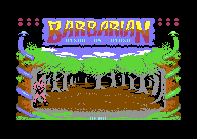

# Barbarian, part 1, V 05 05 87

Barbarian: The Ultimate Warrior is a sword-fighting game by Palace Software, 1987. This project is part 1 of the C64 game, Combat Practice. Two fighters fight in an arena with a sunset and in a forest. One player fights the computer opponents 0 to 7, or two players fight each other. The program has the version text "V 05 05 87". The documentation is for the releases RDI and HTL. The base release is RDI, the crack of Raw Deal Inc. of 19 May 1987. These cracks are the reference files. Nobody examined a Palace disk or tape. Thus "identical" on these pages means identical to the RDI capture, not to the commercial original. The parts that the four projects share are on [../README.md](../README.md).

**Evidence.** **Observed** marks a fact that a run, a byte compare or the coverage of the recordings showed. **Code** marks a fact from the code only. **Conclusion** marks an interpretation.

The attract demo in the arena with the sunset: one computer fighter rolls on the floor, and the mode text shows DEMO (**Observed**).

**Conventions.**
- Addresses are C64 addresses. Names are the names of the knowledge of `practice_v1`.
- A *frame* is one PAL screen, 1/50 of a second. A *pass* is one run of the main loop. The main loop has no frame wait, so a pass takes about 10 frames in the demo.
- A *bout* is one fight, from the walk-in to the kill. The *opponent* is `opponent_index`, 0-7. The *bout clock* is `time_left`, in seconds.
- *Fighter 0* is player 1, with the joystick in port 2. *Fighter 1* is player 2 with the joystick in port 1, or the computer. In the demo, the computer moves both fighters.
- *1PLR* and *2PLR* are the mode texts of a one-player game and of a two-player game.
- *Part 2* is the story game, the other program of the game. *V 05 10 87* is the later build of both parts.

## The development

The program has no credit text, no author name and no copyright line. The traces are a version text, the dead parts of the story, a cartridge header and bytes from the RAM of the machine. Each trace is also in the other programs of the group, so the full story is on [../docs/development.md](../docs/development.md). (**Observed** byte search)

**The version text.** CTRL+V shows [`text_version` `$B945`](src/text/texts.asm#L17), "V 05 05 87", while V stays pressed. As month, day and year, the date is 5 May 1987. Part 1 of FLT has "V 05 10 87", five days later. That build adds guards and corrections to the same code, and no change goes in the other direction. Thus this program is the earlier build (**Code**, **Conclusion**). The differences are on [../docs/versions.md](../docs/versions.md).

**Part 1 comes from the source of part 2.** [`set_end_figure` `$8CAB`](src/leftovers/leftover_8cab.asm#L6) is the routine of part 2 that moves the four sprites of the end of the story. Nothing in part 1 calls it. A byte compare of the 92 bytes finds 6 different bytes, and each is an operand that is exactly `$16A` lower than in part 2 (**Observed**). `$16A` is the shift of all data of part 1. Thus the authors assembled part 1 again from the full source after they cut the final stage. They did not patch the bytes of part 2 (**Conclusion**).

More parts of the story stay in this program, and no code of part 1 uses them (**Code**):

- The sprite set-ups of the end scene at `$CB33-$CB78`. Only the dead copy reads them.
- The 13 sprites of the end of the story at `$FC40-$FF7F`, with the same bytes as in part 2.
- Text 9 "YOUR END HAS COME" and text 10 "THANKS BIG BOY".
- The picture swaps of the end scene, and each test of the flag `final_stage`. Part 1 writes only 0 into this flag.

The two parts differ in one instruction of F1. Part 1 has `LDA two_players` and `EOR #$01`, and part 2 has `LDA #$00` at the same place (**Code**). **Conclusion:** the source was the full game, and part 1 is the cut version.

**No Commodore 128 code.** Part 2 has code for the C128 MMU at `$FFD0-$FFEF`. This program has the `$00 $FF` pattern of RAM after power-on there, in [`unused_ff80` `$FF80`](src/leftovers/leftover_ff80.asm#L6) (**Observed** byte compare). `$FFF0-$FFFE` hold a copy of `$9FF0-$9FFE`, as in part 2. Here these addresses are in the filter settings of the music driver, not in `freq_table`. Thus a memory action of the machine made the copy, and the source did not make it (**Conclusion**).

**The cartridge header.** [`cart_cold_start_vector` `$8000`](src/init/cartridge_header.asm#L6) holds the address `$8009` two times and the signature "CBM80". At a hardware reset, the KERNAL finds the signature and starts the game again without a new load (**Code**). The game fills `$0800-$FFFF`, much more than a cartridge of 16 KB holds. **Conclusion:** the authors used the header to restart a hung game fast during the tests.

**The RAM of the machine.** The bytes after the last table, [`unused_cdb6` `$CDB6`](src/data/unused_cdb6.asm#L6) to `$CFFF`, hold the pattern `$00 $FF`. The area is `$16A` bytes longer than in part 2, because the code is shorter (**Observed** byte compare). The stored forest at `$E000-$E7FF` is a copy of 1 KB of screen RAM and 1 KB of colour RAM. In its colour part, 644 of the 1000 bytes have the high nybble `$F`, and the other bytes have random high nybbles (**Observed**). **Conclusion:** the authors saved memory ranges of a running machine, not the exact length of the code.

## The copy protection

Nobody examined a Palace disk or tape. RDI and HTL are cracks, and each crack starts the game with its own intro and unpacker. The game code reads no disk, no loader value and no special memory state (**Code**). Thus no project of the group has a PROTECTION switch. **Conclusion:** the loader of the commercial original held the protection, and the cracks replaced it. The chain of each crack is on [../docs/releases.md](../docs/releases.md).

The game needs one service of its loader: the colours. The game writes colour RAM only in some areas, for example the fight area and the texts (**Code**). RDI copies 1000 bytes from `$B000-$B3E7` to colour RAM `$D800` and then jumps to `$8009` (**Observed**). After the start, the game uses `$B000-$B3E7` as a part of the clean copy of the fight area (**Code**). **Conclusion:** the loader of the commercial original also filled colour RAM before the jump. No reference file has that loader.

The game also takes the phase of its CIA 1 timers from the loader. It starts the timers without a force load, so the timer values at the entry decide when the sound interrupts come (**Code**). The demo AI also reads these timers as its random source. A loader of rc.19 entered with other timer values, and its replays went one frame off after about 500 checkpoints (**Observed**, see [tests/README.md](tests/README.md)).

## Findings

- **F1 counts passes, not key presses.** [`read_keys_f1_clock` `$929A`](src/input/keyboard.asm#L59) toggles `two_players` in each pass that finds F1 pressed, until F7 starts the game. An odd number of passes gives 2PLR (**Code**). The recordings `decapitation`, `fight` and `win_bout` pressed F1 for 10 frames to play one player. Each of them played a two-player game (**Observed** coverage). The `keys` recording pressed F1 during a pause. Thus no recording played a one-player game. A player who holds F1 gets a mode by chance, and a test must check `two_players` after F1 (**Conclusion**). See [game_flow.md](docs/game_flow.md#f1-and-the-number-of-players).

- **A one-player game has no end but a loss.** Part 1 has no final stage. After a win against opponent 7, [`end_bout_player_won` `$8476`](src/combat/end_of_bout.asm#L81) keeps `opponent_index` at 7 and changes the scene (**Code**). The player thus fights opponent 7 again and again, and a one-player bout has no time limit. Only a lost bout or Q ends the game (**Code**). No recording executed this path. See [game_flow.md](docs/game_flow.md#one-player-against-the-computer).

- **A time-out is a draw.** Only a two-player game uses the bout clock of 60 seconds. At 0, [`check_time_out` `$8307`](src/combat/time_out.asm#L6) sends both fighters to their home columns, gives each 12 energy and starts a new walk-in (**Code**). No fighter gets points, and the scores stay. The recording `fight` executed the full time-out (**Observed** coverage). Thus a two-player game ends only with a kill or with Q. See [game_flow.md](docs/game_flow.md#the-bout-clock-and-the-time-out).

- **The pause does not stop the bout clock.** F5 writes 0 into `sprites_frozen`, so the raster interrupt continues to count the clock (**Code**). **Conclusion:** in a two-player bout, the clock can reach 0 during a long pause, and the time-out starts in the first pass after the pause. No run showed it. See [game_flow.md](docs/game_flow.md#the-bout-clock-and-the-time-out).

- **The time bonus is only for two players.** [`add_time_bonus` `$83A3`](src/score/time_bonus.asm#L6) adds 10 points for each second that remains after a kill, at most 600 points. The counter counts down to `00` while the score grows (**Code**). The recording `two_win` executed this loop (**Observed** coverage). The walk-in also calls the routine in each pass. In the demo and in a one-player game, that call only clears `bout_winner` (**Code**). See [game_flow.md](docs/game_flow.md#the-time-bonus).

- **The hit-record bug reads the I/O area in part 1.** [`get_hit_record` `$86C6`](src/combat/hits.asm#L96) has the bug of part 2: a second list entry for the same defender pose uses a stale high byte. Here `hit_records` is at `$C642`, so the wrong records are at `$DE6F`, `$DE77` and `$DE83` (**Code**). With `$01` = `$25`, these addresses are in the I/O area, and no device answers there. Thus the bug reads random bytes, not the fixed screen bytes of part 2 (**Conclusion**). Thus the knowledge marks `$E3E8-$E3FF` and `$E7E8-$E7FF` as leftovers here, and the default build leaves them out (**Code**). No run showed the case. See [combat.md of game_v1](../game_v1/docs/combat.md#a-bug-the-second-entry-for-a-defender-pose).

- **Both fighters can lose in the same pass.** [`check_hits` `$862F`](src/combat/hits.asm#L6) tests `bout_loser` only before the two attacks, not between them (**Code**). **Conclusion:** in a two-player game, both players can lose their last energy in one pass, and player 1 then wins with 0 energy. No run showed the case. V 05 10 87 tests `bout_loser` before each attack. See [combat.md of game_v1](../game_v1/docs/combat.md#the-winner-move).

- **The joystick in port 1 can act as keys.** The joystick in port 1 uses the lines of CIA 1 port B. Its fire line is the column of F1, and its right line is the column of F7 (**Code**). **Conclusion:** player 2 can start the set-up with the fire button and start the game with the joystick to the right. No run showed it. See [game_flow.md](docs/game_flow.md#f1-and-the-number-of-players).

## How the program works

The crack jumps to `$8009`. The start code prepares the memory, the VIC-II, the interrupts and the sound. Then the demo starts: two computer fighters fight in the arena with the sunset and in the forest. The demo is the title of the game (**Code**).

F1 starts the set-up and toggles 1PLR and 2PLR, and F7 starts the first bout. Each bout starts with a walk-in and ends with a kill or, in a two-player game, a time-out. One player fights the opponents 0 to 7 until a loss. Two players fight one bout. Each end of a game returns to the demo (**Code**).

~~~mermaid
flowchart TB
  S["Start: memory, VIC-II, interrupts, sound (start)"] --> M["Main loop: one pass, no frame wait (main_loop)"]
  M --> K["Status texts, keys, F1 players (read_keys)"]
  M --> C["Bout clock and time-out (check_time_out)"]
  M --> A["Joysticks and computer (ai_choose_moves)"]
  A --> F["Moves, poses and drawing in the work bitmap (animate_fighters)"]
  F --> H["Hits, energy, score, decapitation (check_hits)"]
  H --> E["End of a bout, goblin, time bonus, next opponent (end_bout)"]
  E --> Q["Quit to the demo (quit_to_demo)"]
  I["Raster IRQ at line $FA: sprites and timers (raster_irq)"] -.-> M
  T["CIA 1 timers: music tick and effects tick"] -.-> M
~~~

1. **The start runs after each load and each quit.** [`start` `$8009`](src/init/init.asm#L6) selects the effects mode and continues into `restart`. That code removes BASIC and the KERNAL from the memory map, selects VIC bank 1 and sets the interrupts. `init_game_state` sets the demo with opponent 4 and one player (**Code**).
2. **The main loop sets the pace.** [`main_loop` `$80BB`](src/main/main_loop.asm#L6) calls 21 routines in each pass and never returns. Part 2 calls 23, with the final stage. Each routine tests its own flags, so one loop serves the demo, the set-up and the bouts. In the attract recording, `read_keys` ran 1487 times in about 15500 frames (**Code**, **Observed**).
3. **The keys select the mode.** [`read_keys` `$922F`](src/input/keyboard.asm#L6) reads the keyboard matrix once in each pass, with no edge test. F1 starts the set-up and toggles the players, F7 starts the game, and Q quits (**Code**).
4. **The player and the computer obey the same rules.** The joysticks and [`ai_choose_moves` `$85A0`](src/ai/computer_moves.asm#L6) give a joystick value to each fighter. In a two-player game, the computer routine returns at once (**Code**).
5. **Each pass draws the fighters again.** [`animate_fighters` `$87CE`](src/fighter/animate.asm#L6) builds each pose and draws it into a work bitmap. The main loop then copies the work bitmap to the screen in one copy, so the fighters do not flicker (**Code**, **Conclusion**).
6. **The bout clock runs in the interrupt.** `count_down_timers` decrements `time_left` after each 50 frames. In a two-player game, `check_time_out` ends the bout at 0 (**Code**).
7. **The interrupts keep the time.** [`raster_irq` `$93B0`](src/irq/irq_handler.asm#L42) copies the sprite registers, moves the sprites and counts the timers at line `$FA`. CIA 1 timer B runs [`music_tick` `$97B5`](src/music/tick.asm#L6), and timer A runs the effects (**Code**).

The forest after a scene change in the demo: one fighter stands at the left, and the scores of the demo show (**Observed**).

## The pages

The project has one page of its own, the game flow. Part 1 uses the code and the data of part 2 for each other subsystem, so the pages of `game_v1` explain them. An address of part 1 plus a shift gives the address in `game_v1`. The shift is 0 up to `$80FC`, +6 up to `$8486`, +$16C up to `$92A6` and +$16A from `$92A7` to `$CDB5`. From `$D000` on, it is 0 again (**Code**). The section "Shared with Part 2" of the game flow gives the table.

| Page | Content |
|---|---|
| [docs/game_flow.md](docs/game_flow.md) | **The game flow.** The start, the main loop, the demo, the keys and F1. The set-up, the bout clock, the time-out, the time bonus, the scenes and the quit. |
| [tests/README.md](tests/README.md) | **The tests.** The recordings, the mode that each recording played, the writes that are only for a test, and the replays on the default build. |
| [../game_v1/docs/fighters.md](../game_v1/docs/fighters.md) | **The fighters** (part 2, shared). The joystick, the moves, the poses, the work bitmap, the sprite parts, the turn and the idle move. |
| [../game_v1/docs/combat.md](../game_v1/docs/combat.md) | **Combat** (part 2, shared). The hit lists and records, the energy, the score, the decapitation, the goblin and the hit-record bug. |
| [../game_v1/docs/ai.md](../game_v1/docs/ai.md) | **The computer opponent** (part 2, shared). The AI tables, the level of each opponent, the counter and the CIA timers of the demo. |
| [../game_v1/docs/graphics.md](../game_v1/docs/graphics.md) | **The graphics** (part 2, shared). The bitmap, the scene change, the work bitmap, the colours, the sprites, the raster IRQ and the text output. |
| [../game_v1/docs/sound.md](../game_v1/docs/sound.md) | **Sound and music** (part 2, shared). The driver on two CIA timers, the tune format, the music, the effects and F3. |
| [../docs/development.md](../docs/development.md) | **The development.** The traces of the work of the authors in the four programs. |
| [../docs/versions.md](../docs/versions.md) | **The versions.** Part 1 against part 2, and V 05 05 87 against V 05 10 87. |
| [../docs/releases.md](../docs/releases.md) | **The releases.** The three cracks, their files, the crack chain and the Hotline trainer. |

## The releases

| Label | File | SHA-256 |
|---|---|---|
| RDI | `releases/rdi/Barbarian (Palace) [Raw Deal Inc.].t64` | `3dd5163e552a0992ee6ab2158e8056a58301dbf52588987864384452e77e09d4` |
| RDI | `releases/rdi/barbarian_part1_rdi.prg` | `be23d11d9c2fd24241ff5607f82d871ece4af1cf8e7576972c7e8d8d7c787c1e` |
| RDI | `releases/rdi/BARBARIAN.d64` | `190eba60b94c7099135e30500cb27be9ba9d5e80c431be492bd86a53f84f02f9` |
| HTL | `releases/hotline/Barbarian.D64` | `b24e7f4156b35c1a2b8884a4813fb104e55e0d3a2e51ae41f2e0f290fe9685a2` |
| HTL | `releases/hotline/barbarian_i_hotline.prg` | `bb9559a7cf6563d5fead1e8f13b1331d45753a5a377367f573879abc55a9037a` |

- **RDI** (Raw Deal Inc., 19 May 1987, CSDb 22600): the T64 holds PART 1 and PART 2. `barbarian_part1_rdi.prg` is PART 1 of the T64. The D64 holds only part 1, as BARBARIAN CP/RDI, with the same bytes. CP means Combat Practice. RDI changed no byte of the game (**Observed**, **Conclusion**).
- **HTL** (Hotline, 1 June 1987, CSDb 94591): a recrack of the RDI file with a trainer menu. The patches of the two switches of Hotline hold 24 bytes. Each release build gives the bytes of its capture, so the patches hold each change of Hotline (**Observed**).

The FLT release of Fairlight holds the other build, V 05 10 87. Its part 1 is the project `practice_v2` of the group, see [../README.md](../README.md#the-projects).

**The Hotline trainer of part 1.** The key T in the trainer menu writes `JSR $CE00` and `NOP` at `$8714` in [`apply_hit_damage` `$86D9`](src/combat/hits.asm#L109). The routine at `$CE00` skips the energy loss of player 1 (**Code**). In a two-player game, only player 1 gets this help (**Conclusion**). The trainer has the bug of part 2: when a hit animation runs already, `BMI` at `$870B` goes to `$8716`, inside the new JSR. In part 1, the bytes there give a legal `DEC $D0EA`, then the illegal opcodes of part 2 (**Code**). Thus no fighter loses energy while its hit animation runs, and `$D0EA`, a mirror of the colour register of sprite 3, decreases (**Code**).

**Hotline also changed the cartridge header.** HTL writes `$0838` into both vectors at `$8000` and 0 over the letters CBM. The bytes "80" stay. Without the signature, a reset goes to BASIC and does not restart the game (**Observed** byte compare, **Code**). HTL also changed the byte `$D6EF` from `$59` to `$80`, in the stored bitmap of the forest. Why Hotline changed this byte is not known. The details are on [../docs/releases.md](../docs/releases.md#htl-the-hotline-trainer).

## The rebuild

**The base release.** The knowledge holds the memory of RDI at the game entry `$8009`. It has three segments: `$0800-$080F`, `$083F-$AFFF` and `$B3E8-$FFFF`, 62441 bytes. The capture leaves out three areas of the crack: the intro screen `$0400-$07E7`, the colour copier `$0810-$083E` and its colours `$B000-$B3E7`. The game uses `$B000-$B3E7` only as work RAM, so it needs no bytes there (**Observed**, **Conclusion**).

**The entry state.** `build/clean_loader.prg` is a packed program that starts with RUN. Its copier puts the segments into place and writes the entry state at `$0002-$03FF`. It sets the VIC-II registers of the entry state. Then it waits for a raster line, loads the CIA 1 timers and jumps to `$8009` (**Code**). The timer load keeps the phase of the timer interrupts of the capture (**Observed** in the replays).

**The colour RAM defect.** The entry state in the knowledge holds the 1000 colours of colour RAM. The loader of c64-re-tools 2.7.0-rc.1 does not write them. Thus `build/clean_loader.prg` shows the pictures in wrong colours. The game itself writes only some areas of colour RAM, for example the fight area and the texts. The crack copies the other colours from `$B000-$B3E7` before the jump (**Observed**). The replays compare RAM and not colour RAM, so they pass. This is a defect of the toolkit, not of the knowledge or the source.

**The switches.** `src/config.asm` holds the value of each switch, and `src/switches.asm` holds the values of each release. Each switch is 0 in the default build, so the default build gives the clean RDI program without the leftovers (**Code**).

| Switch | Kind | Default | Releases with it on | What it changes |
|---|---|---|---|---|
| `TRAINER` | trainer | 0 | HTL | `JSR $CE00` / `NOP` at `$8714-$8717`, and the trainer routine at `$CE00-$CE0B` |
| `CRACK_HOTLINE` | crack | 0 | HTL | `$0838`, `$0838` and three 0 bytes at `$8000-$8006`, and `$80` at `$D6EF` |
| `LEFTOVERS` | leftovers | 0 | RDI, HTL | 496 bytes in 10 files of `src/leftovers/` that nothing uses, with the dead copy of `set_end_figure` |

**The builds.** From the project folder, with the scripts of the c64-source and c64-assembler skills:

1. `source.ts generate --out src --loader` writes the source and `build/clean_loader.prg`, the default build. It loads with `LOAD"...",8` and starts with RUN.
2. `assembler.ts build src main.asm --release RDI --compare` builds the RDI bytes, and `--release HTL` builds the HTL bytes. Each release build has the same bytes as its capture in all segments (**Observed**).

**The tests.** Eight recordings with scripted input replay on `build/clean_loader.prg`: `attract`, `decapitation`, `fight`, `keys`, `two_decap`, `two_players`, `two_win` and `win_bout`. Claude wrote the steps, and no person played. Each replay stops at `main_loop` and compares the energy, the position and the move of both fighters. It also compares the opponent, the scene, the loser and the final stage flag. The rebuild gives the same values at all 4756 checkpoints, with no pins (**Observed**). Each recording with a game played a two-player game, because of F1. The notes of each recording are on [tests/README.md](tests/README.md).

**The code that no run executed.** After all recordings, 29 code ranges with 303 instructions stayed unexecuted (**Observed** coverage). The main groups are:

- The dead parts of the story: the copy of `set_end_figure`, the swaps of the end scene and the final stage path of the quit. They have 178 instructions in 3 ranges.
- The end of a one-player bout: the loss, the next opponent and opponent 7. It has 11 instructions in 1 range.
- The commands and options of the sprite motions, the sprite animations, the corner animations and the move sequences that no run used. Examples are the sprite expansion and the Y limits of a sprite: 64 instructions in 11 ranges.
- The paths of the sound driver that no tune uses, for example the command `$F1` and the frequency slide: 34 instructions in 7 ranges.
- The key Q, and the paths of F1 and of the quit that restore the sunset or the sprites. They have 9 instructions in 5 ranges.
- Two rare cases: a hit sprite while the sprite slot 0 is busy, and a head at X 256 or more. They have 7 instructions in 2 ranges.

## Still open

- How does a one-player game of part 1 end, and what happens after the win against opponent 7? — A recording that presses F1 for an even number of passes, then wins and loses bouts.
- Which press lengths of F1 give 2PLR? — A run that counts the passes while F1 stays pressed, in the demo and in the set-up.
- Does the joystick in port 1 start the set-up and the game? — A run with fire and right on port 1 in the demo and in the set-up.
- Does the bout clock reach 0 during a long pause? — A run that presses F5 in a two-player bout and compares `time_left` before and after the pause.
- What does Q do in each state? — A run that presses Q in the demo, the set-up, a bout and the time-out.
- What does a second entry for a defender pose do with the bytes of the I/O area? — A two-player run with fire + back at distance 2 against pose `$3F`, with a watch on `move_ptr`.
- Can both fighters lose their last energy in one pass? — A two-player run with the energy of both fighters at 1 and two attacks in the same pass.
- What does a player see after the bug of the Hotline trainer at `$8716`? — A run of HTL with the trainer and a second hit during a hit animation.

## The reference

[docs/reference/index.md](docs/reference/index.md)
