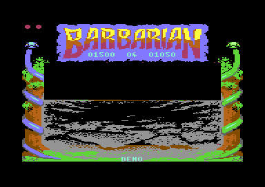

# The game flow (Part 1, V 05 05 87)

The game flow connects the fights of Part 1, Combat Practice. After the start, the program shows a demo: two computer fighters fight in the arena with the sunset. F1 starts the set-up and also selects one or two players. F7 starts the game. In a one-player game, the player fights the computer opponents 0 to 7, and a lost bout ends the game. In a two-player game, two players fight one bout against each other, with a bout clock of 60 seconds. The flow selects the scene, starts the walk-in of each bout, ends each bout and returns to the demo. It also reads the keys for the music, the pause, the version text and the quit. (**Code**)

**Conventions.**
- Addresses are C64 addresses. Names are the names of the knowledge of `practice_v1`.
- A *frame* is one PAL screen, 1/50 of a second. The raster interrupt runs one time in each frame.
- A *pass* is one run of `main_loop`. A pass has no frame wait, so it takes as many frames as its work needs.
- A *bout* is one fight, from the walk-in to the kill. The *walk-in* is the start of a bout: the two fighters walk to each other.
- The *opponent* is [`opponent_index` `$BE`](../src/constants.asm#L99), 0-7. The demo uses opponent 4.
- The *scene* is [`scene_index` `$C4`](../src/constants.asm#L105): 0 is the arena with the sunset, 1 is the forest.
- The *bout clock* is [`time_left` `$C8`](../src/constants.asm#L109), in seconds.
- A *flag* is a byte in which bit 7 set means "on". Many routines do nothing while a flag is on.
- Player 1 is fighter 0, joystick port 2. Fighter 1 is player 2 on joystick port 1, or the computer. In the demo, the computer moves both fighters.
- *Part 2* is the story game. Its game flow is on [../../game_v1/docs/game_flow.md](../../game_v1/docs/game_flow.md).
- **Observed** marks a fact that a run showed. **Code** marks a fact from the code only. **Conclusion** marks an interpretation.

## How it works

The program has no title screen. The demo is the title, and the game returns to the demo after each game. Each game mode uses the same main loop. Flags tell each routine of the loop if it must work in this pass. [`two_players` `$BD`](../src/constants.asm#L98) selects the mode of a game: 0 is one player, 1 is two players. (**Code**)

~~~mermaid
flowchart TB
  A["Start: memory, VIC, interrupts, sound (start)"] --> B["Demo: computer against computer, opponent 4"]
  B -->|F1| C["Set-up: opponent 0, F1 toggles 1PLR and 2PLR"]
  C -->|F7| D["Walk-in of a bout"]
  D --> E["Bout: one pass of the main loop for each step"]
  E -->|two players, clock at 0| F["Time-out: both fighters walk home"]
  F --> D
  E -->|kill| G["Goblin drags the loser away, winner walks home"]
  G -->|one player won| H["Next opponent, other scene"]
  H --> D
  G -->|two players| I["Time bonus for the winner"]
  G -->|player lost| J["Wait 200 frames, quit to the demo"]
  I --> J
  J --> B
~~~

[`start` `$8009`](../src/init/init.asm#L6) prepares the machine and runs into [`main_loop` `$80BB`](../src/main/main_loop.asm#L6). The main loop never returns. Each end of a game goes through [`quit_to_demo` `$9341`](../src/main/quit_to_demo.asm#L6), which resets the stack and jumps to `restart`. The state machine at the end of the page gives each change of state. (**Code**)

### The start and the initialisation

Each crack jumps to `start` after its own code. The cartridge header CBM80 at `$8000` also points to `start`, so a hardware reset starts the game again. The NMI vector points to an RTI, so RESTORE does nothing. (**Code**) The page [../../docs/releases.md](../../docs/releases.md) tells how the Hotline release removed the header.

`start` writes 0 into `sound_off`, so the game starts with the sound effects. Then [`restart` `$800E`](../src/init/init.asm#L11) does the same steps as in Part 2, in this order (**Code**):

1. [`init_game_state` `$9106`](../src/init/state.asm#L6) clears all flags of the game. It writes 0 into `two_players`, 1 into `demo_mode` and 4 into `opponent_index`, so the demo starts.
2. It writes `$25` into `$01`: RAM at `$A000` and `$E000`, I/O at `$D000`, no BASIC and no KERNAL.
3. It selects VIC bank 1, the screen at `$4400` and the bitmap at `$6000`, in multicolour bitmap mode.
4. It writes the IRQ vector (`$937E`) and the NMI vector (`$93AF`, an RTI). The raster interrupt comes at line `$FA`.
5. It clears the sprites, saves the clean fight background and resets the colours and the sprite scripts.
6. `init_fighters` puts both fighters at their start columns 0 and `$1F` with energy 12 and score 0. It sets `walk_in_active`, so the first bout starts with a walk-in.
7. It builds the mirror table at `$02AA` and the mask table at `$03AA`.
8. With the sound effects, it starts the CIA 1 timers A and B, silences the SID and fades the volume in. With the music, it keeps the timers, and the music continues.
9. It enables the interrupts and continues into `main_loop`.

A restart thus keeps the choice of F3, but it clears each other state of the game. Each new game starts as a one-player game until F1 toggles it. (**Code**)

### The main loop

`main_loop` calls 21 routines and jumps back. Part 2 calls 23 routines: Part 1 has no calls of `final_stage_attack` and `set_end_figure`. Each routine tests its own flags. The calls come in this order (**Code**):

1. **The status texts.** It animates the corner blocks and prints the mode text, the counter, the energy bars and the scores.
2. **The time-out.** [`check_time_out` `$8307`](../src/combat/time_out.asm#L6) ends a two-player bout at time 0, see "The time-out".
3. **The input.** [`read_joysticks` `$84A3`](../src/input/joystick.asm#L6) reads the joystick of each human fighter. `ai_choose_moves` gives a joystick value to each computer fighter.
4. **The fighters.** It copies the clean background into the work bitmap, steps the move of each fighter and draws both fighters. It starts the decapitation and the goblin. Then it copies the work bitmap to the screen.
5. **The rules.** It calculates the distance, turns the fighters after they pass each other and finds the hits.
6. **The flow.** `update_walk_in` runs the walk-in, `end_bout` ends a bout after a kill, and `check_player_idle` starts the idle move of a player who does nothing.
7. **The keys.** `read_keys` reads the function keys, Q and CTRL+V.

The main loop has no frame wait. In the attract recording, `read_keys` ran 1487 times in about 15500 frames after the key of the cracktro. A pass thus takes about 10 frames on average. (**Observed**)

The raster interrupt does the work that needs a fixed pace. At line `$FA`, [`raster_irq` `$93B0`](../src/irq/irq_handler.asm#L42) moves the sprites, runs the sprite scripts and calls `count_down_timers`. This routine counts down the idle timers, `wait_counter` and the bout clock. (**Code**)

### The attract demo

The demo starts after each start and after each game. `demo_mode` is 1, so `read_joysticks` reads no joystick and `ai_choose_moves` moves both fighters. Both fighters use the tables of opponent 4, and the counter shows `04`. The mode text shows DEMO. (**Code**)

The demo in the arena with the sunset: one fighter rolls on the floor, and the mode text shows DEMO.

In the demo, the random number of the computer comes from the CIA 1 timers: timer B low EOR timer A low (**Code**). The attract recording has 2336 read pairs of `$DC06` and `$DC04` (**Observed**).

A demo bout ends only with a kill, because `check_time_out` returns at once when `demo_mode` is not 0. After each kill, `end_bout` changes the scene, and the next demo bout starts with a walk-in. `opponent_index` stays 4. The scores of both fighters grow from bout to bout. (**Code**) The forest screenshot shows the scores 01500 and 01050 in the demo (**Observed**).

### The keys

[`read_keys` `$922F`](../src/input/keyboard.asm#L6) reads the keyboard matrix one time in each pass. CIA 1 port A selects a row, and port B gives the columns. The routine has no edge test, so a key acts in each pass that finds it pressed. (**Code**)

| Key | Row, bit | Effect | Condition |
|---|---|---|---|
| CTRL+V | 7 bit 2, 3 bit 7 | Shows "V 05 05 87" while V stays pressed | Always |
| F1 | 0 bit 4 | Starts the set-up: opponent 0, demo off | No set-up, no started game, no turn, no loser |
| F1 | 0 bit 4 | Resets the clock and toggles `two_players` | No started game |
| F3 | 0 bit 5 | Changes between the sound effects and the music | Always |
| F5 | 0 bit 6 | Pauses until the next F5 | Not during the set-up |
| F7 | 0 bit 3 | Starts the game | Only during the set-up |
| Q | 7 bit 6 | Quits to the demo | Always |

F3, F5, CTRL+V and Q work as in Part 2. The page [../../game_v1/docs/game_flow.md](../../game_v1/docs/game_flow.md) explains them. (**Code**)

The keys recording shows the same cases as in Part 2 (**Observed**):

- F3 two times in the demo changes to the music and back.
- CTRL+V for 40 frames shows the version text. The loop read V 134 times.
- F5 for 40 frames in the demo starts the pause. F1, F3, F3 and F7 come during the pause and have no effect.
- F5 for 60 frames ends the pause, and a second pause starts. F3 and Q come during this pause. The recording ends in the pause.

Thus no recording executed the Q path (**Observed**, coverage).

### F1 and the number of players

[`read_keys_f1_clock` `$929A`](../src/input/keyboard.asm#L59) toggles `two_players` between 0 and 1 in each pass that finds F1 pressed. Part 2 writes 0 at the same place. The toggle runs while bit 7 of `game_started` is 0, so F7 fixes the number of players. (**Code**)

The first pass with F1 starts the set-up and also toggles `two_players`. After a restart, the value is 0, so it changes to 1. Thus a press that one pass reads gives 2PLR, and a press that two passes read gives 1PLR. An odd number of passes always gives 2PLR. (**Code**) The recordings `two_players`, `two_win` and `two_decap` press F1 for 3 frames and play a two-player game (**Observed**).

The recordings `decapitation`, `fight` and `win_bout` press F1 for 10 frames. Two-player code also ran in each of them: the time bonus, and in `fight` the time-out. Thus these three recordings also played two-player games. No recording executed the end of a one-player game. (**Observed**, coverage)

The toggle also runs in the demo, during a turn or after a kill. These states skip the start of the set-up, but `game_started` is 0. Thus F1 at that time toggles `two_players` without a set-up. The mode text still shows DEMO. (**Code**)

The joystick in port 1 uses the lines of port B. Its fire line is the column of F1, and its right line is the column of F7. **Conclusion:** player 2 can start the set-up with the fire button and start the game with the joystick to the right. No run showed it.

### The set-up and the start of a game

F1 in the demo starts the set-up. `read_keys` writes `$80` into `setup_active` and 0 into `opponent_index`, `game_started` and `demo_mode`. When the forest shows, it calls `change_scene`, so each game starts in the arena with the sunset. Then it calls `init_fighters` and resets the sprite scripts and the bout clock. (**Code**) The mode text shows 1PLR or 2PLR, from `two_players` (**Code**).

During the set-up, the main loop runs, but most routines do nothing. The fighter animation, the joystick, the computer, the hits and the walk-in all test `setup_active`. F5 has no effect. (**Code**)

F7 during the set-up writes `$80` into `game_started` and 0 into `setup_active`, and resets the bout clock. Now F1 has no effect until the end of the game. `walk_in_active` is still set from `init_fighters`, so the walk-in of the first bout starts in the next pass. (**Code**) Each recording of a game presses F7 30 frames after F1 (**Observed**).

### One player against the computer

In a one-player game, `read_joysticks` reads only port 2, and `ai_choose_moves` moves fighter 1. The player fights the opponents 0 to 7 in turn, one bout each. Each opponent uses its own table of the computer moves. The page [../../game_v1/docs/ai.md](../../game_v1/docs/ai.md) gives the level of each opponent. (**Code**)

A one-player bout has no time limit. The bout clock counts down, but only two-player code reads it. The counter shows the opponent number. (**Code**)

Part 1 has no final stage. After the win against opponent 7, `end_bout` changes the scene and keeps `opponent_index` at 7. Thus the player fights opponent 7 again and again, until he loses a bout. (**Code**) The page [../../docs/versions.md](../../docs/versions.md) compares this with Part 2.

### Two players

In a two-player game, `read_joysticks` reads both ports: port 2 for fighter 0 and port 1 for fighter 1. [`ai_choose_moves` `$85A0`](../src/ai/computer_moves.asm#L6) returns at once, so no computer fighter moves. `check_player_idle` also tests both fighters, because it counts down from `two_players` to 0. (**Code**) The `two_players` recording gives each joystick direction, with and without fire, first in port 2, then in port 1 (**Observed**).

A two-player game has one bout only. The bout ends with a kill or with the time-out. After a kill, the winner gets the time bonus, and the game returns to the demo. After a time-out, the same two players start a new bout with full energy. (**Code**)

The counter between the scores shows the bout clock, not the opponent. The mode text shows 2PLR. `opponent_index` is 0, so the single-colour sprite parts of the fighters use `fighter_colours` of opponent 0, purple. (**Code**)

### The bout clock and the time-out

[`reset_timer` `$9146`](../src/init/state.asm#L44) writes 60 into `time_left` and 50 into `time_frame_count`. F1, F7 and the first pass of each walk-in call it. [`count_down_timers` `$978D`](../src/irq/timers.asm#L6) decrements `time_left` after each 50 frames, down to 0. It stops while `walk_in_active`, `time_out_active` or `bout_loser` has bit 7 set. (**Code**)

`check_time_out` starts the time-out when each of these conditions is true (**Code**):

1. `demo_mode` is 0, and `time_left` is 0.
2. `two_players` is not 0.
3. `turn_request` has bit 7 clear.

The time-out writes `$80` into `time_out_active`. This flag stops the joysticks, the hits, the idle move and the clock. Each fighter walks back with move `$02` to its home column: 3 when it faces right, `$1C` when it faces left. A fighter at home stands in move `$00`. When both fighters stand, the routine clears `time_out_active`. It gives energy 12 to both fighters and sets `walk_in_active`. The next walk-in sets the clock to 60 again. (**Code**)

A time-out is thus a draw. No fighter gets points, and the scores stay. A two-player game ends only with a kill or with Q. (**Code**) The `fight` recording executed the full time-out, with the walk home and the reset of both fighters (**Observed**, coverage).

The F5 pause stores 0 in `sprites_frozen`, so the raster interrupt continues to count the clock during the pause (**Code**). **Conclusion:** in a two-player bout, the clock can reach 0 during a long pause. The time-out then starts in the first pass after the pause.

### The walk-in

[`update_walk_in` `$8352`](../src/combat/walk_in.asm#L6) runs while bit 7 of `walk_in_active` is 1. It gives move `$01`, walk forward, to both fighters. It requests the sound effects `$89`, `$8A` and `$8B` when the sound requests and the tune of voice 0 are free. (**Code**)

When `fighter_distance` is less than 6 columns, the walk-in ends. The routine clears `walk_in_active` and starts the idle timers of both fighters. With the sound effects, it stops the sound and fades the volume in again. (**Code**)

`update_walk_in` also calls `add_time_bonus` in each pass of the walk-in. In a one-player game and in the demo, this call only clears `bout_winner`. A two-player game reaches no walk-in after a kill. (**Code**) **Conclusion:** this call adds no points in Part 1.

### The end of a bout

A kill sets `bout_loser` to `$80` + the number of the loser. `start_winner_move` gives a winner move to the other fighter and sets `bout_winner`. When the loser lies on the floor, `start_goblin` starts the goblin. The goblin drags the body to the right. (**Code**) The page [../../game_v1/docs/combat.md](../../game_v1/docs/combat.md) explains the decapitation and the goblin.

[`end_bout` `$83F2`](../src/combat/end_of_bout.asm#L6) waits until the loser is at column `$28` or more, outside the screen. Then the winner turns and walks back to its home column. At the home column, `end_bout_reset` resets both fighters for the next bout and sets `walk_in_active` again. Then `end_bout` selects the next step (**Code**):

- **Demo.** It changes the scene. The next demo bout starts.
- **Two players.** It adds the time bonus, waits 200 frames and jumps to `quit_to_demo`.
- **One player lost.** It waits 200 frames, 4 seconds, and jumps to `quit_to_demo`.
- **One player won.** It increments `opponent_index` up to 7 and changes the scene. The next bout starts.

The two-player path ran in the recordings `two_decap`, `two_players`, `two_win` and `win_bout`. In `two_decap` and `two_players`, a decapitation ended the bout. (**Observed**, coverage)

### The time bonus

[`add_time_bonus` `$83A3`](../src/score/time_bonus.asm#L6) works only in a two-player game, outside the demo, with bit 7 of `bout_winner` set. The clock stopped at the kill, so `time_left` holds the seconds that remained. (**Code**)

For each second, the routine does these steps (**Code**):

1. It adds the five digits of `time_bonus_points`, 00010, to the score text of the winner.
2. It decrements `time_left`.
3. It prints the score of the winner and the counter.
4. It waits 1 frame.

Thus the winner gets 10 points for each second, at most 600 points. The counter counts down to `00` while the score grows. At the end, the routine clears `bout_winner`. (**Code**) The `two_win` recording executed this loop after the win of player 1 (**Observed**, coverage).

### The scenes

[`change_scene` `$8D07`](../src/screen/scene.asm#L6) changes the centre of the picture to the other stored picture. The centre is rows 7-22, columns 4-35. The routine fades the sound out and copies the centre into a buffer of 16 pages at `$A50E-$B50D`. It swaps the buffer with the store at `$D000-$DFFF` and draws the buffer into the bitmap. Then it fades the sound in. `scene_index` changes from 0 to 1 or from 1 to 0. (**Code**)

The new centre comes from row 22 up to row 7 (**Code**). The screenshot during a change shows the lower rows of the new picture and the black upper rows (**Observed**).

During the scene change in the demo: the lower half of the new picture shows, and the upper half is still black.

The scene changes after each demo bout and after each won bout of one player. A two-player game has no change of scene. F1 and `quit_to_demo` change back to the sunset when the forest shows. Thus each game starts in the arena with the sunset. (**Code**) In the `two_players` recording, the scene changed in the demo after the game (**Observed**, coverage).

The forest after the scene change in the demo: one fighter stands at the left, and the scores of the demo show.

`scene_top_colour` at `$7F40` gives the background colour of the lower screen for each scene. Both bytes are `$09`, brown, so both scenes use the same colour. Part 2 uses `$0B`. (**Code**)

### Quit to the demo

`quit_to_demo` switches off the sprites and removes the fighters from the screen. It mirrors the sprite images back when `sprite_mirror_state` is not 0. It tests `final_stage`, but Part 1 never sets this flag. When the forest shows, it changes back to the sunset. Then it resets the stack pointer to `$FF` and jumps to `restart`. (**Code**)

`restart` calls `init_game_state` again, so the demo starts with opponent 4, new scores and one player. The two-player recordings return to the demo (**Observed**).

## Shared with Part 2

Part 1 uses the code and the data of Part 2 for each other subsystem. Only the addresses change. The pages of `game_v1` explain these subsystems (**Code**):

| Subsystem | Page |
|---|---|
| Joystick, moves, poses, drawing of the fighters | [fighters.md](../../game_v1/docs/fighters.md) |
| Hits, energy, score, decapitation, goblin | [combat.md](../../game_v1/docs/combat.md) |
| Move choice of the computer, AI tables, levels | [ai.md](../../game_v1/docs/ai.md) |
| Bitmap, scene store, sprites, raster interrupt, texts | [graphics.md](../../game_v1/docs/graphics.md) |
| Music driver, tunes, effects, F3 | [sound.md](../../game_v1/docs/sound.md) |

The final stage of [final_stage.md](../../game_v1/docs/final_stage.md) is not in Part 1. The dead copy of `set_end_figure` and its data stay, see [../../docs/versions.md](../../docs/versions.md).

An address of Part 1 plus the shift gives the address of the same code or data in `game_v1` (**Code**):

| Part 1 range | Contents | Shift to `game_v1` |
|---|---|---|
| `$8000-$80BA` | Cartridge header, start | 0 |
| `$80BB-$80FC` | Main loop | 0 |
| `$80FD-$8486` | Status texts, time-out, walk-in, time bonus, end of a bout | +6 |
| `$8487-$92A6` | From `wait_frames` to the F1 code of `read_keys` | +$16C |
| `$92A7-$CDB5` | From the F3 code of `read_keys` on: the rest of the code, the music, the work bitmap, the texts and the tables | +$16A |
| `$CDB6-$CFFF` | Unused RAM, `$CF20-$CFFF` in `game_v1` | - |
| `$D000-$FF7F` | Second picture, font, corners, high tunes, end story sprites | 0 |

For example, `change_scene` is at `$8D07` in Part 1 and at `$8E73` in Part 2. `quit_to_demo` is at `$9341` and at `$94AB`. The F1 code of Part 1 is 2 bytes longer, so the shift changes from +$16C to +$16A inside `read_keys`. (**Code**)

## The data

### The flags of the flow

Most routines of the main loop start with a test of some of these flags. A flag with bit 7 set stops the routine. The flags are zero page bytes from [`bout_loser` `$AF`](../src/constants.asm#L84) to [`final_stage` `$BB`](../src/constants.asm#L96). (**Code**)

| Flag | Set by | Cleared by | Stops |
|---|---|---|---|
| `setup_active` | F1 | F7 | Fighter animation, joystick, computer, hits, walk-in, idle move, F5 |
| `game_started` | F7 | `init_game_state` | F1 |
| `walk_in_active` | `init_fighters`, `end_bout_reset`, `check_time_out` | `update_walk_in` | Joystick, computer, hits, idle move, clock |
| `turn_request` | The fighters pass each other | The turn move | Joystick, computer, hits, time-out, F1 set-up |
| `bout_loser` | A kill (energy 0 or decapitation) | `end_bout_reset` | Joystick, computer, hits, idle move, clock, F1 set-up |
| `time_out_active` | Time 0, two players only | Both fighters at home | Joystick, computer, hits, idle move, clock |
| `final_stage` | No code of Part 1 | `init_game_state` | Never set in Part 1 |

[`demo_mode` `$B3`](../src/constants.asm#L88) and `two_players` are not bit 7 flags. A `demo_mode` that is not 0 gives both fighters to the computer. A `two_players` of 1 gives fighter 1 to player 2. (**Code**)

### The modes

| Mode | `demo_mode` | `two_players` | Fighter 1 | Counter | End of a bout |
|---|---|---|---|---|---|
| Demo | 1 | any | Computer | Opponent 4 | Other scene, next demo bout |
| One player | 0 | 0 | Computer | Opponent 0-7 | Next opponent, or demo after a loss |
| Two players | 0 | 1 | Player 2, port 1 | Bout clock | Time bonus, then demo |

## The state machine of the game

The state is a set of flags, not one byte. The diagram gives the states that a player sees. (**Code**)

~~~mermaid
stateDiagram-v2
  state "Demo (demo_mode 1)" as Demo
  state "Set-up (setup_active)" as Setup
  state "Walk-in (walk_in_active)" as Walk
  state "Bout" as Bout
  state "Time-out (time_out_active)" as TimeOut
  state "End of a bout (bout_loser)" as End
  [*] --> Demo
  Demo --> Setup: F1
  Setup --> Setup: F1 toggles players
  Setup --> Walk: F7
  Walk --> Bout: distance less than 6
  Bout --> TimeOut: two players, time 0
  TimeOut --> Walk: both fighters at home
  Bout --> End: kill
  End --> Walk: demo, or one player won
  End --> Demo: one player lost, or two players
  Bout --> Demo: Q
~~~

| State | Condition | Next state | Code |
|---|---|---|---|
| Start | Always | Demo | `start` |
| Demo | F1 | Set-up, `two_players` toggled | `read_keys` |
| Demo | Kill | End of a bout | `check_hits`, `check_decapitation` |
| Set-up | F1 | Set-up, `two_players` toggled | `read_keys_f1_clock` |
| Set-up | F7 | Walk-in | `read_keys` |
| Walk-in | `fighter_distance` less than 6 | Bout | `update_walk_in` |
| Bout | Two players, `time_left` = 0, no turn | Time-out | `check_time_out` |
| Time-out | Both fighters at home | Walk-in, energy 12 | `check_time_out` |
| Bout | Energy 0 or decapitation | End of a bout | `check_hits`, `check_decapitation` |
| End of a bout | Demo, loser at column `$28`, winner at home | Walk-in, other scene | `end_bout` |
| End of a bout | One player won | Walk-in, next opponent up to 7, other scene | `end_bout` |
| End of a bout | One player lost | Demo, after 200 frames | `end_bout` |
| End of a bout | Two players | Demo, after the time bonus and 200 frames | `end_bout`, `add_time_bonus` |
| Each state | Q | Demo | `quit_to_demo` |
| Each state but the set-up | F5 | Same state, paused until F5 | `read_keys` |

## The worked example: the bout clock on the counter

This example decodes text `$86` and the change that [`show_counter` `$828E`](../src/score/status_line.asm#L19) makes to it in a two-player game. The bytes come from `text_counter` at `$B975`. (**Code**)

| Offset | Byte | Meaning |
|---|---|---|
| 0 | `$13` | Column 19 |
| 1 | `$05` | Row 5 |
| 2 | `$E3` | Colour byte |
| 3 | `$30` | Digit 1: the tens of `time_left` OR `$30` |
| 4 | `$30` | Digit 2: the units of `time_left` OR `$30` |
| 5 | `$24` | End of the text |

`show_counter` subtracts 10 from `time_left` until the value is negative. X counts the subtractions, and `cur_fighter` keeps the last value that was not negative. With 45 seconds, the loop gives X = 4 and the rest 5. Digit 1 becomes `$34` and digit 2 becomes `$35`, so the counter shows `45`. (**Code**)

If player 1 kills player 2 at this time, `add_time_bonus` runs 45 times. Player 1 gets 450 points, and the counter counts from `45` down to `00`. (**Code**)

In the demo and in a one-player game, `show_counter` writes `$30` and `opponent_index` OR `$30`, as in Part 2. The demo screenshots show `04` (**Observed**).

## Still open

- How does a one-player game of Part 1 end? No recording executed the one-player end of a bout. A recording that presses F1 for two passes, or two times, can play a one-player game, win a bout and lose a bout.
- Which press lengths of F1 give 2PLR? A pass of the set-up can be shorter than a pass of the demo. A run that counts the passes while F1 stays pressed can measure it.
- Does the fire button of joystick port 1 start the set-up, and does port 1 to the right start the game? A run with port 1 input in the demo and in the set-up can show it.
- Does the bout clock reach 0 during a long pause, and does the time-out start after the pause? A run that presses F5 in a two-player bout and compares `time_left` before and after the pause can show it.
- What does Q do in each state? No recording executed the Q path. A run that presses Q in the demo, the set-up, a bout and the time-out can show it.
- What does the screen show during the set-up? A run that stops between F1 and F7 can capture the screen.
