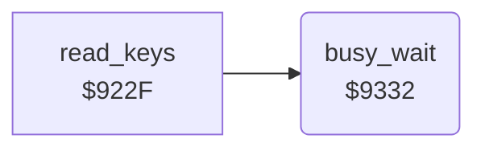

<!-- Generated by c64-docs from knowledge revision 20261029T165744.307-ir6qcw and .c64-re-tools/local/generated/src/source-map.json. Do not edit: change the knowledge, generate the source again, then run docs.ts generate. -->
# input/delay.asm: Busy wait

Range `$9332-$9340`. Source: [input/delay.asm](../../../../src/input/delay.asm). Index: [the reference](../../index.md).

## Routines

| Routine | Address | Reached from | Summary |
|---|---|---|---|
| [`busy_wait`](delay.md#busy_wait) | `$9332` | [`read_keys`](keyboard.md#read_keys) | Waits for 65536 passes of a 13-cycle loop, about 0.9 seconds. |

## Call graph

A solid arrow is a call, a thick arrow a table entry. Rounded nodes are in this file.

## Details

### [`busy_wait`](../../../../src/input/delay.asm#L6) `$9332`

*routine*

Waits for 65536 passes of a 13-cycle loop, about 0.9 seconds. Changes X and Y.

- **Called from:** [`read_keys`](keyboard.md#read_keys)

| Label | Address | Comment |
|---|---|---|
| [`busy_wait_outer`](../../../../src/input/delay.asm#L8) | `$9334` |  |
| [`busy_wait_inner`](../../../../src/input/delay.asm#L10) | `$9336` |  |
