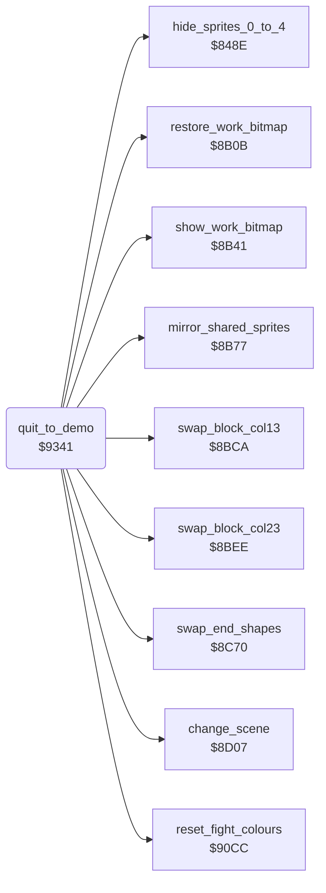

<!-- Generated by c64-docs from knowledge revision 20261029T165744.307-ir6qcw and .c64-re-tools/local/generated/src/source-map.json. Do not edit: change the knowledge, generate the source again, then run docs.ts generate. -->
# main/quit_to_demo.asm: Quit the game and restart the demo

Range `$9341-$937D`. Source: [main/quit_to_demo.asm](../../../../src/main/quit_to_demo.asm). Index: [the reference](../../index.md).

## Routines

| Routine | Address | Reached from | Summary |
|---|---|---|---|
| [`quit_to_demo`](quit_to_demo.md#quit_to_demo) | `$9341` | [`end_bout`](../combat/end_of_bout.md#end_bout), [`read_keys`](../input/keyboard.md#read_keys) | Stops the game: removes the sprites, restores the screen and restarts at $800e. |

## Call graph

A solid arrow is a call, a thick arrow a table entry. Rounded nodes are in this file.

## Details

### [`quit_to_demo`](../../../../src/main/quit_to_demo.asm#L6) `$9341`

*routine*

Stops the game: removes the sprites, restores the screen and restarts at $800e. The demo starts again.

- **Jumped to from:** [`end_bout`](../combat/end_of_bout.md#end_bout), [`read_keys`](../input/keyboard.md#read_keys)
- **Calls:** [`hide_sprites_0_to_4`](../sprites/hide_sprites.md#hide_sprites_0_to_4), [`restore_work_bitmap`](../screen/fight_area.md#restore_work_bitmap), [`show_work_bitmap`](../screen/fight_area.md#show_work_bitmap), [`reset_fight_colours`](../screen/colours.md#reset_fight_colours), [`mirror_shared_sprites`](../sprites/mirror_shared.md#mirror_shared_sprites), [`swap_block_col13`](../story/end_swaps.md#swap_block_col13), [`swap_end_shapes`](../story/end_swaps.md#swap_end_shapes), [`swap_block_col23`](../story/end_swaps.md#swap_block_col23), [`change_scene`](../screen/scene.md#change_scene)
- **Jumps to:** [`restart`](../init/init.md#restart)
- **Reads:** [`sprite_mirror_state`](../../memory-map.md#sprite_mirror_state), [`final_stage`](../../memory-map.md#final_stage), [`final_goal_reached`](../../memory-map.md#final_goal_reached), [`scene_index`](../../memory-map.md#scene_index)
- **Writes:** [`sprite_enable_shadow`](../../memory-map.md#sprite_enable_shadow), [`SPENA`](../../memory-map.md#SPENA), [`sprite_mirror_state`](../../memory-map.md#sprite_mirror_state)

| Label | Address | Comment |
|---|---|---|
| [`quit_to_demo_check_end`](../../../../src/main/quit_to_demo.asm#L20) | `$935F` | Bit 7 of $bb: restores the screen areas of the end scene. Part 1 never sets this bit: only init_game_state writes $bb, with 0. |
| [`quit_to_demo_check_scene`](../../../../src/main/quit_to_demo.asm#L29) | `$9370` | Goes back to scene 0 when scene 1 shows. |
| [`quit_to_demo_restart`](../../../../src/main/quit_to_demo.asm#L34) | `$9377` | Resets the stack and runs the warm start. The music setting stays. |
