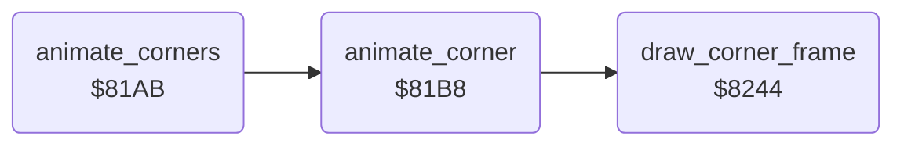

<!-- Generated by c64-docs from knowledge revision 20261029T165744.307-ir6qcw and .c64-re-tools/local/generated/src/source-map.json. Do not edit: change the knowledge, generate the source again, then run docs.ts generate. -->
# screen/corner_anim.asm: Animation of the top corner blocks

Range `$81AB-$827B`. Source: [screen/corner_anim.asm](../../../../src/screen/corner_anim.asm). Index: [the reference](../../index.md).

## Routines

| Routine | Address | Reached from | Summary |
|---|---|---|---|
| [`animate_corners`](corner_anim.md#animate_corners) | `$81AB` | [`$80BB`](../../../../src/main/main_loop.asm#L7) | Steps the corner animation of each fighter that has bit 7 set in its animation number. |
| [`animate_corner`](corner_anim.md#animate_corner) | `$81B8` | [`animate_corners`](corner_anim.md#animate_corners) | Steps the corner animation of fighter X. |
| [`draw_corner_frame`](corner_anim.md#draw_corner_frame) | `$8244` | [`animate_corner`](corner_anim.md#animate_corner) | Copies a frame of block_width x block_rows characters from copy_src_ptr to the bitmap at copy_dst_ptr. |

## Call graph

A solid arrow is a call, a thick arrow a table entry. Rounded nodes are in this file.

## Details

### [`animate_corners`](../../../../src/screen/corner_anim.asm#L6) `$81AB`

*routine*

Steps the corner animation of each fighter that has bit 7 set in its animation number.

- **Called from:** [`$80BB`](../../../../src/main/main_loop.asm#L7)
- **Calls:** [`animate_corner`](corner_anim.md#animate_corner)
- **Reads:** [`corner_anim`](../../memory-map.md#corner_anim)

| Label | Address | Comment |
|---|---|---|
| [`animate_corners_loop`](../../../../src/screen/corner_anim.asm#L8) | `$81AD` |  |
| [`animate_corners_next`](../../../../src/screen/corner_anim.asm#L12) | `$81B4` |  |

### [`animate_corner`](../../../../src/screen/corner_anim.asm#L17) `$81B8`

*routine*

Steps the corner animation of fighter X. The record gives the column, row, width, height and a list of frame words.

- **Called from:** [`animate_corners`](corner_anim.md#animate_corners)
- **Calls:** [`draw_corner_frame`](corner_anim.md#draw_corner_frame)
- **Reads:** [`corner_anim`](../../memory-map.md#corner_anim), [`corner_anim_ptrs`](../graphics/corner_anims.md#corner_anim_ptrs), [`data_ptr`](../../memory-map.md#data_ptr), [`times8_table`](address_tables.md#times8_table), [`times8_table_hi`](address_tables.md#times8_table_hi), [`copy_dst_ptr`](../../memory-map.md#copy_dst_ptr), [`bitmap_row_addr`](address_tables.md#bitmap_row_addr), [`bitmap_row_addr_hi`](address_tables.md#bitmap_row_addr_hi), [`cur_fighter`](../../memory-map.md#cur_fighter), [`corner_anim_pos`](../../memory-map.md#corner_anim_pos), [`copy_src_ptr`](../../memory-map.md#copy_src_ptr)
- **Writes:** [`data_ptr`](../../memory-map.md#data_ptr), [`cur_fighter`](../../memory-map.md#cur_fighter), [`copy_dst_ptr`](../../memory-map.md#copy_dst_ptr), [`block_width`](../../memory-map.md#block_width), [`block_rows`](../../memory-map.md#block_rows), [`copy_src_ptr`](../../memory-map.md#copy_src_ptr), [`corner_anim_pos`](../../memory-map.md#corner_anim_pos), [`corner_anim`](../../memory-map.md#corner_anim)
- **Refers to:** [`data_ptr`](../../memory-map.md#data_ptr), [`copy_dst_ptr`](../../memory-map.md#copy_dst_ptr), [`copy_src_ptr`](../../memory-map.md#copy_src_ptr)

| Label | Address | Comment |
|---|---|---|
| [`animate_corner_step`](../../../../src/screen/corner_anim.asm#L52) | `$81F7` | Reads the next word of the record. A word of 4 or more is the address of a frame. |
| [`animate_corner_cmd_0`](../../../../src/screen/corner_anim.asm#L69) | `$8213` | Word 0: starts the list again. |
| [`animate_corner_cmd_1`](../../../../src/screen/corner_anim.asm#L77) | `$821E` | Word 1: continues at the offset in the next byte. |
| [`animate_corner_cmd_2`](../../../../src/screen/corner_anim.asm#L87) | `$822C` | Word 2: starts the animation in the next byte. |
| [`animate_corner_stop`](../../../../src/screen/corner_anim.asm#L97) | `$823D` | Word 3: stops the animation. |

### [`draw_corner_frame`](../../../../src/screen/corner_anim.asm#L103) `$8244`

*routine*

Copies a frame of block_width x block_rows characters from copy_src_ptr to the bitmap at copy_dst_ptr.

- **Called from:** [`animate_corner`](corner_anim.md#animate_corner)
- **Reads:** [`block_width`](../../memory-map.md#block_width), [`copy_src_ptr`](../../memory-map.md#copy_src_ptr), [`copy_dst_ptr`](../../memory-map.md#copy_dst_ptr), [`saved_y`](../../memory-map.md#saved_y), [`times8_table`](address_tables.md#times8_table), [`times8_table_hi`](address_tables.md#times8_table_hi), [`block_rows`](../../memory-map.md#block_rows)
- **Writes:** [`saved_y`](../../memory-map.md#saved_y), [`copy_src_ptr`](../../memory-map.md#copy_src_ptr), [`copy_dst_ptr`](../../memory-map.md#copy_dst_ptr), [`block_rows`](../../memory-map.md#block_rows)
- **Refers to:** [`copy_src_ptr`](../../memory-map.md#copy_src_ptr), [`copy_dst_ptr`](../../memory-map.md#copy_dst_ptr)

| Label | Address | Comment |
|---|---|---|
| [`draw_corner_frame_char`](../../../../src/screen/corner_anim.asm#L106) | `$8248` |  |
| [`draw_corner_frame_byte`](../../../../src/screen/corner_anim.asm#L109) | `$824C` |  |
