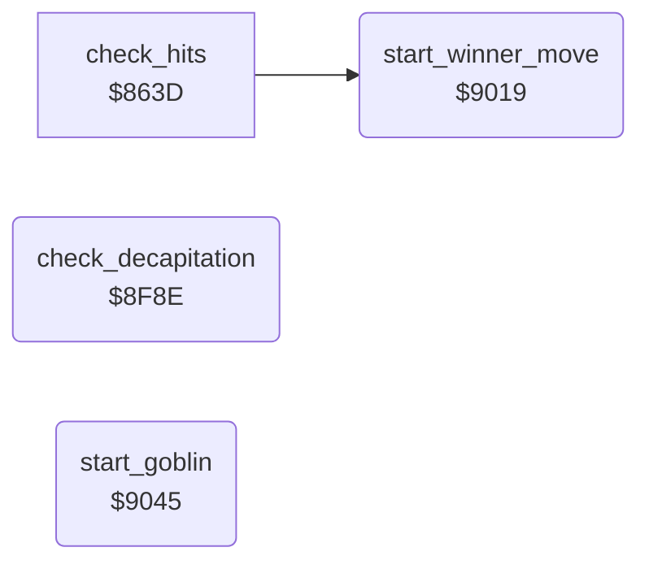

<!-- Generated by c64-docs from knowledge revision 20261025T232349.329-h2a3yw and .c64-re-tools/local/generated/src/source-map.json. Do not edit: change the knowledge, generate the source again, then run docs.ts generate. -->
# combat/bout_end.asm: End of a bout: decapitation, winner move, goblin

Range `$8F8E-$9097`. Source: [combat/bout_end.asm](../../../../src/combat/bout_end.asm). Index: [the reference](../../index.md).

## Routines

| Routine | Address | Reached from | Summary |
|---|---|---|---|
| [`check_decapitation`](bout_end.md#check_decapitation) | `$8F8E` | [`$80D9`](../../../../src/main/main_loop.asm#L17) | Looks for a fighter in move $88 while no loser is set. |
| [`start_winner_move`](bout_end.md#start_winner_move) | `$9019` | [`check_hits`](hits.md#check_hits) | Sets winner_flag to the other fighter. |
| [`start_goblin`](bout_end.md#start_goblin) | `$9045` | [`$80DC`](../../../../src/main/main_loop.asm#L18) | Waits until the loser lies in frame $59 or $14. |

## Call graph

A solid arrow is a call, a thick arrow a table entry. Rounded nodes are in this file.

## Details

### [`check_decapitation`](../../../../src/combat/bout_end.asm#L6) `$8F8E`

*routine*

Looks for a fighter in move $88 while no loser is set. Then starts the decapitation of that fighter.

- **Called from:** [`$80D9`](../../../../src/main/main_loop.asm#L17)
- **Reads:** [`fighter_move`](../../memory-map.md#fighter_move), [`bout_loser`](../../memory-map.md#bout_loser), [`fighter_facing`](../../memory-map.md#fighter_facing), [`move88_sprite0_anims`](../sprites/sprite_motions.md#move88_sprite0_anims), [`move88_sprite0_motions`](../sprites/sprite_motions.md#move88_sprite0_motions), [`move88_sprite1_motions`](../sprites/sprite_motions.md#move88_sprite1_motions), [`fighter_x`](../../memory-map.md#fighter_x), [`times8_table`](../screen/address_tables.md#times8_table), [`move88_sprite_x`](../sprites/sprite_motions.md#move88_sprite_x), [`saved_y`](../../memory-map.md#saved_y), [`times8_table_hi`](../screen/address_tables.md#times8_table_hi), [`sprite_x_msb_shadow`](../../memory-map.md#sprite_x_msb_shadow)
- **Writes:** [`bout_loser`](../../memory-map.md#bout_loser), [`sprite_anim`](../../memory-map.md#sprite_anim), [`sprite_path`](../../memory-map.md#sprite_path), [`sprite_path_timer`](../../memory-map.md#sprite_path_timer), [`sprite_path_cmd`](../../memory-map.md#sprite_path_cmd), [`sprite_path_pos`](../../memory-map.md#sprite_path_pos), [`sprite_anim_timer`](../../memory-map.md#sprite_anim_timer), [`sprite_anim_pos`](../../memory-map.md#sprite_anim_pos), [`saved_y`](../../memory-map.md#saved_y), [`sprite_x_msb_shadow`](../../memory-map.md#sprite_x_msb_shadow), [`sprite_xy_shadow`](../../memory-map.md#sprite_xy_shadow), [`sprite_y_shadow`](../../memory-map.md#sprite_y_shadow)
- **Refers to:** [`sprite_anim`](../../memory-map.md#sprite_anim), [`sprite_path`](../../memory-map.md#sprite_path), [`sprite_xy_shadow`](../../memory-map.md#sprite_xy_shadow)

| Label | Address | Comment |
|---|---|---|
| [`check_decapitation_loop`](../../../../src/combat/bout_end.asm#L8) | `$8F90` |  |
| [`check_decapitation_next`](../../../../src/combat/bout_end.asm#L16) | `$8F9D` |  |
| [`check_decapitation_begin`](../../../../src/combat/bout_end.asm#L21) | `$8FA1` | Sets the loser and starts sprites 0-2 at its position: the head (animation by facing) and animations $83 and $82. |
| [`check_decapitation_clear`](../../../../src/combat/bout_end.asm#L41) | `$8FCC` | Resets the path and animation state of sprites 0-2. |
| [`check_decapitation_msb_on`](../../../../src/combat/bout_end.asm#L64) | `$8FFA` |  |
| [`check_decapitation_msb_off`](../../../../src/combat/bout_end.asm#L68) | `$9001` |  |
| [`check_decapitation_msb_set`](../../../../src/combat/bout_end.asm#L71) | `$9005` | Bit 8 of the X position of sprites 0-2. |

### [`start_winner_move`](../../../../src/combat/bout_end.asm#L84) `$9019`

*routine*

Sets winner_flag to the other fighter. Starts move $93 for the winner. The winner gets move $9c instead when the loser is not in move $88 and the distance is below 2.

- **Called from:** [`check_hits`](hits.md#check_hits)
- **Reads:** [`bout_loser`](../../memory-map.md#bout_loser), [`fighter_move`](../../memory-map.md#fighter_move), [`fighter_distance`](../../memory-map.md#fighter_distance)
- **Writes:** [`bout_winner`](../../memory-map.md#bout_winner), [`fighter_move`](../../memory-map.md#fighter_move), [`fighter_move_step`](../../memory-map.md#fighter_move_step)

| Label | Address | Comment |
|---|---|---|
| [`start_winner_move_near`](../../../../src/combat/bout_end.asm#L98) | `$902F` |  |
| [`start_winner_move_9c`](../../../../src/combat/bout_end.asm#L102) | `$9035` |  |
| [`start_winner_move_93`](../../../../src/combat/bout_end.asm#L106) | `$903C` |  |
| [`start_winner_move_set`](../../../../src/combat/bout_end.asm#L110) | `$9040` |  |

### [`start_goblin`](../../../../src/combat/bout_end.asm#L115) `$9045`

*routine*

Waits until the loser lies in frame $59 or $14. Then starts sprites 3 and 4 at the left edge. Sets goblin_active.

- **Called from:** [`$80DC`](../../../../src/main/main_loop.asm#L18)
- **Reads:** [`goblin_active`](../../memory-map.md#goblin_active), [`bout_loser`](../../memory-map.md#bout_loser), [`fighter_pose`](../../memory-map.md#fighter_pose), [`sprite_x_msb_shadow`](../../memory-map.md#sprite_x_msb_shadow)
- **Writes:** [`sprite_x_msb_shadow`](../../memory-map.md#sprite_x_msb_shadow), [`sprite_y_shadow`](../../memory-map.md#sprite_y_shadow), [`sprite_anim`](../../memory-map.md#sprite_anim), [`sprite_path`](../../memory-map.md#sprite_path), [`sprite_path_timer`](../../memory-map.md#sprite_path_timer), [`sprite_path_cmd`](../../memory-map.md#sprite_path_cmd), [`sprite_path_pos`](../../memory-map.md#sprite_path_pos), [`sprite_anim_timer`](../../memory-map.md#sprite_anim_timer), [`sprite_anim_pos`](../../memory-map.md#sprite_anim_pos), [`goblin_active`](../../memory-map.md#goblin_active)
- **Refers to:** [`sprite_xy_shadow`](../../memory-map.md#sprite_xy_shadow), [`sprite_anim`](../../memory-map.md#sprite_anim), [`sprite_path`](../../memory-map.md#sprite_path), [`sprite_path_timer`](../../memory-map.md#sprite_path_timer), [`sprite_path_cmd`](../../memory-map.md#sprite_path_cmd), [`sprite_path_pos`](../../memory-map.md#sprite_path_pos), [`sprite_anim_timer`](../../memory-map.md#sprite_anim_timer), [`sprite_anim_pos`](../../memory-map.md#sprite_anim_pos)

| Label | Address | Comment |
|---|---|---|
| [`start_goblin_loser`](../../../../src/combat/bout_end.asm#L118) | `$9049` |  |
| [`start_goblin_frame`](../../../../src/combat/bout_end.asm#L121) | `$904D` |  |
| [`start_goblin_frame14`](../../../../src/combat/bout_end.asm#L127) | `$9056` |  |
| [`start_goblin_wait`](../../../../src/combat/bout_end.asm#L130) | `$905A` |  |
| [`start_goblin_now`](../../../../src/combat/bout_end.asm#L132) | `$905B` | Clears the X bit 8 of sprites 3 and 4. |
| [`start_goblin_loop`](../../../../src/combat/bout_end.asm#L145) | `$9072` | Animations $86 and $87, movement path $85. |
| [`start_goblin_set`](../../../../src/combat/bout_end.asm#L161) | `$9094` | goblin_active = $ff. |
| [`start_goblin_done`](../../../../src/combat/bout_end.asm#L164) | `$9097` |  |
