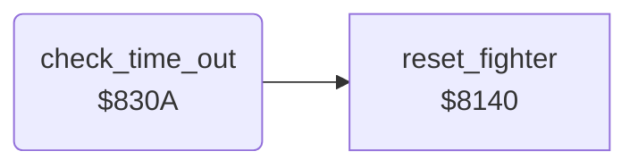

<!-- Generated by c64-docs from knowledge revision 20261029T165720.369-auoxqk and .c64-re-tools/local/generated/src/source-map.json. Do not edit: change the knowledge, generate the source again, then run docs.ts generate. -->
# combat/time_out.asm: End of a bout when the time is 0

Range `$830A-$8354`. Source: [combat/time_out.asm](../../../../src/combat/time_out.asm). Index: [the reference](../../index.md).

## Routines

| Routine | Address | Reached from | Summary |
|---|---|---|---|
| [`check_time_out`](time_out.md#check_time_out) | `$830A` | [`$80C7`](../../../../src/main/main_loop.asm#L11) | Two-player game only: when the time is 0, both fighters walk back to their start positions. |

## Call graph

A solid arrow is a call, a thick arrow a table entry. Rounded nodes are in this file.

## Details

### [`check_time_out`](../../../../src/combat/time_out.asm#L6) `$830A`

*routine*

Two-player game only: when the time is 0, both fighters walk back to their start positions. Then a new bout starts.

- **Called from:** [`$80C7`](../../../../src/main/main_loop.asm#L11)
- **Calls:** [`reset_fighter`](../fighter/fighter_init.md#reset_fighter)
- **Reads:** [`demo_mode`](../../memory-map.md#demo_mode), [`time_left`](../../memory-map.md#time_left), [`two_players`](../../memory-map.md#two_players), [`turn_request`](../../memory-map.md#turn_request), [`fighter_facing`](../../memory-map.md#fighter_facing), [`fighter_x`](../../memory-map.md#fighter_x), [`fighter_home_column`](../data/fighter_constants.md#fighter_home_column), [`fighter_move`](../../memory-map.md#fighter_move)
- **Writes:** [`time_out_active`](../../memory-map.md#time_out_active), [`fighter_move`](../../memory-map.md#fighter_move), [`fighter_move_step`](../../memory-map.md#fighter_move_step), [`walk_in_active`](../../memory-map.md#walk_in_active)
- **Refers to:** [`fighter_move`](../../memory-map.md#fighter_move)

| Label | Address | Comment |
|---|---|---|
| [`check_time_out_loop`](../../../../src/combat/time_out.asm#L17) | `$831E` |  |
| [`check_time_out_next`](../../../../src/combat/time_out.asm#L28) | `$8333` |  |
| [`check_time_out_at_start`](../../../../src/combat/time_out.asm#L33) | `$8337` | The fighter is at its start position: stand still. When both stand, the walk-in starts again. |
| [`check_time_out_done`](../../../../src/combat/time_out.asm#L49) | `$8354` |  |
