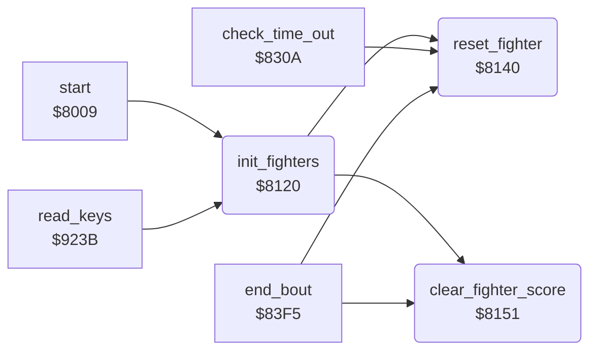

<!-- Generated by c64-docs from knowledge revision 20261025T232349.329-h2a3yw and .c64-re-tools/local/generated/src/source-map.json. Do not edit: change the knowledge, generate the source again, then run docs.ts generate. -->
# fighter/fighter_init.asm: Start values of the fighters

Range `$8120-$816C`. Source: [fighter/fighter_init.asm](../../../../src/fighter/fighter_init.asm). Index: [the reference](../../index.md).

## Routines

| Routine | Address | Reached from | Summary |
|---|---|---|---|
| [`init_fighters`](fighter_init.md#init_fighters) | `$8120` | [`start`](../init/init.md#start), [`read_keys`](../input/keyboard.md#read_keys) | Sets both fighters to the start of a bout: start positions, move $00, facing, energy and score 0. |
| [`reset_fighter`](fighter_init.md#reset_fighter) | `$8140` | [`init_fighters`](fighter_init.md#init_fighters), [`check_time_out`](../combat/time_out.md#check_time_out), [`end_bout`](../combat/end_of_bout.md#end_bout) | Resets fighter X for a bout. |
| [`clear_fighter_score`](fighter_init.md#clear_fighter_score) | `$8151` | [`init_fighters`](fighter_init.md#init_fighters), [`end_bout`](../combat/end_of_bout.md#end_bout) | Sets the 5 score digits of fighter X to 0. |

## Call graph

A solid arrow is a call, a thick arrow a table entry. Rounded nodes are in this file.

## Details

### [`init_fighters`](../../../../src/fighter/fighter_init.asm#L6) `$8120`

*routine*

Sets both fighters to the start of a bout: start positions, move $00, facing, energy and score 0. Sets the walk-in flag.

- **Called from:** [`start`](../init/init.md#start), [`read_keys`](../input/keyboard.md#read_keys)
- **Calls:** [`reset_fighter`](fighter_init.md#reset_fighter), [`clear_fighter_score`](fighter_init.md#clear_fighter_score)
- **Reads:** [`fighter_start_column`](../data/fighter_constants.md#fighter_start_column)
- **Writes:** [`fighter_move_step`](../../memory-map.md#fighter_move_step), [`fighter_move_lock`](../../memory-map.md#fighter_move_lock), [`fighter_x`](../../memory-map.md#fighter_x), [`fighter_move`](../../memory-map.md#fighter_move), [`fighter_facing`](../../memory-map.md#fighter_facing), [`walk_in_active`](../../memory-map.md#walk_in_active)

| Label | Address | Comment |
|---|---|---|
| [`init_fighters_loop`](../../../../src/fighter/fighter_init.asm#L8) | `$8122` |  |

### [`reset_fighter`](../../../../src/fighter/fighter_init.asm#L25) `$8140`

*routine*

Resets fighter X for a bout. A is the corner animation (stored with bit 7 set). Energy 12, idle timer $ff.

- **Called from:** [`init_fighters`](fighter_init.md#init_fighters), [`check_time_out`](../combat/time_out.md#check_time_out), [`end_bout`](../combat/end_of_bout.md#end_bout)
- **Writes:** [`corner_anim`](../../memory-map.md#corner_anim), [`corner_anim_pos`](../../memory-map.md#corner_anim_pos), [`fighter_energy`](../../memory-map.md#fighter_energy), [`fighter_idle_timer`](../../memory-map.md#fighter_idle_timer)

### [`clear_fighter_score`](../../../../src/fighter/fighter_init.asm#L36) `$8151`

*routine*

Sets the 5 score digits of fighter X to 0. The score is the text $87 (fighter 0) or $88 (fighter 1).

- **Called from:** [`init_fighters`](fighter_init.md#init_fighters), [`end_bout`](../combat/end_of_bout.md#end_bout)
- **Reads:** [`text_ptrs`](../text/texts.md#text_ptrs), [`text_ptr`](../../memory-map.md#text_ptr)
- **Writes:** [`text_ptr`](../../memory-map.md#text_ptr)
- **Refers to:** [`text_ptr`](../../memory-map.md#text_ptr)

| Label | Address | Comment |
|---|---|---|
| [`clear_fighter_score_loop`](../../../../src/fighter/fighter_init.asm#L47) | `$8163` |  |
