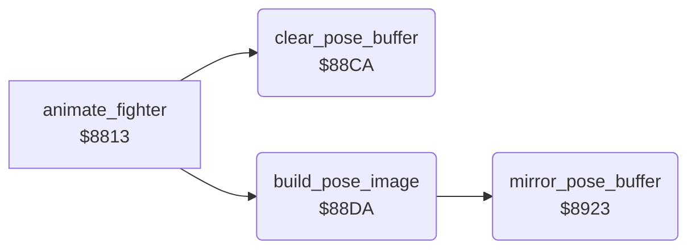

<!-- Generated by c64-docs from knowledge revision 20261029T165720.369-auoxqk and .c64-re-tools/local/generated/src/source-map.json. Do not edit: change the knowledge, generate the source again, then run docs.ts generate. -->
# fighter/pose_image.asm: Pose image of a fighter in the pose buffer

Range `$88CA-$8954`. Source: [fighter/pose_image.asm](../../../../src/fighter/pose_image.asm). Index: [the reference](../../index.md).

## Routines

| Routine | Address | Reached from | Summary |
|---|---|---|---|
| [`clear_pose_buffer`](pose_image.md#clear_pose_buffer) | `$88CA` | [`animate_fighter`](animate.md#animate_fighter) | Clears the pose buffer at $05ca-$07ff and the byte at $0800. |
| [`build_pose_image`](pose_image.md#build_pose_image) | `$88DA` | [`animate_fighter`](animate.md#animate_fighter) | Builds the image of a pose in the pose buffer at $05ca: 63 lines of 9 bytes, a 3 x 3 grid of sprite-shaped parts. |
| [`mirror_pose_buffer`](pose_image.md#mirror_pose_buffer) | `$8923` | [`build_pose_image`](pose_image.md#build_pose_image) | Mirrors the pose buffer horizontally: it reverses the 9 bytes of each line and mirrors each byte through the table at $02aa. |

## Call graph

A solid arrow is a call, a thick arrow a table entry. Rounded nodes are in this file.

## Details

### [`clear_pose_buffer`](../../../../src/fighter/pose_image.asm#L6) `$88CA`

*routine*

Clears the pose buffer at $05ca-$07ff and the byte at $0800. Output: X = 0, A = 0.

- **Called from:** [`animate_fighter`](animate.md#animate_fighter)
- **Writes:** [`compose_buffer`](../../memory-map.md#compose_buffer)
- **Refers to:** [`compose_buffer`](../../memory-map.md#compose_buffer)

| Label | Address | Comment |
|---|---|---|
| [`clear_pose_buffer_loop`](../../../../src/fighter/pose_image.asm#L9) | `$88CD` |  |

### [`build_pose_image`](../../../../src/fighter/pose_image.asm#L17) `$88DA`

*routine*

Builds the image of a pose in the pose buffer at $05ca: 63 lines of 9 bytes, a 3 x 3 grid of sprite-shaped parts. Bytes 0-8 of the pose record at ($89) are the part numbers. A part is 63 bytes at $0800 + 64 * number. 0 = no part. The 0 bytes of a part are transparent. Mirrors the image when fighter $99 faces left ($91,x not 0).

- **Called from:** [`animate_fighter`](animate.md#animate_fighter)
- **Calls:** [`mirror_pose_buffer`](pose_image.md#mirror_pose_buffer)
- **Reads:** [`record_ptr`](../../memory-map.md#record_ptr), [`part_ptr`](../../memory-map.md#part_ptr), [`part_dest_ptrs`](../sprites/part_layout.md#part_dest_ptrs), [`part_byte_offsets`](../sprites/part_layout.md#part_byte_offsets), [`mask_source`](../../memory-map.md#mask_source), [`buffer_ptr`](../../memory-map.md#buffer_ptr), [`saved_y`](../../memory-map.md#saved_y), [`cur_fighter`](../../memory-map.md#cur_fighter), [`anim_fighter`](../../memory-map.md#anim_fighter), [`fighter_facing`](../../memory-map.md#fighter_facing)
- **Writes:** [`part_ptr`](../../memory-map.md#part_ptr), [`cur_fighter`](../../memory-map.md#cur_fighter), [`buffer_ptr`](../../memory-map.md#buffer_ptr), [`mask_source`](../../memory-map.md#mask_source), [`saved_y`](../../memory-map.md#saved_y)
- **Refers to:** [`part_ptr`](../../memory-map.md#part_ptr), [`buffer_ptr`](../../memory-map.md#buffer_ptr)

| Label | Address | Comment |
|---|---|---|
| [`build_pose_image_part`](../../../../src/fighter/pose_image.asm#L19) | `$88DC` |  |
| [`build_pose_image_byte`](../../../../src/fighter/pose_image.asm#L39) | `$88FF` |  |
| [`build_pose_image_skip`](../../../../src/fighter/pose_image.asm#L49) | `$8911` |  |
| [`build_pose_image_next`](../../../../src/fighter/pose_image.asm#L53) | `$8916` |  |
| [`build_pose_image_done`](../../../../src/fighter/pose_image.asm#L60) | `$8922` |  |

### [`mirror_pose_buffer`](../../../../src/fighter/pose_image.asm#L63) `$8923`

*routine*

Mirrors the pose buffer horizontally: it reverses the 9 bytes of each line and mirrors each byte through the table at $02aa.

- **Called from:** [`build_pose_image`](pose_image.md#build_pose_image)
- **Reads:** [`buffer_ptr`](../../memory-map.md#buffer_ptr), [`mirror_table`](../../memory-map.md#mirror_table), [`mirror_row_count`](../../memory-map.md#mirror_row_count)
- **Writes:** [`buffer_ptr`](../../memory-map.md#buffer_ptr), [`mirror_row_count`](../../memory-map.md#mirror_row_count)
- **Refers to:** [`compose_buffer`](../../memory-map.md#compose_buffer), [`buffer_ptr`](../../memory-map.md#buffer_ptr)

| Label | Address | Comment |
|---|---|---|
| [`mirror_pose_buffer_row`](../../../../src/fighter/pose_image.asm#L70) | `$892F` |  |
| [`mirror_pose_buffer_read`](../../../../src/fighter/pose_image.asm#L72) | `$8931` |  |
| [`mirror_pose_buffer_push`](../../../../src/fighter/pose_image.asm#L77) | `$8939` |  |
| [`mirror_pose_buffer_write`](../../../../src/fighter/pose_image.asm#L82) | `$893F` |  |
| [`mirror_pose_buffer_next`](../../../../src/fighter/pose_image.asm#L93) | `$8950` |  |
