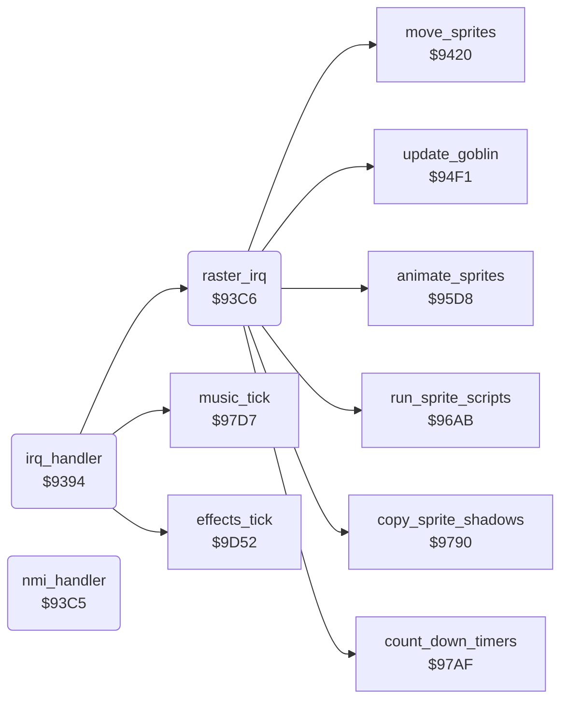

<!-- Generated by c64-docs from knowledge revision 20261029T165720.369-auoxqk and .c64-re-tools/local/generated/src/source-map.json. Do not edit: change the knowledge, generate the source again, then run docs.ts generate. -->
# irq/irq_handler.asm: IRQ and NMI handlers, raster interrupt

Range `$9394-$941F`. Source: [irq/irq_handler.asm](../../../../src/irq/irq_handler.asm). Index: [the reference](../../index.md).

## Routines

| Routine | Address | Reached from | Summary |
|---|---|---|---|
| [`irq_handler`](irq_handler.md#irq_handler) | `$9394` |  | IRQ handler ($fffe). |
| [`nmi_handler`](irq_handler.md#nmi_handler) | `$93C5` |  | NMI handler ($fffa): only RTI. |
| [`raster_irq`](irq_handler.md#raster_irq) | `$93C6` | [`irq_handler`](irq_handler.md#irq_handler) | Raster IRQ at lines $72 and $fa. |

## Data

| Range | Type | Name | Read by | Written by |
|---|---|---|---|---|
| [`$93C5`](../../../../src/irq/irq_handler.asm#L40) | bytes | [`nmi_handler`](../../../../src/irq/irq_handler.asm#L39) |  |  |

## Call graph

A solid arrow is a call, a thick arrow a table entry. Rounded nodes are in this file.

## Details

### [`irq_handler`](../../../../src/irq/irq_handler.asm#L6) `$9394`

*routine*

IRQ handler ($fffe). Runs the raster IRQ and the CIA 1 timer A and timer B routines.

- **Calls:** [`raster_irq`](irq_handler.md#raster_irq), [`music_tick`](../music/tick.md#music_tick), [`effects_tick`](../sound/sid.md#effects_tick)
- **Reads:** [`IRQMSK`](../../memory-map.md#IRQMSK), [`VICIRQ`](../../memory-map.md#VICIRQ), [`CIAICR`](../../memory-map.md#CIAICR), [`cia1_icr_copy`](../../memory-map.md#cia1_icr_copy)
- **Writes:** [`cia1_icr_copy`](../../memory-map.md#cia1_icr_copy)

| Label | Address | Comment |
|---|---|---|
| [`irq_check_cia`](../../../../src/irq/irq_handler.asm#L17) | `$93A6` | Reading the ICR acknowledges the CIA 1 interrupts. |
| [`irq_check_timer_a`](../../../../src/irq/irq_handler.asm#L25) | `$93B5` | Timer A: runs $9d52. It counts down the sound timers and writes the SID. |
| [`irq_exit`](../../../../src/irq/irq_handler.asm#L31) | `$93BF` |  |

### [`nmi_handler`](../../../../src/irq/irq_handler.asm#L39) `$93C5`

*routine*

NMI handler ($fffa): only RTI. Thus the RESTORE key does nothing while $01 = $25.

### [`raster_irq`](../../../../src/irq/irq_handler.asm#L42) `$93C6`

*routine*

Raster IRQ at lines $72 and $fa. Line $72 sets the scene colour, line $fa updates the sprites.

- **Called from:** [`irq_handler`](irq_handler.md#irq_handler)
- **Calls:** [`copy_sprite_shadows`](../sprites/sprite_shadow.md#copy_sprite_shadows), [`move_sprites`](../sprites/sprite_move.md#move_sprites), [`update_goblin`](../story/goblin.md#update_goblin), [`run_sprite_scripts`](../sprites/sprite_script.md#run_sprite_scripts), [`animate_sprites`](../sprites/sprite_anim.md#animate_sprites), [`count_down_timers`](timers.md#count_down_timers)
- **Reads:** [`SCROLY`](../../memory-map.md#SCROLY), [`RASTER`](../../memory-map.md#RASTER), [`scene_index`](../../memory-map.md#scene_index), [`scene_top_colour`](../data/fighter_constants.md#scene_top_colour), [`raster_irq_busy`](../../memory-map.md#raster_irq_busy), [`sprites_frozen`](../../memory-map.md#sprites_frozen)
- **Writes:** [`RASTER`](../../memory-map.md#RASTER), [`VICIRQ`](../../memory-map.md#VICIRQ), [`BGCOL0`](../../memory-map.md#BGCOL0), [`SCROLY`](../../memory-map.md#SCROLY), [`raster_irq_busy`](../../memory-map.md#raster_irq_busy)

| Label | Address | Comment |
|---|---|---|
| [`raster_irq_bottom`](../../../../src/irq/irq_handler.asm#L57) | `$93E5` | Line $fa: next IRQ at line $72, black background for the top of the screen. |
| [`raster_irq_clear_busy`](../../../../src/irq/irq_handler.asm#L80) | `$941B` | Clears the busy flag $ce. |
| [`raster_irq_exit`](../../../../src/irq/irq_handler.asm#L83) | `$941F` |  |
