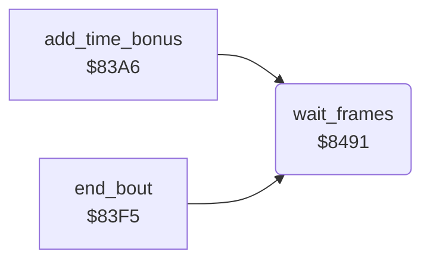

<!-- Generated by c64-docs from knowledge revision 20261025T232349.329-h2a3yw and .c64-re-tools/local/generated/src/source-map.json. Do not edit: change the knowledge, generate the source again, then run docs.ts generate. -->
# main/wait_frames.asm: Wait for a number of frames

Range `$8491-$8497`. Source: [main/wait_frames.asm](../../../../src/main/wait_frames.asm). Index: [the reference](../../index.md).

## Routines

| Routine | Address | Reached from | Summary |
|---|---|---|---|
| [`wait_frames`](wait_frames.md#wait_frames) | `$8491` | [`add_time_bonus`](../score/time_bonus.md#add_time_bonus), [`end_bout`](../combat/end_of_bout.md#end_bout) | Waits A frames. |

## Call graph

A solid arrow is a call, a thick arrow a table entry. Rounded nodes are in this file.

## Details

### [`wait_frames`](../../../../src/main/wait_frames.asm#L6) `$8491`

*routine*

Waits A frames. The IRQ decrements wait_counter once for each frame.

- **Called from:** [`add_time_bonus`](../score/time_bonus.md#add_time_bonus), [`end_bout`](../combat/end_of_bout.md#end_bout)
- **Reads:** [`wait_counter`](../../memory-map.md#wait_counter)
- **Writes:** [`wait_counter`](../../memory-map.md#wait_counter)

| Label | Address | Comment |
|---|---|---|
| [`wait_frames_loop`](../../../../src/main/wait_frames.asm#L8) | `$8493` |  |
