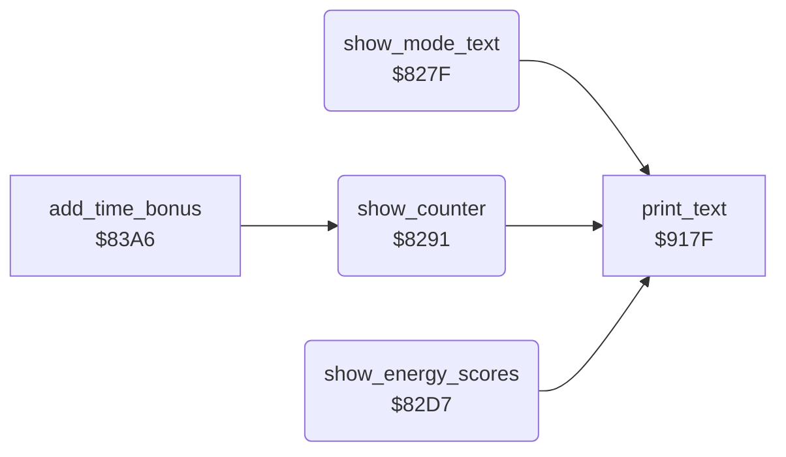

<!-- Generated by c64-docs from knowledge revision 20261025T232349.329-h2a3yw and .c64-re-tools/local/generated/src/source-map.json. Do not edit: change the knowledge, generate the source again, then run docs.ts generate. -->
# score/status_line.asm: Mode text, counter, energy bars and scores

Range `$827F-$8309`. Source: [score/status_line.asm](../../../../src/score/status_line.asm). Index: [the reference](../../index.md).

## Routines

| Routine | Address | Reached from | Summary |
|---|---|---|---|
| [`show_mode_text`](status_line.md#show_mode_text) | `$827F` | [`$80BE`](../../../../src/main/main_loop.asm#L8) | Shows DEMO in the demo. |
| [`show_counter`](status_line.md#show_counter) | `$8291` | [`add_time_bonus`](time_bonus.md#add_time_bonus), [`$80C1`](../../../../src/main/main_loop.asm#L9) | Writes the 2-digit number of text $86 and shows it. |
| [`show_energy_scores`](status_line.md#show_energy_scores) | `$82D7` | [`$80C4`](../../../../src/main/main_loop.asm#L10) | Shows the energy bar and the score of each fighter. |

## Call graph

A solid arrow is a call, a thick arrow a table entry. Rounded nodes are in this file.

## Details

### [`show_mode_text`](../../../../src/score/status_line.asm#L6) `$827F`

*routine*

Shows DEMO in the demo. Else shows 1PLR or 2PLR.

- **Called from:** [`$80BE`](../../../../src/main/main_loop.asm#L8)
- **Calls:** [`print_text`](../text/print_text.md#print_text)
- **Reads:** [`demo_mode`](../../memory-map.md#demo_mode), [`two_players`](../../memory-map.md#two_players)

| Label | Address | Comment |
|---|---|---|
| [`show_mode_text_players`](../../../../src/score/status_line.asm#L11) | `$8288` |  |
| [`show_mode_text_print`](../../../../src/score/status_line.asm#L15) | `$828D` |  |

### [`show_counter`](../../../../src/score/status_line.asm#L19) `$8291`

*routine*

Writes the 2-digit number of text $86 and shows it. Two-player game: the time left. Else: the opponent number.

- **Called from:** [`$80C1`](../../../../src/main/main_loop.asm#L9), [`add_time_bonus`](time_bonus.md#add_time_bonus)
- **Calls:** [`print_text`](../text/print_text.md#print_text)
- **Reads:** [`text_ptrs`](../text/texts.md#text_ptrs), [`demo_mode`](../../memory-map.md#demo_mode), [`two_players`](../../memory-map.md#two_players), [`time_left`](../../memory-map.md#time_left), [`text_ptr`](../../memory-map.md#text_ptr), [`cur_fighter`](../../memory-map.md#cur_fighter), [`opponent_index`](../../memory-map.md#opponent_index)
- **Writes:** [`text_ptr`](../../memory-map.md#text_ptr), [`cur_fighter`](../../memory-map.md#cur_fighter)
- **Refers to:** [`text_ptr`](../../memory-map.md#text_ptr)

| Label | Address | Comment |
|---|---|---|
| [`show_counter_time_loop`](../../../../src/score/status_line.asm#L34) | `$82AD` |  |
| [`show_counter_opponent`](../../../../src/score/status_line.asm#L48) | `$82C4` |  |
| [`show_counter_print`](../../../../src/score/status_line.asm#L56) | `$82D1` |  |

### [`show_energy_scores`](../../../../src/score/status_line.asm#L61) `$82D7`

*routine*

Shows the energy bar and the score of each fighter. The texts $8b-$97 are the bars for energy 0-12.

- **Called from:** [`$80C4`](../../../../src/main/main_loop.asm#L10)
- **Calls:** [`print_text`](../text/print_text.md#print_text)
- **Reads:** [`fighter_energy`](../../memory-map.md#fighter_energy), [`text_ptrs`](../text/texts.md#text_ptrs), [`energy_text_columns`](../text/texts.md#energy_text_columns), [`text_ptr`](../../memory-map.md#text_ptr), [`cur_fighter`](../../memory-map.md#cur_fighter)
- **Writes:** [`cur_fighter`](../../memory-map.md#cur_fighter), [`text_ptr`](../../memory-map.md#text_ptr)
- **Refers to:** [`text_ptr`](../../memory-map.md#text_ptr)

| Label | Address | Comment |
|---|---|---|
| [`show_energy_scores_loop`](../../../../src/score/status_line.asm#L63) | `$82D9` |  |
